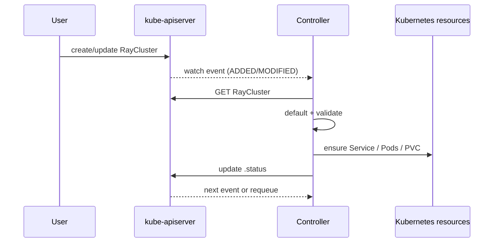

# 第 3 章 Kubernetes Operator 模式

KubeRay 的核心不是 YAML，而是一个持续运行的调和循环。本章用最小概念集解释 Operator，然后把这些概念一一映射到 KubeRay 和 MiniKubeRay。

## 3.1 声明式 API 与控制器

Kubernetes 的基本模式是：

1. 用户提交一个对象（Deployment、Service、RayCluster），描述**期望状态**；
2. API Server 把它持久化；
3. 控制器 watch 到变化，读取**实际状态**；
4. 控制器执行动作，让实际状态逼近期望状态；
5. 状态写回 `.status`，用户/上层系统据此观察。

这被称为 **level-triggered**：控制器不关心“发生了什么事件”，只关心“现在是什么状态，应该是什么状态”。即使错过 100 个事件，下一次调和仍能收敛。



## 3.2 CRD、Scheme 与 RBAC

### 3.2.1 CRD

CRD 定义一种新的资源类型。一个最小的 CRD 包含：

- group/version/kind（`ray.io/v1`、`RayCluster`）；
- scope（Namespaced）；
- OpenAPI schema；
- subresources（`status`、`scale`）；
- printer columns（`kubectl get` 的列）。

KubeRay 的 CRD 很大（每个约 1MB 量级），因为 PodTemplate、Service、NetworkPolicy 等字段都被嵌入了 schema。它们放在 Helm Chart 的 `crds/` 目录，**Helm 安装时创建，升级 Chart 时不会自动升级 CRD**，这是生产升级必须注意的坑（第 17 章）。

### 3.2.2 Scheme 与类型

Go 控制器需要把 JSON 反序列化成类型。KubeRay 在 `ray-operator/apis/ray/v1/` 定义 `RayClusterSpec`、`RayJobSpec`、`RayServiceSpec`、`RayCronJobSpec`。这些类型的字段标签（json tag）就是 API 契约。

### 3.2.3 RBAC

Operator 需要权限：

- 读写 Ray CRD 及其 status/finalizers；
- 创建/删除 Pod、Service、ConfigMap、Secret、PVC；
- 创建 Kubernetes Job（RayJob K8sJobMode）；
- 读取/依赖 EndpointSlice（由 Kubernetes 的 EndpointSlice 控制器为 Service 维护，operator 用它判断 Serve 后端）；
- 创建 Role/RoleBinding（autoscaler）；
- 读取 Node（调度/标签）；
- 可选：NetworkPolicy、Ingress、Gateway API、cert-manager。

KubeRay 的 ClusterRole 见 `manifests/rbac.yaml`。生产环境应按最小权限裁剪。

**Namespace 级安装**：如果 operator 只需要管理一个/几个 namespace，可以用 `watchNamespace`（Helm values，list）或 `--watch-namespace` 限制监听范围；Helm 的 `singleNamespaceInstall=true` 会生成 Role/RoleBinding 而不是 ClusterRole/ClusterRoleBinding。这样做的好处是：

- operator 不再拥有全集群 Secret/Pod 读权限；
- 每租户一个 operator 时，故障和权限边界更清晰；
- 代价是要为每个 namespace 部署一套 operator，升级和监控成本上升。

改 `watchNamespace` 后必须重启 operator；它不会热更新。注意 `--watch-namespace` 与 `singleNamespaceInstall` 的 RBAC 生成方式要匹配，否则会出现“能 watch 但没有权限”的半配置状态。详见附录 G.2.2。

## 3.3 调和循环的骨架

一个典型的 Reconcile 函数：

```text
func Reconcile(req):
    obj = get(req)
    if not found: return
    if deleting:
        cleanupFinalizers(obj)
        return
    if needsFinalizer(obj):
        addFinalizer(obj)
        return
    defaults(obj)
    if invalid(obj):
        event(Warning, InvalidSpec)
        return
    ensureService(obj)
    ensurePods(obj)
    status = calculateStatus(obj)
    updateStatusIfChanged(status)
    return RequeueAfter(...)
```

关键原则：

1. **幂等**：同一对象连续调和两次，第二次不应产生额外变化。
2. **先写 spec，后写 status**：status 是观察结果，不是期望状态。
3. **不要假设顺序**：Pod 可能已存在、可能正在删除、可能被用户手动改过。
4. **冲突要重试**：resourceVersion 冲突是正常现象。
5. **失败要可见**：事件 + condition + 日志，三者缺一不可。

## 3.4 Finalizer：删除也需要控制

Kubernetes 删除对象时，如果对象带有 finalizer，API Server 只会设置 `metadata.deletionTimestamp`，不会真正删除。控制器必须：

1. 看到 `deletionTimestamp`；
2. 清理外部资源（Pod、Service、Redis 命名空间、云资源）；
3. 移除 finalizer；
4. 对象才真正消失。

KubeRay 的 finalizer 例子：

| 对象 | finalizer | 用途 |
|---|---|---|
| RayJob | `ray.io/rayjob-finalizer` | 删除时停止 Ray job |
| RayService | `ray.io/rayservice-finalizer` | 等待 RayCluster 清理 |
| RayCluster | `ray.io/gcs-ft-redis-cleanup-finalizer` | 删除 Redis 中的 GCS 命名空间 |

MiniKubeRay 还给 RayCluster 加了一个通用 finalizer，便于演示“删除 CR → 清理子资源 → 移除 finalizer”的完整链路。

## 3.5 OwnerReference：级联垃圾回收

控制器创建子对象时，通常设置 `ownerReferences`：

```json
{
  "apiVersion": "ray.io/v1",
  "kind": "RayCluster",
  "name": "demo",
  "uid": "...",
  "controller": true,
  "blockOwnerDeletion": true
}
```

这样：

- 删除 RayCluster 时，Kubernetes GC 会删除其 Pod、Service、EndpointSlice；
- `kubectl describe` 能展示归属关系；
- 控制器可以通过 label 快速列出子对象。

KubeRay 的标签体系（`ray.io/cluster`、`ray.io/node-type`、`ray.io/group`）用于**选择**，ownerReference 用于**生命周期**。两者不能互相替代。

MiniKubeRay 的 `minikuberay/controllers/batch.py` 实现了一个简化 GC：owner UID 不存在时删除子对象。

## 3.6 Status、Conditions 与 Events

### 3.6.1 Status

Status 是对象的“观测结果”。KubeRay 的 RayCluster status 包含：

- `state`：`ready` / `suspended` / 空；
- `desiredWorkerReplicas`、`readyWorkerReplicas`、`availableWorkerReplicas`；
- `desiredCPU/Memory/GPU`；
- `endpoints`、`head`；
- `conditions`、`observedGeneration`、`lastUpdateTime`。

### 3.6.2 Conditions

Condition 是结构化的布尔状态：

```yaml
conditions:
  - type: HeadPodReady
    status: "True"
    reason: HeadPodRunningAndReady
    message: ""
    observedGeneration: 2
    lastTransitionTime: "2026-10-18T00:00:00Z"
```

KubeRay 的 condition 类型包括：

- `HeadPodReady`
- `RayClusterProvisioned`（首次全部就绪后保持 True，后续 Pod 失败或 suspend 都不会自动重置）
- `ReplicaFailure`（Go 常量 `RayClusterReplicaFailure`）
- `RayClusterSuspending` / `RayClusterSuspended`
- RayService：`Ready`、`UpgradeInProgress`、`RollbackInProgress`、`Suspending`、`Suspended`（暂停同时反映在底层 RayCluster 的 `RayClusterSuspending`/`RayClusterSuspended`）

`lastTransitionTime` 只在状态变化时更新。否则每次调和都改时间，会导致 status 永远在变、watch 风暴、GitOps 永远不同步。

### 3.6.3 Events

Event 是“发生过什么”的时间线，适合人类排查：

```text
Normal  CreatedHeadPod       Created head Pod demo-head
Normal  CreatedWorkerPod     Created worker Pod demo-workers-0
Warning FailedToCreatePod    insufficient nvidia.com/gpu
```

Event 不是状态，不能作为控制逻辑的依据；它会被 GC、可能丢失、可能重复。

## 3.7 工作队列与限速

controller-runtime 的 workqueue 提供：

- **去重**：同一个 key 在队列中只保留一份；
- **限速**：失败后指数退避，避免打爆 API Server；
- **延迟**：`RequeueAfter` 用于轮询外部状态；
- **并发**：`MaxConcurrentReconciles` 控制每个控制器的并发度。

MiniKubeRay 的 `WorkQueue` 和 `RateLimiter` 在 `minikuberay/controllers/base.py` 中实现了同样的语义，但为了测试可重复性，使用可注入时钟。

### 3.7.1 Informer 缓存与一致性

controller-runtime 的 `Client` 默认读**本地缓存**，不是直接读 API Server：

- 写入后马上 `Get` 可能读不到新对象（缓存还没同步）；
- `Owns` 子资源的变化通过 informer 事件触发父对象调和；
- 缓存可能过期，控制器必须容忍“看到的不是最新”；
- 需要强一致读时用 `APIReader`（直接读 API Server），但会增加负载。

这解释了两个生产现象：

1. 刚创建 Pod 后，下一轮 Reconcile 可能看不到它，导致重复创建（scale expectations 解决）；
2. CR 已删除，但缓存里还在，控制器会收到 NotFound 并忽略。

### 3.7.2 Server-Side Apply 与 managedFields

`kubectl apply` 有 client-side 和 server-side 两种：

- client-side apply 把整个对象作为 patch，冲突时可能覆盖别人的字段；
- server-side apply 用 `managedFields` 跟踪字段所有权，多个控制器可以各管一部分；
- CRD 很大时，client-side apply 的 `last-applied-configuration` 注解可能超过大小限制，建议 `--server-side`。

KubeRay 的控制器通常用 `Create/Update` 而不是 SSA，但在 GitOps/多控制器场景要理解字段所有权，避免“我改的字段被覆盖”。

### 3.7.3 CRD 版本与转换

一个 CRD 可以有多个 version：

- `served`：API Server 是否提供该版本；
- `storage`：etcd 中实际存储的版本；
- conversion：不同版本之间的转换（None/Webhook）；
- `deprecated`：提示客户端迁移。

升级 CRD 时：

- 先加新版本，保持旧版本 served；
- 迁移对象/客户端；
- 再停止旧版本；
- 不要直接删除 storage version。

## 3.8 Leader Election

生产环境通常运行多个 operator 副本。Leader election 保证同一时刻只有一个副本执行调和：

- 使用 `coordination.k8s.io/v1` 的 Lease；
- 默认 namespace 是 operator 所在 namespace；
- 只有 leader 启动 manager 的控制器循环，standby 仍可用于探针/滚动升级；
- 切换期间有短暂停顿，控制器必须能容忍重复调和；
- 新 leader 要等 informer cache 同步完才开始调和；对象越多，切换后的“静默期”越长。

所需的 RBAC 通常包括 Lease（get/create/update）、Event（create）以及 ConfigMap（部分选主实现使用）。Helm 里对应 `leaderElectionEnabled`（默认 true），CLI 参数是 `--enable-leader-election`。KubeRay 的 Deployment 默认 `replicas: 1`；要真正高可用，还要把副本调到 ≥2，否则 leader election 只是空转。

生产验证：`kubectl -n kuberay-system get lease` 看 holder 是否唯一；滚动升级时观察 holder 切换与 reconcile 错误率。

## 3.9 Admission Webhook：可选，不是核心依赖

KubeRay 的默认部署**不依赖** mutating/validating webhook 做核心校验；非法对象通常由控制器写入 `status.conditions` + Event。v1.7.1 的可选 validating webhook 由 **环境变量 `ENABLE_WEBHOOKS=true`** 开启（不是 Helm `webhook.enabled`，也没有 `--enable-webhooks` 命令行参数）。它的校验范围比很多人想象的小：主要是 metadata 约束和 **重复 worker group 名**，并不覆盖 SidecarMode 的 `submitterConfig` 跨字段规则。webhook 通常是 `failurePolicy: Fail`，所以它一旦不可用，Ray CR 写入可能被阻塞。

两类校验的分工：

| 校验 | 默认路径 | 可选 webhook |
|---|---|---|
| 字段类型/范围 | CRD OpenAPI schema | — |
| 跨字段规则 | 控制器 `Validate*Spec` + status/Event | 仅少量 metadata/重复 group 规则 |
| 默认值 | CRD default + 控制器 setDefaults | — |
| SidecarMode 约束 | 控制器校验 | 不覆盖 |

设计取舍：

- 不开 webhook：部署简单、没有证书/Service 依赖，但非法对象会进入 etcd，直到控制器处理；
- 开 webhook：错误更早暴露，但必须保证 webhook 自身高可用、证书可轮换、failurePolicy 与升级顺序匹配。

`NodeLabelDelivery` 是 v1.8/master 方向，不属于 v1.7.1 的稳定 API；不要把它当作本章的 webhook 例子。

## 3.10 KubeRay 的调和顺序

RayCluster 的 `rayClusterReconcile` 大致按以下顺序执行：

1. 外部控制器管理检查（`managedBy`）；
2. 默认值与 metadata/spec/status 校验；
3. GCS FT finalizer 处理；
4. 删除分支；
5. 依次调和：
   - autoscaler ServiceAccount/Role/RoleBinding；
   - Ingress/Route；
   - auth Secret；
   - head Service；
   - headless Service；
   - Serve Service；
   - GCS PVC；
   - Pods；
6. 计算 status；
7. 有变化则立即 requeue（2s），否则 300s 后无条件 requeue。

这个顺序体现了一个原则：**先保证依赖资源存在，再创建依赖它们的 Pod**。逐行细节、错误分支和排查方法见[第 7 章](07-controller-reconcile.md)；本节只建立全局顺序感。

## 3.11 简版实现的模块映射

| 概念 | MiniKubeRay 文件 |
|---|---|
| 对象 store / watch | `minikuberay/store/store.py` |
| 工作队列 / 限速 | `minikuberay/controllers/base.py` |
| 控制器基类 / Operator 循环 | `minikuberay/controllers/base.py` |
| RayCluster 调和 | `minikuberay/controllers/raycluster.py` |
| RayJob 调和 | `minikuberay/controllers/rayjob.py` |
| RayService 调和 | `minikuberay/controllers/rayservice.py` |
| RayCronJob 调和 | `minikuberay/controllers/raycronjob.py` |
| 调度器/kubelet/Job/GC | `minikuberay/controllers/batch.py` |
| 条件/ownerReference | `minikuberay/models/meta.py` |

第 19–23 章会逐个拆解。

## 3.12 小结

- Operator = CRD + 控制器 + 调和循环；核心是 level-triggered 和幂等。
- Finalizer 控制删除，ownerReference 控制级联，label 控制选择。
- Status/Condition/Event 分别回答“现在怎样”“为什么”“发生过什么”。
- Workqueue 负责去重、限速、延迟和并发。
- KubeRay 选择不在核心路径依赖 webhook，用 status 暴露校验错误。
- 调和顺序遵循“依赖先行”。

下一章从整体看 KubeRay v1.7.1：组件、CRD、特性门控、版本与安装方式。

→ [第 4 章 KubeRay 总览](04-kuberay-overview.md)
