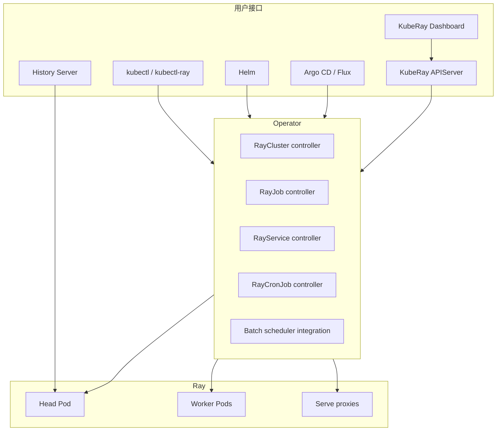
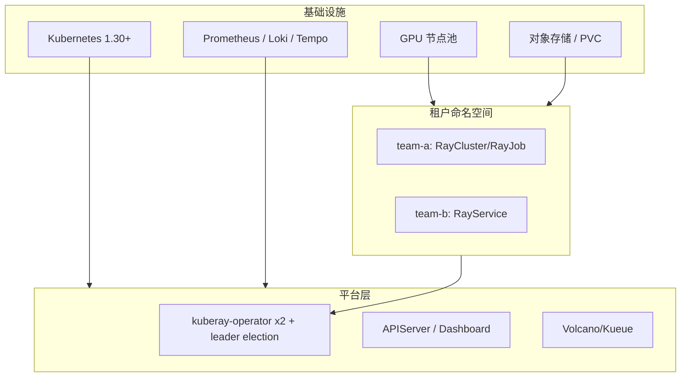

# 第 4 章 KubeRay 总览：组件、版本与生态

本章给出 KubeRay v1.7.1 的全局地图。后续章节会深入每个组件；这里先回答“有哪些东西、它们如何协作、版本之间差什么”。

## 4.1 组件清单

| 组件 | 作用 | 成熟度（v1.7.1） |
|---|---|---|
| **kuberay-operator** | 调和 RayCluster/RayJob/RayService/RayCronJob | 稳定 |
| **CRDs** | 四个 `ray.io/v1` 资源 | 稳定（RayCronJob 为 alpha 门控） |
| **KubeRay APIServer v1** | 简化配置层的 REST API | 维护模式 |
| **KubeRay APIServer v2** | 兼容 Kubernetes API 的 HTTP 代理/SDK | Alpha |
| **KubeRay Dashboard** | 集中查看 KubeRay 资源 | Experimental |
| **kubectl-ray 插件** | `kubectl ray get/create/scale/job submit` | Beta（1.3+） |
| **History Server** | 收集/回放 Ray 事件，集群删除后仍可看 Dashboard | Beta（发布说明；gate 阶段以目标 tag 为准） |
| **Helm Charts** | operator、apiserver、dashboard 安装 | 与 operator 同步发布 |
| **Samples** | 各种 RayCluster/Job/Service/CronJob 示例 | 随仓库发布 |



## 4.2 四个 CRD 的职责边界

| CRD | 生命周期 | 是否创建 RayCluster | 典型问题 |
|---|---|---|---|
| `RayCluster` | 长期 | 否（它自己就是） | 开发环境、共享池 |
| `RayJob` | 一次性 | 是（默认） | 训练、批处理 |
| `RayService` | 长期 + 升级 | 是（active/pending） | 在线推理 |
| `RayCronJob` | 周期性 | 通过子 RayJob | 定时任务 |

选择规则：

- **要交互、要复用**：RayCluster。
- **跑完就删、可重试**：RayJob。
- **对外提供 HTTP、要零停机升级**：RayService。
- **按 cron 周期跑**：RayCronJob。

不要用 RayService 跑一次性批任务，也不要用 RayJob 跑长期服务；它们的清理、重试、流量语义完全不同。

## 4.3 版本与发布节奏

KubeRay 的版本与 Ray 版本解耦，但存在兼容矩阵：

- KubeRay operator 镜像、CRD、Helm Chart 使用同一版本号；
- CRD 的 `ray.io/v1` 在 v1.x 内保持稳定；
- 新字段通常先以 feature gate + alpha 字段出现，再逐步默认开启；
- Ray 版本由 `spec.rayVersion` 和镜像 tag 决定，KubeRay 不强制。

v1.4–v1.7 的关键变化：

| 版本 | 时间 | 关键变化 |
|---|---|---|
| v1.4.0 | 2025-06 | kubectl-ray 增强；KubeRay Dashboard alpha；scheduler-plugins 集成；APIServer v2 alpha；SLI 指标；默认非 login shell；资源名不再静默截断；autoscaler v2 配置改为 `autoscalerOptions.version` |
| v1.5.0 | 2025-11 | Ray label selector API；RayJob `SidecarMode`；高级 deletion policies；RayService 增量升级 alpha；multi-host 改进 |
| v1.6.0 | 2026-03 | History Server alpha；Kubernetes RBAC token auth；RayCronJob alpha；deletion policy beta；`preRunningDeadlineSeconds`；`managedBy` for Kueue |
| v1.7.0 | 2026-08 | History Server beta（feature gate 阶段以 tag 为准）；增量升级 beta（gate 默认值在分支上有 promote/revert，按目标 tag 确认）；mTLS alpha；NetworkPolicy alpha；RocksDB GCS FT alpha；Kubernetes WAS alpha |
| v1.7.1 | 2026-09 | 修复 kubectl-ray 断线、History Server 日志/内存、示例镜像等问题 |

> 本教程以 v1.7.1 为基准。升级前务必核对 release notes，尤其是默认开启的 feature gate 和 CRD schema 变化。

### 4.3.1 兼容矩阵怎么用

不要只记“KubeRay 1.7.1”。生产至少维护：

| 维度 | 需要确认 |
|---|---|
| Kubernetes | 1.30+；`SidecarSubmitterRestart` 需要 1.35+；Gateway API/WAS 对版本有额外要求 |
| KubeRay operator/CRD | 同一版本；CRD 单独升级 |
| Ray | autoscaler v2 2.47+ 可用、2.48+ 默认，SidecarSubmitterRestart 2.54+ |
| Gateway API | v1.4.x（v1.7.1 operator 依赖；以 go.mod/CRD 为准） |
| cert-manager | mTLS/证书轮换 |
| 批调度器 | Volcano/YuniKorn/Kueue 与 K8s 版本 |
| GPU | 驱动/CUDA/device plugin/GPU Operator |

升级时一次只动一个维度，先在 staging 跑 RayCluster/RayJob/RayService 三条路径。

## 4.4 Feature Gates（v1.7.1）

| Gate | 默认 | 阶段 | 作用 |
|---|---|---|---|
| `RayClusterStatusConditions` | true | Beta | 新的 RayCluster conditions |
| `RayJobDeletionPolicy` | true | Beta | `deletionStrategy` / deletion rules |
| `RayMultiHostIndexing` | true | Beta | 多主机 worker 的 replica/host 索引 |
| `RayServiceIncrementalUpgrade` | 以 tag 为准* | Beta | Gateway API 增量升级；v1.7 分支有 promote/revert，生产显式设置 |
| `RayCronJob` | false | Alpha | RayCronJob 控制器 |
| `SidecarSubmitterRestart` | false | Alpha | Sidecar submitter 容器重启（K8s 1.35+） |
| `RayClusterNetworkPolicy` | false | Alpha | `spec.networkPolicy` |
| `GCSFaultToleranceEmbeddedStorage` | false | Alpha | RocksDB GCS FT |
| `RayClusterMTLS` | false | Alpha | cert-manager mTLS |
| `RayClusterHistoryServer` | false | Alpha/Beta 以 tag 为准（默认关闭） | 自动注入 collector sidecar |
| `KubernetesWAS` | false | Alpha | Kubernetes Workload-Aware Scheduling |

> \* `RayServiceIncrementalUpgrade` 在 v1.7 分支上出现过 promote（#4599）后 revert（#4602）的提交，不同 patch/tag 的默认值可能不同。以目标 tag 的 `pkg/features/features.go` 或 `kubectl get deploy kuberay-operator -o yaml | grep feature-gates` 为准；生产建议显式设置。
>
> v1.8/master 还在推进 `RayNodeEventForwarder`、`NodeLabelDelivery` 等 gate；它们不属于 v1.7.1 的稳定 API，本教程只在第 18 章讨论。
>
> IPPR 不在这个门控列表里：它由 RayCluster 的 `ray.io/ippr` 注解 + autoscaler v2 + Kubernetes 1.35 共同启用，KubeRay 文档将其标为 alpha。不要等一个不存在的 `InPlacePodResizing` gate。详见[第 57 章](57-in-place-pod-resizing-ippr.md)。

开启方式：

```bash
# Helm
helm upgrade kuberay-operator kuberay/kuberay-operator \
  -f feature-gates.yaml  # featureGates: [{name: RayCronJob, enabled: true}]

# 或直接改 Deployment args
kubectl -n kuberay-system patch deployment kuberay-operator --type=json \
  -p='[{"op":"add","path":"/spec/template/spec/containers/0/args/-","value":"--feature-gates=RayCronJob=true"}]'
```

生产建议：**一次只开一个 alpha gate**，观察事件、指标和 CRD 行为，再推进。

## 4.5 安装方式

### 4.5.1 Helm（推荐）

```bash
helm repo add kuberay https://ray-project.github.io/kuberay-helm/
helm repo update

helm install kuberay-operator kuberay/kuberay-operator \
  --version 1.7.1 \
  --namespace kuberay-system --create-namespace
```

检查：

```bash
kubectl -n kuberay-system get pods
kubectl get crd | grep ray.io
```

### 4.5.2 原始清单

```bash
kubectl apply -f manifests/crds/ray.io_rayclusters.yaml
kubectl apply -f manifests/crds/ray.io_rayjobs.yaml
kubectl apply -f manifests/crds/ray.io_rayservices.yaml
kubectl apply -f manifests/crds/ray.io_raycronjobs.yaml
kubectl apply -f manifests/rbac.yaml
kubectl apply -f manifests/operator.yaml
```

本仓库的 `manifests/` 是教学版清单，字段与真实 CRD 对齐，但不是官方发布物；生产请使用 KubeRay 官方 Chart。

### 4.5.3 第一个 RayCluster

```bash
kubectl apply -f manifests/samples/ray-cluster.yaml
kubectl get rayclusters
kubectl describe raycluster raycluster-sample
```

期望看到：

```text
NAME               DESIRED WORKERS   AVAILABLE WORKERS   CPUS   MEMORY   GPUS   STATUS   AGE
raycluster-sample  2                 2                   5      5Gi      0      ready    30s
```

端口转发：

```bash
kubectl port-forward svc/raycluster-sample-head-svc 8265:8265 10001:10001
# Dashboard: http://localhost:8265
```

### 4.5.4 安装后自检

```bash
kubectl -n kuberay-system get deploy,pods
kubectl get crd | grep ray.io
kubectl auth can-i create rayclusters -n default
kubectl apply -f manifests/samples/ray-cluster.yaml
if ! kubectl wait --for=condition=RayClusterProvisioned raycluster/raycluster-sample --timeout=5m; then
  kubectl describe raycluster/raycluster-sample
  exit 1
fi
kubectl get raycluster,po,svc -l ray.io/cluster=raycluster-sample
```

如果 `wait` 超时，不要继续装其他组件；先按第 17 章/附录 C 排查。完整的 kind + Helm 实验见[第 26 章](26-real-cluster-lab.md)。

## 4.6 仓库结构（真实 KubeRay）

```text
kuberay/
├── ray-operator/
│   ├── apis/ray/v1/           # CRD Go 类型
│   ├── controllers/ray/       # 控制器、common、utils
│   ├── config/crd/bases/      # 生成的 CRD YAML
│   ├── config/samples/        # 官方样例
│   └── pkg/features/          # feature gates
├── apiserver/                 # APIServer v1/v2
├── dashboard/                 # KubeRay Dashboard
├── historyserver/             # History Server
├── kubectl-plugin/            # kubectl-ray
└── helm-chart/                # Helm charts
```

读源码的建议顺序：

1. `apis/ray/v1/raycluster_types.go`：字段与默认值；
2. `controllers/ray/raycluster_controller.go`：调和顺序；
3. `controllers/ray/common/pod.go`：Pod 如何生成；
4. `controllers/ray/common/service.go`：Service/DNS；
5. `controllers/ray/rayjob_controller.go`：作业状态机；
6. `controllers/ray/rayservice_controller.go`：active/pending 与升级；
7. `pkg/features/features.go`：默认开启的功能。

## 4.7 生态集成

KubeRay 不是孤岛。常见集成：

- **Prometheus/Grafana**：operator SLI、Ray 指标、Pod 资源；
- **Volcano / YuniKorn / Kueue / scheduler-plugins**：gang scheduling、队列、配额；
- **Kueue MultiKueue**：`managedBy: kueue.x-k8s.io/multikueue` 把 RayCluster 交给 Kueue 管理；
- **Gateway API / Istio / NGINX**：RayService 增量升级、外部访问；
- **cert-manager**：mTLS 证书签发/轮换；
- **S3/GCS/Azure Blob/OSS**：History Server 事件存储、模型/数据；
- **Argo CD / Flux**：GitOps 管理 CR；
- **Kubeflow / Flyte / Ray Train**：上层工作流调用 RayJob。

第 12、14、16 章会分别展开。

## 4.8 生产拓扑建议



建议：

- operator 与租户命名空间分离；
- operator 开 leader election，至少 2 副本；
- 每个租户一个 namespace，配 ResourceQuota、LimitRange、NetworkPolicy；
- GPU 节点池用 taint/toleration + nodeSelector 隔离；
- 监控 operator 的 reconcile 错误率、队列深度、RayCluster Ready 状态；
- CRD 升级走独立变更流程，不依赖 Helm 自动升级。

## 4.9 简版实现覆盖了哪些组件

| 组件 | MiniKubeRay | 备注 |
|---|---|---|
| Operator + 四控制器 | 是 | 进程内循环 |
| CRD schema | `manifests/crds/` | 教学版 schema |
| APIServer | 是 | 子集 REST |
| Dashboard | 是 | 单页 HTML |
| CLI | 是 | apply/get/describe/logs/scale/delete/job stop/create/history |
| History Server | 是（简化） | 事件/快照/回放、JSON 持久化、REST/CLI |
| Gateway API | 是（控制面） | Gateway/HTTPRoute 对象与权重；无数据面 |
| 批调度 | 是（对象） | PodGroup/schedulerName；无真实调度器 |
| kubectl 插件 | 否 | CLI 提供类似能力 |
| 真实 Ray | 否 | 运行时模拟 |

## 4.10 版本治理：支持窗口与升级节奏

KubeRay 的版本不是“装完就忘”。平台至少要有：

| 策略 | 建议 |
|---|---|
| 支持窗口 | 当前 minor + 前一个 minor；patch 只修关键 bug |
| 升级节奏 | 每季度评估一次 minor，patch 按安全/关键修复 |
| CRD 升级 | 单独变更，不依赖 Helm `crds/` |
| Feature gate | 一次只开一个 alpha；beta 观察一个版本 |
| Ray 版本 | 与 KubeRay/驱动/依赖一起测，不单独追新 |
| 弃用 | 至少跨一个 minor，文档/事件/替代方案齐全 |

### 4.10.1 升级窗口怎么选

- 避开大作业提交高峰；
- RayService 升级要预留 surge 容量；
- operator 升级与 Ray 镜像升级分开；
- 先 staging，再灰度 namespace/租户；
- 观察 24 小时再全量。

### 4.10.2 版本矩阵的最小内容

```yaml
kubernetes: "1.32"
kuberay: "v1.7.1"
ray: "2.59.0"
gateway_api: "v1.3.0"
kueue: "v0.10.0"
gpu_operator: "25.3"
cni: "cilium-1.18"
```

这份矩阵要进 CI/文档，而不是只存在某个人脑子里。

## 4.11 小结

- KubeRay v1.7.1 由 operator、四个 CRD、APIServer、Dashboard、kubectl-ray、History Server 和 Helm Chart 组成。
- 四个 CRD 的生命周期语义不同，选择取决于工作负载形态。
- Feature gate 是理解版本差异的钥匙；alpha 功能默认关闭。
- 安装优先 Helm，但 CRD 升级需要单独处理。
- 生产拓扑要把 operator、租户、GPU 节点池、可观测性分开设计。

下一章进入最核心的 CRD：RayCluster。我们会逐字段解释 head/worker、autoscaler、GCS FT、auth、TLS、NetworkPolicy、History Server 和状态条件。

→ [第 5 章 RayCluster CRD 深度解析](05-raycluster-crd.md)
