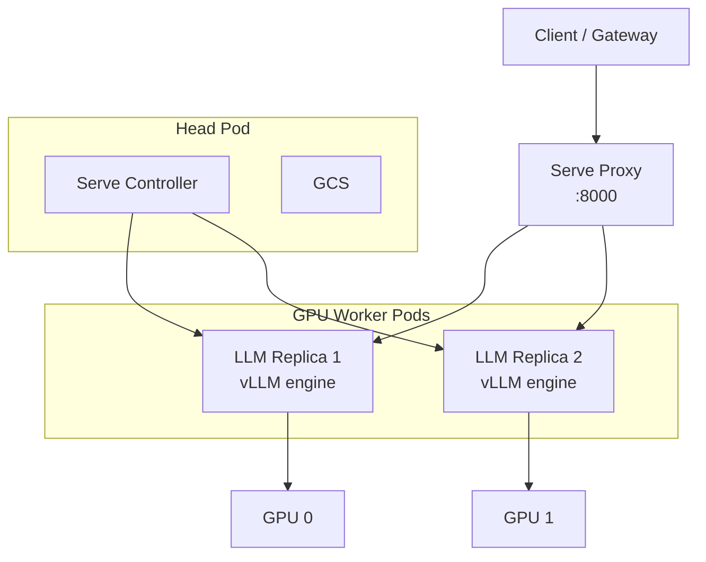

# 第 28 章 LLM 推理平台：Ray Serve、vLLM 与 SGLang

LLM 推理把 KubeRay 的几个能力推到了极限：GPU 昂贵、模型加载慢、请求长、流量突发、升级不能丢请求。RayService 正好提供了“多副本 Serve + active/pending 升级 + Gateway 流量切换”的组合，但它不是开箱即用的推理平台。本章讲清楚怎么做、哪里会坏、如何衡量。

## 28.1 为什么用 Ray Serve 跑 LLM

单模型单副本可以用一个 Deployment + vLLM 容器解决。Ray Serve 的价值在：

- **多模型/多应用**：一个 RayService 里部署多个 application，共享 GPU 池；
- **组合式应用**：预处理、路由、RAG、后处理可以是不同的 Serve deployment；
- **统一自动扩缩容**：Serve 按请求并发扩副本，Ray autoscaler 按资源扩节点；
- **零停机升级**：active/pending + Gateway 权重迁移；
- **多框架**：vLLM、SGLang、TensorRT-LLM、自定义 engine 都能包成 deployment。

代价是：

- 多一层 Serve controller/proxy；
- 资源模型更复杂（Serve 副本 vs Ray worker 节点）；
- 调试链路更长；
- 需要理解模型加载、KV cache、tensor parallel。

## 28.2 运行时结构



关键点：

- Serve controller 在 head 上，负责 deployment 状态、副本数、滚动更新；
- 每个 LLM replica 是一个 Ray actor，内部运行 vLLM/SGLang engine；
- proxy 负责 HTTP 路由、负载均衡、流式响应；
- GPU 由 Ray 分配给 replica，`ray_actor_options.num_gpus` 必须与 engine 需求一致；
- 模型权重通常在 replica 启动时加载，加载时间是冷启动的主要部分。

## 28.3 用 Ray Serve LLM 部署 OpenAI 兼容服务

Ray 2.59 提供 `ray.serve.llm`，封装了 vLLM 的 OpenAI 兼容 API。这个版本线里有两个值得注意的变化：

- **Ray Data LLM 与 Serve LLM 在 2.59 转为 GA**，vLLM 依赖固定在 0.27.0；`rayproject/ray-llm:2.59.0` 已经包含匹配的依赖，自己装 vLLM 时要对齐版本，避免 engine API 不兼容；
- Serve LLM 的 HTTP 入口支持 `multipart/form-data`，`s3://` 模型源在流式加载时不再被丢弃；生产上仍建议把模型缓存到节点本地或 PVC，减少每个副本的下载时间。

```yaml
apiVersion: ray.io/v1
kind: RayService
metadata:
  name: llm
spec:
  serveConfigV2: |
    applications:
      - name: llm
        import_path: ray.serve.llm:build_openai_app
        route_prefix: /
        args:
          llm_configs:
            - model_loading_config:
                model_id: meta-llama/Llama-3.1-8B-Instruct
              deployment_config:
                autoscaling_config:
                  min_replicas: 1
                  max_replicas: 4
                  target_num_ongoing_requests_per_replica: 8
                ray_actor_options:
                  num_gpus: 1
                  num_cpus: 2
              engine_kwargs:
                tensor_parallel_size: 1
                max_model_len: 8192
                gpu_memory_utilization: 0.9
              accelerator_type: A100
  rayClusterConfig:
    rayVersion: "2.59.0"
    enableInTreeAutoscaling: true
    autoscalerOptions:
      version: v2
      idleTimeoutSeconds: 120
    headGroupSpec:
      template:
        spec:
          containers:
            - name: ray
              image: rayproject/ray-llm:2.59.0
              resources:
                requests: {cpu: "4", memory: 16Gi}
    workerGroupSpecs:
      - groupName: gpu
        replicas: 1
        minReplicas: 1
        maxReplicas: 8
        template:
          spec:
            containers:
              - name: ray
                image: rayproject/ray-llm:2.59.0
                resources:
                  requests: {cpu: "8", memory: 64Gi, nvidia.com/gpu: "1"}
                  limits: {nvidia.com/gpu: "1"}
```

> 镜像：`rayproject/ray-llm:2.59.0` 预装了 Ray LLM/vLLM 依赖；如果使用 `rayproject/ray:2.59.0-gpu`，需要把 vLLM 等依赖装进镜像。模型权重需要 HF token（`HF_TOKEN` Secret）或可从对象存储/PVC 读取；生产建议把模型缓存挂到节点本地 SSD/PVC，避免每个副本重复下载。
>
> GPUs：`ray_actor_options.num_gpus` 必须与 `tensor_parallel_size` 匹配。TP=2 时每个 replica 需要 2 张 GPU，`num_gpus: 2`，且两张卡最好在同一节点/NVLink 域。

部署后：

```bash
kubectl port-forward svc/llm-serve-svc 8000:8000
curl http://127.0.0.1:8000/v1/chat/completions \
  -H 'Content-Type: application/json' \
  -d '{"model":"meta-llama/Llama-3.1-8B-Instruct","messages":[{"role":"user","content":"hello"}],"stream":true}'
```

注意：

- `model_id` 要与请求里的 `model` 字段一致；
- 模型权重需要可访问（HF token/对象存储/本地 PVC）；
- `accelerator_type` 是 Ray 的资源标签，不是 Kubernetes GPU 型号；两者要匹配；
- `tensor_parallel_size` 必须能整除 replica 的 GPU 数；例如 8B 模型 TP=2 需要每个 replica 2 张 GPU。

## 28.4 serveConfigV2 的关键字段

### 28.4.1 application

| 字段 | 作用 |
|---|---|
| `name` | 应用名，状态里按它索引 |
| `import_path` | `module:attr`，指向 deployment/app |
| `route_prefix` | HTTP 路径前缀 |
| `runtime_env` | 代码/依赖 |
| `deployments` | 覆盖 deployment 配置 |
| `args` | 传给 build app 的参数（LLM 配置） |

### 28.4.2 deployment

| 字段 | 作用 |
|---|---|
| `num_replicas` | 固定副本数 |
| `autoscaling_config` | 自动扩缩容 |
| `ray_actor_options.num_cpus/num_gpus` | 副本资源 |
| `max_concurrent_queries` | 每副本并发上限 |
| `graceful_shutdown_timeout_s` | 优雅退出 |
| `health_check_period_s` / `health_check_timeout_s` | 健康检查 |

### 28.4.3 LLM engine

| 字段 | 作用 |
|---|---|
| `model_loading_config.model_id` | 请求中的模型名 |
| `engine_kwargs.tensor_parallel_size` | TP 并行度 |
| `engine_kwargs.pipeline_parallel_size` | PP 并行度 |
| `engine_kwargs.max_model_len` | 上下文长度 |
| `engine_kwargs.gpu_memory_utilization` | KV cache 占比 |
| `engine_kwargs.enforce_eager` | 关闭 CUDA graph（调试用） |
| `accelerator_type` | Ray 资源标签 |

## 28.5 vLLM 与 SGLang 的选择

| 维度 | vLLM | SGLang |
|---|---|---|
| 生态 | 最广，OpenAI 兼容 | 快速迭代，结构化生成强 |
| 吞吐 | PagedAttention，成熟 | RadixAttention，前缀复用强 |
| 多模态 | 支持广 | 支持增长中 |
| 部署 | Ray Serve LLM 原生封装 | 可包成 Serve deployment |
| 适用 | 通用聊天/补全 | RAG/多轮/结构化输出 |

两者都可以作为 Serve deployment。选择时看：

- 模型支持；
- 前缀缓存/RAG 场景；
- 量化格式；
- 多 GPU/多节点并行；
- 团队经验。

不要只看 benchmark；用你的 prompt 分布、上下文长度、并发做压测。

## 28.6 GPU 规划

### 28.6.1 模型大小与显存

粗略估算：

```text
权重显存 ≈ 参数量 × 每参数字节数
FP16: 2 bytes/param
INT8: 1 byte/param
INT4: 0.5 byte/param
KV cache ≈ 2 × layers × num_kv_heads × head_dim × context × batch × bytes
```

`num_kv_heads × head_dim` 才是每层 K/V 的真实宽度；GQA/MQA 模型的 `num_kv_heads` 远小于 attention heads，直接用 `hidden` 会高估数倍。例如 Llama-3.1-8B（32 层、8 个 KV head、head_dim 128、FP16、4K context、batch=1）的 KV cache 约 512 MiB，而权重约 16GB；A100 80GB 的剩余空间还要留给激活/碎片。`gpu_memory_utilization` 控制 engine 可使用比例；太高会 OOM，太低浪费。

### 28.6.2 并行策略

- **TP（tensor parallel）**：层内切分，需要同一节点内高带宽（NVLink）；
- **PP（pipeline parallel）**：层间切分，跨节点也可，但会有气泡；
- **DP（data parallel）**：多个 replica，各自完整模型；
- **EP（expert parallel）**：MoE 模型。

KubeRay 侧：

- TP/PP 需要每个 replica 申请多张 GPU（`num_gpus: N`）；
- Ray 会把 replica 调度到一个节点（或 gang）；
- 跨节点 TP 需要高速网络；
- 多副本 DP 用 Serve autoscaling。

### 28.6.3 GPU 共享

| 方式 | 说明 | 风险 |
|---|---|---|
| MIG | 硬件分区 | 配置复杂、显存固定 |
| Time-slicing | NVIDIA device plugin 共享 | 相互干扰、延迟抖动 |
| 多进程共享 | 不推荐用于 LLM | 显存不可控 |
| 小模型多副本 | 每副本 1 GPU | 成本高但隔离好 |

LLM 通常不建议 time-slicing：KV cache 和显存峰值不可预测。

## 28.7 自动扩缩容的两层

```text
请求并发上升
  -> Serve autoscaling 增加 deployment replicas
  -> 每个 replica 需要 1 GPU
  -> Ray autoscaler 增加 GPU worker 节点
  -> Kubernetes 调度 Pod / Cluster Autoscaler 加节点
  -> 模型加载（冷启动）
  -> 新 replica 接流量
```

任何一层慢，都会表现为“扩容没反应”：

- Serve `max_replicas` 太小；
- Ray `maxReplicas` 太小；
- 节点池没有 GPU；
- 镜像/模型下载慢；
- `target_num_ongoing_requests_per_replica` 设置不合理。

### 28.7.1 冷启动优化

- 预拉镜像；
- 模型权重放节点本地缓存/PVC/高带宽对象存储；
- 使用更小的量化模型；
- 预热副本（`min_replicas > 0`）；
- 避免每次启动 pip install；
- 使用 model cache（vLLM/SGLang 的本地缓存）；
- 对延迟敏感的流量保留 warm pool。

### 28.7.2 扩缩容指标

- 每副本 ongoing requests；
- 队列等待时间；
- TTFT（time to first token）；
- TPOT（time per output token）；
- GPU KV cache 使用率；
- tokens/s；
- 错误率/超时率。

只看 CPU/GPU 利用率会误导：LLM 的瓶颈经常是 KV cache 或调度队列。

## 28.8 流量管理

### 28.8.1 Gateway API

生产入口建议：

```text
Client -> Gateway (TLS, auth, rate limit) -> HTTPRoute -> Ray Serve Service
```

RayService 的增量升级会创建/更新 HTTPRoute 的 `backendRefs` 权重。注意：

- Gateway 要支持 HTTPRoute；
- gRPC 流式请求需要单独的匹配规则；
- 长连接/流式响应要配置足够的 idle timeout；
- 限流/配额在 Gateway 层做，避免打爆 GPU。

### 28.8.2 灰度与回滚

- 用权重 5% -> 25% -> 50% -> 100%；
- 观察 TTFT/TPOT/错误率；
- 出问题立即把权重切回；
- 保留旧集群直到 in-flight 请求结束；
- 客户端要支持重试和超时。

### 28.8.3 多模型路由

一个 Serve app 可以按 header/path 路由到不同模型：

```python
@serve.deployment
class Router:
    def __init__(self, small, large):
        self.small = small
        self.large = large

    async def __call__(self, request):
        handle = self.small if request.headers.get("x-model") == "small" else self.large
        return await handle.remote(request)
```

但要注意 GPU 池共享和隔离；大模型可能饿死小模型。

## 28.9 可观测性

### 28.9.1 指标

| 指标 | 含义 |
|---|---|
| `ray_serve_deployment_queued_queries` | 排队请求 |
| `ray_serve_deployment_processing_latency_ms` | 处理延迟 |
| `ray_serve_num_http_requests` | HTTP 请求数 |
| vLLM `num_requests_running/waiting` | engine 队列 |
| vLLM `gpu_cache_usage_perc` | KV cache |
| vLLM `time_to_first_token` | TTFT |
| vLLM `tokens_per_second` | 吞吐 |

### 28.9.2 日志

- Serve controller/proxy 日志；
- vLLM engine 日志（OOM、CUDA、模型加载）；
- 请求日志（注意脱敏）；
- 慢请求采样；
- 错误分类（429/500/503/timeout）。

### 28.9.3 追踪

- 在 Gateway/Proxy 注入 trace ID；
- Serve deployment 读取并传递；
- 记录模型名、输入 token 数、输出 token 数、排队时间；
- 不要把完整 prompt 写入日志（隐私）。

## 28.10 容量与成本

### 28.10.1 估算

```text
所需 GPU 数 ≈ 峰值并发 × 每请求 GPU 占用 / 目标利用率
```

更实用的方法：

1. 用生产 prompt 分布压测单副本；
2. 测出 TTFT/TPOT 与并发曲线；
3. 找到满足 SLO 的最大并发；
4. 按峰值并发 / 单副本并发 × 冗余系数 规划；
5. 预留升级/故障的 surge 容量。

### 28.10.2 降本

- 量化（FP8/INT8/INT4）；
- 前缀缓存（RAG/多轮）；
- 动态 batching；
- 小模型路由；
- Spot GPU + checkpoint/快速重建；
- 缩容到 0（冷启动可接受时）；
- 多租户共享 GPU 池（注意隔离）。

## 28.11 故障模式

| 现象 | 可能原因 | 排查 |
|---|---|---|
| replica 一直 DEPLOYING | 模型下载慢/显存不足/CUDA 错误 | engine 日志、nvidia-smi |
| 503 | Serve Service 无 endpoint | `ray.io/serve` 标签、proxy 健康 |
| 429 | 并发上限/限流 | `max_concurrent_queries`、Gateway |
| TTFT 高 | 排队/模型大/KV cache 满 | 队列指标、GPU 显存 |
| 扩容不生效 | 节点池/镜像/模型加载 | autoscaler 日志、Pending Pod |
| 升级后全部 503 | HTTPRoute 指向错误/新集群未 Ready | `pendingServiceStatus`、HTTPRoute |
| 显存 OOM | batch/context 太大 | 降 `max_model_len`/batch |

## 28.12 实验

1. 部署一个 8B 模型，测单副本在不同并发下的 TTFT/TPOT。
2. 把 `tensor_parallel_size` 从 1 改成 2，比较吞吐与延迟。
3. 开启 Serve autoscaling，观察副本数与 Ray worker 数的联动。
4. 做一次增量升级，观察 HTTPRoute 权重变化与错误率。
5. 模拟 GPU 不足，验证 Pending Pod 与 autoscaler 行为。
6. 把模型换成量化版本，比较显存/吞吐/质量。

## 28.13 LLM 容量计算器：从 SLO 到 GPU 数

### 28.13.1 输入

| 输入 | 含义 | 示例 |
|---|---|---|
| `λ` | 到达率（req/s） | 6.7 |
| `prompt_tokens` | 输入 token 数（P95） | 800 |
| `output_tokens` | 输出 token 数（P95） | 300 |
| `TTFT_slo` | 首 token 延迟（P95） | 1.5s |
| `TPOT_slo` | 每输出 token 时间（P95） | 50ms |
| `concurrency_per_replica` | 单副本可承载并发 | 8 |
| `gpu_count` | 单副本 GPU 数 | 1 |
| `tensor_parallel` | TP 并行度 | 1 |

### 28.13.2 计算步骤

```text
1. 单请求 GPU 时间 ≈ TTFT + output_tokens × TPOT
   例：1.5 + 300 × 0.05 = 16.5 GPU·s（近似）

2. 所需并发副本（按 Little's Law）
   L = λ × W
   W 用 SLO 延迟（TTFT + output_tokens × TPOT）
   replicas_concurrency = ceil(L / concurrency_per_replica)

3. 所需 GPU 数
   gpus = replicas_concurrency × gpu_count

4. 显存约束
   权重 + KV cache + 激活/碎片 < GPU 显存
   KV cache ≈ 2 × layers × num_kv_heads × head_dim × context × batch × bytes

5. 取 max(并发约束, 显存约束, 吞吐约束)

6. 加冗余
   峰值突发 × 1.5–3
   升级 surge（NewCluster 2× / maxSurgePercent）
   故障 N+1
```

### 28.13.3 一个算例

```text
λ = 6.7 req/s
W = 1.5 + 300 × 0.05 = 16.5s
L = 6.7 × 16.5 ≈ 110.6 在途请求
concurrency_per_replica = 8
replicas = ceil(110.6 / 8) = 14
gpus = 14 × 1 = 14
```

如果显存只能放下 8 个并发，则 `concurrency_per_replica=8` 已经是上限；再增加副本只会增加 GPU 数，不会提高单卡并发。

### 28.13.4 常见误算

- 只用 QPS × 平均延迟，不用 P95；
- 忽略输出 token 数（LLM 的延迟主要来自解码）；
- 把 `max_concurrent_queries` 当成实际并发；
- 忽略前缀缓存对 TTFT 的影响；
- 不预留升级 surge；
- 把 GPU 利用率当成吞吐上限。

### 28.13.5 压测对照表

| 配置 | 副本 | 并发 | RPS | TTFT P95 | TPOT P95 | 结论 |
|---|---:|---:|---:|---:|---:|---|
| baseline | 2 | 8 | | | | |
| TP=2 | 2 | 8 | | | | |
| 量化 | 2 | 8 | | | | |
| 前缀缓存 | 2 | 8 | | | | |

用同一组 prompt/输出长度对比，才能判断优化是否有效。

## 28.14 小结

- RayService + Serve LLM 可以构建多模型、可升级、可扩缩的推理平台。
- LLM 的瓶颈通常是显存/KV cache/冷启动，不是 CPU。
- Serve autoscaling 与 Ray autoscaler 是两层，必须同时配置。
- 增量升级依赖 Gateway API；流量切换要配合客户端重试。
- 观测 TTFT/TPOT/队列/KV cache，比看 GPU 利用率更有用。

continuous batching、PagedAttention、前缀缓存、chunked prefill 与 PD 分离的内部机制见[第 47 章](47-llm-inference-internals.md)。

下一章看生态：Kueue、Volcano、YuniKorn、Argo Workflows、Airflow 与 Kubeflow 如何与 KubeRay 组合。

→ [第 29 章 生态集成：队列、调度与工作流](29-ecosystem-integrations.md)
