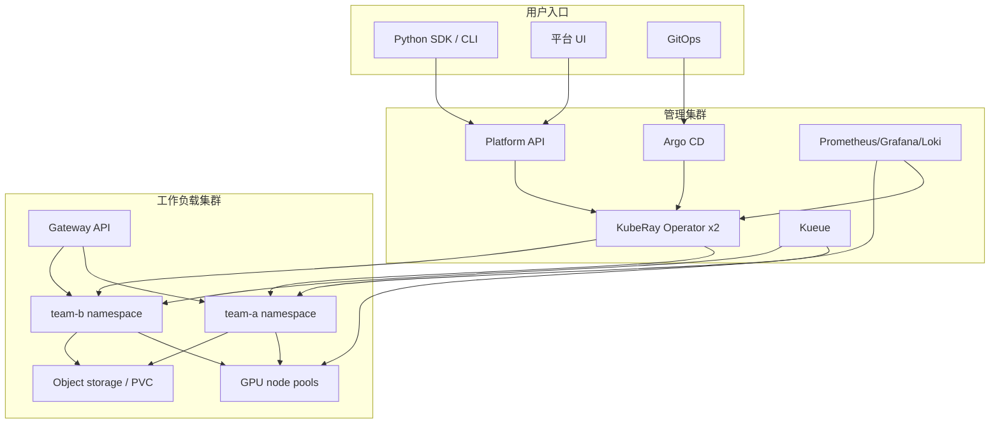

# 第 32 章 平台实战：多租户 Ray 平台设计

前面各章是零件：CRD、控制器、调度、网络、存储、可观测性、安全、成本。本章把它们组装成一个可运营的多租户 Ray 平台，回答“如果我要给 5 个团队、200 个数据科学家、几十张 GPU 提供 Ray，应该怎么设计”。

## 32.1 需求与约束

先写清楚平台契约，而不是先选工具：

| 维度 | 问题 | 示例目标 |
|---|---|---|
| 用户 | 谁用？ | 数据科学家、ML 工程师、推理服务团队 |
| 工作负载 | 跑什么？ | 训练、ETL、Tune、在线推理 |
| 规模 | 多少租户/集群/GPU？ | 10 租户、100 集群、64 GPU |
| 隔离 | 强度？ | namespace 级软隔离，敏感团队独立集群 |
| SLO | 可用性/延迟？ | 推理 99.9%，训练排队 < 10 分钟 |
| 成本 | 预算/计费？ | 按 namespace/队列分摊 |
| 合规 | 数据/审计？ | 数据不出区、审计 180 天 |
| 运维 | 团队能力？ | 2 名平台工程师 + on-call |

没有这些约束，架构会变成“所有功能都开”的复杂系统。

## 32.2 参考架构



### 32.2.1 管理集群 vs 工作负载集群

| 模式 | 优点 | 缺点 |
|---|---|---|
| 单集群（operator + 租户同集群） | 简单、延迟低 | 爆炸半径大 |
| 管理集群 + 多工作负载集群 | 隔离、按地域扩展 | 复杂、跨集群网络 |
| 每租户独立集群 | 最强隔离 | 成本/运维高 |
| vCluster | 虚拟控制面隔离 | 网络/GPU 仍需共享 |

起步建议：单集群多 namespace；规模/合规上来后再拆。

### 32.2.2 operator 部署

- 每个工作负载集群一个 operator；
- 或管理集群 operator 通过 `watchNamespace`/多集群管理（需要额外方案）；
- 生产至少 2 副本 + leader election；
- operator namespace 与租户 namespace 分离；
- operator RBAC 最小化（见第 14 章）。

## 32.3 租户模型

### 32.3.1 隔离级别

| 级别 | 手段 | 适用 |
|---|---|---|
| L1 逻辑隔离 | namespace + RBAC + quota | 同信任域团队 |
| L2 网络/存储隔离 | NetworkPolicy + 独立 PVC/对象存储前缀 | 一般生产 |
| L3 节点隔离 | taint/toleration + 独立 node pool | GPU/敏感负载 |
| L4 集群隔离 | 独立集群/vCluster | 强合规/多地域 |

不要承诺“namespace 就是安全边界”；Ray 能执行任意代码，Pod 安全上下文/网络策略/镜像策略必须一起上。

### 32.3.2 namespace 模板

每个租户 namespace 创建：

- ResourceQuota（CPU/内存/GPU/Pod 数）；
- LimitRange（默认 request/limit）；
- NetworkPolicy（默认拒绝，按需放行）；
- ServiceAccount + RoleBinding；
- ImagePullSecret；
- 默认 RayCluster 模板（ConfigMap）；
- Kueue LocalQueue（如果使用）；
- 监控/日志标签。

```yaml
apiVersion: v1
kind: ResourceQuota
metadata:
  name: team-a
  namespace: team-a
spec:
  hard:
    requests.cpu: "400"
    requests.memory: 1Ti
    requests.nvidia.com/gpu: "32"
    pods: "400"
    persistentvolumeclaims: "20"
---
apiVersion: v1
kind: LimitRange
metadata:
  name: defaults
  namespace: team-a
spec:
  limits:
    - type: Container
      default:
        cpu: "1"
        memory: 2Gi
      defaultRequest:
        cpu: "500m"
        memory: 1Gi
```

### 32.3.3 配额与队列

- ResourceQuota 是硬上限，kube-apiserver 拒绝超额；
- Kueue 做作业级准入/借用/抢占；
- Volcano/YuniKorn 做 gang scheduling；
- 监控配额使用率，避免“配额占满但 GPU 空闲”。

## 32.4 GPU 池设计

### 32.4.1 节点池

| 池 | 用途 | 机型 | taint |
|---|---|---|---|
| cpu-general | 数据/小模型 | 32–64 核 | 无 |
| gpu-a100 | 大模型训练/推理 | A100 80GB | `nvidia.com/gpu=present:NoSchedule` |
| gpu-l4 | 轻量推理 | L4 | 同上 |
| spot | 可中断训练 | 多种 | `spot=true:NoSchedule` |

Pod 通过 `nodeSelector`/`toleration` 选择池；KubeRay 的资源请求必须与池匹配。

### 32.4.2 设备插件与 GPU Operator

- NVIDIA GPU Operator 管理驱动/device plugin/DCGM；
- MIG 需要启用 MIG manager；
- time-slicing 通过 device plugin 配置；
- 监控 DCGM 指标（利用率/显存/温度/XID）。

### 32.4.3 拓扑

- NVLink 同机；
- InfiniBand/RoCE 多机；
- 同可用区减少跨区流量；
- `topologySpreadConstraints` 控制打散；
- 大 GPU Pod 的碎片问题：预留整机/整组。

## 32.5 网络与入口

### 32.5.1 集群内

- head Service headless + `publishNotReadyAddresses`；
- worker 通过 6379 加入；
- NetworkPolicy 默认拒绝，显式放行 DNS/head/Redis/对象存储；
- mTLS（alpha）保护 Pod 间 gRPC；
- 不要把 6379 暴露到集群外。

### 32.5.2 外部入口

```text
Client -> DNS -> Gateway (TLS/auth/rate limit) -> HTTPRoute -> Ray Serve Service
```

- 每个租户一个 hostname/path；
- Gateway 做 TLS 终止、OIDC、限流；
- RayService 增量升级用 HTTPRoute 权重；
- Dashboard 不要直接暴露公网；
- 训练集群用 port-forward/VPN，不用 Ingress。

### 32.5.3 出口

- 对象存储/镜像仓库/PyPI 走白名单；
- 禁止任意公网访问（数据泄漏/供应链）；
- 用 egress gateway/NAT/代理；
- 记录出口流量。

## 32.6 身份与权限

### 32.6.1 用户身份

- OIDC 集成（Dex/Keycloak/云 IAM）；
- 用户 -> group -> RoleBinding；
- 租户只能操作自己的 namespace；
- 平台管理员单独角色；
- 审计所有 CR 创建/修改/删除。

### 32.6.2 工作负载身份

- 每租户 ServiceAccount；
- 对象存储用 IRSA/Workload Identity/GKE Workload Identity；
- 不要把长期 AK/SK 放进 Secret；
- Ray token auth/K8s RBAC 委托（第 14 章）；
- 最小权限：只读需要的 bucket/prefix。

## 32.7 镜像与供应链

- 内部镜像仓库 + 扫描（Trivy）；
- 固定 digest；
- cosign 签名/验证；
- 禁止 `latest`；
- 基础镜像定期重建；
- 租户只能拉取白名单仓库；
- Ray 镜像与 CUDA/驱动兼容矩阵；
- 离线环境镜像同步流程。

## 32.8 自助服务 API

### 32.8.1 平台抽象

不要直接把原始 CR 暴露给所有用户。提供：

- **模板**：小/中/大 GPU 训练、批 ETL、在线推理；
- **默认值**：镜像、资源、重启策略、TTL、队列；
- **策略**：最大 GPU、最长运行时间、允许的镜像；
- **API**：创建/查询/停止/日志；
- **UI**：表单 + 状态 + 事件。

### 32.8.2 实现方式

| 方式 | 说明 |
|---|---|
| CRD + GitOps | 用户提 PR，平台审核 |
| Platform API | 后端写 CR，做鉴权/配额/审计 |
| KubeRay APIServer v2 | 兼容 K8s API 的代理 |
| kubectl-ray | 命令行 |
| 自定义 UI | 调 API |

无论哪种，最终都写 CR；operator 仍是唯一数据面写入者。

### 32.8.3 策略即代码

- OPA/Gatekeeper/Kyverno：
  - 禁止 `hostPath`；
  - 禁止 privileged；
  - 限制镜像仓库；
  - 要求 resource requests；
  - 限制 GPU 数；
  - 要求标签/队列。
- 准入失败要给用户可读的错误。

## 32.9 可观测性与 SLO

### 32.9.1 分层指标

| 层 | 指标 |
|---|---|
| 平台 | operator reconcile 错误率、CRD 延迟、队列深度 |
| 租户 | RayCluster Ready、RayJob 成功率、RayService SLO |
| 节点 | CPU/GPU/内存/磁盘/网络 |
| Ray | task/actor 排队、对象存储、GCS |
| 应用 | TTFT/TPOT、吞吐、错误率 |
| 成本 | GPU 小时、闲置率、按 namespace 分摊 |

### 32.9.2 SLO 示例

| SLI | 目标 | 告警 |
|---|---|---|
| RayCluster 创建到 Ready | P95 < 5 分钟 | 10 分钟 |
| RayJob 成功率 | > 99% | 95% |
| RayService 可用性 | > 99.9% | 99.5% |
| 推理 TTFT P99 | < 2s | 3s |
| operator reconcile 错误率 | < 0.1% | 1% |
| GPU 闲置率 | < 20% | 30% |

### 32.9.3 告警分级

- P1：所有推理不可用、operator 不工作、控制面故障；
- P2：单租户/单集群故障、作业失败率上升；
- P3：容量/成本/单 Pod 重启；
- P4：趋势/优化建议。

## 32.10 成本与计费

### 32.10.1 成本模型

```text
总成本 =
  GPU/CPU 节点
+ 存储（PVC/对象存储）
+ 网络（跨区/出口）
+ 控制面（operator/监控）
+ 闲置/碎片
```

### 32.10.2 分摊

- 按 namespace/队列/标签聚合；
- GPU 小时是最直观的单位；
- 记录 RayJob/RayService 的资源请求与实际使用；
- 区分“预留”和“实际使用”；
- 对闲置 GPU 告警；
- 月度报告 + 预算告警。

### 32.10.3 降本

- autoscaling/缩容到 0；
- Spot + checkpoint；
- 多 group priority；
- 量化/小模型；
- 共享 GPU 池（隔离风险）；
- 对象存储生命周期；
- 镜像/模型缓存。

### 32.10.4 从公式到 FinOps 工具

成本模型只有落到标签和账单才有用。最小闭环：

1. **强制标签**：`team`、`cost-center`、`workload`、`ray.io/cluster`、`ray.io/originated-from-crd`。用准入策略（Kyverno/Gatekeeper）拒绝缺标签的 Ray 资源。
2. **分摊**：OpenCost/Kubecost 按 namespace + 标签聚合；GPU 用 `nvidia.com/gpu` 请求小时数计价，CPU/内存按 request 或实际使用（二选一，口径固定）。
3. **Showback/Chargeback**：每周给租户发“预留 GPU 小时 / 实际利用 / 闲置 / 排队”四列；账单争议先看标签和 CR 归属。
4. **预算告警**：按 namespace/队列设置月度预算，80%/100% 两级；对“连续 24h GPU 利用率 < 10%”的 RayCluster 告警。
5. **Spot 中断**：监听云厂商的中断通知（如 AWS EventBridge/Node Termination Handler），在 Ray 侧触发 checkpoint/优雅退出；head/Redis 不要放 Spot。
6. **对账**：每月用账单反推“每 GPU 小时成本”，和平台容量模型对账；差异大时先查跨区流量、NAT、闲置 headroom。

不要把“成本”做成月底的一张报表；它应该是租户可见的实时指标 + 预算门禁。

## 32.11 Day-2 运维

### 32.11.1 变更管理

- CRD/operator 升级单独变更；
- 一次只开一个 alpha gate；
- 灰度 namespace/租户；
- 观察 24 小时；
- 回滚预案；
- 变更记录/审计。

### 32.11.2 故障演练

- 删除 head/worker；
- 杀 Redis；
- 网络分区；
- GPU 故障；
- 节点 drain；
- 镜像仓库故障；
- 配额耗尽；
- 升级回滚。

### 32.11.3 容量规划

- 峰值 GPU/CPU/内存；
- 扩容启动时间；
- 升级 surge；
- 故障冗余；
- 队列/配额；
- 季度 review。

## 32.12 分阶段落地

### 阶段 1：单集群 MVP

- KubeRay Helm；
- 1–2 个 namespace；
- RayCluster + RayJob；
- 基本监控；
- 手动 YAML/GitOps。

### 阶段 2：多租户

- 配额/LimitRange/NetworkPolicy；
- 模板/默认值；
- Kueue/Volcano；
- 镜像仓库/扫描；
- SLO/告警。

### 阶段 3：生产化

- RayService/增量升级；
- GCS FT；
- 多集群/DR；
- 成本分摊；
- 自助 API/UI；
- 审计/合规。

### 阶段 4：优化

- 自动扩缩容调优；
- GPU 共享/MIG；
- LLM 推理平台；
- 多集群调度；
- 混沌测试。

## 32.13 平台 API 契约示例

平台 API 不是“把 CR 暴露给用户”，而是一层**受约束的抽象**。一个最小契约：

| 方法 | 路径 | 作用 |
|---|---|---|
| POST | `/v1/jobs` | 提交训练/批处理 |
| GET | `/v1/jobs/{id}` | 查询状态 |
| POST | `/v1/jobs/{id}/stop` | 停止 |
| GET | `/v1/jobs/{id}/logs` | 日志 |
| POST | `/v1/services` | 创建/更新推理服务 |
| GET | `/v1/services/{id}` | 查询 |
| DELETE | `/v1/services/{id}` | 删除 |
| GET | `/v1/quotas` | 配额使用 |

请求示例：

```json
{
  "template": "gpu-train-medium",
  "entrypoint": "python train.py",
  "image": "registry.local/team-a/train:2026-10-18",
  "resources": {"gpu": 4, "cpu": 32, "memory": "256Gi"},
  "queue": "team-a",
  "ttlSecondsAfterFinished": 3600,
  "idempotencyKey": "train-2026-10-18-001"
}
```

响应示例：

```json
{
  "id": "job-7f3c",
  "namespace": "team-a",
  "kind": "RayJob",
  "name": "train-7f3c",
  "state": "Initializing",
  "links": {"console": "/v1/jobs/job-7f3c", "logs": "/v1/jobs/job-7f3c/logs"}
}
```

契约要点：

- **幂等键**：重复提交返回同一对象；
- **模板**：用户不能任意写 Pod spec；
- **配额**：提交时检查 ResourceQuota/Kueue；
- **鉴权**：OIDC/group → namespace；
- **审计**：记录提交者/镜像/entrypoint/资源；
- **状态映射**：把 `jobDeploymentStatus`/`jobStatus` 映射成用户可读状态；
- **错误可读**：不要直接返回 CR 的原始 condition；
- **删除语义**：停止 vs 删除 vs 保留日志。

不要让平台 API 绕过 operator 直接写 Pod；最终仍然只写 CR。

## 32.14 反模式

- 把 operator 和租户放在同一 namespace，给 cluster-admin；
- 用 `latest` 镜像；
- 没有 ResourceQuota，一个团队占满 GPU；
- 所有团队共用一个 RayCluster，互相干扰；
- 直接改 Pod，不让 operator 调和；
- 不设 TTL，RayJob 完成后集群永久保留；
- 把 Dashboard 暴露公网；
- 没有备份/DR；
- 同时开多个 gang 调度器；
- 把 alpha 功能当稳定功能。

## 32.15 平台检查表

- [ ] 租户隔离级别已定义
- [ ] namespace 模板（quota/limit/network/SA/secret）
- [ ] GPU 节点池/taint/device plugin
- [ ] operator 多副本/leader election/最小 RBAC
- [ ] 队列/配额/抢占策略
- [ ] 镜像仓库/扫描/签名
- [ ] 入口 Gateway/TLS/限流
- [ ] 出口白名单
- [ ] 身份/对象存储 Workload Identity
- [ ] 模板/默认值/策略
- [ ] 监控/日志/追踪/SLO
- [ ] 成本分摊
- [ ] 升级/备份/DR 演练
- [ ] 混沌测试
- [ ] 文档/onboarding

## 32.16 平台成熟度模型（L0–L4）

用成熟度模型评估“现在在哪、下一步做什么”，比罗列功能更有效。

| 级别 | 名称 | 特征 | 典型缺口 |
|---|---|---|---|
| L0 | 手工 | 手动 apply YAML、无配额、无监控 | 不可重复、爆炸半径大 |
| L1 | 标准化 | 模板/GitOps、基本监控、单租户 | 无多租户/队列/成本 |
| L2 | 多租户 | namespace + 配额 + NetworkPolicy + 队列 | 升级/DR/成本分摊 |
| L3 | 生产化 | SLO、灰度、备份/DR、审计、on-call | 规模化/自动化优化 |
| L4 | 优化 | 控制面分片、多集群、成本优化、混沌 | 持续演进 |

### 32.16.1 各级别的“出门条件”

**L0 -> L1**

- 所有工作负载来自 Git/模板；
- 有 RayCluster/RayJob 的 smoke test；
- 有基本监控（operator/集群/作业）。

**L1 -> L2**

- 每租户 namespace/配额/网络策略；
- 有队列/准入（Kueue/Volcano）；
- 镜像仓库/扫描；
- 租户 onboarding 文档。

**L2 -> L3**

- SLO/告警/on-call；
- 升级/回滚演练；
- 备份/DR（RTO/RPO）；
- 审计/合规；
- 成本分摊。

**L3 -> L4**

- 控制面分片/多集群；
- 性能/容量基准；
- 混沌测试；
- 自助 API/UI；
- GPU 共享/推理平台。

### 32.16.2 不要跳级

- 没有 L1 的模板/GitOps，直接上 L2 多租户会变成“每个租户一套手工配置”；
- 没有 L2 的配额，直接上 L3 成本分摊没有意义；
- 没有 L3 的 SLO/演练，直接上 L4 多集群会把故障放大。

### 32.16.3 自评问题

1. 新租户从申请到跑第一个作业需要多久？
2. 一次 operator 升级需要多少人工步骤？
3. 上一次故障演练是什么时候？
4. 能否在 30 分钟内定位“某个 RayService 为什么 503”？
5. GPU 闲置率是多少？谁负责？
6. 一个租户能否影响另一个租户的调度/网络/配额？

## 32.17 小结

- 平台设计从约束开始，不是从功能清单开始。
- 隔离是分层的：namespace、网络、节点、集群；不要只靠一层。
- 配额/队列/调度解决“谁能跑”；镜像/身份/网络解决“能跑什么”。
- 自助服务最终都写 CR；operator 是唯一数据面写入者。
- SLO/成本/升级/DR 是平台能否长期运营的关键。

下一章回到代码：把 History Server、Gateway API、批调度等新能力在 MiniKubeRay 中实现出来。

→ [第 33 章 MiniKubeRay 进阶实现：History Server、Gateway API 与批调度](33-mini-advanced-implementation.md)
