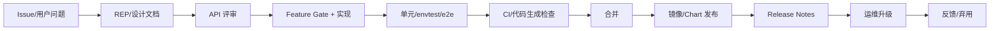

# 第 43 章 从 Issue 到 Release：KubeRay 贡献、API 治理与发布工程

第 30 章教你怎么读源码，第 38 章教你怎么把 MiniKubeRay 移植成生产 operator。本章补上最后一环：**一个字段/功能从想法到发布，中间要经过哪些工程环节**。

对平台团队来说，这不仅是“给开源做贡献”的问题。你们内部维护的 operator 同样需要：

- API 设计与兼容性评审；
- 代码生成与 CRD 发布；
- 单元/envtest/e2e 分层；
- 镜像签名、SBOM、Helm 发布；
- 版本矩阵、弃用策略、release notes；
- 安全漏洞响应。

本章以 KubeRay v1.7.x 的工程实践为参照，给出一套可复用的流程。

## 43.1 一个功能的一生



关键原则：

1. **先定义问题，再定义 API**；
2. **新功能默认关闭**（feature gate），观察一个版本再默认开启；
3. **API 一旦发布，删除/改语义就是 breaking change**；
4. **每一层都要有可执行的验证**，不能只靠 review；
5. **发布物要可追溯**（镜像 digest、SBOM、签名、chart 版本）。

## 43.2 Issue、REP 与设计评审

### 43.2.1 什么时候需要 REP

REP（Ray Enhancement Proposal）适合：

- 新增 CRD 字段/类型；
- 改变默认值/状态机；
- 引入新依赖（Gateway API、Kueue、cert-manager）；
- 影响升级/兼容性的行为；
- 跨组件（operator + APIServer + Dashboard + CLI）的改动。

小 bug 修复不需要 REP；但**任何用户可见的 API 变化**都值得写清楚。

### 43.2.2 设计文档的最小结构

```text
1. 动机：用户问题、现有 workaround、为什么不够
2. 目标/非目标
3. API：字段、默认值、校验、状态、事件
4. 行为：状态机、幂等、失败/重试、清理
5. 兼容性：旧对象、旧 operator、升级/回滚
6. 安全：RBAC、Secret、网络、供应链
7. 可观测性：指标、事件、日志
8. 测试计划：单元/envtest/e2e/文档
9. 分阶段：feature gate、默认值、弃用
```

### 43.2.3 API 评审问题清单

- 字段名是否符合 Kubernetes API conventions（camelCase、单位、可选性）？
- 默认值放在 CRD 还是 controller？会不会与旧对象冲突？
- 跨字段校验放在哪里？失败如何暴露？
- 状态字段是否必要？能否从子资源推导？
- 是否可幂等重试？失败会不会留下半成品？
- 是否需要 finalizer？删除顺序是什么？
- 是否需要新 RBAC/CRD/依赖？
- 旧 operator 读到新字段会怎样（忽略/裁剪/报错）？
- 回滚时新字段会不会导致旧 operator 行为异常？

## 43.3 Feature Gate 生命周期

KubeRay 的功能门控通常经历：

```text
Alpha（默认 false） -> Beta（通常默认 true） -> GA（移除 gate）
```

| 阶段 | 默认 | 稳定性 | 使用建议 |
|---|---|---|---|
| Alpha | false | API 可能变 | 测试集群、单租户 |
| Beta | 通常 true；需要外部依赖/显式选择时可为 false | API 基本稳定 | 生产可用，关注 release notes |
| GA | 移除 | 稳定 | 正常使用 |

例外：`RayClusterHistoryServer` 默认 false，因为它依赖对象存储采集链路，需要用户显式开启。发布说明称 v1.7 为 Beta，但目标 tag 的 `features.go` 可能仍标 Alpha/default false；不要用“Beta 就一定默认 true”做自动化判断，按 tag 确认。

### 43.3.1 加一个 gate

```go
var (
    MyFeature = featuregate.Feature("MyFeature")
)

func init() {
    utilruntime.Must(DefaultFeatureGate.Add(map[featuregate.Feature]featuregate.FeatureSpec{
        MyFeature: {Default: false, PreRelease: featuregate.Alpha},
    }))
}
```

### 43.3.2 在控制器里检查

```go
if !features.DefaultFeatureGate.Enabled(features.MyFeature) {
    // 保持旧行为；不要静默忽略用户字段而不报错
    r.Recorder.Event(&cluster, corev1.EventTypeWarning, "FeatureGateDisabled",
        "spec.myField requires the MyFeature feature gate")
    return ctrl.Result{}, nil
}
```

### 43.3.3 提升/移除 gate

- Alpha -> Beta：改默认值，保留字段；在 release notes 标注；
- Beta -> GA：删除 gate 检查，保留字段；
- 删除字段：先弃用（annotation/文档/警告），至少跨一个 minor；
- 不要在同一版本同时“默认开启 + 改语义”。

## 43.4 代码生成与 CRD

KubeRay 的 Go 类型是 API 契约，CRD YAML 由代码生成。

### 43.4.1 类型与标记

```go
type MySpec struct {
    // +kubebuilder:validation:Minimum=0
    // +kubebuilder:validation:Maximum=100
    // +kubebuilder:default=10
    // +optional
    Percent *int32 `json:"percent,omitempty"`

    // +kubebuilder:validation:Enum=Default;Aggressive
    // +kubebuilder:default=Default
    // +optional
    Mode *string `json:"mode,omitempty"`
}
```

### 43.4.2 生成命令

```bash
make generate     # deepcopy、client 等
make manifests    # CRD YAML
make generate && make manifests && git diff --exit-code
```

CI 必须检查“生成物已提交且与源码一致”，否则发布出去的 CRD 会和代码不一致。

### 43.4.3 CRD 变更检查

- 新增字段：通常兼容；
- 删除/重命名字段：breaking；
- 默认值变化：行为变化；
- 枚举/范围收紧：旧对象可能非法；
- `x-kubernetes-preserve-unknown-fields` 变化：字段可能被裁剪；
- storage/served 版本变化：迁移风险。

```bash
kubectl apply --server-side --dry-run=server -f new-crd.yaml
kubectl get crd rayclusters.ray.io -o yaml > old.yaml
diff <(yq '.spec.versions' old.yaml) <(yq '.spec.versions' new.yaml)
```

## 43.5 测试分层

### 43.5.1 单元测试

覆盖纯函数：

- 默认值；
- 校验；
- 命名/hash；
- 状态机转移；
- Pod/Service builder（golden test）。

```bash
go test ./ray-operator/...
```

### 43.5.2 envtest

启动真实 kube-apiserver + etcd，不启动 kubelet/scheduler：

- Reconcile 的 API 交互；
- finalizer 两阶段删除；
- status subresource；
- 冲突重试；
- ownerReference。

### 43.5.3 e2e

kind/真实集群：

- CRD 安装；
- operator RBAC；
- Pod/Service/EndpointSlice；
- 真实 Ray 进程/端口；
- 作业提交/日志。

```bash
make docker-build IMG=...
kind load docker-image ...
make deploy IMG=...
go test ./test/e2e/... -v
```

### 43.5.4 测试金字塔的取舍

| 层 | 速度 | 覆盖 | 频率 |
|---|---|---|---|
| 单元 | 秒 | 逻辑 | 每次 PR |
| envtest | 十秒 | API/调和 | 每次 PR |
| e2e | 分钟 | 数据面 | 合并前/夜间 |
| 混沌 | 十分钟+ | 故障 | 周期性 |

不要把 e2e 当单元测试跑；也不要只写单元测试就发布 operator。

## 43.6 CI 流水线

一个生产级 KubeRay 仓库的 CI 至少包括：

```text
lint          gofmt/goimports/golangci-lint
generate      make generate && git diff --exit-code
manifests     make manifests && git diff --exit-code
unit          go test ./...
envtest       setup-envtest + go test
build         docker build
e2e           kind + make deploy + go test ./test/e2e
docs          markdown/link/YAML 检查
security      trivy/cosign/SBOM
```

### 43.6.1 缓存与并行

- Go module/build cache；
- Docker layer cache；
- 单元测试并行；
- e2e 用固定 kind 镜像；
- 失败时上传 operator/Pod 日志。

### 43.6.2 必过检查

- 生成物一致；
- 单元/envtest 通过；
- CRD schema 合法；
- 镜像可构建；
- 文档链接/样例有效；
- 代码签名/扫描（发布前）。

## 43.7 发布工程

### 43.7.1 版本号

- operator、CRD、Helm Chart 使用同一版本号；
- 预发布：`v1.8.0-rc.0`；
- patch：`v1.7.1`；
- 不要用 `latest` 作为生产 tag。

### 43.7.2 发布物

| 产物 | 内容 |
|---|---|
| 镜像 | operator、APIServer、Dashboard、History Server、collector |
| CRD YAML | 四个 CRD |
| Helm Chart | operator/APIServer/ray-cluster（Dashboard/History 用 manifests 或 operator chart 选项） |
| Samples | 可运行清单 |
| Release Notes | breaking changes、feature gates、升级步骤 |
| SBOM/签名 | 供应链安全 |

### 43.7.3 镜像构建

```bash
make docker-build IMG=quay.io/kuberay/operator:v1.8.0
make docker-push IMG=quay.io/kuberay/operator:v1.8.0
```

生产建议：

- 多阶段构建，最小运行时；
- 非 root；
- 固定基础镜像 digest；
- 多架构（amd64/arm64）；
- 签名（cosign）+ SBOM（Syft/Trivy）；
- 扫描 CVE。

### 43.7.4 Helm Chart 发布

- `crds/` 目录只安装不升级；
- values 兼容旧版本（新增键有默认值）；
- 模板渲染测试（`helm template`）；
- chart 版本与 appVersion 分开；
- 发布前 `helm lint`/`helm diff`。

### 43.7.5 Release Notes 模板

```markdown
## Highlights
## Breaking Changes
## Deprecations
## New Features
## Bug Fixes
## Upgrade Notes
  - CRD apply order
  - feature gate changes
  - Ray version compatibility
## Contributors
```

**升级步骤**必须单独写清楚，尤其是：

- 是否需要先升级 CRD；
- 哪些 gate 默认值变了；
- 旧对象是否需要迁移；
- 回滚是否可行。

## 43.8 版本兼容与弃用

### 43.8.1 三个版本轴

| 轴 | 例子 | 兼容性来源 |
|---|---|---|
| Kubernetes | 1.30+（`SidecarSubmitterRestart` 需 1.35+） | KubeRay release notes |
| KubeRay | 1.6 -> 1.7 | API/CRD 变更 |
| Ray | 2.55 -> 2.59 | Ray/KubeRay 矩阵 |
| Gateway API | v1.3 | 增量升级 |
| Kueue/Volcano | 各自 | 集成版本 |

### 43.8.2 弃用流程

```text
1. 文档标记 deprecated
2. 事件/日志警告（不要静默）
3. 保留至少一个 minor
4. release notes 说明替代方案
5. 下一个 major/minor 删除
```

### 43.8.3 版本偏差（version skew）

- 新 operator + 旧 CRD：字段被裁剪；
- 旧 operator + 新 CRD：新字段被忽略；
- 新 Ray + 旧 operator：命令/端口/API 可能不兼容；
- 新旧 Ray 混跑：序列化/协议不兼容。

升级时一次只动一个轴，并在 staging 跑三条主路径。

### 43.8.4 CRD 存储版本、转换与校验棘轮

改 CRD 前先看四个字段：

```bash
kubectl get crd rayclusters.ray.io -o yaml | yq '{
  versions: .spec.versions[] | {name, served, storage},
  conversion: .spec.conversion.strategy
}'
```

- `served`：客户端能否用这个版本读写；
- `storage`：etcd 里实际存储的版本；
- `conversion.strategy: None`：没有 webhook，API server 不会做字段语义转换；
- `conversion.strategy: Webhook`：需要额外的 conversion webhook 服务/证书，发布工程要把它纳入可用性范围。

KubeRay 核心 CRD 通常没有 conversion webhook。新增字段时优先“只增不改”：

- 不要改已有字段的类型/含义；
- 新字段给默认值，并考虑旧对象读回时的零值语义；
- 枚举只能加值，不能删值；
- 校验收紧（更严格的 pattern/minimum）会拒绝旧对象，属于 breaking change；
- 用 `kubectl apply --dry-run=server` 和 staging 旧对象回归，不要只跑新样例。

CRD 升级后可以用 `kubectl get ... -o yaml` 观察对象是否被默认值/裁剪改写；存储版本迁移要单独演练导出、剥离服务端字段、重新 apply（第 31 章）。

## 43.9 安全与供应链

- 依赖扫描（Go modules/Python 包）；
- 镜像扫描（Trivy）；
- SBOM；
- cosign 签名/验证；
- 固定 digest；
- 最小 RBAC；
- 安全披露流程（security@ / GitHub Security Advisory）；
- 不在 issue 里贴 Secret/Token；
- 发布前检查 CRD/RBAC 的权限扩大。

## 43.10 一个字段的端到端实战

假设要给 RayCluster 增加一个**示例字段** `spec.exampleField`（仅用于演示流程，不是上游真实字段）。

### 43.10.1 设计

- 字段：`exampleField`，string，可选；
- 默认值：空；
- 校验：只能是 `a`/`b`；
- 行为：写入 Pod annotation；
- 兼容：旧对象没有该字段时行为不变；
- 测试：默认/校验/builder/envtest；
- 文档：API reference/sample/release notes。

### 43.10.2 类型

```go
// +kubebuilder:validation:Enum=a;b
// +optional
ExampleField *string `json:"exampleField,omitempty"`
```

### 43.10.3 生成

```bash
make generate
make manifests
git diff --stat
```

### 43.10.4 默认/校验

```go
func setDefaults(cluster *rayv1.RayCluster) {
    // 不要给 exampleField 设非空默认值，除非你确认旧对象也适用
}

func validate(cluster *rayv1.RayCluster) error {
    if v := cluster.Spec.ExampleField; v != nil && *v != "a" && *v != "b" {
        return fmt.Errorf("spec.exampleField must be a or b")
    }
    return nil
}
```

### 43.10.5 调和

```go
if cluster.Spec.ExampleField != nil {
    pod.Annotations["example.com/field"] = *cluster.Spec.ExampleField
}
```

### 43.10.6 测试

```go
func TestExampleFieldValidation(t *testing.T) { ... }
func TestExampleFieldAnnotation(t *testing.T) { ... }
// envtest：创建 CR -> 断言 Pod annotation
```

### 43.10.7 文档与发布

- 更新 `appendix-a-api-reference.md`；
- 加一个 sample；
- 在 release notes 的 “New Features” 写清楚；
- 如果行为会影响现有对象，加 feature gate。

## 43.11 PR 与 Review

### 43.11.1 PR 大小

- 一个 PR 一个功能/修复；
- 不混入无关格式化；
- 生成物单独提交（或按仓库约定）；
- 大功能拆成“类型/默认校验/调和/测试/文档”多个 PR。

### 43.11.2 Review 清单

- [ ] 动机/问题清楚
- [ ] API 兼容
- [ ] 默认值/校验一致
- [ ] 幂等/失败路径
- [ ] finalizer/ownerReference
- [ ] status 只在变化时写
- [ ] 测试覆盖成功/失败/边界
- [ ] 文档/sample/release note
- [ ] RBAC/安全
- [ ] 性能/规模

### 43.11.3 Review 时最常被忽略的问题

- 缓存最终一致（scale expectations）；
- status 抖动；
- 删除分支继续创建子资源；
- 默认值与 CRD 冲突；
- 旧对象升级后的行为；
- 高基数指标；
- 测试只断言最终状态，不断言中间状态。

## 43.12 社区与协作

- 先搜 issue/REP，避免重复；
- 小步提交，及时同步设计；
- 对 breaking change 明确标注；
- 回应 review 时解释“为什么”，而不只是改代码；
- 维护者关注的是长期可维护性，不只是“能跑”。

一个可执行的贡献回路：

```bash
# 1. fork + 分支（分支名带类型，便于 triage）
git checkout -b feat/rayjob-entrypoint-resources

# 2. 改类型/默认/校验/调和
#    apis/ray/v1/*_types.go -> controllers/ray/... -> common/...

# 3. 生成代码与清单
make generate manifests

# 4. 本地测试
make test          # 单元
make test-e2e      # 需要 kind/集群，按仓库 Makefile 为准

# 5. 提交（DCO sign-off；不要只写“fix”）
git commit -s -m "feat(rayjob): forward entrypoint resources to the Job API"

# 6. 开 PR：动机/API 变更/兼容性/测试/回滚
```

PR 描述至少回答：**为什么现在做、API 是否变化、旧对象怎么办、怎么测、怎么回滚**。如果改了 CRD，附上 `make manifests` 的 diff；如果改了默认值/校验，附上 envtest 用例；如果改了调度/网络，附上 kind 实验证据。

## 43.13 练习

1. 给 MiniKubeRay 加一个 `spec.exampleField`，走完类型/默认/校验/调和/测试/文档全流程。
2. 为你的字段写一份 REP：动机、API、兼容性、测试计划。
3. 设计一个 feature gate 从 Alpha 到 Beta 的发布计划（两个版本）。
4. 写一份 release notes 的 “Breaking Changes/Upgrade Notes”。
5. 给一个现有字段设计弃用路径（警告、替代、删除）。
6. 用 `helm template` + `kubectl apply --dry-run=server` 验证一次 chart 升级。

## 43.14 小结

- 功能从 issue/REP 开始，不是从写代码开始。
- API 一旦发布，兼容性是长期债务；feature gate 是控制风险的工具。
- 生成物（deepcopy/CRD/client）必须与源码一致。
- 测试分单元/envtest/e2e/混沌四层，各司其职。
- 发布物要可追溯：镜像 digest、SBOM、签名、chart、release notes。
- 升级/弃用要跨版本规划，不能在同一版本“默认开启 + 改语义”。

← [第 42 章 可运行故障实验室](42-incident-lab.md)

→ [第 44 章 多可用区、托管 Kubernetes 与灾难恢复](44-multi-az-managed-kubernetes-dr.md)
