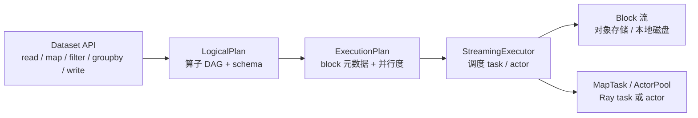
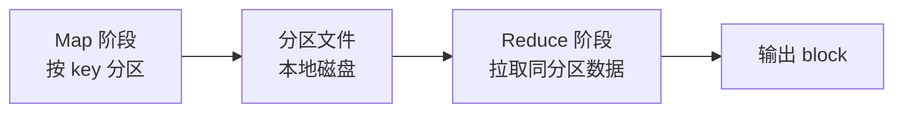

# 第 45 章 Ray Data 执行引擎深潜：流式调度、背压、Shuffle 与对象存储

第 27 章讲了“怎么在 KubeRay 上提交一个 Ray Data 作业”。本章回答更底层的问题：**一条 `read_parquet().map_batches().write_parquet()` 在 Ray 内部到底怎样被拆成 task、怎样限制内存、什么时候会 spill、为什么扩容了反而更慢**。

Ray Data 是 KubeRay 上最常见的批处理形态，也是最容易“看起来跑着、其实在 OOM 或空转”的形态。把执行引擎讲清楚，才能把 KubeRay 的 worker 数量、对象存储、`/dev/shm`、PVC 和 autoscaler 配到正确的量级。

> 版本边界：Ray 2.59 的 Ray Data 仍在快速演进，执行器选项和指标名会随版本变化。本章描述稳定的执行模型（logical plan、block、streaming executor、backpressure、shuffle），具体开关以 `ray.data` 的 API 文档和你使用的版本为准。

## 45.1 为什么 Ray Data 值得单独一章

一个 Ray Data 作业有三个与普通 Ray task 不同的特征：

1. **数据量远大于单机内存**：所以必须有流式执行、背压和 spill，不能把整个数据集物化。
2. **并行度由数据分块决定，而不是由函数调用次数决定**：block 的数量、大小和分布直接决定 task 数量与倾斜。
3. **shuffle 是全局屏障**：`groupby`、`sort`、`repartition`、`random_shuffle` 会把“流式”变成“阶段性物化”，也是磁盘和网络压力的主要来源。

在 KubeRay 上，这三个特征分别对应：

| Ray Data 机制 | KubeRay 侧的资源 | 常见故障 |
|---|---|---|
| 流式执行 + 背压 | worker 内存、对象存储 | OOMKilled、对象存储 spill 打满本地盘 |
| block 并行度 | worker 数量、CPU/GPU 请求 | 大量小 block 导致调度开销；block 太大导致长尾 |
| shuffle | 本地 NVMe/PVC、网络带宽 | shuffle spill 慢、节点磁盘打满、倾斜 |

## 45.2 从 Dataset 到执行计划

Ray Data 的执行分三层：



### 45.2.1 LogicalPlan

LogicalPlan 是“要做什么”：

- `Read`：数据源与 schema；
- `MapBatches` / `MapRows` / `Filter`：逐 block 或逐行变换；
- `FlatMap`：一行变多行；
- `GroupBy` / `Sort` / `Repartition`：需要 shuffle 的算子；
- `Write`：sink。

LogicalPlan 还携带 **schema**。schema 决定了：

- 是否需要读 Parquet footer；
- `map_batches` 的 batch format（pandas/numpy/Arrow）；
- 输出字段类型是否兼容；
- 能否做 projection/filter pushdown。

### 45.2.2 ExecutionPlan

ExecutionPlan 是“怎样做”：

- 每个算子被展开成 **block 级 task**；
- 决定 block 的大小、数量和位置；
- 决定哪些算子可以 **fusion**（融合）到同一个 task；
- 决定 shuffle 的分区数和落盘策略。

### 45.2.3 Block

Block 是 Ray Data 的最小调度单位，通常是 Arrow table 或 pandas DataFrame 的一个分片。Block 的几个关键属性：

| 属性 | 影响 |
|---|---|
| 行数 | task 的计算时间与输出大小 |
| 字节数 | 对象存储占用、网络传输、spill 成本 |
| 位置 | 数据本地性；跨节点读取走网络 |
| schema | 类型兼容与序列化成本 |

**经验值**：block 的合理大小通常是几十 MB 到几百 MB。太小会让调度和元数据开销占主导；太大会让单个 task 成为长尾，并放大对象存储峰值。

## 45.3 流式执行器

Ray Data 默认使用流式执行器（streaming executor）。它的核心不是“把所有 block 先算出来”，而是维护一条有界的数据流：

```text
Read operator ──► Map operator ──► Map operator ──► Write operator
      │                │                │                │
      └── block 队列 ───┴── block 队列 ──┴── block 队列 ──┘
             有界                有界                有界
```

### 45.3.1 算子融合

相邻的窄依赖算子（例如连续多个 `map_batches`）可以融合到同一个 task 中执行，避免中间 block 落对象存储。融合的收益：

- 减少对象存储读写；
- 减少 task 调度次数；
- 降低端到端延迟。

融合的边界通常是：

- shuffle 算子（必须物化）；
- 需要不同资源形状的算子（例如 CPU 预处理后接 GPU 推理）；
- 需要单独设置 `num_cpus`/`num_gpus`/`concurrency` 的算子。

### 45.3.2 有界队列与背压

流式执行器在算子之间维护有界队列。上游算子只有在队列有空位时才继续产出 block；这就是 **背压**。背压的作用：

- 防止读算子把整个数据源拉进内存；
- 让慢算子（例如 GPU 推理）自然限制上游速度；
- 把内存峰值控制在大约 `队列深度 × block 大小 × 活跃算子数`。

没有背压时，典型故障是：

1. 读算子很快，map 很慢；
2. 未处理的 block 堆积在对象存储；
3. 对象存储超过阈值，开始 spill 到本地盘；
4. 本地盘打满，task 失败或节点 NotReady。

### 45.3.3 并行度从哪里来

Ray Data 的并行度不是简单地等于 worker 数。它由以下因素共同决定：

- **block 数**：有多少个可调度的输入分片；
- **每个算子的 `concurrency`**：`map_batches(..., concurrency=N)` 可以为一个算子单独设置并发；
- **资源**：每个 task 的 `num_cpus`/`num_gpus` 决定一个节点能同时跑多少个；
- **actor pool**：有状态算子（例如模型推理）使用 actor pool，池大小就是并发上限；
- **调度策略**：`task_size`、`max_concurrent_batches` 等选项影响在途 block 数。

一个常见的误区是“worker 扩到 32 个，吞吐就线性增长”。如果输入只有 8 个 block，最多只有 8 个 task 并行；如果每个 block 只有 1 MB，调度开销会吞掉大部分收益。

## 45.4 内存、对象存储与 Spill

### 45.4.1 三层内存

Ray Data 的内存可以分成三层：

| 层 | 位置 | 典型大小 | 作用 |
|---|---|---|---|
| 堆内存 | worker 进程 | 容器 memory limit 减去其他开销 | Python 对象、pandas/Arrow 中间结果 |
| 对象存储 | `/dev/shm` | `object-store-memory` 或 30% 内存 | block 的共享存储与跨节点传输 |
| 本地磁盘 | 容器盘 / PVC / NVMe | 节点磁盘 | spill、shuffle、checkpoint |

### 45.4.2 对象存储阈值与 Spill

当对象存储用量超过阈值时，Ray 会把对象 spill 到本地磁盘。spill 不是免费的：

- 序列化/反序列化成本；
- 磁盘 IO；
- 如果磁盘也满了，task 会失败。

Ray Data 的 `execution_options` 可以控制相关行为（名称随版本变化，常见的有 `resource_limits`、`object_store_memory`、`max_errored_blocks` 等）。在生产中更重要的是：

- 给 `/dev/shm` 足够空间（KubeRay 默认会按内存比例设置；见第 6 章）；
- 给 spill 目录挂本地 NVMe 或高 IOPS PVC；
- 监控 `ray_object_store_memory` 和节点磁盘；
- 控制 block 大小与在途 block 数。

### 45.4.3 一个内存估算公式

对一条 `read -> map -> write` 的流水线，粗略的峰值内存是：

```text
peak ≈ queue_depth × block_bytes × active_stages
     + actor_pool_size × per_actor_state
     + shuffle_buffer_bytes
```

例如 `queue_depth=2`、`block=128 MB`、`active_stages=3`，仅 block 就有约 768 MB；再加上 Python/Arrow 的副本和对象存储，容器至少要留出 2–3 GB 余量。

## 45.5 Shuffle：从流式到屏障

### 45.5.1 什么时候需要 shuffle

以下算子需要全局重分布：

- `groupby` / `aggregate`；
- `sort`；
- `repartition`；
- `random_shuffle`；
- 某些 join（尤其是非广播 join）。

### 45.5.2 Shuffle 的两个阶段



- **Map 阶段**：每个 task 把自己的输出按 `hash(key) % num_partitions` 写到本地分区文件；
- **Reduce 阶段**：每个 reduce task 拉取所有 map task 的对应分区，做聚合/排序。

### 45.5.3 分区数与倾斜

分区数太少：

- 单个 reduce task 处理太多数据，成为长尾；
- 无法充分利用 worker。

分区数太多：

- 小文件和小 task 过多；
- 调度与元数据开销上升；
- shuffle 文件数爆炸。

经验规则：

- 分区数大约是 **总 CPU 核数的 1–4 倍**；
- 单分区数据量控制在 **几百 MB**；
- 对严重倾斜的 key 做加盐（salting）或两阶段聚合。

### 45.5.4 Spill 与磁盘

shuffle 的中间数据通常写本地磁盘。KubeRay 上要特别注意：

- 容器可写层通常不是高性能盘；
- 多个 worker 共享节点磁盘时会互相影响；
- 节点临时盘不足会导致 shuffle 失败。

生产建议：

- 给 shuffle 密集的 worker 挂本地 NVMe（hostPath 或 local PV）；
- 或者挂高 IOPS 的 PVC；
- 监控磁盘使用率和 IO wait；
- 避免把 shuffle 目录放在 `/dev/shm`（会挤占对象存储）。

## 45.6 数据源、格式与下推

### 45.6.1 列式格式优先

Parquet/ORC 的优势：

- 列裁剪（只读需要的列）；
- 谓词下推（跳过不满足条件的 row group）；
- 压缩率高，减少 IO。

CSV/JSON 的优势是通用，但：

- 需要全量解析；
- 压缩与列裁剪能力弱；
- 大文件更容易造成长尾。

### 45.6.2 文件数量

输入文件太多会导致：

- 元数据操作成为瓶颈；
- 产生大量小 block；
- task 调度开销上升。

输入文件太少会导致：

- 并行度不足；
- 单个 task 太大。

目标通常是 **每个文件几百 MB**，并让 block 数略大于可用核数。

### 45.6.3 数据湖格式

Ray Data 可以读取 Iceberg/Delta/Hudi 等表格式（具体支持随版本变化）。在 KubeRay 上使用时要注意：

- 元数据服务/目录服务的网络可达性；
- 凭据注入（Secret / workload identity）；
- 快照隔离与增量读取；
- 小文件合并与 compaction 不应和训练作业抢同一批 worker。

## 45.7 Ray Data 与 Autoscaler 的交互

Ray Data 的资源需求是“阶段性的”：

1. 读阶段需要网络/CPU；
2. map 阶段需要 CPU 或 GPU；
3. shuffle 阶段需要磁盘/网络；
4. write 阶段需要网络/对象存储带宽。

Ray autoscaler 看到的是 **pending task/actor 的资源向量**。因此：

- 如果 driver 一次性提交了所有 block 的 task，autoscaler 会迅速扩到 `maxReplicas`；
- 如果流式执行器限制了在途 block，autoscaler 可能只看到少量 pending task，扩缩容更平滑；
- shuffle 阶段可能出现“CPU 空闲但磁盘打满”的假象，autoscaler 不会因为磁盘压力扩容。

### 45.7.1 扩容到零的陷阱

`minReplicas: 0` 很诱人，但对 Ray Data 有一个冷启动问题：

- 第一个 block 到达时才有 demand；
- 拉起 worker、拉镜像、启动 Raylet 需要分钟级；
- 作业可能在扩容完成前就超时或重试。

如果作业对完成时间敏感，保留 1 个 warm worker，或用 `minReplicas: 1`。

### 45.7.2 资源形状要与算子匹配

```yaml
# 只展示 RayCluster 的 worker group 片段；完整对象见 manifests/samples/
workerGroupSpecs:
  - groupName: cpu-etl
    replicas: 4
    minReplicas: 0
    maxReplicas: 32
    template:
      spec:
        containers:
          - name: ray
            image: rayproject/ray:2.59.0
            resources:
              requests:
                cpu: "8"
                memory: 32Gi
```

如果 GPU 推理算子和 CPU 预处理混在同一个 worker group：

- 每个 Pod 都带 GPU，成本高；
- CPU 阶段 GPU 空闲；
- autoscaler 按最稀缺资源扩容，容易过冲。

更好的做法是拆成两个 worker group，或在同一个 Ray 集群里用不同的 `ray_actor_options.num_gpus` 让 Ray 调度器区分资源。

## 45.8 在 KubeRay 上的资源规划

### 45.8.1 head 不是计算节点

Ray Data 的 driver 默认在 head 上运行（K8sJobMode 的 submitter 只负责提交）。head 的资源要给足：

- driver 内存（元数据、progress bar、schema）；
- Dashboard/Job API；
- GCS 与对象存储。

不要把大规模 `ray.get` 或 `to_pandas()` 放在 driver 上。

### 45.8.2 `/dev/shm` 与对象存储

KubeRay 会为 Ray 容器设置 `/dev/shm`。如果作业有大量 block 在节点间传输：

- `/dev/shm` 太小会频繁 spill；
- 太大会挤压容器内存。

经验值：对象存储内存约为容器内存的 30%，`/dev/shm` 至少覆盖对象存储上限。第 6 章给出了 KubeRay 的默认规则和覆盖方式。

### 45.8.3 本地磁盘

为 shuffle/spill 挂载本地盘：

```yaml
# Pod spec 片段
volumes:
  - name: shuffle
    emptyDir:
      medium: ""
      sizeLimit: 200Gi
containers:
  - name: ray
    volumeMounts:
      - name: shuffle
        mountPath: /tmp/ray
```

注意：`emptyDir` 使用节点磁盘，节点磁盘不足时仍会失败；对性能敏感的 shuffle 用 local NVMe。

### 45.8.4 批调度

shuffle 作业通常希望“整组 worker 一起起来”，否则先到的 task 会等待未调度的 worker。可以用：

- Volcano/YuniKorn 的 gang scheduling；
- Kueue 的队列准入；
- Kubernetes WAS。

见第 12、29 章。

## 45.9 可观测性

### 45.9.1 Ray Data 自带统计

```python
import ray

ds = ray.data.read_parquet("s3://bucket/raw/")
ds = ds.map_batches(transform, batch_size=1024)
ds.write_parquet("s3://bucket/curated/")
print(ds.stats())
```

`stats()` 会给出：

- 每个算子的输出 block 数、行数、字节数；
- task 数量与耗时；
- 是否有 spill；
- 算子融合情况。

### 45.9.2 指标

Ray 暴露的 Data 指标（名称随版本变化）通常包括：

- `ray_data_output_blocks_*`；
- `ray_data_output_rows_*`；
- `ray_data_spilled_bytes`；
- `ray_data_current_bytes`；
- `ray_data_processed_bytes`。

在 KubeRay 上要同时看：

- worker 的 CPU/GPU 利用率；
- 对象存储用量；
- 节点磁盘与 IO wait；
- autoscaler 的 `replicas` 与 pending demand；
- task 失败/重试次数。

### 45.9.3 日志

Ray Data 的 task 日志分散在各个 worker。建议：

- 用 Ray Dashboard 的 Data 页面看算子进度；
- 用 `ray logs` 或 `kubectl logs` 按 task/worker 过滤；
- 把关键统计写入作业日志（block 数、行数、spill 字节）；
- 在 KubeRay 侧用 `ray.io/cluster`、`ray.io/group` 标签做日志聚合。

## 45.10 故障与重试

### 45.10.1 Task 失败

Ray 会重试失败的 task。重试的边界：

- 读 task：通常可安全重试；
- 纯 map task：通常可安全重试；
- 有副作用的 task（写外部系统、发送消息）：必须幂等。

### 45.10.2 Block 丢失

如果对象存储中的 block 丢失（节点故障、spill 文件损坏），Ray 会尝试从 lineage 重建。重建的代价取决于上游算子：

- 读文件 -> 重新读；
- map -> 重新计算；
- shuffle -> 重新拉取/重算。

### 45.10.3 输出幂等

`write_parquet` 默认可能覆盖或追加，取决于模式。生产建议：

- 写到临时目录，成功后原子 rename；
- 或按分区覆盖（`partition_overwrite`）；
- 写 `_SUCCESS` 标记；
- 记录输入版本与输出行数。

这与 RayJob 的重试语义（第 10 章）直接相关：RayJob 的 `backoffLimit` 会重建集群重跑 entrypoint，输出必须可重入。

## 45.11 实验：`examples/data_execution_lab.py`

这个实验不依赖 Ray，用确定性的模型演示：

- 有界队列与背压；
- block 级 map/filter；
- 哈希 shuffle 与 spill；
- 流式峰值 vs 全量物化峰值。

运行：

```bash
python examples/data_execution_lab.py
```

输出示例：

```text
blocks=240 rows=60000 input=117.2 MiB
max queue depth  : 2 (bounded)
spilled blocks   : 240 (78.12 MiB)
streaming peak   : 0.98 MiB
materialized peak: 117.19 MiB
OK: streaming execution respected backpressure, spilled under budget, and wrote every retained row.
```

怎么读这些数字：

| 数字 | 含义 | 对应生产问题 |
|---|---|---|
| `max queue depth` | 在途 block 上限 | 背压是否生效 |
| `spilled blocks` | 因 shuffle 预算触发的 spill 次数 | 磁盘是否会被打满 |
| `streaming peak` | 流式执行的峰值内存 | 容器 memory limit 是否足够 |
| `materialized peak` | 全量物化的峰值 | 为什么不能 `to_pandas()` |
| `rows in/out` | 过滤后的行数 | 输出是否正确 |

实验的断言固定在 `tests/test_examples.py`，脚本失效会让 pytest 直接失败。

## 45.12 调优清单

- [ ] 输入文件大小在几百 MB 量级，block 数略大于核数；
- [ ] `batch_size` 与单 batch 内存匹配，避免 `map_batches` OOM；
- [ ] 为 GPU 算子单独设置 `num_gpus` 和 `concurrency`；
- [ ] 为 shuffle 挂本地 NVMe/PVC，监控磁盘；
- [ ] `/dev/shm` 覆盖对象存储上限；
- [ ] 开启流式执行，避免 `to_pandas()`/全量物化；
- [ ] 为输出设计幂等路径与 `_SUCCESS` 标记；
- [ ] 用 `ds.stats()` 和 Ray Data 指标定位长尾；
- [ ] 需要 gang scheduling 时配置批调度器/Kueue；
- [ ] 扩容到零时评估冷启动与超时。

## 45.13 练习

1. 把实验中的 `queue_depth` 改为 1、4，观察峰值内存与 spill 次数的变化，并解释为什么不是线性关系。
2. 给实验增加一个“倾斜 key”场景：让 80% 的 block 落到同一个分区，观察 reduce 阶段的长尾。设计一个加盐方案。
3. 用真实 Ray 集群跑一个 `groupby().count()`，记录 `ds.stats()` 与 Ray Data 指标，找出最慢的算子。
4. 给一个 8 卡 GPU 推理作业设计 worker group：预处理用 CPU、推理用 GPU，说明为什么不应该放在同一个 group。
5. 设计一个“读 S3 -> 清洗 -> 写 Iceberg”的幂等输出方案，包括失败重试与重复数据检测。

## 45.14 小结

- Ray Data 的执行模型是 **LogicalPlan -> ExecutionPlan -> block 流**；并行度由 block 数、资源形状和算子并发共同决定。
- 流式执行器用有界队列做背压；没有背压，对象存储和磁盘会先于 CPU 崩溃。
- shuffle 是全局屏障，分区数、倾斜和本地磁盘决定它的成败。
- 在 KubeRay 上，Ray Data 的瓶颈经常不在 CPU/GPU，而在 `/dev/shm`、spill 目录、网络和 autoscaler 的冷启动。
- 输出必须幂等，因为 RayJob/autoscaler 都可能重试。
- `examples/data_execution_lab.py` 把背压、spill 和流式峰值变成了可断言的数字。

下一章从批处理转向训练：当 worker 会失败、会加入、会离开时，checkpoint、world size 和 gang scheduling 如何共同决定一次训练能否完成。

→ [第 46 章 弹性分布式训练](46-elastic-distributed-training.md)
