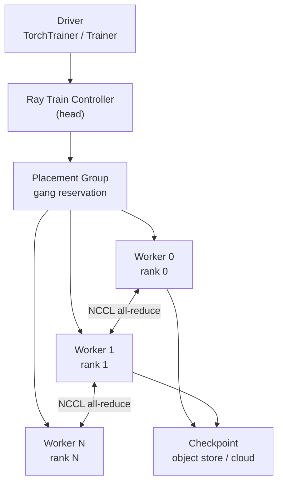

# 第 46 章 弹性分布式训练：Ray Train、TorchElastic、Checkpoint 与故障恢复

第 27 章从使用者视角给出了 `TorchTrainer` 模板。本章继续往下：**当一张 GPU 掉了、一个 worker 被驱逐、world size 从 4 变成 2 再变成 6 时，训练为什么还能继续，以及哪些情况下不能继续**。

弹性训练不是“把副本数改大”这么简单。它要求：

- 所有 worker 在同一个 **rendezvous** 里达成一致的 world size；
- 每个 worker 从同一个 **checkpoint** 恢复；
- 数据分片、全局 batch、学习率调度与新 world size 对齐；
- 失败被限制在可控的重试预算内，而不是无限重启。

KubeRay 提供资源与生命周期，Ray Train 提供训练编排，PyTorch 提供集合通信。三者边界不清时，最常见的结果是“Pod 都 Running，训练永远不开始”。

## 46.1 并行策略与资源形状

### 46.1.1 四种并行

| 策略 | 切分对象 | 通信模式 | KubeRay 侧资源 |
|---|---|---|---|
| Data Parallel（DP/DDP） | 数据 | all-reduce 梯度 | 每个 worker 一张 GPU，副本数 = world size |
| Tensor Parallel（TP） | 单层权重 | 高频 all-reduce/all-gather | 一个模型副本跨多卡，通常同节点/NVLink |
| Pipeline Parallel（PP） | 层 | 点对点激活传递 | 多节点，阶段间带宽敏感 |
| Sequence/Context Parallel | 序列维度 | attention 通信 | 长上下文训练，通常与 TP 组合 |

KubeRay 不感知这些并行策略；它只负责把 Pod 放到节点上。并行策略影响的是：

- 一个 worker group 需要多少张卡；
- 是否必须同节点/NVLink 域；
- 是否需要 RDMA/InfiniBand；
- checkpoint 的分片方式。

### 46.1.2 一个训练作业的资源形状

```text
RayJob
└── RayCluster
    ├── head (driver + GCS + dashboard)
    └── worker group (train)
        ├── Pod 1: 8 GPU, 96 CPU, 1 TiB RAM
        ├── Pod 2: 8 GPU, 96 CPU, 1 TiB RAM
        └── ...
```

如果使用 TP=8，一个模型副本必须落在同一个 8 卡 Pod（或同一 NVLink 域）内；如果用 DP=16，则需要 16 个 1 卡副本。两者的故障域和调度约束完全不同。

## 46.2 Ray Train 的进程模型



### 46.2.1 Driver 在哪里

`TorchTrainer.fit()` 通常在 driver 进程里执行。driver 可以在：

- head Pod（最常见）；
- 一个专门的 worker/driver Pod；
- 集群外通过 Jobs API 提交时，entrypoint 在 Ray 集群内启动，driver 仍然在集群里；RayJob 的 submitter 只负责提交，不执行训练。

driver 需要：

- 能访问 Ray GCS；
- 足够的 CPU/内存做协调；
- 能写 checkpoint（对象存储/PVC）。

### 46.2.2 Worker 是 Ray actor

每个训练 worker 是一个 Ray actor，运行用户的训练函数。Ray Train 负责：

- 创建 placement group；
- 启动 actor；
- 注入 `TrainContext`（world rank、world size、checkpoint）；
- 汇总结果与 checkpoint。

### 46.2.3 Placement Group

Placement group 是“整组资源一起预留”的机制。常见策略：

| 策略 | 语义 | 适用 |
|---|---|---|
| `STRICT_PACK` | 所有 bundle 在同一节点 | 单机多卡、NVLink |
| `PACK` | 尽量集中 | 减少跨节点通信 |
| `SPREAD` | 尽量打散 | 故障隔离、跨机架 |

Ray Train 默认按 bundle 申请 GPU/CPU。KubeRay 侧的 worker group 必须能提供这些 bundle；否则 placement group 会一直 Pending，表现为“RayJob Running 但训练不开始”。

## 46.3 Gang Scheduling：为什么部分分配比等待更糟

假设一个 8-worker 训练作业：

- 集群有 5 个空闲 GPU；
- 默认调度器逐个调度 Pod，先启动 5 个 worker；
- 这 5 个 worker 占着 GPU 等待另外 3 个；
- 其他作业也无法使用这 5 张卡。

Gang scheduling 要求“要么全部满足，要么一个都不调度”。KubeRay 支持：

- Volcano/YuniKorn 的 PodGroup；
- Kueue 的 Workload 准入；
- Kubernetes WAS。

在 KubeRay 上配置 gang scheduling 的要点：

- `minMember` 覆盖 head + 所有 worker（或至少覆盖训练 worker）；
- 队列容量按“最大 gang 形状”配置，而不是按平均作业；
- 抢占策略要能回收“部分分配”的作业。

## 46.4 Checkpoint 语义

### 46.4.1 一个 checkpoint 包含什么

一个可恢复的训练 checkpoint 至少包含：

- 模型参数（可能分片）；
- 优化器状态（Adam 的 moment estimates）；
- 学习率调度器状态；
- 当前 step/epoch；
- 数据加载器的位置（或可重建的种子）；
- 随机数状态（Python/NumPy/Torch/CUDA）；
- 分布式训练的元数据（world size、分片方式、并行策略）。

只保存模型参数是不够的：恢复后优化器动量丢失，训练曲线会跳变；数据加载器从头开始会导致重复样本。

### 46.4.2 原子写

checkpoint 写入必须原子：

```text
1. 写到临时目录/临时对象：checkpoints/step-1000.tmp/
2. 写入所有分片与 manifest
3. 校验行数/哈希
4. 原子 rename 到 checkpoints/step-1000/
5. 写 _SUCCESS 或 manifest 的 committed 标记
6. 更新 latest 指针
```

如果第 4 步之前失败，旧的 `latest` 仍然有效；如果第 5 步失败，恢复逻辑应忽略不完整的目录。

### 46.4.3 分片 checkpoint

大规模训练通常使用 **sharded checkpoint**：

- 每个 rank 写自己的分片；
- 一个 rank 写 manifest；
- 恢复时按同样的并行策略加载。

如果 world size 改变，分片方式必须能重新映射：

- 按参数张量切分（而不是按 rank 文件）更弹性；
- 或者保存完整参数（成本高，但恢复简单）。

### 46.4.4 Ray Train 的 Checkpoint API

```python
from ray import train
from ray.train import Checkpoint

def train_loop_per_worker(config):
    context = train.get_context()
    checkpoint = context.get_checkpoint()
    if checkpoint:
        state = checkpoint.to_dict()
        start_step = state["step"] + 1
        model.load_state_dict(state["model"])
        optimizer.load_state_dict(state["optimizer"])
    else:
        start_step = 0

    for step in range(start_step, config["max_steps"]):
        train_one_step()
        if step % config["checkpoint_every"] == 0:
            state = {
                "step": step,
                "model": model.state_dict(),
                "optimizer": optimizer.state_dict(),
            }
            train.report(
                {"loss": loss},
                checkpoint=Checkpoint.from_dict(state),
            )
```

真实实现还应保存 RNG 状态、数据加载器状态和并行策略元数据。

## 46.5 故障分类与恢复

### 46.5.1 Worker 失败

| 失败 | 现象 | 恢复 |
|---|---|---|
| 单 worker 进程崩溃 | 其他 worker 的 NCCL 集合通信超时 | Ray Train 终止本次尝试，按 `FailureConfig` 重试 |
| worker Pod 被驱逐 | Pod 消失，Ray actor 失败 | 重新调度 Pod，重新加入 rendezvous |
| GPU XID 错误 | 训练报 CUDA error | 通常需要换节点/重启容器 |
| OOMKilled | 容器退出码 137 | 降低 batch/模型并行，或提高 memory limit |
| 节点 NotReady | 多个 Pod 同时失败 | 等待节点恢复或迁移 |

### 46.5.2 Driver 失败

driver 失败时：

- 训练协调停止；
- Ray Train controller 可能重启训练；
- 如果 driver 在 head 上，head 故障还会影响 GCS。

因此：

- driver 不要和 GCS 抢资源；
- head 使用稳定节点池；
- 关键 checkpoint 写对象存储，不写 head 本地盘。

### 46.5.3 Head 失败

没有 GCS FT 时，head 失败 = 整个 Ray 集群元数据丢失：

- Ray Train controller 状态丢失；
- actor 无法重新注册；
- 训练必须从 checkpoint 重启。

有 GCS FT 时（第 13 章），worker 可以重连，但 Ray Train 的 controller 仍可能重启。不要把“GCS FT”误认为“训练零中断”。

### 46.5.4 FailureConfig

Ray Train 的重试预算通常由 `FailureConfig(max_failures=N)` 控制。要点：

- 重试次数是 **整个训练尝试** 的预算，不是单个 worker 的；
- 重试会重新创建 placement group 和 worker；
- 每次重试都从最新 checkpoint 恢复；
- 如果失败发生在 checkpoint 之外，会丢失该区间的工作。

## 46.6 弹性扩缩容

### 46.6.1 什么可以弹性

弹性训练要求算法与框架支持 world size 变化：

- **数据并行**：通常可以，重新分片数据、调整全局 batch；
- **张量并行**：通常不可以，模型切分方式改变需要重新切分权重；
- **流水线并行**：通常不可以，阶段数固定；
- **FSDP/ZeRO**：可以，但需要重新分片优化器状态。

### 46.6.2 全局 batch 与学习率

world size 变化时：

```text
global_batch = micro_batch × world_size × grad_accum_steps
```

如果保持 `global_batch` 不变：

- world size 减半 -> `grad_accum_steps` 翻倍；
- world size 翻倍 -> `grad_accum_steps` 减半。

如果保持 `micro_batch` 和 `grad_accum_steps` 不变：

- `global_batch` 随 world size 变化；
- 通常需要按比例调整学习率（线性缩放规则），并重新 warmup。

### 46.6.3 弹性扩缩容的时机

只在 **checkpoint 边界** 改变 world size：

- 所有 rank 在同一个 step 达成一致；
- checkpoint 已提交；
- 新的 rank 从同一个 checkpoint 加载；
- 旧的 rank 优雅退出。

如果在 step 中间扩容：

- 新 rank 没有该 step 的梯度；
- all-reduce 的参与者不一致；
- 训练结果不可复现。

### 46.6.4 KubeRay 侧如何触发

两种方式：

1. **修改 worker group 的 `replicas`**：Ray autoscaler 或人工 patch；
2. **Ray Train 的 `ScalingConfig`**：在训练过程中请求更多/更少 worker。

KubeRay 只负责 Pod 数量；Ray Train 负责 rendezvous 和 checkpoint。两者需要通过标签/资源形状对齐。

## 46.7 TorchElastic 与 Ray Train 的对比

| 维度 | TorchElastic / torchrun | Ray Train |
|---|---|---|
| Rendezvous | `etcd`/static/file | Ray GCS + Train controller |
| 进程启动 | 每个节点一个 agent | Ray actor |
| 弹性 | 支持（`--rdzv`） | 支持（`ScalingConfig`） |
| 资源调度 | 依赖 K8s Job/JobSet | Ray placement group |
| Checkpoint | 用户自己实现 | `Checkpoint` + `TrainContext` |
| 与 KubeRay | 需要 JobSet/自定义 controller | 原生 RayJob/RayCluster |
| 故障恢复 | agent 重建进程 | controller 重建 actor |

选择建议：

- 已经在用 PyTorch 生态、只需要 torchrun：Kubeflow Training Operator/JobSet 更直接；
- 需要 Ray Data/Tune/Serve 一体化：Ray Train + KubeRay；
- 需要跨框架（XGBoost/LightGBM/HuggingFace）：Ray Train 的统一 API 更有价值。

## 46.8 KubeRay 配置模板

`manifests/samples/ray-job-train.yaml` 是一个可提交的模板。关键字段：

- `entrypoint`：训练脚本；
- `runtimeEnvYAML`：数据/checkpoint 路径；
- `rayClusterSpec.workerGroupSpecs[].replicas`：初始 worker 数；
- GPU 请求/限制：`nvidia.com/gpu: "1"`；
- `nodeSelector`/`tolerations`：绑定 GPU 节点池；
- `activeDeadlineSeconds`：防止训练无限挂起；
- `ttlSecondsAfterFinished`：清理。

一个更贴近弹性的片段：

```yaml
# RayJob.spec 片段；完整对象见 manifests/samples/ray-job-train.yaml
entrypoint: python /home/ray/app/train.py
shutdownAfterJobFinishes: true
activeDeadlineSeconds: 172800
runtimeEnvYAML: |
  env_vars:
    DATA_PATH: s3://example-bucket/train
    CHECKPOINT_PATH: s3://example-bucket/checkpoints
rayClusterSpec:
  enableInTreeAutoscaling: true
  autoscalerOptions:
    version: v2
    idleTimeoutSeconds: 120
  workerGroupSpecs:
    - groupName: gpu-workers
      replicas: 4
      minReplicas: 0
      maxReplicas: 16
      template:
        spec:
          containers:
            - name: ray
              image: rayproject/ray:2.59.0-gpu
              resources:
                requests:
                  cpu: "8"
                  memory: 64Gi
                  nvidia.com/gpu: "1"
                limits:
                  nvidia.com/gpu: "1"
```

注意：

- `minReplicas: 0` 会让训练在空闲时缩到零，但下一次恢复需要冷启动；
- `maxReplicas` 要覆盖最大 world size；
- autoscaler 扩容的是 **Ray 节点**，Ray Train 的 `ScalingConfig` 扩的是 **worker actor**；两者要一起调。

## 46.9 可观测性

### 46.9.1 训练指标

Ray Train 会把 `train.report()` 的指标写入：

- Ray Dashboard 的 Train 页面；
- `ray.train` 的日志；
- 回调（MLflow/W&B/TensorBoard）。

关键指标：

- 每个 step 的 loss/learning rate；
- 吞吐（samples/s、tokens/s）；
- GPU 利用率与显存；
- checkpoint 写入耗时；
- 重试次数与恢复耗时。

### 46.9.2 日志

每个 rank 的日志要能区分：

- rank 0 的协调日志；
- 各 rank 的训练日志；
- NCCL 的超时/错误；
- checkpoint 的成功/失败。

KubeRay 侧用 `ray.io/group`、`ray.io/worker-group-replica-index` 等标签过滤。

### 46.9.3 常见故障信号

| 信号 | 可能原因 |
|---|---|
| `NCCL timeout` | 某个 rank 卡住/掉线、网络不通、GPU XID |
| `Address already in use` | rendezvous 端口冲突/旧进程未清理 |
| `CUDA out of memory` | micro batch 太大、TP/PP 配置错误 |
| placement group Pending | 资源形状不满足、gang 无法满足 |
| checkpoint 写入慢 | 对象存储限流、分片太多、单文件太大 |
| 恢复后 loss 跳变 | 优化器/RNG/数据加载器状态未保存 |

## 46.10 实验：`examples/elastic_training_lab.py`

实验用确定性的 step 模型演示：

- 4 worker 训练到 step 8；
- 2 个 worker 失败，从 step 8 恢复，world size 变为 2；
- 在 step 14 扩容到 6；
- 与“静态 torchrun 从 0 重启”对比重放步数；
- 演示 gang admission 的“要么全给、要么等待”。

运行：

```bash
python examples/elastic_training_lab.py
```

输出示例：

```text
completed steps : 20 (unique 20, duplicates 0)
missing steps   : []
checkpoints     : [2, 4, 6, 8, 10, 12, 14, 16, 18, 20]
final world     : 6, global batch 48
static restart  : replayed 8 steps
OK: elastic resume replayed 0 steps; static restart replayed 8.
```

实验的断言：

- 没有重复 step；
- 没有缺失 step；
- checkpoint 只在边界产生；
- 扩容后 global batch 按 world size 重算；
- 静态重启会重放已完成的 step。

## 46.11 练习

1. 把实验中的失败点改到 step 7（非 checkpoint 边界），观察会丢失多少工作；设计一个“每步都 checkpoint”与“每 N 步”的权衡。
2. 给实验增加“优化器状态丢失”场景：恢复时只加载模型参数，观察 loss 曲线（用模拟值）如何跳变。
3. 设计一个 TP=8、DP=4 的训练作业：需要多少 GPU、多少个 Pod、placement group 应该用什么策略？
4. 解释为什么 `minReplicas: 0` 对交互式训练不友好，而对夜间批训练可能合适。
5. 用真实 Ray Train 跑一个 2-worker 的 `TorchTrainer`，在训练中删除一个 worker Pod，记录 Ray Train 的重试与恢复时间。

## 46.12 小结

- 弹性训练的核心是 **rendezvous + checkpoint + 数据分片** 三者一致，而不是副本数。
- world size 变化只应发生在 checkpoint 边界；全局 batch 与学习率要同步调整。
- Gang scheduling 避免“部分分配”占住资源；批调度器/Kueue 是 KubeRay 上的主要手段。
- 只保存模型参数不足以恢复；优化器、RNG、数据加载器和并行策略元数据都要保存。
- KubeRay 负责 Pod 生命周期，Ray Train 负责训练编排；两者边界不清会导致“Running 但不训练”。
- `examples/elastic_training_lab.py` 用可断言的 step 账本证明了弹性恢复与静态重放的差异。

下一章进入 LLM 推理的内部机制：continuous batching、KV cache、前缀缓存和 PD 分离，解释为什么同一张 GPU 在不同调度策略下吞吐能差几倍。

→ [第 47 章 LLM 推理内部机制](47-llm-inference-internals.md)
