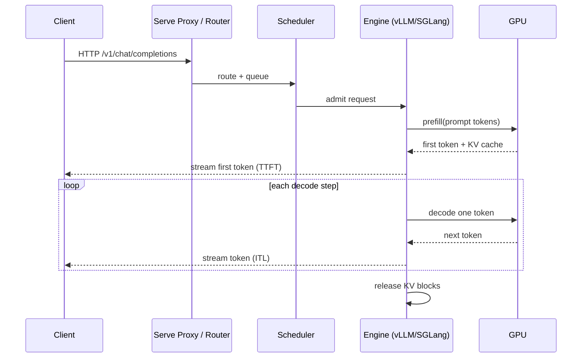
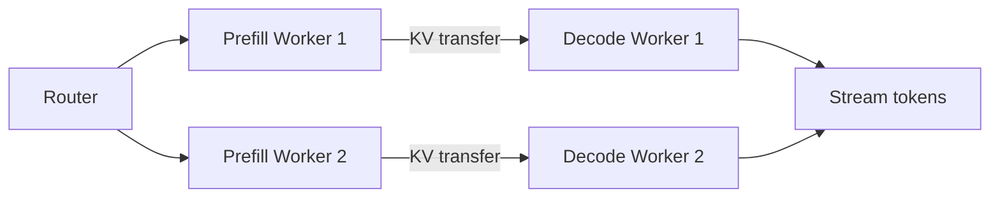

# 第 47 章 LLM 推理内部机制：Continuous Batching、KV Cache、前缀缓存与 PD 分离

第 28 章讲了“怎样在 KubeRay 上部署一个 LLM 服务”，重点是 `RayService`、`serveConfigV2`、GPU 规划和容量公式。本章再往下走一层：**同一个模型、同一张 GPU，为什么换一个调度策略吞吐能差 2–5 倍；为什么长 prompt 会把短请求的尾延迟拖垮；为什么 PD 分离在数据中心里值得多一跳网络**。

这些机制不是 Ray 独有的，vLLM、SGLang、TensorRT-LLM 都实现了类似的东西。理解它们之后，你才能判断某个“优化开关”在你的流量下是否真的有用，以及为什么 KubeRay 的 worker group/节点拓扑会直接影响推理性能。

> 版本边界：Ray 2.59 / vLLM / SGLang 的调度器实现与参数名会变化。本章描述稳定的机制（continuous batching、paged KV cache、prefix caching、chunked prefill、PD disaggregation），具体参数以你使用的 engine 版本为准。

## 47.1 一次请求的完整生命周期



四个关键指标：

| 指标 | 定义 | 受什么影响 |
|---|---|---|
| TTFT | 首 token 延迟 | prompt 长度、排队、prefill 算力、前缀缓存 |
| TPOT / ITL | 每输出 token 时间 / inter-token latency | batch 大小、KV 带宽、decode 算力 |
| 吞吐 | tokens/s（总输出） | batch、并行策略、GPU 利用率 |
| Goodput | 满足 SLO 的请求比例/吞吐 | 调度、尾延迟、超时 |

**TTFT 与 TPOT 互相拉扯**：把更多请求塞进一个 batch 能提高吞吐，但会拉长每个请求的 ITL；长 prompt 的 prefill 会阻塞 decode，造成尾延迟抖动。

## 47.2 Continuous Batching

### 47.2.1 从静态 batch 到迭代级调度

静态 batching：

```text
batch = [r1, r2, r3, r4]
for step in range(max_output_len):
    run all requests for one token
```

问题：

- 短请求完成后，它的槽位空着；
- 长请求决定整个 batch 的时长；
- 新请求必须等当前 batch 结束。

Continuous batching（iteration-level scheduling）：

```text
for each iteration:
    remove finished requests
    admit new requests if capacity allows
    run one decode step for all active requests
```

好处：

- 完成的请求立即释放槽位；
- 新请求可以在下一个 iteration 加入；
- GPU 利用率显著提高。

### 47.2.2 调度约束

一个 iteration 的 batch 受以下约束：

- `max_num_seqs`：最大并发序列数；
- `max_num_batched_tokens`：一个 iteration 的 token 预算；
- KV cache 块数；
- 显存/带宽；
- 优先级/公平性策略。

prefill 和 decode 消耗的 token 预算不同：

- prefill：一次处理整个 prompt（或一个 chunk）；
- decode：每个请求一个 token。

因此调度器需要决定：**这一轮是把预算给 prefill 还是 decode**。这直接引出 chunked prefill 和 PD 分离。

## 47.3 KV Cache 与 PagedAttention

### 47.3.1 为什么需要 KV cache

自回归生成时，每个新 token 都要 attend 到之前所有 token。如果每步重算 K/V，处理第 t 个 token 需要 O(t) 计算，整个序列是 O(n²)；KV cache 保存历史 K/V，使 decode 每步只需计算新 token：

```text
decode step t: Q_t × [K_1..K_t]^T -> attention -> output_t
```

代价是显存：KV cache 随上下文长度线性增长。

### 47.3.2 KV cache 大小公式

对一层、一个 token：

```text
kv_bytes_per_token_per_layer = 2 × num_kv_heads × head_dim × dtype_bytes
```

总 KV cache：

```text
kv_bytes_per_token = 2 × num_layers × num_kv_heads × head_dim × dtype_bytes
```

以 Llama-3.1-8B（32 层、8 个 KV heads、head_dim=128、FP16）为例：

```text
2 × 32 × 8 × 128 × 2 = 131,072 bytes = 128 KiB/token
8,192 tokens ≈ 1 GiB
```

Llama-3.1-70B（80 层、8 个 KV heads、128、FP16）：

```text
2 × 80 × 8 × 128 × 2 = 327,680 bytes = 320 KiB/token
8,192 tokens ≈ 2.5 GiB
```

GQA/MQA 的价值就在这里：KV heads 越少，每 token 的 KV cache 越小，同样显存能支持更长上下文或更多并发。

### 47.3.3 PagedAttention

传统做法为每个请求预留一段连续显存，按最大长度分配：

- 内部碎片：实际生成长度小于最大长度；
- 外部碎片：不同请求的空闲段无法合并；
- 扩容需要复制。

PagedAttention 把 KV cache 切成固定大小的 **block**（例如 16 tokens），用 **block table** 把逻辑位置映射到物理块：

```text
request A: logical block 0 -> physical 7
           logical block 1 -> physical 12
request B: logical block 0 -> physical 9
```

好处：

- 按需分配，减少碎片；
- block 可以不连续；
- 支持 copy-on-write（beam search、并行采样）；
- 支持前缀共享（多个请求指向同一物理块）。

### 47.3.4 显存预算

一张 GPU 的显存要分给：

- 模型权重；
- KV cache；
- 激活/临时 buffer；
- CUDA context/通信 buffer。

vLLM 的 `gpu_memory_utilization` 控制“模型 + KV cache”可用的比例。实际可用 KV 块数：

```text
kv_blocks ≈ (gpu_memory × utilization - model_weights - overhead) / (block_size × kv_bytes_per_token)
```

如果块数不够：

- 新请求排队；
- 或触发 preemption（换出/重算）。

## 47.4 前缀缓存

### 47.4.1 为什么有效

很多请求共享相同前缀：

- 系统提示词（system prompt）；
- few-shot 示例；
- RAG 的固定指令；
- 多轮对话的历史。

如果每个请求都重新 prefill 这 512/1024 个 token，TTFT 和算力都被浪费。前缀缓存把前缀的 KV block 复用：

```text
request A: [system 512][user A] -> prefill 512 + user A
request B: [system 512][user B] -> reuse 512 blocks, prefill user B
```

### 47.4.2 实现方式

常见实现：

- **Radix tree**（SGLang）：按 token 序列建前缀树，节点存 KV block；
- **Block hash**（vLLM）：对每个 block 的 token + 前驱 hash 做 key；
- **LRU/引用计数**：块被多个请求引用时不能驱逐。

关键细节：

- hash 必须包含 **前驱 block 的 hash**，否则相同后缀在不同上下文下会误命中；
- 块要按引用计数管理；
- 驱逐策略要在“命中率”和“显存”之间平衡；
- 不同 LoRA/模型不能共享块。

### 47.4.3 缓存感知路由

如果多个 Serve replica 各自有前缀缓存，把同一前缀的请求路由到同一个 replica 能提高命中率。常见做法：

- 按 prefix hash 做一致性哈希；
- 在 Gateway/Proxy 层读取请求的 system prompt；
- 或用 session affinity。

代价：

- 负载可能不均；
- replica 扩容后缓存冷启动；
- 路由层需要解析请求体。

## 47.5 Chunked Prefill

### 47.5.1 问题

一个 32k token 的 prefill 会占用大量算力，导致同一 iteration 中的所有 decode 请求等待。表现：

- 长 prompt 到达时，其他请求的 ITL 飙升；
- 尾延迟不可预测。

### 47.5.2 方案

把长 prefill 切成多个 chunk，与 decode 交错执行：

```text
iteration 1: prefill chunk 1 (8k) + decode batch
iteration 2: prefill chunk 2 (8k) + decode batch
...
```

好处：

- decode 请求的 ITL 更稳定；
- 长 prompt 的 TTFT 略增，但整体公平性更好。

参数：

- chunk size（例如 512/1024/2048 tokens）；
- 是否优先 decode；
- 每个 iteration 的 token 预算。

### 47.5.3 权衡

| 配置 | TTFT | ITL | 吞吐 |
|---|---|---|---|
| 不切 chunk | 长 prompt 小 | 抖动大 | 受长 prompt 影响 |
| 小 chunk | 略大 | 稳定 | 调度开销略增 |
| 大 chunk | 较小 | 抖动较大 | 吞吐较高 |

没有“最优值”，要看 SLO 更在意 TTFT 还是 ITL。

## 47.6 PD 分离（Prefill/Decode Disaggregation）

### 47.6.1 为什么分离

prefill 和 decode 的硬件特性不同：

| 阶段 | 计算特征 | 瓶颈 |
|---|---|---|
| Prefill | 大矩阵乘、高并行 | 算力（FLOPS） |
| Decode | 逐 token、访存密集 | 显存带宽、KV cache |

把它们放在同一张 GPU 上：

- 长 prompt 的 prefill 会打断 decode；
- 两种负载的资源需求不同，难以同时最优；
- 尾延迟不可控。

PD 分离：



### 47.6.2 KV 传输成本

传输的数据量就是 KV cache：

```text
transfer_bytes = prompt_tokens × kv_bytes_per_token
```

以 Llama-3.1-8B、8k prompt 为例：

```text
8,192 × 128 KiB ≈ 1 GiB
```

传输时间取决于互联：

| 互联 | 带宽（示意） | 1 GiB 传输时间 |
|---|---:|---:|
| NVLink | 300–900 GB/s | 1–3 ms |
| InfiniBand HDR | 200 Gb/s ≈ 25 GB/s | ~40 ms |
| 100 GbE | 12.5 GB/s | ~80 ms |
| 25 GbE | 3.1 GB/s | ~330 ms |

结论：

- 同节点/NVLink：PD 分离的传输成本可忽略；
- 跨节点普通以太网：传输可能吃掉收益；
- 需要 RDMA/RoCE/IB 或高速互联；
- decode worker 要预留接收 buffer。

### 47.6.3 部署拓扑

在 KubeRay 上，PD 分离通常意味着：

- 两个 worker group：`prefill` 与 `decode`；
- 不同的 GPU 型号/数量；
- 不同的 `ray_actor_options.num_gpus`；
- 通过标签/节点亲和性把 prefill 和 decode 放到不同节点池；
- Gateway/Proxy 负责把请求路由到 prefill，再把 KV 句柄交给 decode。

注意：Ray Serve 的标准 LLM API 不一定直接暴露 PD 分离配置；有些实现通过自定义 deployment 或 engine 参数完成。不要假设 `serveConfigV2` 里有一个通用 `disaggregation: true` 字段。

## 47.7 投机解码与量化

### 47.7.1 投机解码

用一个小的 draft model 先猜 k 个 token，再用大模型一次验证：

```text
接受率 α，平均接受 token 数 ≈ (1 - α^(k+1)) / (1 - α)
```

收益取决于：

- draft model 与目标模型分布是否接近；
- 验证的 batch 效率；
- 额外显存/算力。

适用：低并发、对 ITL 敏感、draft model 容易获得的场景。高并发下 GPU 已经饱和，收益可能为负。

### 47.7.2 量化

| 方式 | 收益 | 代价 |
|---|---|---|
| FP8/INT8 权重 | 显存减半、带宽降低 | 精度损失、校准 |
| KV cache 量化 | 支持更长上下文/更多并发 | 精度损失、kernel 支持 |
| AWQ/GPTQ | 4-bit 权重 | 质量下降、部分模型不支持 |
| FP8 KV | 显存减半 | 需要硬件/框架支持 |

量化会改变 KV cache 的 `dtype_bytes`，直接改变并发容量。容量规划时要重新算。

## 47.8 调度策略与 SLO

### 47.8.1 常见策略

| 策略 | 优点 | 缺点 |
|---|---|---|
| FCFS | 简单、公平 | 长请求阻塞短请求 |
| 优先级 | 保护关键业务 | 低优先级饥饿 |
| SJF（最短作业优先） | 平均延迟低 | 长请求饥饿 |
| 公平分享 | 多租户 | 实现复杂 |
| 截止时间优先 | 适合 SLO | 需要预测输出长度 |

### 47.8.2 准入控制

当 KV cache/队列满时：

- 排队：TTFT 上升，但不丢请求；
- 拒绝：返回 429，保护已准入请求的 SLO；
- 降级：缩短最大输出、降低 batch。

生产建议：

- 为不同优先级设置独立队列/配额；
- 监控队列长度与 TTFT 分位数；
- 不要把 `max_concurrent_queries` 设得过高，否则所有请求一起变慢。

### 47.8.3 尾延迟

LLM 服务的 p99 往往由以下因素决定：

- 最长 prompt；
- 最大输出长度；
- batch 中的长请求；
- KV cache 碎片；
- 抢占/重算。

降低尾延迟的手段：

- chunked prefill；
- PD 分离；
- 限制单请求最大输出；
- 对长 prompt 单独路由；
- 预留容量/优先级。

## 47.9 映射到 KubeRay 与 Ray Serve

### 47.9.1 资源声明

```yaml
# serveConfigV2 片段
deployments:
  - name: LLMDeployment
    ray_actor_options:
      num_gpus: 2
      num_cpus: 8
    max_concurrent_queries: 32
    autoscaling_config:
      min_replicas: 1
      max_replicas: 8
      target_num_ongoing_requests_per_replica: 8
```

要点：

- `num_gpus` 必须与 `tensor_parallel_size` 匹配；
- `max_concurrent_queries` 是 Serve 层并发，不是 engine 的 batch 大小；
- Serve 扩 replica 与 Ray autoscaler 扩节点是两层（第 28 章）；
- 每个 replica 的 KV cache 独立，前缀缓存不跨 replica。

### 47.9.2 TP/PP 与节点拓扑

- TP 通常要求同一节点/NVLink；
- PP 可以跨节点，但阶段间带宽敏感；
- 一个 replica 的 GPU 必须由同一个 Ray 节点/placement group 提供；
- KubeRay 的 worker group 要能提供完整的 replica 资源，否则 Serve 会一直 Pending。

### 47.9.3 冷启动

模型加载时间包括：

- 权重下载（几 GB 到几百 GB）；
- 权重加载到 GPU；
- CUDA graph/编译；
- KV cache 预分配。

优化：

- 模型缓存挂 PVC/本地 SSD；
- 预热镜像；
- 保留 `min_replicas >= 1`；
- 使用更快的存储/网络；
- 避免每次扩缩容都重新下载。

## 47.10 可观测性

### 47.10.1 指标

| 指标 | 说明 |
|---|---|
| `serve_*_request_latency` | 端到端延迟 |
| TTFT / time_to_first_token | 首 token |
| ITL / TPOT | 每 token 时间 |
| `num_requests_waiting` | 队列长度 |
| `kv_cache_usage` | KV 块使用率 |
| `prefix_cache_hit_rate` | 前缀命中率 |
| `num_preemptions` | 抢占次数 |
| GPU utilization / memory | 资源 |

### 47.10.2 日志与追踪

- 在 Gateway/Proxy 注入 trace ID；
- 把 request ID 写入 engine 日志；
- 记录 prompt/output token 数、cache hit、排队时间；
- 不要记录完整 prompt（PII/成本）。

### 47.10.3 压测

压测必须固定：

- 输入/输出长度分布；
- 并发/到达率；
- 模型与量化；
- batch/调度参数；
- GPU 型号/互联。

只报“tokens/s”没有意义；要同时报 TTFT/TPOT 分位数和 goodput。

## 47.11 实验：`examples/llm_scheduler_lab.py`

实验用 tick 模型比较三种策略：

- `baseline`：coupled batching，无前缀缓存；
- `prefix`：coupled + 512-token 前缀缓存；
- `pd`：前缀缓存 + prefill/decode 分离。

运行：

```bash
python examples/llm_scheduler_lab.py
```

输出示例：

```text
mode       makespan  tok/tick  meanTTFT  p95TTFT  meanTPOT  hits  peakKV
baseline        150      2.99     18.67       64      1.02     0    3184
prefix          148      3.03     16.67       62      1.02     5    1648
pd              133      3.37      2.17        3      1.02     5    2048
```

怎么读：

- `makespan` 下降说明整体吞吐提高；
- `meanTTFT` 下降说明排队/prefill 改善；
- `hits` 是前缀缓存命中数；
- `peakKV` 是峰值 KV 占用，必须低于容量；
- `pd` 的 TTFT 大幅下降，是因为 prefill 不再和 decode 抢同一个槽位。

实验的断言固定在 `tests/test_examples.py`。

## 47.12 练习

1. 把实验中的 `kv_capacity_tokens` 改为 2048，观察哪些请求被推迟，解释 FCFS 的队头阻塞。
2. 把共享前缀从 512 改为 1024，重算 prefix 模式的 `hits` 与 TTFT。
3. 给 PD 模式增加“跨节点传输 100 ms”的成本，观察什么 prompt 长度下 PD 仍然划算。
4. 用 Llama-3.1-8B 的参数手算 16k 上下文的 KV cache，并估算一张 24 GB GPU 能支持多少并发。
5. 设计一个多租户 LLM 服务：如何用 Serve 的多个 application + 优先级队列隔离“交互式”和“批处理”流量？

## 47.13 小结

- Continuous batching 把调度粒度从“整个 batch”降到“每个 iteration”，是吞吐提升的基础。
- KV cache 大小由层数、KV heads、head_dim、dtype 和 token 数决定；GQA/MQA 和量化直接改变容量。
- PagedAttention 用 block table 消除碎片并支持共享。
- 前缀缓存对共享 system prompt/RAG 场景收益最大；缓存感知路由能进一步提高命中率。
- Chunked prefill 用 TTFT 换 ITL 稳定性；PD 分离用额外传输换 prefill/decode 的独立扩缩容。
- 在 KubeRay 上，这些机制的收益取决于 GPU 拓扑、节点互联和 Serve/Ray 两层扩缩容是否对齐。
- `examples/llm_scheduler_lab.py` 把 TTFT、吞吐、缓存命中和 KV 峰值变成了可复现的数字。

下一章从单次请求转向整个平台：如何用 OpenTelemetry 把 operator、Ray 和应用串成一条 trace，如何定义 SLO、计算错误预算，以及如何让日志和指标的成本可控。

→ [第 48 章 可观测性 2.0](48-observability-2.md)
