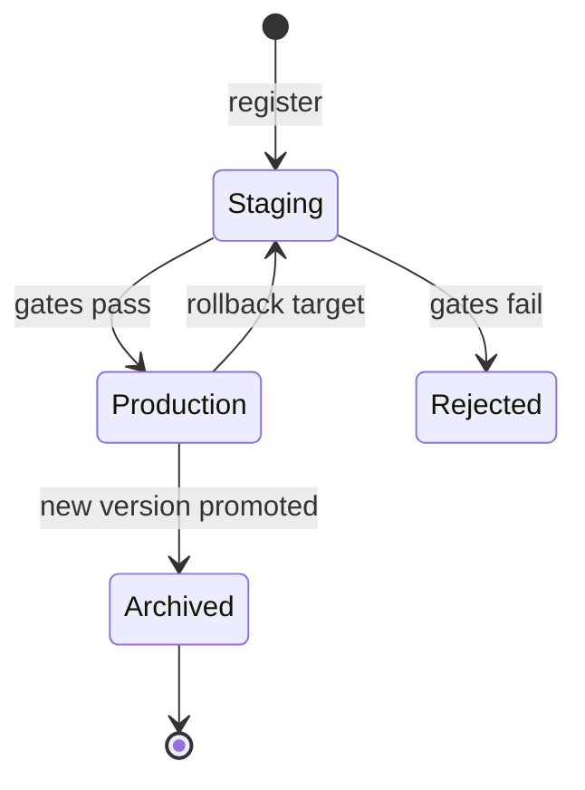

# 第 50 章 数据与模型治理：Schema、血缘、Point-in-Time 特征与模型注册

KubeRay 能保证“作业跑完、Pod 回收、服务上线”，但不能保证：

- 训练用的是哪一版数据；
- 特征在训练和推理时是否用同一套逻辑；
- 模型为什么被提升到生产；
- 出问题时能否回到上一个版本；
- 数据被删除/更正后，模型是否还能复现。

这些是 **数据与模型治理** 的问题。对 AI 平台来说，治理不是合规部门的附加项，而是“模型可复现、可回滚、可审计”的工程基础。

## 50.1 一个事故的起点

某推荐模型上线后效果下降。排查发现：

- 训练数据是 `user_events@2026-01-05`；
- 特征视图已经升级到 `v2`，把“金额”从 float 改成 string；
- 服务端用 v2 特征，训练时用 v1；
- 模型注册表里没有记录特征版本；
- 回滚时发现上一个模型也依赖同一个有问题的特征视图。

如果没有治理层，这个事故几乎无法快速定位。有了治理层，问题会变成：

```text
model:spend-ranker:v42
  dataset: user_events@v1 (hash 7d436900eb06)
  feature_view: user_spend_7d@v1
  training_schema: amount:float
  serving_schema: amount:string  <- mismatch
```

## 50.2 数据契约与 Schema

### 50.2.1 什么是数据契约

数据契约（data contract）是生产者和消费者之间的显式约定：

- 字段名、类型、可空性；
- 主键/时间字段；
- 分区方式；
- 更新频率与 SLA；
- 兼容性规则；
- 质量阈值（空值率、唯一性、范围）。

契约不是“文档”，而是可以被 CI/运行时校验的代码/配置。

### 50.2.2 Schema 演进

常见兼容性：

| 变更 | 向后兼容 | 向前兼容 | 说明 |
|---|---|---|---|
| 新增可选字段 | 是 | 是 | 最常见 |
| 删除字段 | 是 | 否 | 新消费者能读旧数据；旧消费者读不到缺失字段，会失败 |
| 改字段类型 | 通常否 | 通常否 | 需要迁移 |
| 重命名字段 | 否 | 否 | 需要双写/视图 |
| 放宽可空性 | 是 | 否 | 生产者可空，消费者要处理 |

对训练/推理链路：

- 训练数据可以有新增字段（模型忽略）；
- 推理输入不能缺训练时依赖的字段；
- 类型必须一致（`float` vs `string` 是最常见的坑）；
- 单位/币种/时区要写进契约。

### 50.2.3 Schema Registry

一个最小 schema registry 需要：

- schema 版本；
- 兼容性检查；
- 与数据集版本的绑定；
- 消费者注册；
- 变更审批。

开源方案：Confluent Schema Registry（Avro/Protobuf/JSON Schema）、OpenMetadata、DataHub 等。小团队也可以用 Git + CI 实现最小版本。

## 50.3 版本、快照与血缘

### 50.3.1 数据集版本

一个数据集版本应包含：

- 逻辑名称；
- 版本号（或内容 hash）；
- schema；
- 行数/字节数；
- 创建时间与创建者；
- 上游数据源与转换；
- 存储位置（不可变路径）；
- 质量检查结果。

内容 hash 的建议：

```text
hash = H(schema + sorted(row_hashes) + transform_version)
```

只 hash 行而不 hash schema，会把“同一批数据、不同契约”误认为同一版本。

### 50.3.2 不可变快照

推荐布局：

```text
s3://lake/user_events/
  v1/                 # immutable snapshot
    data/*.parquet
    _schema.json
    _manifest.json
    _SUCCESS
  v2/
  latest -> v2        # pointer, not the data itself
```

要点：

- 数据写入后不修改；
- `latest` 只是指针；
- 删除/更正通过新版本表达；
- 保留策略与合规删除要能按版本执行。

### 50.3.3 血缘

血缘图至少覆盖：

```text
source tables -> dataset versions -> feature views -> training runs -> models -> deployments
```

每条边记录：

- 输入/输出版本；
- 转换代码的 git commit；
- 运行 ID（Ray job ID）；
- 时间；
- 操作者/系统。

KubeRay 侧的接入点：

- RayJob 的 label/annotation 记录 `dataset-version`、`feature-view`、`model-version`；
- 作业日志/History Server 记录 Ray job ID；
- 训练脚本上报 lineage 事件；
- 模型注册表保存 lineage。

## 50.4 特征存储与 Point-in-Time 正确性

### 50.4.1 离线/在线特征

| 存储 | 用途 | 要求 |
|---|---|---|
| 离线 | 训练、回填 | 全量、可扫描、版本化 |
| 在线 | 推理 | 低延迟、高可用、TTL |
| 特征视图 | 定义 | 同一逻辑用于离线和在线 |

训练/服务 skew 的根源通常是：

- 离线用 SQL，在线用 Python；
- 时间窗口边界不一致；
- 空值/默认值处理不同；
- 特征更新延迟；
- schema 演进不同步。

### 50.4.2 Point-in-Time Join

训练样本必须只使用“在预测时刻已经知道”的特征：

```text
feature_value = aggregate(events where event_time <= as_of)
```

而不是：

```text
feature_value = aggregate(all events)   # 未来泄漏
```

一个常见的泄漏：

- 用“用户过去 7 天消费”做特征；
- 但离线表按 `ingestion_time` 而不是 `event_time` 过滤；
- 训练时看到了未来才入库的事件。

### 50.4.3 一个可验证的规则

```text
for every training sample (entity, as_of):
    assert all(event.event_time <= as_of for event in used_events)
    assert all(event.event_time > as_of - window for event in used_events)
```

`examples/governance_lab.py` 用这个规则验证了：

- 窗口外的旧事件不参与；
- `as_of` 之后的未来事件不参与；
- 只有窗口内的事件被聚合。

### 50.4.4 训练/服务一致性

上线前检查：

- 训练与服务的特征定义版本一致；
- schema 兼容；
- 默认值/空值处理一致；
- 单位/币种/时区一致；
- 在线特征的 TTL 与离线窗口一致；
- 采样/去重逻辑一致。

## 50.5 模型注册表

### 50.5.1 模型版本应包含什么

- 模型名称/版本；
- 训练数据集版本与 hash；
- 特征视图版本；
- 训练代码 commit；
- 超参数；
- 评估指标与评估数据集；
- 训练环境（镜像 digest、依赖锁）；
- 产物路径与校验和；
- 签名/审批；
- 阶段（Staging/Production/Archived）；
- 回滚目标。

### 50.5.2 阶段与门禁



常见门禁：

- 离线指标 >= 阈值；
- 与当前生产模型相比无显著退化；
- 训练/服务 schema 兼容；
- 无 PII/合规问题；
- 模型大小/延迟在预算内；
- 审批人签字。

### 50.5.3 回滚

回滚必须是：

- 一键；
- 可审计；
- 不依赖重新训练；
- 回滚后监控指标恢复。

回滚目标要保留：

- 模型产物；
- 特征视图版本；
- 数据集版本；
- 服务配置。

如果特征视图已经变了，仅回滚模型可能不够；这也是为什么血缘必须覆盖特征。

## 50.6 可复现性

### 50.6.1 复现一个训练运行需要什么

| 维度 | 记录内容 |
|---|---|
| 代码 | git commit / 镜像 digest |
| 数据 | 数据集版本 + hash |
| 特征 | 特征视图版本 + 转换代码 |
| 配置 | 超参数、Ray runtime_env |
| 环境 | Python/库版本、CUDA/驱动 |
| 随机性 | seed、确定性开关 |
| 硬件 | GPU 型号/数量、拓扑 |
| 输出 | 模型 hash、评估报告 |

### 50.6.2 Ray 侧的记录

- RayJob 的 `metadata.labels/annotations` 记录数据/模型版本；
- `runtimeEnvYAML` 固定依赖；
- entrypoint 打印 git commit、数据版本、seed；
- checkpoint 目录包含 `manifest.json`；
- 训练结束上报指标与 lineage。

### 50.6.3 不可复现的常见原因

- 数据被覆盖（没有不可变快照）；
- 依赖浮动（`pip install package` 不带版本）；
- 非确定性 CUDA kernel；
- 数据加载顺序/分片随 world size 变化；
- 没有记录随机种子；
- 特征视图悄悄升级。

## 50.7 服务侧的一致性

### 50.7.1 Schema 检查

在服务入口做最小校验：

- 必需字段存在；
- 类型正确；
- 枚举/范围合法；
- 版本兼容。

失败时：

- 返回 4xx（客户端问题）；
- 或降级到默认值（要记录）；
- 不要静默接受错误类型。

### 50.7.2 特征版本绑定

RayService 的 `serveConfigV2` / 应用配置应显式绑定：

- 特征视图版本；
- 模型版本；
- schema 版本。

部署时校验：

- 模型期望的 schema 与服务提供的 schema 兼容；
- 不兼容则拒绝上线。

### 50.7.3 监控

- 输入分布漂移；
- 特征缺失率；
- 预测分布；
- 模型延迟/错误率；
- 版本标签。

漂移不一定是事故，但要能和模型版本/数据版本关联。

## 50.8 在 KubeRay 上落地

### 50.8.1 标签与注解

```yaml
# RayJob.metadata 片段
metadata:
  labels:
    team: recsys
    workload: train
    model: spend-ranker
  annotations:
    governance.example.com/dataset-version: user_events@v1
    governance.example.com/feature-view: user_spend_7d@v1
    governance.example.com/model-version: spend-ranker@v42
    governance.example.com/code-commit: 3f2a1c9
```

这些标签/注解可以：

- 被 RayJob 控制器保留；
- 被日志/指标采集；
- 被 lineage 上报器读取；
- 被成本归因使用。

### 50.8.2 产物路径

```text
s3://ml-artifacts/
  datasets/user_events/v1/
  features/user_spend_7d/v1/
  runs/2026-01-10/spend-ranker/3f2a1c9/
    checkpoint/
    metrics.json
    manifest.json
  models/spend-ranker/v42/
    model/
    card.md
    lineage.json
```

`manifest.json` 至少包含：

- 输入版本/hash；
- 代码 commit；
- 超参数；
- 指标；
- 产物 hash；
- 创建时间/操作者。

### 50.8.3 与 Ray Train/RayJob 集成

- 训练脚本从环境变量/注解读取数据版本；
- 训练结束把指标/产物写入注册表；
- checkpoint 的 manifest 包含 lineage；
- RayJob 的 History Server 会话保留作业元数据；
- 失败重试时使用同一个输入版本（幂等）。

### 50.8.4 与部署集成

- RayService 的配置引用模型版本；
- 部署前跑 schema 兼容检查；
- 灰度/回滚使用第 11、28 章的机制；
- 回滚时同时回滚模型与特征视图。

## 50.9 合规、保留与删除

### 50.9.1 PII

- 训练数据中的 PII 要脱敏/加密；
- 日志/trace 不记录原始 prompt/用户标识；
- 模型可能记忆训练数据，评估时要考虑提取风险。

### 50.9.2 删除请求

GDPR/隐私法规可能要求删除个人数据。挑战：

- 数据湖有多个版本/备份；
- 特征存储有物化结果；
- 模型可能已经学习到该数据。

应对：

- 数据版本支持按主体删除/重写；
- 特征视图支持回填；
- 记录删除审计；
- 必要时重新训练。

### 50.9.3 保留策略

- 原始数据：按合规要求；
- 特征：可重建则较短；
- 模型：保留生产 + 回滚目标；
- 日志/trace：按成本与合规；
- 审计：通常更长。

## 50.10 实验：`examples/governance_lab.py`

实验实现了一个最小治理层：

- 数据集版本与 schema（内容 hash 包含 schema）；
- point-in-time 特征聚合（排除未来事件）；
- schema 兼容/不兼容检测；
- 模型注册、promotion gates、回滚、审计日志。

运行：

```bash
python examples/governance_lab.py
```

输出示例：

```text
dataset v1 hash   : 7d436900eb06 (5 rows)
dataset v2 hash   : 4305917b5bbd (adds currency)
features as of    : 2026-01-09T10:00:00Z -> user 1 spend 7d = 32.5
full input sum    : 1041.5 (including the future 999.0 event)
m1 -> Production : True []
m2 -> Production : False ['auc 0.780 < 0.80']
m3 -> Production : False ['training/serving skew: amount: expected float, got string; ...']
m4 -> Production : True []
rollback         : m1 (production is now m1)
OK: point-in-time features excluded future data, skew blocked a bad model, rollback restored m1.
```

实验的断言：

- 窗口外的旧事件与 `as_of` 之后的未来事件都不参与；
- schema 变更被识别；
- 低指标/不兼容模型被门禁拒绝；
- 合规模型被提升；
- 回滚恢复上一个生产版本；
- 审计记录完整。

## 50.11 练习

1. 给实验增加“数据集删除请求”：按 `user_id` 重写一个新版本，并记录删除审计。
2. 设计一个特征视图的在线/离线一致性检查：列出至少 8 个必须一致的维度。
3. 给模型注册表增加“评估数据集版本”和“评估代码 commit”，并让 promotion gate 检查它们。
4. 设计一个 RayJob 的 manifest 模板，自动注入 dataset/feature/model 版本注解。
5. 讨论：如果特征视图升级导致旧模型无法服务，回滚策略应该是什么？

## 50.12 小结

- 治理的目标是 **可复现、可回滚、可审计**，不是增加流程。
- 数据契约要覆盖字段、类型、窗口、单位和兼容性；schema 必须参与数据集版本 hash。
- 血缘要覆盖 source -> dataset -> feature -> run -> model -> deployment。
- Point-in-time join 是防止未来泄漏的核心规则；训练/服务一致性要显式检查。
- 模型注册表要保存数据/特征/代码/环境/指标，而不只是模型文件。
- KubeRay 的标签/注解、RayJob 元数据、History Server 和产物路径是治理的接入点。
- `examples/governance_lab.py` 用可断言的场景展示了泄漏、skew、门禁和回滚。

至此，教程从“为什么需要 KubeRay”走到“怎样运营一个可治理的 Ray 平台”。实现部分（第 19–25、33 章）仍然可以逐行调试，真实集群部分（第 26 章）可以按清单落地，附录提供了字段、端口、排障、术语、时序和实验索引。

接下来三章把“平台”落到运维现场：节点弹性、Pod 生命周期，以及开发者怎样进入集群。

← [第 49 章 平台治理](49-platform-governance-supply-chain.md)

→ [第 51 章 Kubernetes 弹性伸缩栈](51-kubernetes-elasticity-stack.md)
