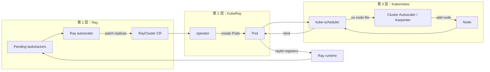
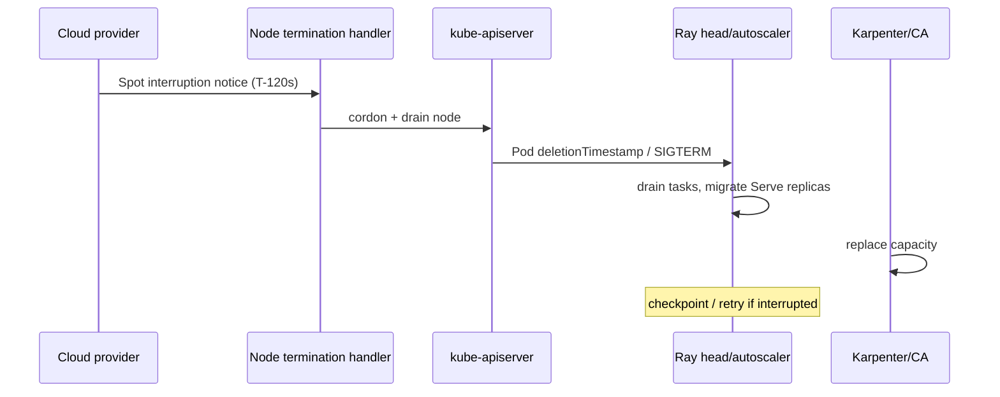

# 第 51 章 Kubernetes 弹性伸缩栈：从 Pending Pod 到节点池

第 9 章讲的是 Ray autoscaler 如何把“排队任务”翻译成 `replicas`，第 34 章讲的是 autoscaler v2 内部如何做实例管理和装箱。两章都停在一个边界上：**Pod 已经创建，但节点上没有容量**。本章从这个边界继续往下，讲清楚 Kubernetes 侧的第三层控制回路：kube-scheduler、Cluster Autoscaler（CA）、Karpenter、节点池、配额和 Spot。

如果这一层配错，你看到的现象永远是同一句话：“Ray 说扩容了，但任务没跑起来。”

## 51.1 三层控制回路

把一个 Ray 任务从“排队”送到“运行”，至少要经过三个独立的控制回路：



三层各有自己的输入、输出和时间尺度：

| 层 | 决策者 | 输入 | 输出 | 典型延迟 |
|---|---|---|---|---|
| Ray | autoscaler sidecar | task/actor demand、节点资源 | `replicas`、`workersToDelete` | 秒级 |
| KubeRay | operator | RayCluster spec | Pod/Service/status | 秒级 |
| 调度 | kube-scheduler | Pod requests、节点容量、亲和性 | Pod → Node 绑定 | 毫秒到秒 |
| 供给 | CA/Karpenter | Pending Pod、节点池约束 | 新节点/删节点 | 30 秒到数分钟 |

这四行里任何一行缺失，链路就断了。最常见的是**只配了第 1 层**：Ray autoscaler 把 `replicas` 从 0 改到 20，但节点池没有容量，20 个 Pod 全部 Pending，Ray 侧看到的仍是“没有新节点加入”，于是继续要求扩容。

## 51.2 为什么 Ray autoscaler 看不见 Pending Pod

Ray autoscaler 的输入是 Ray 自己的资源模型：待调度的 task/actor、placement group、已有节点的可用资源。它**不读取 Kubernetes 的 Pending Pod**，也不理解节点池。

这带来两个直接后果：

1. **Ray 侧扩容成功不等于 Pod 能运行**。autoscaler 只负责把“需要多少节点”写进 `replicas`。
2. **Kubernetes 侧 Pending 不会反过来触发 Ray 扩容**。Pod 已经存在，Ray 认为“节点正在启动”，会等待；如果节点永远不来，任务就永远排队。

因此，平台必须同时提供：

- Ray 能识别的节点形状（`rayStartParams` 的 `num-cpus`/`num-gpus`/`memory` 或顶层 `resources`）；
- Kubernetes 能调度的 Pod 请求（requests）；
- 节点池能补上的机器容量（CA/Karpenter）；
- 队列/配额能解释“为什么还不扩”（ResourceQuota/Kueue）。

### 51.2.1 一个典型的断链现场

```text
Ray:        demand 32 CPU -> replicas 8
KubeRay:    creates 8 worker Pods
Scheduler:  0/12 nodes available: insufficient cpu
CA:         node group "cpu" is at maxSize=4
```

此时：

- `kubectl get rayclusters` 可能显示 `Ready`（head 是好的）；
- `kubectl get pods` 有 8 个 Pending；
- Ray Dashboard 显示 8 个节点“正在启动”；
- 任务一直排队。

排查顺序应该是**从下往上**：先看 Pod 的 Pending 原因，再看节点池上限，最后才怀疑 Ray autoscaler。

## 51.3 节点池设计：先定形状，再定数量

节点池不是“越大越好”。Ray 的资源形状（CPU/GPU/内存/自定义资源）必须和节点池的实例类型一一对应，否则 autoscaler 会在错误的池子里请求资源。

### 51.3.1 一个可维护的节点池划分

| 池 | 实例形状 | 用途 | 最小/最大 | 计费 |
|---|---|---|---|---|
| `system` | 4 vCPU / 16 GiB | operator、APIServer、监控 | 2/6 | on-demand |
| `ray-head` | 8 vCPU / 32 GiB | Ray head、GCS、Dashboard | 1/3 | on-demand |
| `ray-cpu` | 16 vCPU / 64 GiB | CPU worker、Ray Data | 0/50 | spot 优先 |
| `ray-gpu-a100` | 16 vCPU / 128 GiB / 2×A100 | 训练、LLM | 0/16 | on-demand + spot |
| `ray-gpu-l4` | 8 vCPU / 32 GiB / 1×L4 | 小模型推理 | 0/20 | spot |

划分原则：

- **head 永远不要和 worker 抢同一类 Spot 节点**。head 被回收会带走 GCS；即使有 GCS FT，也会造成一次恢复。
- **GPU 池按型号拆开**。不同型号的显存、算力、NVLink 拓扑不同，混在一个池里会让调度和容量计算都失真。
- **CPU 池可以混用实例类型，但请求形状要一致**。如果 8 核和 32 核节点混部，Ray autoscaler 的“节点数”语义会变得难以预测。
- **系统组件单独一个池**。operator 自己也需要 CPU/内存；把它和 Ray worker 混在一起，扩容时可能先把 operator 挤掉。

### 51.3.2 节点池上限的算术

设一个 worker group：

- `maxReplicas = R`
- 每个 Pod 请求 `c` 核、`m` 内存、`g` 张 GPU
- `numOfHosts = H`（多主机时一个 replica 有 H 个 Pod）

节点池必须满足：

```text
pool_cpu_capacity     >= R × H × c + head/系统预留
pool_memory_capacity  >= R × H × m + head/系统预留
pool_gpu_capacity     >= R × H × g
```

并且节点供给上限要能容纳 `ceil(R × H / pods_per_node)` 台节点：

- Cluster Autoscaler：node group 的 `maxSize`（节点数）不能小于该值；
- Karpenter v1：没有 `maxSize`，用 NodePool 的 `spec.limits`（CPU/内存/GPU 总量）约束；要把它换算成“最多多少台”。

```text
Karpenter limits.cpu >= ceil(R × H / pods_per_node) × 单节点 CPU
```

例：`R=20`、每 Pod 4 核/16 GiB、节点 16 核/64 GiB（可分配 15.5 核/62 GiB）：

```text
每节点可放 = min(floor(15.5/4), floor(62/16)) = min(3, 3) = 3 个 Pod
需要节点   = ceil(20/3) = 7 台
```

如果节点池 `maxSize=4`，最多只能跑 12 个 worker，剩下 8 个永远 Pending。Ray 侧看到的 `maxReplicas=20` 是一个**永远无法兑现的承诺**。

### 51.3.3 资源碎片

装箱不是简单的除法。考虑 3 台 16 核节点和 4 个 Pod：

| Pod 形状 | 数量 | 单节点容量 | 实际放置 |
|---|---:|---:|---|
| 12 核 | 2 | 1 | 2 台各放 1 个，剩 4 核 |
| 4 核 | 2 | 4 | 第 3 台放 2 个（容量 4，未满） |

但顺序反过来（先放 2 个 4 核，再放 12 核）：

```text
node-1: 4 + 4 = 8 核，12 核放不下
node-2: 12 核
node-3: 12 核
=> 仍然需要 3 台，但 node-1 浪费了 8 核
```

kube-scheduler 的默认打分（LeastAllocated/BalancedAllocation）并不保证全局最优装箱；Ray autoscaler 的 v2 装箱和 CA 的节点选择也各自独立。生产上要做的是：

- 让同一 worker group 的 Pod 形状一致；
- 用 `topologySpreadConstraints` 控制打散，而不是依赖调度器“恰好”装好；
- 对 GPU 这种不可压缩资源，按整卡请求，避免 1 卡 Pod 把 2 卡节点切碎；
- 观察 `kube_pod_container_resource_requests` 与节点 allocatable 的差值。

## 51.4 Cluster Autoscaler 与 Karpenter 的差异

两者都解决“Pending Pod → 新节点”，但模型不同。

| 维度 | Cluster Autoscaler | Karpenter |
|---|---|---|
| 配置单位 | 预定义的 node group / ASG | NodePool + EC2NodeClass 等 |
| 扩容决策 | 模拟调度，选择能放下 Pending Pod 的 node group | 直接选择实例类型，支持多实例族 |
| 缩容 | 节点空闲 10 分钟后删除 | consolidation（`WhenEmpty`/`WhenEmptyOrUnderutilized`） |
| 实例多样性 | 受 ASG 限制 | 原生支持大量实例类型 |
| 中断处理 | 依赖 cloud provider 的节点终止处理器 | 内置 Spot 中断、`expireAfter` |
| 适用 | 已有 ASG、多云/自建 | AWS 为主，其他云有对应实现 |

### 51.4.1 Cluster Autoscaler 的关键参数

以常见 flag 为例（不同版本名称可能略有差异，以 `--help` 为准）：

| 参数 | 默认 | 作用 |
|---|---:|---|
| `--scan-interval` | 10s | 多久检查一次 Pending/空闲 |
| `--scale-down-delay-after-add` | 10m | 扩容后多久才允许缩容 |
| `--scale-down-unneeded-time` | 10m | 节点空闲多久才删除 |
| `--scale-down-utilization-threshold` | 0.5 | 低于该利用率才考虑缩容 |
| `--max-node-provision-time` | 15m | 新节点多久没 Ready 就放弃 |
| `--skip-nodes-with-local-storage` | true | 有本地存储的节点是否跳过缩容 |

调参的核心矛盾：

- 缩容太慢 → 空闲 GPU 烧钱；
- 缩容太快 → 任务刚启动就被打断，Ray 侧表现为 worker 反复重建。

对 Ray 的建议：

- `scale-down-unneeded-time` 至少大于 `idleTimeoutSeconds`，否则 Ray 还没决定缩容，CA 已经把节点拿走了；
- 对 GPU 池使用更长的缩容延迟（30 分钟），因为 GPU 节点启动和镜像拉取都慢；
- 给 Ray worker 加 `cluster-autoscaler.kubernetes.io/safe-to-evict: "true"` 之前，先确认 `terminationGracePeriodSeconds` 足够（第 52 章）。

### 51.4.2 Karpenter 的 consolidation

Karpenter 的 consolidation 不只是“删空节点”，还会：

- 把多台小节点的 Pod 合并到一台大节点；
- 用更便宜的实例类型替换现有节点；
- 在 `consolidateAfter` 之后执行。

这对 Ray 是双刃剑：

- 好处：CPU 池的利用率更高，成本更低；
- 风险：consolidation 会驱逐 Pod，Ray worker 可能正在跑 task。必须配合 PDB、`karpenter.sh/do-not-disrupt` 和足够长的 grace。

一个保守的起点：

```yaml
apiVersion: karpenter.sh/v1
kind: NodePool
metadata:
  name: ray-cpu
spec:
  disruption:
    consolidationPolicy: WhenEmpty
    consolidateAfter: 30m
  limits:
    cpu: "800"
  template:
    spec:
      # Karpenter v1 必须引用一个 NodeClass（AWS 用 EC2NodeClass）
      nodeClassRef:
        name: default
        kind: EC2NodeClass
        group: karpenter.k8s.aws
      requirements:
        - key: karpenter.sh/capacity-type
          operator: In
          values: ["spot", "on-demand"]
        - key: node.kubernetes.io/instance-type
          operator: In
          values: ["c6i.4xlarge", "c6a.4xlarge", "c7i.4xlarge"]
```

`WhenEmpty` 只删空节点，不会为了合并而驱逐正在运行的 Ray worker；`WhenEmptyOrUnderutilized` 更激进，适合无状态 CPU 批处理，不适合长时间训练。注意 `WhenUnderutilized` 是 v1beta1 的旧拼写，v1 API 不接受。

> 版本提示：Karpenter 的 API 在 v1beta1 → v1 之间有过调整，`consolidationPolicy`、`consolidateAfter`、`expireAfter` 的字段名和默认值以你部署的 CRD 为准。不要把本章的 YAML 直接当成跨版本兼容清单。

## 51.5 PriorityClass、抢占与配额

Ray autoscaler v2 的 `priority` 是**worker group 之间**的优先级，不是 Kubernetes 的 `PriorityClass`。两者解决不同问题：

| 机制 | 作用域 | 是否抢占 | 典型用途 |
|---|---|---|---|
| `workerGroupSpecs[].priority` | Ray 节点类型选择 | 否 | 便宜的 CPU 池优先、GPU 兜底 |
| `PriorityClass` | Kubernetes Pod | 是 | 高优先级训练抢占低优先级批处理 |
| `ResourceQuota` | Namespace | 否（拒绝创建） | 租户总配额 |
| Kueue | 队列/ClusterQueue | 是（可配置） | 团队配额、gang admission |

### 51.5.1 PriorityClass 的正确用法

给 Ray worker 的 Pod template 设置 `priorityClassName`：

```yaml
workerGroupSpecs:
  - groupName: interactive
    replicas: 2
    minReplicas: 0
    maxReplicas: 4
    template:
      spec:
        priorityClassName: ray-interactive
```

```yaml
apiVersion: scheduling.k8s.io/v1
kind: PriorityClass
metadata:
  name: ray-interactive
value: 100000
globalDefault: false
preemptionPolicy: PreemptLowerPriority
description: "Interactive Ray notebooks; may preempt batch workers."
```

注意：

- 抢占会驱逐低优先级 Pod，但**不保证**抢占后高优先级 Pod 一定能调度（可能被亲和性/污点挡住）；
- 被抢占的 Ray worker 会丢失本地 task；有状态 actor 需要重建或迁移；
- 不要让所有 Ray 负载都用同一个高优先级，否则抢占退化成“谁先来谁赢”；
- `preemptionPolicy: Never` 可以让高优先级 Pod 只排队、不抢占，适合“重要但不能伤害别人”的作业。

### 51.5.2 ResourceQuota 是硬上限，不是弹性信号

ResourceQuota 在**准入**阶段拒绝超出配额的 Pod。它不会让 CA 扩容，也不会让 Ray autoscaler 停止扩容；它只会让新 Pod 创建失败或 Pending。

```yaml
apiVersion: v1
kind: ResourceQuota
metadata:
  name: team-a
  namespace: team-a
spec:
  hard:
    requests.cpu: "200"
    requests.memory: 800Gi
    requests.nvidia.com/gpu: "16"
    count/rayclusters.ray.io: "4"
    count/pods: "120"
```

常见误区：

- 只限制 `requests.cpu`，不限制 `requests.nvidia.com/gpu` → GPU 被一个租户吃光；
- 不限制 `count/pods` → 大量小 Pod 打爆调度器；
- 把 quota 设成“刚好等于峰值” → 滚动升级时新 Pod 无法创建，升级卡住。

滚动升级需要额外容量：`maxSurge` 期间旧 Pod 和新 Pod 同时存在。quota 至少要为 `maxSurge` 留出余量。

### 51.5.3 Kueue：把“排队”从 Kubernetes 调度器里拿出来

ResourceQuota 是“超过就拒绝”，Kueue 是“超过就排队”。对 RayJob 来说，后者通常更合适：

```yaml
apiVersion: kueue.x-k8s.io/v1beta1
kind: LocalQueue
metadata:
  name: team-a
  namespace: team-a
spec:
  clusterQueue: shared-gpu
```

RayJob 通过标签 `kueue.x-k8s.io/queue-name: team-a` 进入队列。Kueue 在 RayJob **创建时**就通过 admission 创建 `Workload`；配额可用时再准入（取消 suspend）并允许 Pod 创建，还可以要求 gang admission（所有 worker 同时到位）。配额不足时 Workload 存在但处于排队状态。第 12、29 章有更完整的集成说明。

## 51.6 HPA/VPA 在 Ray 上为什么常常是错的

Kubernetes 原生的 HPA/VPA 以 Pod 的 CPU/内存为信号，而 Ray 的扩缩容信号是**任务队列和资源需求**。

| 机制 | 信号 | 对 Ray 的问题 |
|---|---|---|
| HPA（CPU） | Pod CPU 利用率 | Ray worker 空闲时 CPU 也可能很高（raylet、对象传输）；扩容后任务可能已经结束 |
| HPA（自定义指标） | Prometheus 指标 | 需要把 Ray demand 暴露成指标，配置复杂 |
| VPA | 历史资源使用 | 改 Pod requests 会触发重建；Ray 进程不会热调整资源 |
| Ray autoscaler | task/actor demand | 与 Ray 调度器一致，推荐 |

结论：

- **Ray worker 的副本数交给 Ray autoscaler**，不要再叠加 HPA；
- **Ray Serve 的副本数交给 Serve autoscaler**（`max_replicas`、`target_num_ongoing_requests_per_replica`），不要用 HPA 直接改 Deployment；
- 如果确实需要 HPA，把它用在**入口网关/代理**（如 Envoy、NGINX）上，而不是 Ray worker；
- KEDA 可以把 Ray 的 queue length 转成 HPA 指标，但通常不如直接用 Ray autoscaler。

## 51.7 Spot、抢占与中断

Spot 是 Ray 平台上最大的成本杠杆，也是最大的稳定性来源。

### 51.7.1 中断预算

设：

- on-demand 单价 `P_on`
- spot 单价 `P_spot`（通常为 `P_on` 的 30%–40%）
- spot 比例 `s`
- 中断导致的额外重试/恢复成本系数 `k`（例如 1.1）

则混合成本近似：

```text
C = (1 - s) × P_on + s × P_spot × k
```

例：`P_on=1.0`、`P_spot=0.35`、`s=0.7`、`k=1.2`：

```text
C = 0.3 × 1.0 + 0.7 × 0.35 × 1.2 = 0.3 + 0.294 = 0.594
```

约为全 on-demand 的 59%。但如果 `k` 因为频繁中断升到 1.8，成本变成 `0.3 + 0.441 = 0.741`，节省只剩 26%。所以“Spot 用得越多越便宜”不成立，**中断率 × 恢复成本**才是关键。

### 51.7.2 Spot 的三条铁律

1. **head 不放 Spot**。head 回收会触发 GCS 恢复或集群重建。
2. **worker 的 grace 必须短于中断通知窗口**。AWS 通常给 2 分钟，GCP/Azure 可能更短；`preStop + drain + buffer < warning`。
3. **不要用 PDB 对抗 Spot 中断**。PDB 只约束自愿驱逐（drain/eviction API），不阻止云厂商直接终止实例。真正要做的是：
   - 让 Ray 感知节点 draining；
   - 让 Serve 副本在节点消失前迁移；
   - 让训练任务从 checkpoint 恢复（第 46 章）。

### 51.7.3 中断处理链路



## 51.8 容量规划算例

### 51.8.1 CPU 批处理池

输入：

- 峰值 200 个 task，每个 2 核/4 GiB；
- 单 task 平均 10 分钟；
- 目标 15 分钟内清空；
- 节点 32 核/128 GiB（可分配 30 核/120 GiB）；
- 每节点预留 2 核给系统。

计算：

```text
每节点可放 Pod = min(floor(30/2), floor(120/4)) = min(15, 30) = 15
所需并发       = ceil(200 × 10 / 15) ≈ 134 个 task
需要节点       = ceil(134 / 15) = 9 台
```

如果 Ray autoscaler 的 `maxReplicas=134`，节点池 9 台 × 15 = 135 个 Pod 刚好够；再考虑滚动/故障，至少留 20% 余量 → 11 台。把 `maxReplicas` 写成 200 会多要 66 个并发，节点池也会被高估到 14–17 台。

### 51.8.2 GPU 训练池

输入：

- 8 节点 × 8×A100 训练；
- 每节点 96 核/1 TiB；
- 需要 2 个并发实验；
- 节点池 `maxSize=16`。

计算：

```text
每实验 8 节点 -> 2 个实验需要 16 节点
但滚动升级/故障需要 +1 节点
=> maxSize 至少 17，或者接受其中一个实验排队
```

GPU 池的关键不是 CPU 核数，而是**整机形状**：8 卡节点通常要求 Pod 请求 8 张卡（或至少一个 gang 能占满），否则碎片会让大作业永远等不到。

### 51.8.3 推理池

输入：

- 峰值 120 QPS；
- 单副本 30 QPS（满足 SLO）；
- 需要 4 副本；
- `maxSurge=1`、`maxUnavailable=0`；
- 每副本 1 张 L4。

```text
稳定容量 = 4 副本
滚动峰值 = 5 副本（surge 1）
节点池   = 至少 5 张 L4 的容量
```

如果节点是 4 卡 L4，至少 2 台；再考虑 AZ 打散，至少 2 个 AZ × 2 台。

## 51.9 可观测性：看哪几个指标

| 现象 | 指标/命令 | 说明 |
|---|---|---|
| Pod 不调度 | `kube_pod_status_unschedulable` | 按 reason 分组 |
| CA 不扩容 | `cluster_autoscaler_nodes_count`、`cluster_autoscaler_unschedulable_pods_count` | 看是否到达 maxSize |
| Karpenter 不扩容 | `karpenter_nodes_created_total`、`karpenter_pods_state` | 看 NodePool limits/实例可用性 |
| 节点启动慢 | `kube_node_status_condition{condition="Ready"}` | 镜像/网络/GPU 驱动 |
| 配额拒绝 | `kube_resourcequota`、apiserver 审计日志 | `exceeded quota` |
| Ray 侧等待 | `ray_cluster_pending_nodes`、autoscaler 日志 | 确认 replicas 是否真的变了 |
| 抢占 | `kube_pod_status_reason{reason="Evicted"}` | 区分 preemption 与 OOM |

一条实用的排查命令链：

```bash
# 1. 哪些 Pod Pending，为什么
kubectl get pods -A --field-selector=status.phase=Pending
kubectl describe pod <pod> | sed -n '/Events/,$p'

# 2. 节点池还有没有上限
kubectl get nodepool -o yaml | grep -E 'name:|maxSize|limits'
kubectl -n kube-system logs deploy/cluster-autoscaler --tail=200

# 3. 配额是否拒绝
kubectl get resourcequota -A
kubectl get events -A --field-selector reason=FailedCreate

# 4. Ray 侧到底要求了多少
kubectl exec <head> -- ray status
kubectl get raycluster <name> -o jsonpath='{.spec.workerGroupSpecs[*].replicas}'
```

## 51.10 实验：`examples/elasticity_lab.py`

本仓库的弹性实验把上面几件事压缩成一个确定性模型：

```bash
python examples/elasticity_lab.py
```

预期输出：

```text
[scale-up] 8 workers -> nodes=3 cost=$1.15/h
[scale-down] nodes 2 -> 1 after 600s idle
[gpu] two 1-GPU Pods packed together; a 2-GPU Pod forced a second node
[preemption] scheduled high-priority by evicting 1 low-priority Pod(s)
[spot+pdb] first node drained; second blocked until replacements were Ready
[spot-warning] 120s notice was enough to drain and replace
[quota] scheduled 5/8 workers; 3 remain pending at the 20-CPU quota ceiling
OK: node autoscaling packed Pods cost-aware, honored quotas, preempted by priority, and respected PDBs during Spot drain.
```

实验对应的模型：

| 场景 | 真实系统里的对应物 | 关键断言 |
|---|---|---|
| `scale-up` | CA/Karpenter 根据 Pending Pod 加节点 | 8 个 worker 全部调度，成本按每 Pod 单价选择实例 |
| `scale-down` | CA 空闲缩容 | 600 秒后回到 `minSize` |
| `gpu` | GPU 碎片 | 两个 1 卡 Pod 共享一台，2 卡 Pod 触发新节点 |
| `preemption` | PriorityClass 抢占 | 高优先级 Pod 通过驱逐低优先级 Pod 获得容量 |
| `spot+pdb` | PDB + 节点 drain | 第二次驱逐被 PDB 挡住，替换 Ready 后放行 |
| `spot-warning` | Spot 两分钟通知 | 120 秒内完成 drain 和替换 |
| `quota` | ResourceQuota | 20 核配额下只准入 5 个 4 核 Pod |

实验不是 CA/Karpenter 的替代品，它证明的是**决策顺序**：先装箱、再扩容、再抢占、最后才让配额拒绝。

## 51.11 检查表

上线前逐项确认：

- [ ] 每个 worker group 的 `maxReplicas` 与节点池 `maxSize` 对得上；
- [ ] head 在独立、非 Spot 的节点池；
- [ ] GPU 池按型号拆分，worker group 有对应的 nodeSelector/亲和性；
- [ ] `ResourceQuota` 覆盖 CPU/内存/GPU/Pod 数，并给滚动升级留余量；
- [ ] PriorityClass 只给真正需要抢占的负载；
- [ ] Spot 节点有 taint + toleration，普通负载不会误入；
- [ ] `terminationGracePeriodSeconds` 覆盖 preStop + drain；
- [ ] CA/Karpenter 的缩容延迟大于 Ray `idleTimeoutSeconds`；
- [ ] 监控 Pending 原因、节点池上限、配额拒绝、Spot 中断；
- [ ] 做过一次“节点池打满”演练，确认告警和排队行为符合预期。

## 51.12 练习

1. 把 `elasticity_lab.py` 的 `CPU_POOL` 改成 3 种实例类型（4/8/16 核），观察成本感知选择是否仍然最优。
2. 给 `Fleet` 增加 `consolidate()`：把两台半满节点合并成一台，并在合并前检查 PDB。
3. 用真实 kind 集群 + Cluster Autoscaler 模拟器（或云上 CA）复现“节点池 maxSize 打满”的 Pending。
4. 设计一个混合池：70% Spot + 30% on-demand，写出中断率从 5% 升到 20% 时的成本对比。
5. 解释为什么“Ray `priority` 高”不等于“Kubernetes 抢占成功”。

## 51.13 小结

- 弹性不是一层，而是 Ray demand → replicas → Pod → 节点四层回路。
- Ray autoscaler 看不见 Pending Pod；节点供给必须由 CA/Karpenter 单独负责。
- 节点池要按资源形状划分，`maxReplicas` 必须与池容量对齐。
- PriorityClass 负责抢占，ResourceQuota 负责拒绝，Kueue 负责排队，三者不能互相替代。
- HPA/VPA 不适合 Ray worker；副本数交给 Ray/Serve autoscaler。
- Spot 的成本优势取决于中断率与恢复成本，不是比例越高越好。
- `elasticity_lab.py` 把装箱、扩容、抢占、PDB、Spot、配额串成了一条可断言的链路。

下一章继续往下：Pod 被删除/驱逐/回收时，到底发生了什么，以及怎样让 Ray 优雅地退出。

← [第 50 章 数据与模型治理](50-data-model-governance.md)

→ [第 52 章 生命周期、驱逐与优雅终止](52-graceful-termination-disruption.md)
