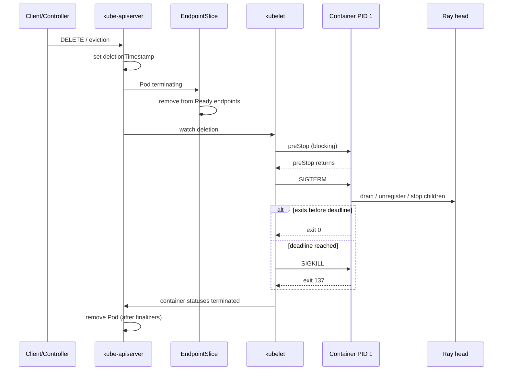

# 第 52 章 生命周期、驱逐与优雅终止

KubeRay 负责把 Pod 创建出来，但 Pod 怎么结束，主要由 Kubernetes 和 Ray 运行时决定。生产上大量“看起来像 KubeRay bug”的问题，最后都落在同一条时间线上：

```text
deletionTimestamp -> preStop -> SIGTERM -> drain -> exit
                                      \-> grace 到期 -> SIGKILL
```

本章把这条时间线拆开，讲清楚 head、worker、Serve 副本在缩容、升级、节点 drain、Spot 中断和 CR 删除时分别经历什么，以及怎样把“丢任务”变成“可恢复的中断”。

## 52.1 删除一个 Pod 不等于杀死进程

Kubernetes 的删除是**协作式**的：

1. 客户端（kubectl、控制器、CA）发出删除/驱逐请求；
2. apiserver 设置 `metadata.deletionTimestamp`，对象进入 Terminating；
3. EndpointSlice 控制器把 Pod 从 Ready 端点中移除（除非 `publishNotReadyAddresses`）；
4. kubelet 执行 `preStop`（如果配置了）；
5. kubelet 向容器 PID 1 发送 `SIGTERM`；
6. 进程自行退出，或等待 `terminationGracePeriodSeconds` 到期；
7. 到期后 kubelet 发送 `SIGKILL`；
8. 容器停止；如果 Pod 还有 finalizer，对象继续保留，直到 finalizer 被移除。

关键点：

- **preStop 的时间计入 grace**，不是额外赠送；grace 到期时 preStop 未返回，只有约 2 秒的一次性延长，随后 SIGKILL；
- **SIGTERM 只发给 PID 1**，是否传给子进程取决于进程实现；
- **finalizer 不清，Pod 对象不会消失**，即使容器已经停了；
- **PDB 只约束 eviction API**，不约束直接 `delete`、控制器缩容或云厂商终止实例。

## 52.2 终止时序



这张图里有两个容易被忽略的窗口：

- **端点移除与进程退出之间**：Pod 已经不再接收新流量，但旧连接可能还在；
- **SIGTERM 与 Ray 真正停止之间**：worker 可能还在执行 task，Serve 副本可能还在处理请求。

### 52.2.1 原生 sidecar 改变了时序

如果 Pod 里有原生 sidecar（`initContainers` + `restartPolicy: Always`，Kubernetes 1.33 GA），终止顺序是：

```text
1. 主容器（ray）收到 SIGTERM 并退出
2. 主容器全部退出后，sidecar 按逆序收到 SIGTERM
3. sidecar 退出后 Pod 才结束
```

这意味着日志/指标 sidecar 会比 Ray 活得久，可以把 Ray 退出前的日志刷出去；但 `terminationGracePeriodSeconds` 要覆盖“Ray 的 drain + sidecar 的 flush”两段预算，而不是只算 Ray。反过来，启动顺序是 sidecar 先 ready、Ray 后启动；sidecar 的 readiness 会推迟 Pod Ready。完整语义见[第 58.2 节](58-kubernetes-primitives.md)。

## 52.3 preStop、SIGTERM 与 PID 1

### 52.3.1 preStop 的语义

```yaml
lifecycle:
  preStop:
    exec:
      command: ["/bin/sh", "-c", "ray stop"]
```

- preStop 在 SIGTERM **之前**执行；
- 它是**阻塞**的：命令返回后才发 SIGTERM；
- 它和 SIGTERM 共享同一个 grace 预算；
- preStop 失败不会阻止终止，kubelet 记录事件后继续；
- 如果 preStop 在 grace 到期时仍未返回，kubelet 会给一个很小的一次性宽限（Kubernetes 文档为约 2 秒），然后 SIGKILL；不要把这两秒算进预算。

对 Ray 来说，`ray stop` 会通知本地 raylet/worker 退出，并尽量把状态写回 GCS。它比“直接 SIGTERM 然后等”更可控。

### 52.3.2 PID 1 与信号转发

容器里的 PID 1 有特殊语义：**没有默认的信号处理**。如果 PID 1 是 shell，而 shell 不转发 SIGTERM，进程可能一直活到 grace 到期。

Ray 的启动命令经历过一次重要变化：

- 早期 KubeRay 用 `bash -c "...; ray start ... --block"`，bash 是 PID 1，非交互 bash 不转发 SIGTERM；
- Ray 2.33 之后，bash 的 last-command `exec` 优化让 `ray start` 成为 PID 1，SIGTERM 能到达 Ray 的信号处理器；
- 这暴露了一个新问题：Ray 收到 SIGTERM 后立即拆本地 Serve 副本，而旧 proxy 还在路由，升级期间出现 HTTP 500。

因此，**不要假设 SIGTERM 一定被处理，也不要假设它一定被优雅处理**。用 preStop 显式执行 `ray stop`，并给 Ray 的 drain 留出时间。

### 52.3.3 Ray 的 drain 开关

较新的 Ray 版本在 `ray start --block` 的 SIGTERM 路径上支持 drain：

```text
RAY_GRACEFUL_SHUTDOWN_DRAIN_TIMEOUT_S=30
```

行为大致是：

1. 向 GCS 标记本节点 draining（reason: preemption）；
2. Serve 组件停止接收新请求，迁移本地副本；
3. 等待 raylet 退出或超时；
4. 再执行常规的进程清理。

注意：

- 这个变量在不同 Ray 版本中的存在性和默认值可能不同，部署前用 `python -c "import ray; ..."` 或查看 `ray_constants.py` 确认；
- drain 超时是**总预算的一部分**，不是额外时间；
- 如果 Ray 版本不支持，preStop 的 `ray stop` 仍然是主要的优雅退出手段。

### 52.3.4 Serve 侧的优雅退出

Ray Serve 有自己的关闭参数（部署配置/环境变量，名称随版本略有差异）：

| 参数 | 作用 |
|---|---|
| `graceful_shutdown_wait_loop_s` | 关闭时轮询未完成请求的间隔（默认约 2s） |
| `graceful_shutdown_timeout_s` | 等待请求完成的最长时间（默认约 20s） |

原则：**Serve 的 drain 时间 ≤ Pod 的 grace 预算 - preStop 时间**。否则请求会被 SIGKILL 截断。

### 52.3.5 `preStop: ray stop` 与 SIGTERM drain 的冲突

Ray 的 `ray stop` 自己有一个 `--grace-period`（默认 **16 秒**），并且把时间**平均分给三组进程**（raylet、worker、其他；见 `ray/scripts/scripts.py`）。默认情况下每组只有约 5.3 秒，之后直接 SIGKILL。

这意味着：

- 如果 preStop 里写默认的 `ray stop`，它会在约 5 秒后杀掉 raylet，`RAY_GRACEFUL_SHUTDOWN_DRAIN_TIMEOUT_S=30` 根本来不及生效；
- preStop 返回后 kubelet 才发 SIGTERM，但此时 Ray 进程可能已经被 `ray stop` 杀掉了。

两种可用模式：

| 模式 | 配置 | 适用 |
|---|---|---|
| A. 依赖 SIGTERM drain | 不放 `ray stop` preStop；设置 `RAY_GRACEFUL_SHUTDOWN_DRAIN_TIMEOUT_S`，grace 覆盖 drain + 传播 + buffer | Ray 2.59+（SIGTERM 已处理 drain） |
| B. 显式 preStop | `ray stop --grace-period N`，N 要大于 `3 × drain_timeout`；不再依赖 drain env | 旧 Ray，或需要显式停止进程 |

模式 A 更简单，但要求 Ray 版本支持 SIGTERM drain；模式 B 更可控，但要把 `ray stop` 的 3 段预算算进 preStop 时长。

## 52.4 KubeRay 的默认行为：不注入 preStop，需要显式配置

核对 v1.7.1 的 `controllers/ray/common/pod.go`：`BuildPod`/`DefaultHeadPodTemplate`/`DefaultWorkerPodTemplate` **没有**给 head 或 worker 注入 `preStop`。Ray 官方 Kubernetes 配置指南则建议**每个 Ray 容器**都加一个阻塞的：

```yaml
lifecycle:
  preStop:
    exec:
      command: ["/bin/sh", "-c", "ray stop"]
```

因此：

- **worker Pod**：默认没有 preStop；如果你希望缩容/驱逐前执行 `ray stop`，要自己写；
- **head Pod**：同样没有默认 preStop。head 的终止语义更复杂：`ray stop` 会关闭 GCS，触发所有 worker 断开；
- **RayJob 的 submitter**：按 submissionMode 不同，生命周期由 Job/Sidecar/HTTP 管理，不走 Ray worker 的 preStop；
- **Serve 副本**：运行在 worker 上，继承 worker 的终止行为，但 Serve 自己的 drain 由 Serve 配置控制。

> 版本提示：KubeRay 的 Helm chart、示例或后续版本可能通过 values/默认模板提供 preStop。不要假设，直接看实际 Pod：
>
> ```bash
> kubectl get pod <pod> -o jsonpath='{.spec.containers[0].lifecycle}'
> ```
>
> 如果为空，就自己加。

一个显式的 head + worker 配置：

```yaml
headGroupSpec:
  template:
    spec:
      terminationGracePeriodSeconds: 60
      containers:
        - name: ray
          lifecycle:
            preStop:
              exec:
                command: ["/bin/sh", "-c", "ray stop"]
```

配合 GCS FT（第 13 章），head 的退出才不会变成“整集群丢状态”。

`manifests/samples/ray-cluster-graceful.yaml` 采用模式 A（不写 preStop，依赖 Ray 2.59 的 SIGTERM drain）；如果你用的是旧 Ray，按模式 B 加回 `preStop: ray stop --grace-period N`，并把 N/3 算进 preStop 预算。

## 52.5 缩容路径：`workersToDelete` 与 idle

Ray autoscaler 缩容时不是“随便删一个 Pod”，而是：

1. 选择一个空闲超过 `idleTimeoutSeconds` 的节点；
2. 确认没有正在运行的 task/actor；
3. 把 Pod 名写入 `spec.workerGroupSpecs[].scaleStrategy.workersToDelete`；
4. operator 删除这些 Pod；
5. 节点从 Ray 集群注销。

KubeRay 默认在开启 autoscaling 时禁止随机删除 Pod（`ENABLE_RANDOM_POD_DELETE=false`），因为随机删除可能杀掉有任务的节点。这个约束很重要：

- **手动改 `replicas` 缩容**：operator 需要决定删哪个 Pod，可能触发随机删除；
- **autoscaler 缩容**：通过 `workersToDelete` 精确指定，优先走优雅路径；
- **多主机组**：删一个 replica 会删整组 `numOfHosts` 个 Pod，不能只删一个 host。

缩容前的检查清单：

- [ ] `idleTimeoutSeconds` 大于任务的最短执行时间；
- [ ] `terminationGracePeriodSeconds` 覆盖 `ray stop` + drain；
- [ ] 有状态 actor 已迁移或标记为不可缩容；
- [ ] Serve 的 `target_capacity`/副本数不会因为节点缩容瞬间掉到 SLO 以下；
- [ ] 监控缩容后的 task 重试率。

## 52.6 节点 drain、cordon 与 PDB

### 52.6.1 三种“驱逐”

| 操作 | 走 eviction API | 受 PDB 约束 | 典型场景 |
|---|---|---|---|
| `kubectl delete pod` | 否 | 否 | 手动清理 |
| `kubectl drain` | 是（默认） | 是 | 节点维护 |
| CA/Karpenter 缩容 | 是 | 是 | 节点回收 |
| ReplicaSet 缩容 | 否 | 否 | 控制器删 Pod |
| 云厂商终止实例 | 否 | 否 | Spot 中断/硬件故障 |

这张表解释了一个常见困惑：**为什么 PDB 没保护住我的 Pod？** 因为删除它的不是 eviction API。

### 52.6.2 PDB 的正确写法

```yaml
apiVersion: policy/v1
kind: PodDisruptionBudget
metadata:
  name: ray-service-workers
spec:
  minAvailable: 2
  selector:
    matchLabels:
      ray.io/cluster: ray-service
      ray.io/node-type: worker
```

或：

```yaml
spec:
  maxUnavailable: 25%
```

注意：

- `minAvailable` 和 `maxUnavailable` 只能二选一；
- 百分比按**当前期望副本数**计算，可能向上/向下取整；
- PDB 只保护匹配的 Pod；Ray 的 worker 标签是 `ray.io/cluster` + `ray.io/node-type=worker`；
- PDB 不保护 head（head 只有一个，`minAvailable: 1` 会让 drain 永远卡住）；
- 对多主机 worker，一个 replica 的多个 Pod 可能同时被驱逐，PDB 需要按 replica 而不是 Pod 计数（当前 PDB 只能按 Pod，需额外设计）。

### 52.6.3 drain 的完整流程

```bash
# 1. 标记节点不可调度
kubectl cordon node-a

# 2. 驱逐（默认使用 eviction API）
kubectl drain node-a \
  --ignore-daemonsets \
  --delete-emptydir-data \
  --timeout=10m

# 3. 观察被 PDB 挡住的 Pod
kubectl get pdb -A
kubectl describe pdb ray-service-workers

# 4. 处理完节点后恢复
kubectl uncordon node-a
```

如果 `drain` 卡住：

- 看 PDB 的 `ALLOWED DISRUPTIONS` 是否为 0；
- 看是否有 Pod 一直不 Ready，导致 PDB 永远不满足；
- 看是否有 finalizer 阻止 Pod 消失；
- 看 `kubectl get events --field-selector reason=Eviction`。

## 52.7 Spot 中断与抢占

### 52.7.1 时间预算

Spot 中断通知通常给 120 秒（AWS），部分平台更短。你的终止预算必须小于通知窗口：

```text
preStop + SIGTERM drain + endpoint propagation + buffer < warning
```

例：

```text
preStop 5s + drain 30s + 传播 5s + buffer 10s = 50s < 120s  ✓
preStop 30s + drain 120s + ... = 160s > 120s                ✗
```

### 52.7.2 中断处理的四层

| 层 | 机制 | 负责什么 |
|---|---|---|
| 云 | Spot interruption notice / EventBridge/SQS | 提前通知 |
| 节点 | Node termination handler、Karpenter | cordon/drain |
| Kubernetes | PDB、grace、preStop | 有序退出 |
| Ray | drain、checkpoint、重试 | 任务恢复 |

任何一层缺失，都会把“可恢复中断”变成“任务丢失”。

### 52.7.3 抢占与 Spot 的区别

- **抢占（preemption）**：高优先级 Pod 驱逐低优先级 Pod，走 scheduler 的 preemption 逻辑，**不走 PDB**；
- **Spot 中断**：云厂商终止实例，走节点终止处理器，通常走 drain + PDB；
- **CA/Karpenter 缩容**：走 eviction API，受 PDB 约束。

三者都会让 Ray worker 消失，但 Ray 侧的恢复路径不同：

- 抢占可能立即 SIGKILL（没有优雅期）；
- Spot 中断通常有 2 分钟；
- 缩容通常有 grace。

## 52.8 RayJob、RayService 与 CR 删除

### 52.8.1 RayJob 的删除策略

`deletionStrategy` 决定作业结束后删什么：

| 策略 | 删除范围 |
|---|---|
| `DeleteCluster` | 整个 RayCluster |
| `DeleteWorkers` | worker group，保留 head |
| `DeleteSelf` | RayJob CR 自身 |
| `DeleteNone` | 什么都不删 |

规则可以按成功/失败分别配置：

```yaml
deletionStrategy:
  deletionRules:
    - condition:
        jobStatus: SUCCEEDED
      policy: DeleteCluster
    - condition:
        jobStatus: FAILED
      policy: DeleteNone
```

删除集群时，operator 会先删 Pod，再删 Service/PVC（如果配置了），最后移除 finalizer。GCS FT 的 Redis 清理是**另一个 finalizer**，可能在 Pod 停止后继续存在一段时间。

### 52.8.2 RayService 的删除延迟

`rayClusterDeletionDelaySeconds`（默认 60）让旧集群在切换后保留一段时间，便于回滚。它不是“优雅终止预算”，而是**资源保留窗口**：

- 保留期间旧集群仍然占资源；
- 超过窗口后 operator 删除旧集群；
- 回滚要在窗口内完成，否则需要重建。

### 52.8.3 finalizer 卡住

Pod/CR 一直 Terminating，常见原因：

1. **GCS FT Redis cleanup**：operator 在等 Redis 清理 Job；超过 `ray.io/gcs-ft-deletion-timeout`（整数秒，默认 300s）后会强制移除 finalizer，可能留下 Redis 垃圾数据。先看 cleanup Job 日志；
2. **operator 不在**：finalizer 没人移除；
3. **preStop 超过 grace**：kubelet 已 SIGKILL，但 finalizer 还在；
4. **存储卸载失败**：CSI 驱动卡住，Pod 无法彻底删除。

排查：

```bash
kubectl get pod <pod> -o jsonpath='{.metadata.finalizers}'
kubectl get raycluster <name> -o jsonpath='{.metadata.finalizers}'
kubectl get jobs -n <ns> | grep redis
kubectl logs deploy/kuberay-operator -n kuberay-system --tail=200
```

## 52.9 预算公式与算例

### 52.9.1 公式

```text
terminationGracePeriodSeconds
  >= preStop_max
   + SIGTERM_drain
   + endpoint_propagation
   + safety_buffer
```

其中：

- `preStop_max`：最慢的一次 preStop（例如 `ray stop` 偶发变慢）；
- `SIGTERM_drain`：Ray/Serve 的 drain 超时；
- `endpoint_propagation`：EndpointSlice 更新到所有节点的时间（通常 1–5 秒）；
- `safety_buffer`：给内核/容器运行时/日志刷盘留的余量。

### 52.9.2 三个算例

| 场景 | preStop | drain | 传播 | buffer | grace |
|---|---:|---:|---:|---:|---:|
| CPU worker | 2 | 5 | 2 | 6 | **15** |
| Serve 副本 | 5 | 30 | 5 | 20 | **60** |
| 大模型推理 | 10 | 60 | 5 | 25 | **100** |

如果 grace 小于总和，最后被 SIGKILL 的可能是**正在写 checkpoint 的训练进程**或**正在返回最后一个 token 的推理副本**。

### 52.9.3 反向检查

给定 grace，反推最大 drain：

```text
drain_max = grace - preStop_max - propagation - buffer
```

例：grace 30、preStop 5、传播 3、buffer 2 → `drain_max = 20` 秒。把 `RAY_GRACEFUL_SHUTDOWN_DRAIN_TIMEOUT_S` 设为 20 或更小。

## 52.10 实验：`examples/lifecycle_lab.py`

```bash
python examples/lifecycle_lab.py
```

预期输出：

```text
[worker] preStop 2s + drain 3s -> exit 0 at t=5, no SIGKILL
[stuck] SIGTERM ignored -> SIGKILL at grace deadline t=10 (exit 137)
[budget] preStop 2s + drain 15s > grace 10s -> SIGKILL at t=10
[head] graceful exit at t=2, but without GCS FT the jobs and workers are lost
[head+gcs-ft] graceful head exit; replacement head in 15s, no job loss
[pdb] drain timeline=[(5, 1), (10, 0), (20, 2), (25, 1), (30, 0)]; ready never fell below 4
[rollout] maxSurge=2 maxUnavailable=0 -> capacity=[('surge +2', 6), ('retire old, add new', 6), ('retire old, add new', 6), ('retire old', 5), ('retire old', 4)]; failures=0
[spot] notice=120s: fast drain finished at t=15; slow drain would exceed the warning and be lost
OK: grace budgets, preStop/SIGTERM, head failure, PDB drains, rolling upgrades and Spot warnings are reproducible.
```

实验覆盖：

| 场景 | 结论 |
|---|---|
| `worker` | preStop + drain 都在预算内 → exit 0 |
| `stuck` | 进程不处理 SIGTERM → SIGKILL 137 |
| `budget` | drain 超过 grace → SIGKILL |
| `head` | 进程优雅退出 ≠ GCS 状态持久化 |
| `head+gcs-ft` | 有 GCS FT 时 head 恢复，作业不丢 |
| `pdb` | 驱逐被 PDB 挡住，替换 Ready 后放行 |
| `rollout` | `maxSurge=2`、`maxUnavailable=0` 时容量不低于 4 |
| `spot` | 120 秒通知内完成 drain，否则丢失 |

## 52.11 Runbook：Pod 一直 Terminating

按顺序检查：

1. **看 finalizer**

   ```bash
   kubectl get pod <pod> -o jsonpath='{.metadata.finalizers}'
   ```

   如果有 `ray.io/gcs-ft-redis-cleanup-finalizer`，跳到第 4 步。

2. **看 preStop 是否卡住**

   ```bash
   kubectl describe pod <pod> | grep -A5 'PreStop\|Events'
   ```

   preStop 里的 `ray stop` 可能在等 raylet；如果 raylet 已经失联，会等到 grace。

3. **看 grace 和实际时间**

   ```bash
   kubectl get pod <pod> -o jsonpath='{.spec.terminationGracePeriodSeconds}'
   ```

   如果已经超过 grace 还在 Terminating，问题不在容器，而在 finalizer/存储。

4. **看 GCS FT 清理 Job**

   ```bash
   kubectl get jobs -A | grep -i redis
   kubectl logs job/<cleanup-job> --tail=100
   ```

   operator 可能在等 Redis 清理；检查 cleanup Job 状态、`ray.io/gcs-ft-deletion-timeout` 和 operator 日志。

5. **看 operator 日志**

   ```bash
   kubectl logs deploy/kuberay-operator -n kuberay-system --tail=300 | grep -i 'finalizer\|delete'
   ```

6. **最后手段**

   只有在确认没有数据风险后，才手动移除 finalizer：

   ```bash
   kubectl patch pod <pod> -p '{"metadata":{"finalizers":null}}' --type=merge
   ```

   这会跳过清理逻辑，可能留下 Redis/PVC/对象存储垃圾。

## 52.12 检查表

- [ ] 明确选择模式 A（SIGTERM drain）或 B（preStop `ray stop`），并让 grace 预算与之一致；v1.7.1 不自动注入 preStop，先看实际 Pod spec；
- [ ] head 显式配置 preStop 和 grace；
- [ ] `terminationGracePeriodSeconds >= preStop + drain + 传播 + buffer`；
- [ ] `RAY_GRACEFUL_SHUTDOWN_DRAIN_TIMEOUT_S`（若版本支持）小于剩余预算；
- [ ] Serve 的 `graceful_shutdown_timeout_s` 小于剩余预算；
- [ ] PDB 选择器覆盖正确的 worker 标签，且不会把 head 锁死；
- [ ] PDB 的 `minAvailable` 小于期望副本数，给滚动升级留余量；
- [ ] Spot 通知窗口大于终止预算；
- [ ] RayJob 的 deletionStrategy 与保留/清理预期一致；
- [ ] 有“Pod 卡 Terminating”的 runbook 和演练。

## 52.13 练习

1. 把 `lifecycle_lab.py` 的 `terminate()` 扩展为支持“preStop 失败”：失败后是否仍然发 SIGTERM？记录事件。
2. 给 `ReplicaSet` 加 `unhealthyPodEvictionPolicy` 的简化语义：不健康 Pod 是否总是允许驱逐？
3. 用 kind 集群创建 3 个副本 + PDB `minAvailable: 2`，执行 `kubectl drain`，观察 eviction 被拒绝时的 429 事件。
4. 设计一个 8 卡训练 Pod 的终止预算：preStop 10s、checkpoint 90s、传播 5s，求 grace。
5. 解释为什么“Ray head 优雅退出”仍然可能在无 GCS FT 时丢失作业。

## 52.14 小结

- Kubernetes 终止是协作式的：deletionTimestamp → preStop → SIGTERM → drain → SIGKILL。
- preStop 和 SIGTERM 共享 grace；grace 不是“额外等待时间”。
- v1.7.1 不自动注入 preStop；按 Ray 版本选择 SIGTERM drain 或显式 `ray stop`，并注意 `ray stop` 默认 16 秒会分给 3 组进程。
- Ray 的 SIGTERM 行为和版本相关；用 preStop + drain 显式控制，不要依赖默认。
- 缩容走 `workersToDelete`，节点回收走 eviction API，PDB 只保护后者。
- Spot 的终止预算必须小于中断通知窗口。
- head 的进程优雅退出不等于 GCS 状态持久化；GCS FT 才是。
- `lifecycle_lab.py` 把 grace、PDB、滚动升级和 Spot 的时序变成了可断言的结果。

下一章从“集群怎么退出”转到“人怎么进来”：交互式开发、Notebook、代码同步与调试。

← [第 51 章 Kubernetes 弹性伸缩栈](51-kubernetes-elasticity-stack.md)

→ [第 53 章 交互式开发与 Notebook 平台](53-interactive-dev-notebooks.md)
