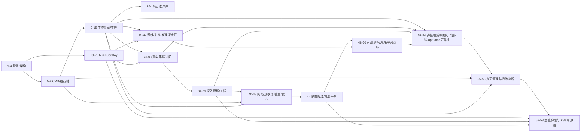

# KubeRay 教程：从原理到可运行的简版实现

> 基准版本：KubeRay **v1.7.1**（2026-09），Ray **2.59.0**，Kubernetes 1.30+（`SidecarSubmitterRestart` 需 1.35+）。
> 教程中的 API 字段、默认值、端口、特性门控按 KubeRay v1.7.x 的源码与发布说明整理；简版实现 `minikuberay/` 不依赖 Kubernetes 与 Ray，可以直接运行、测试和调试。

这套教程解决两个问题：

1. **把 KubeRay 讲透**：Ray 的进程模型、Kubernetes Operator 的调和循环、四个 CRD、自动扩缩容、RayJob 的四种提交模式、RayService 的零停机与增量升级、GCS 容错、安全、可观测性、真实集群实验、Ray Train/Data/Tune、LLM 推理、批调度/Kueue、源码导读、升级迁移、平台设计、autoscaler v2 内部机制、Ray 运行时内幕、GPU/DRA、故障复盘与生产移植，以及 Kubernetes 网络深潜、控制面规模化、多可用区/托管 Kubernetes/灾难恢复、Ray Data 执行引擎、弹性分布式训练、LLM 推理内部机制（continuous batching/KV cache/PD 分离）、可观测性 2.0（OpenTelemetry/SLO）、平台治理与供应链、数据与模型治理、Kubernetes 弹性伸缩栈（CA/Karpenter/Spot/配额/抢占）、Pod 生命周期与优雅终止（preStop/SIGTERM/PDB/drain）、交互式开发与 Notebook 平台（Jobs API/runtime_env/JupyterHub）、Operator 自身可靠性（缓存同步、leader election、workqueue、探针、控制面 SLO）、**在运行中的集群上做变更**（spec hash、`Recreate`/`None`、head 维护、版本升级），以及**活体诊断**（Ray State API、`ray status/list/logs`、证据链）、**垂直弹性**（IPPR、原地 Pod resize）、**Kubernetes 新原语**（原生 sidecar、容器级重启、`schedulingGates`、`PreferSameZone`、Pod 级资源）、可运行故障实验室和开源发布工程。
2. **把 KubeRay 做出来**：用一个 40+ Python 模块的工程化实现，复现 CRD 默认值与校验、API Server、资源版本与 watch、控制器、调度器、kubelet 模拟、Ray 运行时模拟、自动扩缩容、**In-Place Pod Resizing（IPPR）**、RayJob/RayService/RayCronJob、History Server、Gateway API、批调度、多主机、Ingress、GCS FT 清理、指标、**Ray 风格 State API 子集**、CLI 和测试。它不替代真实 operator，而是一台可以逐行调试的“控制平面实验台”。

本版新增最后两章，补齐 2026 年的两个方向：

- **第 57 章 IPPR**：Kubernetes 1.35 的原地 Pod resize + KubeRay `ray.io/ippr` 注解，把弹性从“加副本”扩展到“把 Pod 变大”；包含 MiniKubeRay 的完整实现、19 个 pytest 和 6 个场景的可运行实验。
- **第 58 章 Kubernetes 新原语**：原生 sidecar、容器级重启（`SidecarSubmitterRestart`）、`schedulingGates`、`PreferSameZone` 拓扑感知路由、Pod 级资源，逐条说明它们与 KubeRay 状态机的接缝。

## 30 秒快速开始

```bash
# 在教程根目录直接运行；安装开发依赖只是为了 pytest/PyYAML
python -m pip install -r requirements-dev.txt

# 1) 跑完整测试（确定性时钟，不依赖网络/K8s）
python -m pytest -q

# 2) 跑文档与清单一致性检查
python check_docs.py

# 3) 跑端到端演示：RayCluster -> RayJob -> 自动扩缩容 -> RayService -> RayCronJob
python -m minikuberay demo --fast

# 4) 启动带 Dashboard、History Server 和 Prometheus 指标的本地平台
python -m minikuberay server --history-path ./history.json
# 浏览器打开 http://127.0.0.1:8080/dashboard

# 5) 或一次跑完全量验证矩阵（测试、文档、demo、24 个示例/实验）
python scripts/verify.py

# 6) 四种 RayJob 提交模式并排对比
python examples/rayjob_modes.py

# 7) RayCluster 生命周期：suspend/resume/Recreate/扩缩容
python examples/cluster_lifecycle.py

# 8) RayCronJob：cron/时区/suspend/补跑/幂等
python examples/cronjob_lab.py

# 9) 故障实验室：11 个确定性故障场景
python examples/incident_lab.py

# 10) 控制面规模基准：对象数/写入数/时间
python examples/scale_benchmark.py --clusters 100 --workers 2

# 11) Ray Data 执行引擎：背压、shuffle、spill
python examples/data_execution_lab.py

# 12) 弹性训练：checkpoint、world size、gang admission
python examples/elastic_training_lab.py

# 13) LLM 调度：continuous batching、前缀缓存、PD 分离
python examples/llm_scheduler_lab.py

# 14) 可观测性：trace 树、RED、SLO/错误预算
python examples/observability_lab.py

# 15) 策略即代码：enforce/audit 与回归用例
python examples/policy_lab.py

# 16) 数据/模型治理：point-in-time、skew、promotion、rollback
python examples/governance_lab.py

# 17) 节点弹性：CA/Karpenter 装箱、抢占、PDB、Spot、配额
python examples/elasticity_lab.py

# 18) 生命周期：preStop/SIGTERM/grace、PDB drain、滚动升级、Spot 通知
python examples/lifecycle_lab.py

# 19) 开发回路：runtime_env 打包、幂等提交、Jobs API、Notebook 回收
python examples/dev_loop_lab.py

# 20) Operator 可靠性：cache sync、leader election、重试、panic、探针、SLO
python examples/operator_reliability_lab.py

# 21) 变更管理：Recreate/None、spec hash、混合版本、head 维护
python examples/maintenance_lab.py

# 22) 活体诊断：status/nodes/jobs/events 证据链
python examples/diagnosis_lab.py

# 23) IPPR：原地扩容、水平兜底、超时回滚、注解校验
python examples/ippr_lab.py

# 24) Kubernetes 新原语：sidecar 顺序、调度门、拓扑路由、Pod 级资源
python examples/k8s_primitives_lab.py
```

> State API 子集也可以直接从 CLI 查询：先 `python -m minikuberay server`，再
> `python -m minikuberay state nodes --cluster demo`（详见第 56 章）。

验证基线（本仓库当前状态）：

| 检查项 | 命令 | 期望 |
|---|---|---|
| 单元/集成测试 | `python -m pytest -q` | 272 passed |
| 文档/清单一致性 | `python check_docs.py` | `OK: documentation, manifests and facts are consistent` |
| 端到端演示 | `python -m minikuberay demo --fast` | 输出 `Demo complete` |
| 平台启动 | `python -m minikuberay server` | Dashboard、`/metrics`、`/api/history/sessions` 可访问 |
| 示例脚本 | `python examples/autoscaling_smoke.py` | 打印扩缩容前后的副本数 |
| 决策实验 | `python examples/autoscaler_walkthrough.py` | 打印四组确定性扩缩容决策 |
| 提交模式实验 | `python examples/rayjob_modes.py` | `OK: all four submission modes reached Complete` |
| 集群生命周期实验 | `python examples/cluster_lifecycle.py` | `OK: suspend/resume, Recreate upgrade...` |
| 定时任务实验 | `python examples/cronjob_lab.py` | `OK: cron scheduling, time zone...` |
| 故障实验室 | `python examples/incident_lab.py` | 11/11 scenarios passed |
| 规模基准 | `python examples/scale_benchmark.py` | 打印对象数、写入数、收敛轮数 |
| Ray Data 实验 | `python examples/data_execution_lab.py` | `OK: streaming execution respected backpressure...` |
| 弹性训练实验 | `python examples/elastic_training_lab.py` | `OK: elastic resume replayed 0 steps; static restart replayed 8.` |
| LLM 调度实验 | `python examples/llm_scheduler_lab.py` | `OK: prefix caching cut TTFT; PD overlapped prefill and decode...` |
| 可观测性实验 | `python examples/observability_lab.py` | `OK: spans form a trace tree, the SLO math is reproducible...` |
| 策略实验 | `python examples/policy_lab.py` | `OK: the admission contract is explicit, testable and mode-aware.` |
| 治理实验 | `python examples/governance_lab.py` | `OK: point-in-time features excluded future data...` |
| 弹性实验 | `python examples/elasticity_lab.py` | `OK: node autoscaling packed Pods cost-aware...` |
| 优雅终止实验 | `python examples/lifecycle_lab.py` | `OK: grace budgets, preStop/SIGTERM...` |
| 开发回路实验 | `python examples/dev_loop_lab.py` | `OK: the dev loop has a deterministic packaging...` |
| Operator 可靠性实验 | `python examples/operator_reliability_lab.py` | `OK: cache sync, leader election, retry backoff...` |
| 变更管理实验 | `python examples/maintenance_lab.py` | `OK: upgrade strategy, spec-hash scope...` |
| 活体诊断实验 | `python examples/diagnosis_lab.py` | `OK: status, State API nodes/jobs...` |
| IPPR 实验 | `python examples/ippr_lab.py` | `OK: IPPR resized a running Pod in place...` |
| K8s 原语实验 | `python examples/k8s_primitives_lab.py` | `OK: sidecars ordered correctly, Jobs completed...` |
| State API 子集 | `python -m minikuberay state nodes --cluster demo` | 打印节点表与 `total=` |

事实标记（`check_docs.py` 会校验，修改代码或章节后请同步更新 `docs/facts.json`）：

- `tests=272`
- `chapters=58`
- `sample_manifests=33`
- `python_modules=44`

## 目录

### 第一部分：背景与架构

1. [为什么需要 KubeRay](01-why-kuberay.md)
2. [Ray 运行时架构回顾](02-ray-architecture.md)
3. [Kubernetes Operator 模式](03-kubernetes-operator.md)
4. [KubeRay 总览：组件、版本与生态](04-kuberay-overview.md)

### 第二部分：CRD 与运行时

5. [RayCluster CRD 深度解析](05-raycluster-crd.md)
6. [Pod、网络、存储与调度](06-pods-networking-storage.md)
7. [控制器调和循环：从 CR 到 Pod](07-controller-reconcile.md)
8. [状态、条件、事件与可观测性](08-observability.md)

### 第三部分：工作负载与生产

9. [自动扩缩容：Ray Autoscaler 与 KubeRay](09-autoscaling.md)
10. [RayJob：提交模式、生命周期与清理](10-rayjob.md)
11. [RayService：Serve、零停机升级与流量切换](11-rayservice.md)
12. [RayCronJob 与批调度生态](12-raycronjob-batch.md)
13. [高可用、容错与 GCS FT](13-ha-fault-tolerance.md)
14. [安全：RBAC、网络、Secret、mTLS 与多租户](14-security.md)
15. [性能、容量与成本](15-performance-cost.md)

### 第四部分：运维与未来

16. [KubeRay APIServer、Dashboard 与 kubectl-ray](16-apiserver-dashboard-cli.md)
17. [生产运行手册](17-production-runbook.md)
18. [未来方向：Roadmap 与生态趋势](18-future.md)

### 第五部分：简版 KubeRay 实现

19. [MiniKubeRay 架构与设计取舍](19-mini-architecture.md)
20. [实现：API 模型、默认值、校验与 Store](20-mini-api-store.md)
21. [实现：控制器、调度器、Kubelet 与自动扩缩容](21-mini-controllers.md)
22. [实现：RayJob、RayService 与 RayCronJob](22-mini-jobs-services.md)
23. [实现：APIServer、Dashboard、CLI 与指标](23-mini-apiserver-cli.md)
24. [测试、验证与故障注入](24-testing-verification.md)
25. [练习、扩展路线与真实 KubeRay 的差距](25-roadmap-exercises.md)

### 第六部分：真实集群与进阶专题

26. [真实集群实验：从 kind 到第一个 RayService](26-real-cluster-lab.md)
27. [在 KubeRay 上运行 Ray Train / Data / Tune / RLlib](27-ray-train-data-tune.md)
28. [LLM 推理平台：Ray Serve、vLLM 与 SGLang](28-llm-serving.md)
29. [生态集成：队列、调度与工作流](29-ecosystem-integrations.md)
30. [KubeRay 源码导读与二次开发](30-source-code-tour.md)
31. [升级、迁移、离线安装与灾难恢复](31-upgrade-migration-dr.md)
32. [平台实战：多租户 Ray 平台设计](32-platform-capstone.md)
33. [MiniKubeRay 进阶实现：History Server、Gateway API 与批调度](33-mini-advanced-implementation.md)

### 第七部分：深入原理与工程实践

34. [Autoscaler v2 内部机制与容量模型](34-autoscaler-v2-internals.md)
35. [Ray 运行时深潜：GCS、Raylet、对象存储与调度](35-ray-runtime-internals.md)
36. [GPU 与异构资源调度：device plugin、MIG、DRA 与拓扑](36-gpu-heterogeneous-scheduling.md)
37. [生产故障案例与复盘](37-production-incident-postmortems.md)
38. [从 MiniKubeRay 到生产 Operator：移植与二次开发](38-porting-to-production-operator.md)
39. [选型与替代方案：KubeRay、托管 Ray、Slurm 与其他系统](39-selection-alternatives.md)

### 第八部分：网络、规模化与工程化

40. [Kubernetes 网络深潜：CNI、DNS、Service、NetworkPolicy 与 mTLS](40-kubernetes-network-internals.md)
41. [控制面规模化与多集群运营：从 10 到 1000 个 RayCluster](41-control-plane-at-scale.md)
42. [可运行故障实验室：用 MiniKubeRay 复现生产事故](42-incident-lab.md)
43. [从 Issue 到 Release：KubeRay 贡献、API 治理与发布工程](43-contribution-release-engineering.md)

### 第九部分：跨故障域与托管平台

44. [多可用区、托管 Kubernetes 与灾难恢复](44-multi-az-managed-kubernetes-dr.md)

### 第十部分：数据、训练与推理深水区

45. [Ray Data 执行引擎深潜：流式调度、背压、Shuffle 与对象存储](45-ray-data-execution-engine.md)
46. [弹性分布式训练：Ray Train、TorchElastic、Checkpoint 与故障恢复](46-elastic-distributed-training.md)
47. [LLM 推理内部机制：Continuous Batching、KV Cache、前缀缓存与 PD 分离](47-llm-inference-internals.md)

### 第十一部分：可观测性、治理与平台闭环

48. [可观测性 2.0：OpenTelemetry、日志管道、SLO 与错误预算](48-observability-2.md)
49. [平台治理：准入控制、策略即代码与供应链安全](49-platform-governance-supply-chain.md)
50. [数据与模型治理：Schema、血缘、Point-in-Time 特征与模型注册](50-data-model-governance.md)

### 第十二部分：弹性、生命周期、开发者体验与 Operator 可靠性

51. [Kubernetes 弹性伸缩栈：从 Pending Pod 到节点池](51-kubernetes-elasticity-stack.md)
52. [生命周期、驱逐与优雅终止](52-graceful-termination-disruption.md)
53. [交互式开发与 Notebook 平台](53-interactive-dev-notebooks.md)
54. [Operator 可靠性与控制面 SLO](54-operator-reliability-control-plane-slo.md)

### 第十三部分：变更管理与活体诊断

55. [变更管理：升级、重启与不丢状态](55-change-management-upgrades.md)
56. [Ray 活体诊断：State API、ray CLI 与证据链](56-live-diagnostics-state-api.md)

### 第十四部分：垂直弹性与 Kubernetes 新原语

57. [垂直弹性：KubeRay IPPR 与原地 Pod 扩缩](57-in-place-pod-resizing-ippr.md)
58. [Kubernetes 新原语与 KubeRay：原生 sidecar、调度门、拓扑感知与 Pod 级资源](58-kubernetes-primitives.md)

### 附录

- [A. API 字段速查](appendix-a-api-reference.md)
- [B. 端口、指标与环境变量](appendix-b-ports-metrics-env.md)
- [C. 故障排查手册](appendix-c-troubleshooting.md)
- [D. 术语表](appendix-d-glossary.md)
- [E. 参考资料](appendix-e-references.md)
- [F. 真实集群实验命令速查](appendix-f-lab-cheatsheet.md)
- [G. Helm Values 与安装矩阵](appendix-g-helm-values.md)
- [H. 事件、错误与状态码目录](appendix-h-events-errors-status.md)
- [I. 自测题与答案](appendix-i-self-assessment.md)
- [J. 端到端时序图集](appendix-j-sequence-atlas.md)
- [K. 可运行实验与验证索引](appendix-k-lab-index.md)

## 章节依赖图



## 本版结构变化

- **新增第十四部分（第 57–58 章）**：
  - 第 57 章把“扩容”从一维（副本数）扩成二维（副本数 + 单 Pod 资源）。它从 Kubernetes 1.35 的原地 Pod resize 讲起，给出 KubeRay `ray.io/ippr` 注解的完整契约、八条前置校验、四步决策顺序（当前容量 → 最大容量 → resize → 水平扩容）、`ray.io/ippr-status` 状态机、超时/回滚、只扩不缩/仅 CPU 内存/节点余量/VPA 冲突等边界，以及分阶段生产采用路径；
  - 第 58 章把 2025–2026 的 Kubernetes 新原语逐条接到 KubeRay 上：原生 sidecar（1.33 GA）的启动/退出/Job 完成语义、容器级重启与 `SidecarSubmitterRestart` 的 1.35 版本偏差、`schedulingGates` 与 autoscaler 的交互、`trafficDistribution: PreferSameZone` 对 Serve 流量与跨区成本的影响、Pod 级资源与 Ray 资源探测的错位。
- **MiniKubeRay 新增 IPPR 实现**：`models/ippr.py`（解析/校验/状态机/回滚）、`autoscaler/policy.py`（垂直决策 + 水平兜底）、`controllers/raycluster.py`（应用 resize/rollback）、`controllers/batch.py`（模拟 kubelet 完成/失败）、`runtime/cluster_runtime.py`（更新 Raylet 逻辑资源）；新增 19 个 `tests/test_ippr.py` 测试。
- **新增两个可运行实验**：
  - `examples/ippr_lab.py`：配置解析、原地扩容（UID 不变）、超出上限后的水平兜底、超时回滚、非法注解校验；
  - `examples/k8s_primitives_lab.py`：sidecar 启动/退出顺序、Job 完成、调度门、`PreferSameZone` 路由、Pod 级资源的“调度可见但 Ray 不可见”。
- **新增样例**：`manifests/samples/ray-cluster-ippr.yaml`（K8s 1.35+、autoscaler v2、`resizePolicy: NotRequired`）和 `ray-cluster-native-sidecar.yaml`（K8s 1.33+ 原生 sidecar）。
- **验证基线更新**：272 个测试、58 章、33 个样例、44 个 Python 模块；新增实验与测试均由 pytest 在进程内执行。
- **新增第十三部分（第 55–56 章）**：
  - 第 55 章把“改一个正在运行的集群”拆成 spec、控制面、数据面三个平面：给出字段变更影响矩阵、spec hash 的精确语义（为什么 replicas 不触发重建）、`Recreate`/`None` 的差异、没有 `RollingUpdate` 的原因、Ray 版本升级的三种路径、head 维护与 `ray.io/disable-provisioned-head-restart`、worker 按组维护和回滚矩阵；
  - 第 56 章把排障整理成五层证据链：status/events → Pod → `ray status` → State API/`ray list` → 日志/trace；覆盖 task/actor 状态机、`PENDING_*` 的含义、State API 端点与响应信封，以及六类常见症状的诊断剧本。
- **新增两个可运行实验**：
  - `examples/maintenance_lab.py`：用 Pod UID 与镜像集合断言 `None` 的混合版本、`Recreate` 的全量替换、replicas 不进入 hash、head 按住/恢复；
  - `examples/diagnosis_lab.py`：把 status、State API 节点/作业、worker 自愈、非法 spec 事件串成一条可断言的证据链。
- **MiniKubeRay 新增 Ray 风格 State API 子集**：`/api/v0/nodes`、`/api/v0/jobs`、`/api/v0/serve/applications`、`/api/v0/events`、`/api/v0/healthz`，使用与 Ray 相同的 `data.result.result/total` 信封；CLI 新增 `python -m minikuberay state ...`，HTTP 客户端新增 `state()`；未建模的 tasks/actors/objects 返回 404，而不是伪造空数据。
- **上一版基线（第 55–56 章时）**：251 个测试、56 章、31 个样例、43 个 Python 模块；State API 测试、两个实验以及审计发现的回归测试都由 pytest 在进程内执行。
- **审计驱动的事实修正**：统一 condition 序列化名 `ReplicaFailure`；修正 RayJob `jobDeploymentStatus` 的公开枚举、`clusterSelector` 的 backoff/deletion 规则、RayCronJob 的计划时刻注解与逐 tick 补跑语义、RayService Ready 的 endpoint 判定、Serve application/deployment 两套状态、History Server 的 AWS 变量与 30080 端口、`/dev/shm` 卷名 `shared-mem`、`RAY_ROLE`/`RAY_NODE_TYPE_NAME` 环境变量、webhook 的 `ENABLE_WEBHOOKS` 开关、`kubectl ray job submit` 语法、RocksDB `storage.claimName`，以及 autoscaler/容量/排队公式中的数值错误。
- **审计驱动的实现修正**：`upgradeStrategy=None` 不再跳过 Service 调和；worker 命令不再重复 `--address`；移除 worker group 会清理其 Pod；autoscaler 在持续 demand 下不再抖动，并能回收手动缩容后的多余 Pod；submitter Job 的 `backoffLimit` 会先重试再失败；RayService condition 的 `observedGeneration` 使用真实 generation；增量升级的 active 流量百分比与路由权重一致；store 拒绝 kind 篡改、服务端分配 UID、watch 压缩返回 410；清理 Job Pod 不再注册为 Ray 节点。
- **历史内容保留**：第 51–54 章（弹性、终止、开发回路、operator 可靠性）、附录 J/K 以及此前的深水区章节不变；本版追加变更管理与诊断两条主线，并修掉旧 README 中重复/过期的历史基线段落。

## 目录结构

```text
kuberay-tutorial/
├── README.md                  # 本文件
├── 01-... ~ 58-...md          # 58 章正文
├── appendix-a ~ k.md          # 11 个附录
├── check_docs.py              # 文档/清单/事实一致性检查
├── minikuberay/               # 可运行的简版实现
│   ├── models/                # API 对象、默认值、校验、命名
│   ├── store/                 # resourceVersion、generation、watch
│   ├── kube/                  # LocalClient / HTTPClient
│   ├── controllers/           # 控制器、调度器、kubelet、GC
│   ├── autoscaler/            # 扩缩容策略
│   ├── runtime/               # Ray 运行时模拟
│   ├── tracing.py             # OpenTelemetry 风格 span/trace 收集
│   ├── history/               # History Server（事件/快照/回放）
│   ├── apiserver/             # REST API + Dashboard + /api/traces
│   ├── cli/                   # `python -m minikuberay`
│   └── demo.py                # 端到端演示
├── manifests/
│   ├── crds/                  # 四个 CRD
│   ├── samples/               # 33 个样例 + 前置条件说明
│   ├── rbac.yaml
│   └── operator.yaml
├── examples/                  # Ray 作业、Serve app、平台脚本，以及提交模式/生命周期/cron/故障/规模/数据/训练/LLM/可观测性/策略/治理/IPPR/K8s 原语实验
└── tests/                     # 272 个确定性测试（含十七个实验的进程内断言）
```

## 功能覆盖矩阵

| KubeRay 能力 | 教程位置 | 简版实现 |
|---|---|---|
| RayCluster / head / worker | 第 5–7 章 | `minikuberay/controllers/raycluster.py` |
| Pod/Service/网络/存储/调度 | 第 6、36 章 | `minikuberay/controllers/builders.py` |
| 自动扩缩容 v1/v2（简化策略） | 第 9、34 章 | `minikuberay/autoscaler/policy.py`；v1/v2 仅建模为字段/env，决策函数是简化版 |
| RayJob 四种提交模式 | 第 10 章 | `minikuberay/controllers/rayjob.py` |
| RayService / 零停机 / 增量升级 | 第 11 章 | `minikuberay/controllers/rayservice.py` |
| RayCronJob | 第 12 章 | `minikuberay/controllers/raycronjob.py` |
| GCS FT / Redis / RocksDB | 第 5、13、35 章 | 字段/PVC/env + Redis cleanup Job/finalizer |
| NetworkPolicy / mTLS / token auth | 第 5、14 章 | 对象/字段/Secret，数据面模拟 |
| 批调度（Volcano/YuniKorn/Kueue/WAS） | 第 12、29、36 章 | PodGroup/schedulerName/queue；仅跳过 MultiKueue 的 `managedBy`，本地 Kueue 准入未实现 |
| 指标/事件/Dashboard | 第 8、16 章 | metrics/events/Dashboard |
| History Server | 第 8、33 章 | 事件/快照/JSON 持久化/REST/CLI |
| Gateway API 增量升级 | 第 11、33 章 | Gateway/HTTPRoute 对象 + 权重 |
| 多主机 worker | 第 5、6、33 章 | replica/host 索引与整组替换 |
| Ingress / 自定义 head Service | 第 6 章 | Ingress 对象；端口按名合并 |
| APIServer / kubectl-ray / GitOps | 第 16 章 | REST + CLI + History |
| 真实集群实验 | 第 26 章 | kind/Helm 完整步骤 |
| Ray Train/Data/Tune/RLlib | 第 27 章 | 工作负载模式 + 样例 |
| LLM 推理 | 第 28 章 | Ray Serve LLM/vLLM 配置与容量 |
| 源码与二次开发 | 第 30、38 章 | Go 源码导读 + 移植骨架 |
| 升级/迁移/离线/DR | 第 31 章 | 流程与检查表 |
| 多租户平台 | 第 32 章 | 参考架构与落地阶段 |
| Autoscaler v2 内部机制 | 第 34 章 | 决策函数 + 容量公式 + 可运行实验 |
| Ray 运行时内幕 | 第 35 章 | `NodeRecord`/`JobRecord`/`ServeState` 边界 |
| GPU/MIG/DRA/拓扑 | 第 36 章 | 字段/Pod template；不模拟设备 |
| 生产故障复盘 | 第 37 章 | 14 个案例 + 演练题库 |
| 选型与替代方案 | 第 39 章 | 决策树 + TCO 模型 |
| Kubernetes 网络/CNI/DNS/NetworkPolicy/mTLS | 第 40 章 | 字段/对象 + kind 实验 |
| 控制面规模化/分片/多集群 | 第 41 章 | `examples/scale_benchmark.py` |
| 故障复现与回归 | 第 42 章 | `examples/incident_lab.py`（11 场景） |
| 多可用区/托管 K8s/DR | 第 44 章 | 放置/PDB/容量/恢复检查表 + `ray-cluster-multiaz.yaml` |
| 贡献/API 治理/发布工程 | 第 43 章 | 流程、检查表与代码生成 |
| Ray Data 执行引擎 | 第 45 章 | `examples/data_execution_lab.py`（背压/spill/shuffle 模型） |
| 弹性训练与 checkpoint | 第 46 章 | `examples/elastic_training_lab.py`（world size/恢复/重放对比） |
| LLM 推理内部机制 | 第 47 章 | `examples/llm_scheduler_lab.py`（batching/前缀缓存/PD） |
| OpenTelemetry trace | 第 48 章 | `minikuberay/tracing.py` + `/api/traces` + `examples/observability_lab.py` |
| 策略即代码与供应链 | 第 49 章 | `examples/policy_lab.py`（enforce/audit/回归） |
| 数据与模型治理 | 第 50 章 | `examples/governance_lab.py`（PIT/skew/注册/回滚） |
| 节点弹性/CA/Karpenter/Spot | 第 51 章 | `examples/elasticity_lab.py`（装箱/抢占/PDB/配额） |
| 优雅终止/PDB/drain | 第 52 章 | `examples/lifecycle_lab.py`（grace/滚动升级/Spot） |
| 交互式开发/Notebook | 第 53 章 | `examples/dev_loop_lab.py`（打包/幂等提交/连接矩阵） |
| Operator 可靠性/控制面 SLO | 第 54 章 | `examples/operator_reliability_lab.py`（cache/选主/重试/探针/SLO） |
| 变更管理/升级/head 维护 | 第 55 章 | `examples/maintenance_lab.py`（Recreate/None/hash/head hold） |
| Ray State API/活体诊断 | 第 56 章 | `/api/v0/*` 子集 + `state` CLI + `examples/diagnosis_lab.py` |
| In-Place Pod Resizing（IPPR） | 第 57 章 | `models/ippr.py` + `autoscaler/policy.py` + kubelet 状态机 + `examples/ippr_lab.py` |
| 原生 sidecar / 调度门 / 拓扑路由 / Pod 级资源 | 第 58 章 | `examples/k8s_primitives_lab.py`（语义模型，不外连集群） |
| 未来方向 | 第 18 章 | — |

## 怎么读

先按目标选一条路径；每章末尾都有下一章的链接，也可以直接跳读。

| 路径 | 章节 | 预计时间 | 产出 |
|---|---|---:|---|
| 快速上手 | 1、4、5、10、11、26 | 4–6 小时 | 能在 kind 上跑通 RayCluster/RayJob/RayService |
| 平台工程师 | 1–18、26、29–32、40、41、44 | 22–32 小时 | 能设计多租户/网络/容量/升级/多可用区方案 |
| 实现与二次开发 | 3、19–25、30、33、34、38、42、43 | 30–40 小时 | 能读懂/修改/测试 operator |
| ML 平台 | 5、6、10、11、27、28、32、35、36 | 10–15 小时 | 能跑训练/调参/LLM 推理 |
| on-call/排障 | 8、17、37、40、42、附录 C/H/J | 6–8 小时 | 能按 runbook 定位常见故障 |
| 贡献/发版 | 30、38、43 | 8–12 小时 | 能走完字段/功能的完整发布流程 |
| 数据/训练/推理深水区 | 45、46、47，配合 27、28、35 | 8–12 小时 | 能定位数据/训练/推理的瓶颈并给出配置 |
| 可观测性/SLO | 8、48、17、附录 H/J | 4–6 小时 | 能设计 trace、SLO、告警与成本报表 |
| 平台治理/安全 | 14、49、43、32 | 6–8 小时 | 能落地 admission、供应链与多租户策略 |
| 数据/模型治理 | 50，配合 27、28、29 | 3–5 小时 | 能设计版本、血缘、特征一致性与模型门禁 |
| 运维/控制面可靠性 | 17、41、51、52、54，附录 C/H/J | 8–12 小时 | 能处理节点容量、优雅终止、operator 选主/缓存/限流 |
| 变更管理/升级值班 | 5、7、31、52、55，附录 K | 5–7 小时 | 能安全改镜像/副本/head，能设计回滚 |
| 活体诊断/on-call | 8、17、35、56，附录 C/H | 5–7 小时 | 能用 status/State API/ray CLI 建立证据链 |
| 垂直弹性/IPPR | 9、34、57，配合 5、52 | 3–5 小时 | 能配置 `ray.io/ippr`、判断何时用垂直/水平、排查 resize 失败 |
| Kubernetes 新原语 | 6、52、58，配合 36、40 | 3–4 小时 | 能用原生 sidecar、调度门、拓扑路由和 Pod 级资源设计 Ray Pod |
| 快速验证/CI | 24、附录 K | 30 分钟 | 能跑全量检查并解释每一层证明什么 |

- **只想用 KubeRay**：读 1、4、5、10、11、17，然后看 `manifests/samples/`；想上真实集群直接读 26。
- **想写 Operator**：读 3、7、8、19–23，配合 `minikuberay/controllers/` 逐行阅读；再看 30 的 Go 源码导读和 38 的移植路线。
- **想做平台/基础设施**：读 6、9、13、14、15、16、17、29、31、32、34、36、39。
- **想做 ML 平台**：读 5、6、10、11、27、28、32、35、36。
- **想研究实现细节**：直接跑 `python -m minikuberay demo --fast`，再读 24 章的验证方法、33 章的进阶实现和 38 章的移植。
- **想排障/做 on-call**：读 17、37、40、附录 C、附录 H，再跑第 42 章的故障实验室。
- **想准备面试/自测**：读附录 I，再回到对应章节补细节。
- **想贡献 KubeRay**：读 30、38、43，再按“类型 → 默认/校验 → 调和 → 测试”的顺序改。
- **想做网络/平台排障**：读 40，配合第 6、14、26 章；重点是 Service/EndpointSlice、DNS、NetworkPolicy 和动态端口。
- **想扩到 1000 个集群**：读 41，先跑 `scale_benchmark.py`，再设计分片/多集群。
- **想做多可用区/托管 K8s/灾备**：读 44，配合 13（GCS FT）、31（DR 流程）、36（GPU 放置）、40（网络）。
- **想验证失败路径**：直接跑 `python examples/incident_lab.py`，再对照第 37、42 章和 `minikuberay/controllers/` 的源码。
- **想参与开源/发版**：读 43，按 REP → feature gate → 测试 → 发布清单推进。
- **想深入数据/训练/推理**：读 45（Ray Data）、46（弹性训练）、47（LLM 调度），配合 27、28、35 和三个新实验。
- **想做可观测性/SLO**：读 48，再跑 `examples/observability_lab.py`；trace 实现在 `minikuberay/tracing.py`。
- **想做平台治理**：读 49，先跑 `examples/policy_lab.py`，再把规则迁移到 Kyverno/Gatekeeper；供应链部分配合 43。
- **想做数据/模型治理**：读 50，跑 `examples/governance_lab.py`，再对照 27、28 的训练/服务配置。
- **想保证控制面稳定**：读 54，跑 `examples/operator_reliability_lab.py`，再对照 17 的 runbook 和 41 的规模化。
- **想处理节点容量/驱逐**：读 51、52，跑 `examples/elasticity_lab.py` 与 `examples/lifecycle_lab.py`。
- **想安全升级/维护一个在线集群**：读 55，先跑 `examples/maintenance_lab.py`；重点理解 `Recreate`/`None`、spec hash 与 head 维护。
- **想做 on-call 现场诊断**：读 56，跑 `examples/diagnosis_lab.py`，再用 `python -m minikuberay state ...` 对照 State API 的响应信封。
- **想快速确认“现在还能跑吗”**：直接看[附录 K](appendix-k-lab-index.md)，五分钟跑完全量检查；每个命令都写了预期输出和失败排查入口。
- **想理解一次操作经过哪些组件**：看[附录 J](appendix-j-sequence-atlas.md) 的时序图，再回到对应章节读细节。
- **想用垂直弹性**：读第 57 章，先跑 `examples/ippr_lab.py`；重点理解 `ray.io/ippr` 的八条前置校验、四步决策顺序和“只扩不缩”。
- **想用 Kubernetes 新原语**：读第 58 章，跑 `examples/k8s_primitives_lab.py`；重点看原生 sidecar 的启动/退出顺序、`schedulingGates` 与 autoscaler 的交互、Pod 级资源与 Ray 探测的错位。

## 简版实现的边界

`minikuberay/` 是**教学实现**，不是生产 operator：

- 不连接真实 Kubernetes：自带进程内 API Store、模拟调度器和模拟 kubelet。
- 不执行真实 Ray 分布式计算：Ray 作业以确定性状态机模拟，日志与状态与 Ray Job Submission 对齐；`examples/ray_job.py` 是给真实集群用的。
- 不实现真实网络、证书签发、Redis、Gateway API 数据面：这些字段会被建模、校验、写入状态和产生事件，但数据面是模拟的。
- History Server 采集 operator 事件与运行时快照，不是 Ray collector sidecar + 对象存储。
- Ray Serve 运行时是时间驱动的状态机；`targetCapacity`/`trafficRoutedPercent` 是控制面字段，不模拟真实的按容量预热与逐副本健康检查。
- IPPR 不模拟真实 cgroup/kubelet resize 子资源：它修改 Pod spec、写 `ray.io/ippr-status`、用延迟/结果注解推进状态机，并更新模拟 Raylet 的逻辑资源。真实集群的 cgroup v2、运行时能力和节点余量仍需按第 57 章验证。
- 第 58 章的原语实验是纯模型，不连接 Kubernetes；它断言的是排序/路由/记账语义，不是某个 CNI 或 kube-proxy 实现。
- 目标是让控制平面的**状态机、边界条件、失败路径**可读、可测、可改。生产使用请以 KubeRay 官方 Helm Chart 与 CRD 为准。

## 验证哲学

这个仓库把“能跑”拆成四层，任何一层失败都算失败：

1. **模型层**：默认值与校验和文档一致（`tests/test_defaults_validation.py`）。
2. **控制层**：调和是幂等的，收敛后 `operator.run_once()` 不再改动任何对象（`tests/test_e2e.py`）。
3. **接口层**：REST、CLI、Dashboard、指标、History Server 可用（`tests/test_apiserver_cli.py`、`tests/test_history.py`）。
4. **文档层**：章节链接、代码路径、YAML 片段、样例清单、事实数字全部可校验（`check_docs.py`）。

这套分层验证也是教程第 24 章的主题。新增章节若引用新代码/新命令，必须同时更新 `docs/facts.json` 并跑：

```bash
python -m pytest -q
python check_docs.py
python -m minikuberay demo --fast
python examples/autoscaler_walkthrough.py
python examples/rayjob_modes.py
python examples/cluster_lifecycle.py
python examples/cronjob_lab.py
python examples/incident_lab.py
python examples/scale_benchmark.py --clusters 30 --workers 2
python examples/data_execution_lab.py
python examples/elastic_training_lab.py
python examples/llm_scheduler_lab.py
python examples/observability_lab.py
python examples/policy_lab.py
python examples/governance_lab.py
python examples/elasticity_lab.py
python examples/lifecycle_lab.py
python examples/dev_loop_lab.py
python examples/operator_reliability_lab.py
python examples/maintenance_lab.py
python examples/diagnosis_lab.py
python examples/ippr_lab.py
python examples/k8s_primitives_lab.py
```

第 42 章的故障实验室是“失败路径的回归测试”：新增控制器行为时，优先加一个场景，而不是只加一个 happy-path 测试。第 41 章的基准是“规模回归”：对象数/写入数是确定性的，时间只做趋势。第 10/7/12/51/52 章的新实验是“生命周期回归”：它们用 UID、状态迁移、节点数和驱逐时序断言行为，而不是只打印日志。第 54 章把 operator 自身的 cache sync、选主和重试也纳入同样的确定性断言。

完整的命令索引、预期输出与 CI 最小集合见[附录 K](appendix-k-lab-index.md)。
