# 附录 J. 端到端时序图集

正文章节解释“每个组件做什么”，本附录把它们串成“一次操作到底经过哪些步骤”。排障时先定位自己停在哪一张图的哪一步，再回到对应章节看细节。

约定：

- 实线箭头是控制面请求/响应，虚线箭头是异步 watch/轮询；
- 图中省略了 RBAC、缓存同步、重试等横切逻辑；
- Ray 内部进程（GCS/Raylet/worker）用 `Ray` 统一表示，细节见第 35 章；
- 所有图都对应 `minikuberay/` 中可运行的状态机，实验命令见附录 K。

## J.1 RayCluster 首次创建

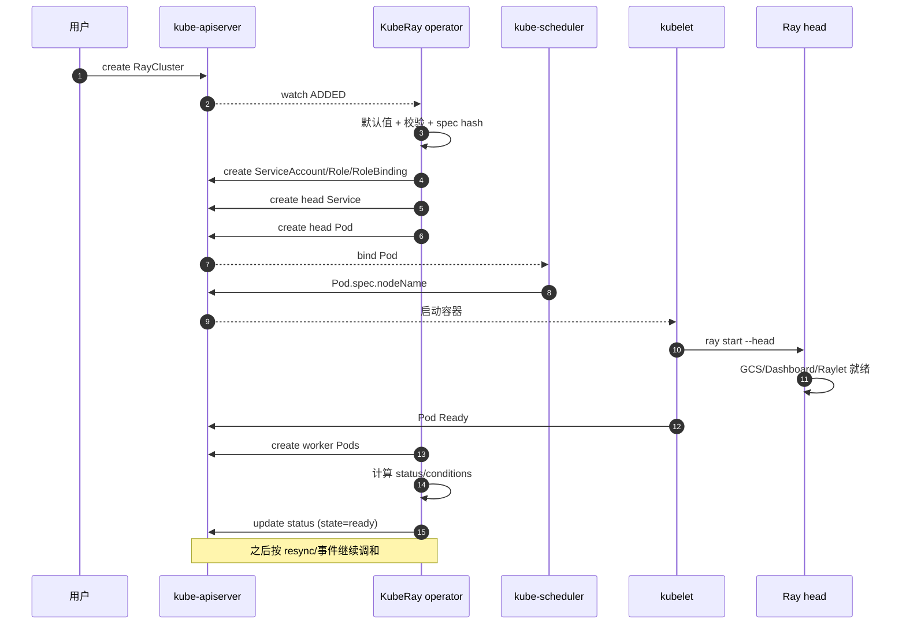

排查锚点：

| 停在哪 | 先看 |
|---|---|
| CR 没有默认值/条件 | operator 日志、CRD 是否升级 |
| 没有 Service/Pod | RBAC、operator 错误事件 |
| Pod Pending | 资源/配额/污点/亲和性（附录 C） |
| Pod Running 但不 Ready | head 日志、端口、`ray start` 参数 |
| status 不更新 | status 子资源权限、冲突重试 |

## J.2 RayJob：K8sJobMode

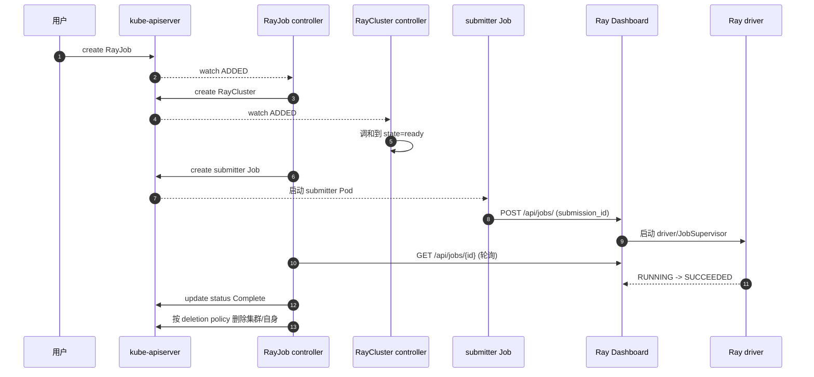

关键点：

- submitter 只负责“提交”，不负责“执行”；
- `submission_id` 是幂等键，submitter 重试不会创建第二个作业；
- operator 轮询 Dashboard，不直接读 driver 状态。

## J.3 RayJob：HTTPMode

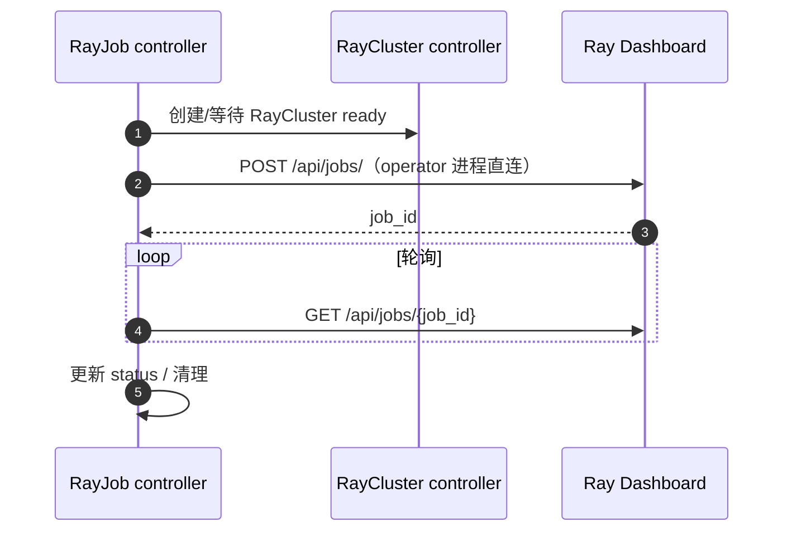

与 K8sJobMode 的差别只有“谁发 HTTP 请求”。因此 operator 必须能解析 head Service；NetworkPolicy 忘记放行 operator 时，会卡在 Initializing/Running 而没有 submitter 日志。

## J.4 RayJob：SidecarMode

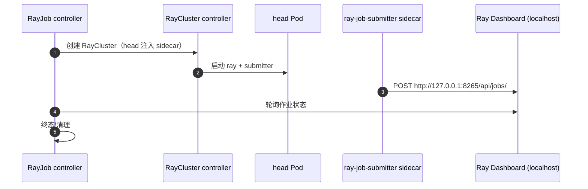

关键点：

- sidecar 与 head 共享网络命名空间，不需要 operator→head 连通；
- 不支持 `clusterSelector`、`submitterPodTemplate`、`submitterConfig`；
- head 的 `restartPolicy` 必须是 `Never`；
- head 重启会丢提交上下文，所以 SidecarMode 集群禁止自动重建 head。

## J.5 RayJob：InteractiveMode

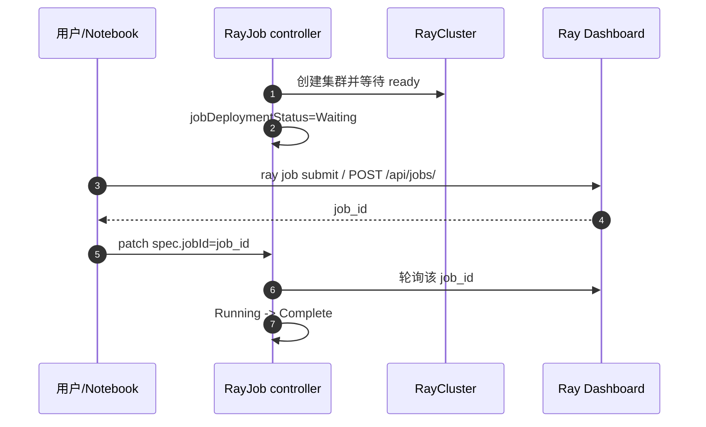

关键点：

- operator 不生成 job ID，也不会替你提交；
- 忘记写 `spec.jobId` 会永远停在 Waiting；
- `backoffLimit` 必须为 0（重试语义由用户负责）。

## J.6 RayService：NewCluster 升级

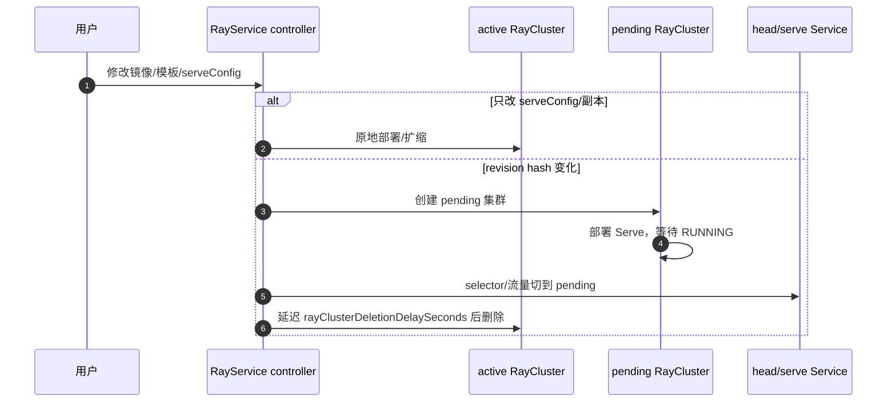

关键点：

- NewCluster 需要 2 倍资源；
- 切换是 Service selector 的改变，长连接可能断开；
- `rayClusterDeletionDelaySeconds` 给 in-flight 请求留时间。

## J.7 RayService：增量升级

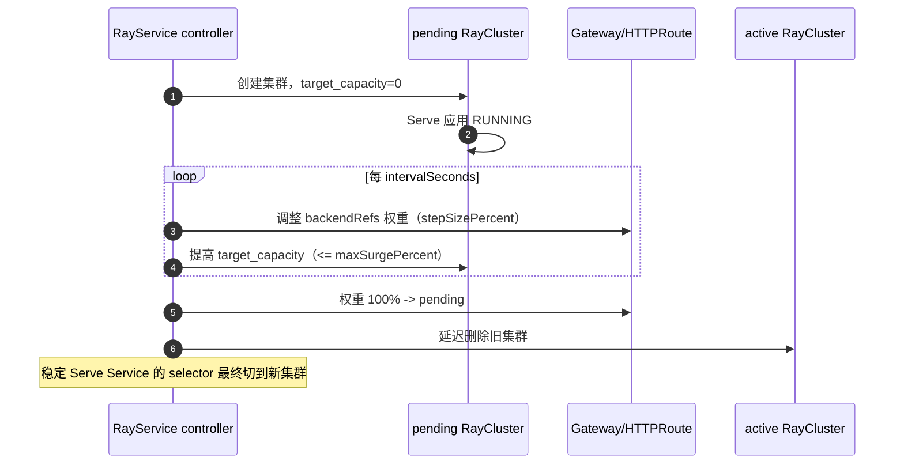

关键点：

- 权重控制“多少流量”，`target_capacity` 控制“副本准备好多少”；
- Gateway 的 idle timeout 要覆盖流式响应；
- 接管已有 HTTPRoute 时只需要 patch `backendRefs`，但 RBAC 必须允许。

## J.8 Autoscaler v2 扩容/缩容

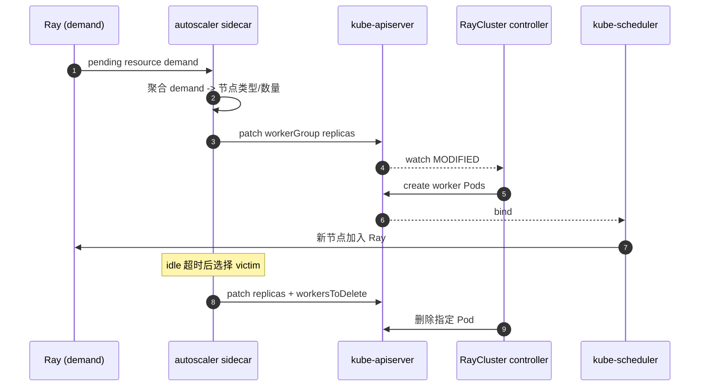

关键点：

- autoscaler 只改 `replicas`/`workersToDelete`，不直接删 Pod；
- 单一写入者：不要同时手工改 replicas；
- 扩容看起来“没生效”时，依次看 demand、replicas、Pod Pending、节点池上限。

### J.8.1 IPPR：原地扩容与回滚

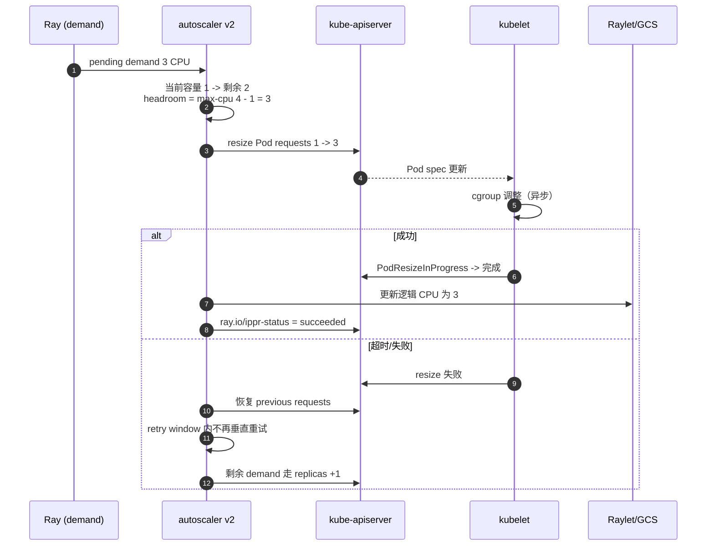

关键点：

- resize 只改 Pod spec，不重建 Pod；UID 不变；
- kubelet 完成 cgroup 后，autoscaler 还要更新 Raylet 的逻辑资源；
- 失败时先回滚，再把 demand 交给水平路径；`ray.io/ippr-status` 与事件是主要证据。

## J.9 GCS FT：head 故障恢复

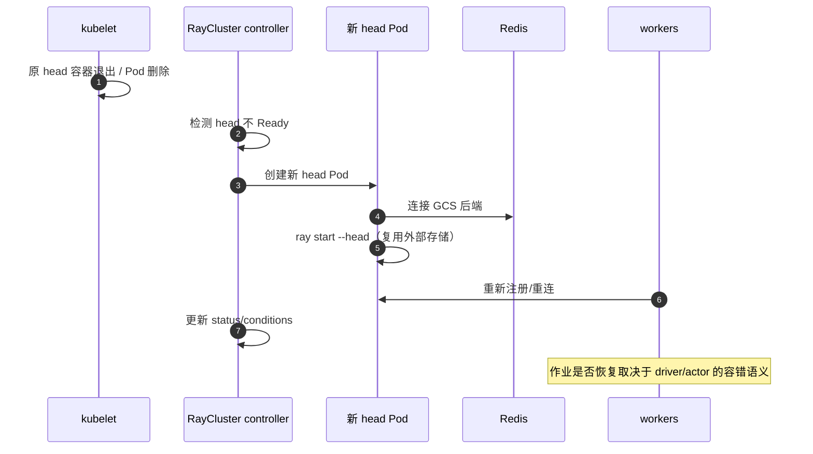

关键点：

- GCS FT 恢复的是**集群元数据**，不保证正在运行的 driver 自动恢复；
- Redis 地址/密码/namespace 必须稳定；
- RocksDB 后端是单写者，不能同时挂两个 head。

## J.10 Operator 启动与缓存同步

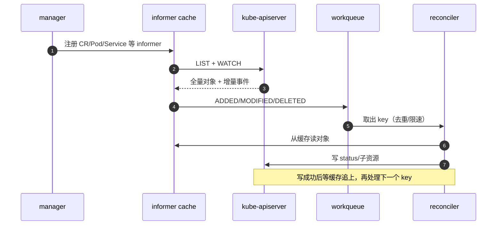

排查锚点：

| 现象 | 可能原因 |
|---|---|
| 启动后长时间不调和 | 缓存未同步、RBAC 无 list/watch 权限 |
| 反复处理同一个 key | 写入了不稳定字段（时间戳/随机数） |
| 删除后还在创建 | 没有先处理 deletionTimestamp |
| 多副本同时写 | leader election 未生效 |

## J.11 Ray 作业内部路径（补充）

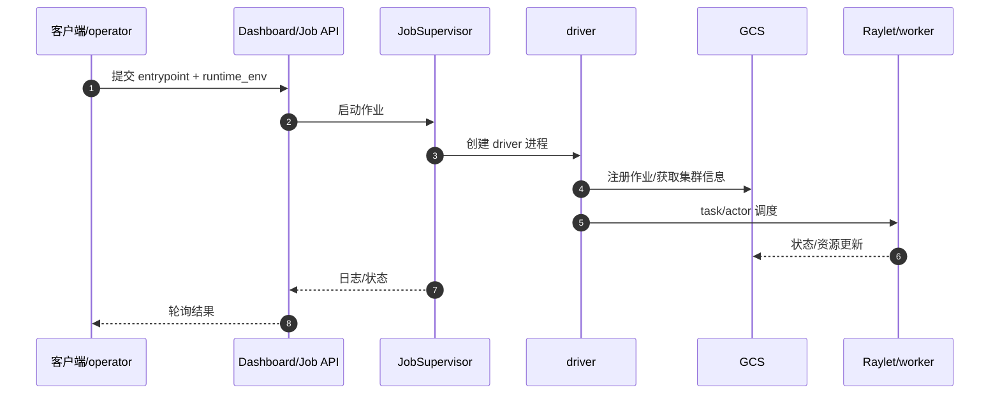

这张图解释了为什么“Pod Ready”不等于“作业能跑”：runtime_env 准备、driver 启动、GCS 注册、worker 资源都可能失败。

## J.12 RayCronJob 调度

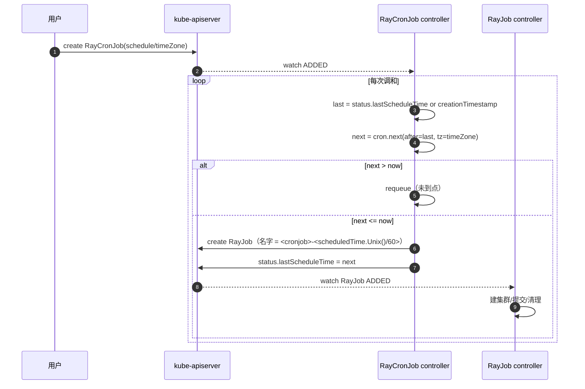

关键点：create 与 status 写回不是原子的；名字由计划时刻决定（上游和 MiniKubeRay 都使用 unix 分钟），重复 create 依赖 AlreadyExists 去重，不能假设“绝不会重复创建”。

## J.13 suspend / resume

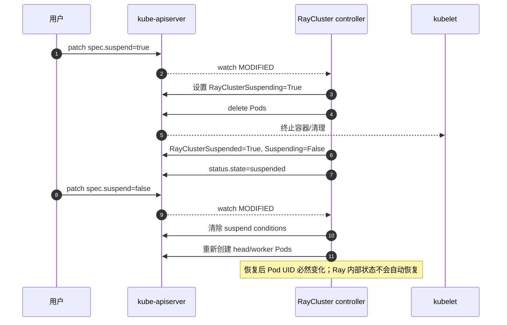

## J.14 删除与 finalizer

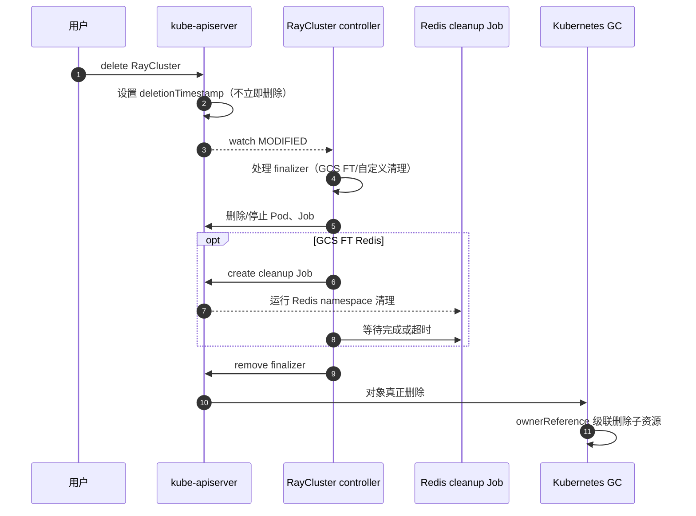

关键点：finalizer 清理必须幂等且有超时；超时放行可能留下外部垃圾（Redis namespace、PVC、对象存储）。

## J.15 一次 reconcile 的 trace 树

时序图回答“谁调用了谁”；trace 树回答“这一轮实际花了多久、在哪一层出错”。MiniKubeRay 的 `Operator.run_once()` 自动产生：

```text
operator.round (root)
├── reconcile (raycluster, result=success)
├── reconcile (raycluster, result=success)
├── reconcile (rayjob, result=success)
└── reconcile (batchjob, result=success)
```

生产接入 OpenTelemetry 后，子 span 可以继续展开：

```text
rayjob.reconcile
├── ensure_raycluster
├── submit_job
│   ├── http.request (8265)
│   └── retry (backoff=2s)
└── update_status
```

查看方式：

```bash
python -m minikuberay traces --tree --limit 5
curl -s http://127.0.0.1:8080/api/traces/<trace_id>
```

诊断顺序：先找 `status=ERROR` 的 span，再沿 `parent_span_id` 向上找调用者；如果错误 span 的父节点是 `submit_job`，问题在 Ray Dashboard/网络；如果是 `ensure_pod`，问题在调度/镜像/RBAC。

## J.16 用图定位问题

| 症状 | 先看哪张图 | 关键证据 |
|---|---|---|
| RayCluster 一直不 Ready | J.1 | Pod 状态、head 日志、conditions |
| RayJob 卡 Initializing | J.2/J.3 | 集群是否 Ready、submitter 是否存在 |
| RayJob 卡 Waiting | J.5 | `spec.jobId` 是否写回 |
| RayService 升级不切流 | J.6/J.7 | active/pending、Service selector、HTTPRoute 权重 |
| 扩容不生效 | J.8 | demand、replicas、Pending Pod、节点池 |
| 扩容后 Pod 一直 Pending | J.17 | Pending reason、配额、NodePool maxSize、云容量 |
| Pod 卡 Terminating / drain 卡住 | J.18 | finalizer、preStop、PDB、grace |
| head 挂了没恢复 | J.9 | GCS FT 配置、Redis 连通性、新 head 日志 |
| operator 重启后风暴 | J.10 | 缓存同步、status 抖动、事件去重 |
| operator 多副本不切换/脑裂 | J.19 | Lease 续约、租约到期、leader 切换 |
| 定时任务没触发/重复触发 | J.12 | `lastScheduleTime`、子 RayJob 名/标签 |
| suspend 卡住/恢复后不 Ready | J.13 | conditions、Pod UID、最终状态 |
| 删除卡在 Terminating | J.14 | finalizers、cleanup Job、超时事件 |

## J.17 节点供给：从 Pending Pod 到 Raylet 注册

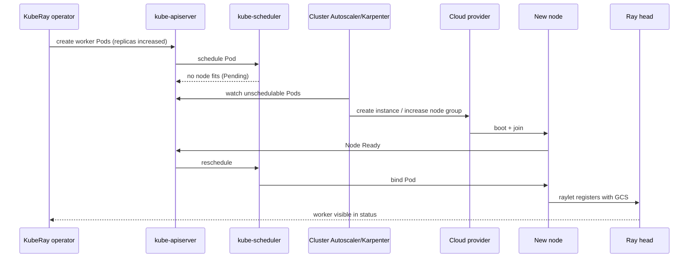

关键证据链：`Pod.status.conditions[PodScheduled]=False` → `cluster-autoscaler`/`karpenter` 日志 → Node Ready → Pod Bound → `ray status` 里出现节点。任何一步缺失，都不要再等“Ray autoscaler 再扩一次”。

## J.18 Pod 终止与 drain

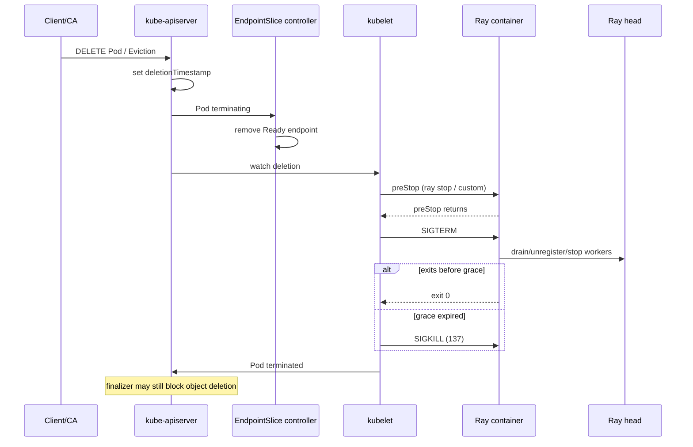

关键证据链：`deletionTimestamp` → EndpointSlice 移除 → preStop 事件 → SIGTERM/exit code → finalizer。`kubectl drain` 被 429 拒绝时，先看 PDB 的 `ALLOWED DISRUPTIONS`，不要反复重试。

## J.19 Operator leader election

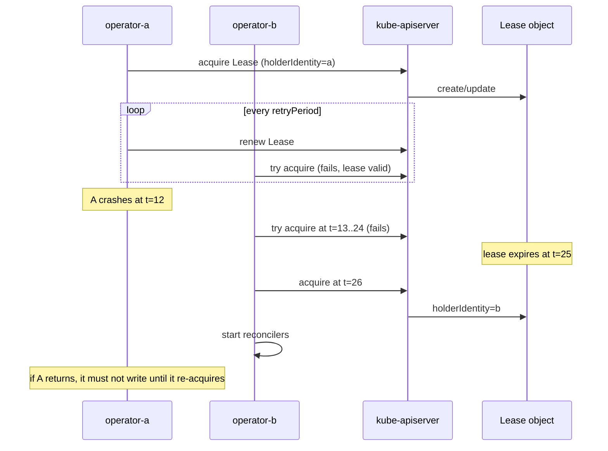

关键证据：Lease 的 `holderIdentity`/`renewTime`/`leaseDurationSeconds`、operator 日志中的 “became leader/lost leader”、副本重启次数。`leaseDuration > renewDeadline > retryPeriod` 不满足时，先修参数，不要先怀疑控制器逻辑。

## J.20 变更：Recreate 与 head 维护

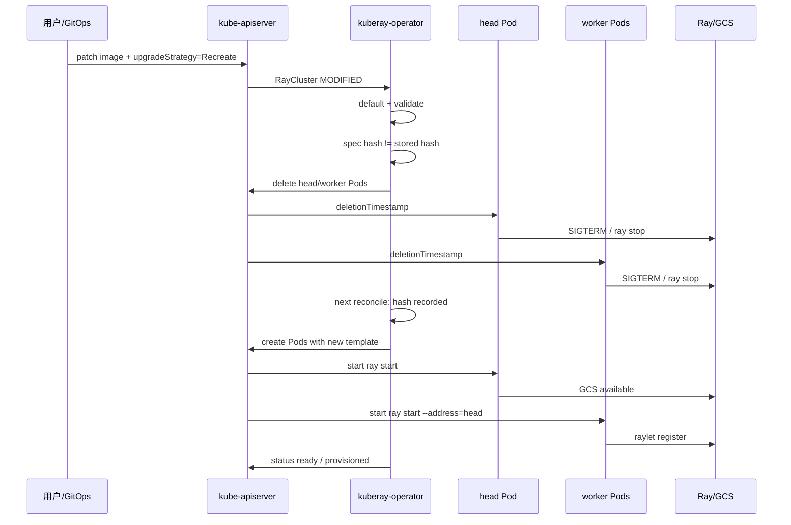

head 维护则是另一条路径：先给 CR 加 `ray.io/disable-provisioned-head-restart: "true"`，删除 head Pod 后控制器**不会**创建替代者；维护完成移除注解，下一轮调和才补回 head。证据链：CR 注解 → head Pod 不存在 → 事件/status → 移除注解后新 head UID。

变更后的完整检查表见[第 55 章](55-change-management-upgrades.md)，现场取证见[第 56 章](56-live-diagnostics-state-api.md)。

更细的排查命令见[附录 C](appendix-c-troubleshooting.md)与[附录 F](appendix-f-lab-cheatsheet.md)。

← [附录 I. 自测题与答案](appendix-i-self-assessment.md) ｜ [返回目录](README.md) ｜ [附录 K. 可运行实验索引](appendix-k-lab-index.md)
