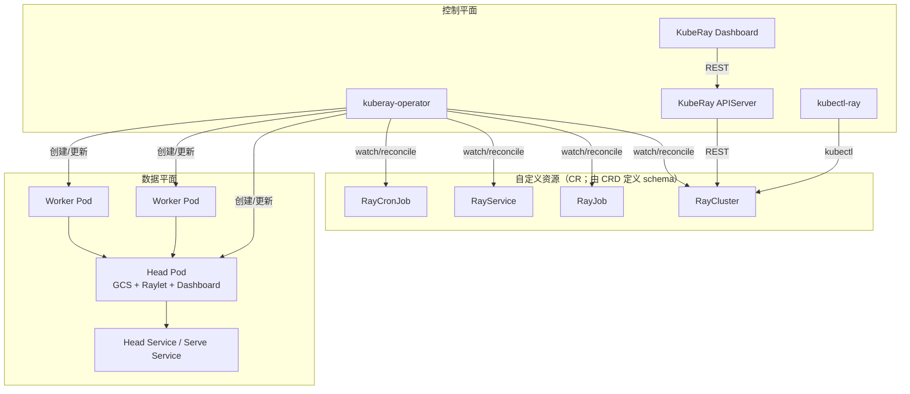

# 第 1 章 为什么需要 KubeRay

## 1.1 一个常见的起点

你已经有一个 Kubernetes 集群。数据团队想跑 Ray：

```bash
ray start --head
ray start --address=<head>:6379
ray job submit --address http://<head>:8265 -- python train.py
```

在单机上这很简单。到了生产环境，问题会依次出现：

- head 挂了，谁负责重启？重启后 GCS 里的元数据还在吗？
- 任务结束后，worker Pod 谁来回收？忘记回收的 GPU 一个月要多少钱？
- 训练任务需要 8 张 A100，集群里只有 3 张空闲，任务应该排队还是失败？
- 推理服务要升级模型，如何做到不丢请求？
- 两个团队共用集群，如何隔离命名空间、网络、配额和镜像？
- 如何用 GitOps 管理“一个 Ray 集群 + 一个作业 + 一个服务”的全部生命周期？

KubeRay 的答案是：**把 Ray 集群也变成 Kubernetes 的一等公民**。用 CRD 描述期望状态，用 Operator 持续调和实际状态。

## 1.2 Ray Cluster Launcher 与 KubeRay 的分工

Ray 自带 `ray up`/`ray down`（Cluster Launcher），它面向云虚拟机或静态节点，核心是“启动一组机器，在上面跑 Ray”。KubeRay 不替代 Ray 的运行时，而是把 Kubernetes 作为弹性资源池：

| 维度 | Ray Cluster Launcher | KubeRay |
|---|---|---|
| 资源抽象 | 云主机 / 静态节点 | Pod、Service、PVC、GPU 资源 |
| 扩缩容 | 调用云 API | 修改 worker group 副本数，Kubernetes 调度 |
| 生命周期 | `ray up/down` 命令 | CR + 控制器持续调和 |
| 与 K8s 生态 | 弱 | RBAC、NetworkPolicy、Helm、GitOps、批调度器 |
| 适用场景 | 研究、临时集群 | 平台化、多租户、生产 |

两者不是互斥的：KubeRay 生成的 head/worker Pod 里仍然运行 `ray start`，只是“谁来决定启动多少 Pod、何时删除、失败怎么办”交给了 Kubernetes。

## 1.3 KubeRay 解决的问题

### 1.3.1 声明式生命周期

一个 `RayCluster` 对象描述了 head、worker group、镜像、资源、自动扩缩容策略。控制器负责：

- 创建 head Service，让 worker 通过稳定的 DNS 名字加入集群；
- 创建 head Pod 与 worker Pod；
- 在副本数变化时增删 Pod；
- 在 head 失败时重建；
- 在删除 CR 时清理子资源。

这使“Ray 集群”可以像 Deployment 一样被 Git 管理、被 CI 校验、被 Argo CD 同步。

### 1.3.2 弹性与成本

Ray 的 autoscaler 关心的是“还有多少 task/actor 在等资源”。KubeRay 把这个信号接到 Kubernetes 的副本数上：

- 有排队任务时扩容 worker group；
- worker 空闲超过 `idleTimeoutSeconds` 时缩容；
- 任务结束后由 RayJob 删除整个集群；
- 用 `ttlSecondsAfterFinished` 和 deletion rules 精细控制保留时间。

对 GPU 集群，这意味着不再需要长期保留一批空闲卡。

### 1.3.3 多种工作负载形态

KubeRay 提供四个 CRD：

| CRD | 解决的问题 | 典型场景 |
|---|---|---|
| `RayCluster` | 长期存在的 Ray 集群 | 交互式开发、Notebook、共享计算池 |
| `RayJob` | 一次性作业 + 自动建/删集群 | 训练、批推理、数据预处理 |
| `RayService` | Ray Serve 服务 + 零停机升级 | 在线推理、API 服务 |
| `RayCronJob` | 周期性 RayJob（alpha，`RayCronJob` gate 默认关闭） | 每日特征计算、定时训练 |

它们共享同一套 RayCluster 模板和控制器基础设施，但生命周期语义不同。第 10–12 章会逐一拆解。

### 1.3.4 与 Kubernetes 原语对齐

KubeRay 不发明新的资源模型，而是复用：

- **Pod**：一个 Ray 节点就是一个 Pod；
- **Service**：head 的 GCS、Dashboard、Client、Serve 端口通过 Service 暴露；
- **PVC**：GCS RocksDB、用户数据、模型缓存；
- **RBAC**：operator 与 autoscaler 的权限边界；
- **NetworkPolicy**：Ray 集群内外流量隔离；
- **Job**：RayJob 在 `K8sJobMode` 下用 Kubernetes Job 运行 submitter；
- **Gateway API / Ingress**：RayService 增量升级与外部访问。

这让 Ray 平台工程师可以继续使用已有的可观测性、策略和审计体系。

## 1.4 KubeRay 的整体架构



关键点：

- **operator 是唯一写数据面的控制器**。用户只改 CR，不直接改 Pod。
- **head 是单点**。GCS 在 head 上，worker 通过 head Service 加入；GCS 容错是可选项（[第 13 章](kuberay教程-13-高可用、容错与GCS-FT.md)）。
- **autoscaler 运行在 head Pod 的 sidecar 里**，通过 Kubernetes API 修改 RayCluster 的 `replicas`（[第 9 章](kuberay教程-09-自动扩缩容-Ray-Autoscaler与KubeRay.md)）。
- **APIServer/Dashboard 是可选组件**，不参与核心调和。

## 1.5 什么时候不该用 KubeRay

KubeRay 不是万能解：

- **单机 Ray**：`ray.init()` 足够，operator 只会增加复杂度。
- **极短、极轻的任务**：每个任务都建集群，Pod 启动和镜像拉取的成本可能高于计算本身；可考虑共享 RayCluster + RayJob `clusterSelector`。
- **强依赖 VM 特性的负载**：需要特殊内核、RDMA 直通、非容器化设备时，先确认 Kubernetes 节点能力。
- **无法接受 head 单点**：需要 GCS FT、RayService 双集群或业务层重试；KubeRay 不会把 Ray 变成无状态系统。
- **团队没有 K8s 运维能力**：CRD 升级、RBAC、网络策略、GPU 设备插件都需要平台能力。

理解这些边界，比记住 YAML 字段更重要。

### 1.5.1 KubeRay 与 Ray 自带 Kubernetes 支持的关系

Ray 本身也能在 Kubernetes 上运行：`ray start`、Ray Cluster Launcher 的 Kubernetes 模式、以及 Ray 的 autoscaler 都能创建/管理 Pod。KubeRay 的区别是**把生命周期交给 Kubernetes 控制器**：

| 维度 | Ray 自带/脚本 | KubeRay |
|---|---|---|
| 谁创建 Pod | 脚本/autoscaler 直接调 K8s API | operator 根据 CR 调和 |
| 谁负责重启 | 脚本/外部系统 | 控制器 + kubelet |
| 谁负责清理 | 脚本/手动 | finalizer + ownerReference |
| 声明式 | 弱 | CR + status/conditions |
| 与 GitOps/RBAC/策略 | 需要自己接 | 原生 CR |

KubeRay 仍然复用 Ray 的 autoscaler/Serve/Job API，不是另一套运行时。

### 1.5.2 平台团队视角

平台团队关心的不是“能不能跑 Ray”，而是：

- **隔离**：租户 A 的 Ray 集群不能吃光租户 B 的 GPU；
- **配额**：谁能用多少卡、排队多久；
- **可观测**：失败时能定位到 CR/Pod/Ray 进程；
- **升级**：operator/CRD/Ray/镜像的版本矩阵；
- **成本**：闲置 GPU、TTL、缩容；
- **审计**：谁创建/删除了什么。

这些问题大多不是 KubeRay 一个组件能解决的；KubeRay 提供“控制点”，平台要把 RBAC、Kueue、NetworkPolicy、镜像策略、监控组合起来（第 32 章）。

## 1.6 本教程的简版实现如何对应

`minikuberay/` 把上面每个概念映射成可运行代码：

| 真实组件 | 简版实现 | 说明 |
|---|---|---|
| kube-apiserver | `minikuberay/store/store.py` | 对象存储、resourceVersion、watch |
| controller-runtime | `minikuberay/controllers/base.py` | 工作队列、限速、调和循环 |
| RayCluster controller | `minikuberay/controllers/raycluster.py` | head/worker/service/status |
| kube-scheduler + kubelet | `minikuberay/controllers/batch.py` | 资源拟合、Pod 状态机 |
| Ray autoscaler | `minikuberay/autoscaler/policy.py` | 需求驱动扩缩容 |
| Ray dashboard/GCS | `minikuberay/runtime/cluster_runtime.py` | 节点、作业、Serve 状态 |
| KubeRay APIServer | `minikuberay/apiserver/server.py` | REST + Dashboard |
| kubectl-ray | `minikuberay/cli/main.py` | apply/get/describe/logs/scale |

[第 19 章](kuberay教程-19-MiniKubeRay架构与设计取舍.md)会给出完整架构图和“保真度矩阵”，明确哪些行为是真实语义、哪些是模拟。

## 1.7 引入 KubeRay 的决策清单

“能不能用”不是选型问题，“值不值得引入”才是。下面是一张可打分的清单（1–5 分，5 分最有利）：

| 维度 | 问题 | 1 分 | 5 分 | 权重 |
|---|---|---|---|---|
| 工作负载 | 是否有会结束的批作业、在线 Serve、定时任务？ | 只有单机脚本 | 三类以上 | ×2 |
| Kubernetes 成熟度 | 是否已有 RBAC/网络/存储/监控/GPU 运维能力？ | 刚建集群 | 多租户平台 | ×2 |
| 弹性需求 | 是否需要按需扩缩、缩容到零、Spot？ | 固定长期集群 | 强弹性 | ×2 |
| 隔离 | 是否需要 namespace/网络/配额/节点隔离？ | 单团队 | 多租户/合规 | ×2 |
| 规模 | 集群/GPU/作业数量是否超过手工管理边界？ | < 5 个集群 | > 50 个 | ×1 |
| 成本 | 闲置 GPU 是否显著？ | 无 | 大量闲置 | ×1 |
| 团队 | 是否有 2 人以上平台/on-call？ | 无 | 专职平台 | ×2 |
| 生态 | 是否已有 GitOps/Kueue/Volcano/Argo？ | 无 | 成熟 | ×1 |

加权满分 = 5 × (2+2+2+2+1+1+2+1) = **65**。把每项打分乘以权重后求和：

- **≥ 52（80%）**：KubeRay 很可能值得；
- **39–51（60%–80%）**：先做 PoC，重点验证网络/GPU/升级；
- **< 39（60%）**：先不要引入 operator，考虑托管 Ray、单机 Ray 或 Kubernetes Job。

例：工作负载 4、K8s 成熟度 3、弹性 5、隔离 4、规模 2、成本 3、团队 3、生态 2
= 4×2 + 3×2 + 5×2 + 4×2 + 2×1 + 3×1 + 3×2 + 2×1 = **45**，落在 PoC 区间。

不要用“别人都在用”做理由。KubeRay 引入的是**一套控制平面**，不是一次安装；它需要持续升级、监控、配额和 on-call。

### 1.7.1 迁移成本清单

除了软件本身，还要算：

- CRD/operator 的升级流程；
- 镜像/依赖/GPU 驱动的版本矩阵；
- 现有 `ray up` 脚本/VM 自定义项的容器化；
- 现有调度器（Slurm/YARN）的队列/配额映射；
- 监控/日志/追踪的重新接入；
- 团队培训与 runbook；
- 回滚方案与双跑期。

### 1.7.2 不引入 KubeRay 的替代路径

| 场景 | 更简单的选择 |
|---|---|
| 单机/单节点实验 | `ray.init()` |
| 固定几台 VM、长期运行 | Ray Cluster Launcher |
| 只需要批处理、无 Ray 生态 | Kubernetes Job/JobSet |
| 小团队、想省运维 | 托管 Ray/Serverless GPU |
| 已有 Slurm/HPC | Slurm + Ray（按需） |

这些路径的共同点是：**先解决当前问题，再为下一阶段留接口**。第 39 章会给出完整选型矩阵。

## 1.8 小结

- KubeRay 是 Kubernetes Operator，把 Ray 集群、作业、服务、定时任务建模为 CRD。
- 它复用 Kubernetes 的调度、网络、存储、RBAC 和 GitOps，而不是重新发明一套。
- 四个 CRD 覆盖长期集群、一次性作业、在线服务和周期任务。
- head 仍是 Ray 的单点；高可用需要 GCS FT、RayService 或业务层设计。
- 简版实现的目标是让控制平面的状态机可读、可测、可改，而不是替代生产 operator。

下一章先回到 Ray 本身：GCS、Raylet、object store、调度器和 Serve 到底如何工作。理解这些，才能理解 KubeRay 为什么这样建 Pod、这样暴露端口、这样处理故障。

→ [第 2 章 Ray 运行时架构回顾](kuberay教程-02-Ray运行时架构回顾.md)
