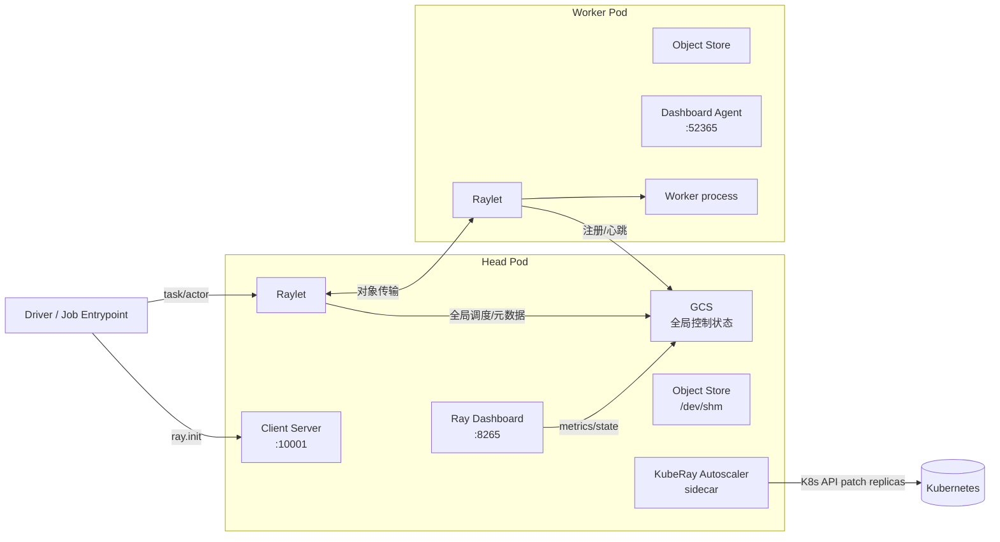

# 第 2 章 Ray 运行时架构回顾

KubeRay 只负责“把 Pod 摆好”，真正执行计算的是 Ray。要读懂 KubeRay 生成的命令、探针和端口，必须先知道一个 Ray 集群里有哪些进程、它们如何通信、失败时会发生什么。

本章以 Ray 2.59 的行为为基准。不同小版本的细节会变，但进程边界和端口基本稳定。

## 2.1 一个 Ray 集群由什么组成



### 2.1.1 Driver

Driver 是执行用户入口的进程。它可以是：

- `python train.py` 这样直接运行的程序；
- `ray job submit` 提交到集群的 entrypoint；
- Ray Serve 的 controller（在 head 上）；
- 一个长期运行的交互式客户端。

连接方式有两类，容易混淆：

- **集群内**：`ray.init(address="auto")` 或 `RAY_ADDRESS=<head-svc>:6379` 直接连 **GCS（6379）**；
- **集群外/客户端模式**：`ray.init(address="ray://<host>:10001")` 使用 **Ray Client（10001）**。Ray Client 已废弃（deprecated），且要求客户端与集群的 Ray/Python 次版本精确匹配；新项目应使用 **Ray Jobs API**（8265）或 Dashboard；
- **作业提交**：`ray job submit --address http://<host>:8265` / Dashboard 的 Jobs API 把 entrypoint 交给 head 的 JobSupervisor。Jobs API 的客户端不需要与集群 Ray 版本一致。

> 版本提示：Ray Client 在 Ray 2.x 后期不再积极维护，官方 issue #47700 已把迁移建议指向 Jobs API。第 53 章会比较四种交互式开发回路。

### 2.1.2 Worker

Worker 是执行 task/actor 的进程。一个 Pod 可以有多个 worker 进程，数量由 CPU/GPU 资源和 `--num-cpus` 等参数决定。KubeRay 的资源请求决定 Pod 的调度，Ray 的资源参数决定 Ray 内部调度；两者需要一致，否则会出现“K8s 认为有 4 核，Ray 只看到 2 核”的错配。

### 2.1.3 Raylet

每个节点（每个 Ray Pod）都有一个 Raylet：

- 管理本节点的 worker 进程池；
- 执行本地调度；
- 与 GCS 保持心跳；
- 参与对象传输；
- 提供 `raylet` 的本地 API。

Head Pod 和 Worker Pod 都运行 Raylet。KubeRay 生成 worker 的 `ray start --address=<head-svc>:6379`，就是让 worker 的 Raylet 注册到 head 的 GCS。

### 2.1.4 GCS（Global Control Store）

GCS 保存集群级元数据：

- 节点注册信息；
- actor 的位置和生命周期；
- placement group；
- 作业和运行时环境；
- 部分调度状态。

GCS 运行在 head 上，默认端口 **6379**（与 Redis 端口相同，但新版本的 GCS 不是简单 Redis）。这也是为什么：

- head 是单点；
- worker 必须能访问 head Service 的 6379；
- GCS 容错需要外部 Redis 或嵌入式 RocksDB（第 13 章）。

### 2.1.5 Object Store

Ray 的对象存储（Plasma）把不可变对象放在共享内存中，避免 Python 序列化/反序列化的重复成本。容器默认的 `/dev/shm` 往往只有 64MB，远小于对象存储需求，因此 KubeRay 会给 Ray 容器挂载一个 `emptyDir`（`medium: Memory`，卷名 `shared-mem`）到 `/dev/shm`，其 `sizeLimit` 按 Ray 容器的 memory request/limit 推导（通常 1:1）；自定义模板时不要无意中覆盖或移除它。

这也是第 6 章要强调的：**没有正确配置 `/dev/shm` 的 Ray 集群会出现难以解释的 OOM 或性能下降**。

### 2.1.6 Dashboard 与 Dashboard Agent

- Head 上的 Ray Dashboard 默认监听 **8265**，提供 Job、Serve、节点、日志、指标等 API/UI。
- 每个节点上的 dashboard agent 默认监听 **52365**，负责本地指标、日志和健康检查。
- KubeRay 的 RayJob `HTTPMode`、RayService 健康检查、`ray job submit` 都依赖 Dashboard API。

### 2.1.7 Autoscaler

Ray autoscaler 读取“待调度资源需求”和“节点利用率”，决定增加/删除节点。在 KubeRay 中，它通常作为 head Pod 的 sidecar 运行（`ray kuberay-autoscaler`），通过 Kubernetes API 修改 RayCluster 的 `workerGroupSpecs[].replicas`。

Ray 2.48+ 默认 autoscaler v2；KubeRay 1.4+ 用 `spec.autoscalerOptions.version` 显式选择 v1/v2。[第 9 章](kuberay教程-09-自动扩缩容-Ray-Autoscaler与KubeRay.md)详细展开。

### 2.1.8 进程与线程模型

一个 Ray Pod 里通常有：

```text
ray container
├── raylet (C++)
│   ├── 本地调度器
│   ├── object manager
│   └── worker pool
├── gcs_server (head only, C++)
├── dashboard (head, Python)
├── dashboard agent (每个节点, Python)
├── worker processes (Python, 按 task/actor 动态创建)
└── Serve controller/proxies (head/worker, Python)
```

要点：

- **一个 Pod 一个 Raylet**；worker 进程数量由资源和任务决定，不是固定进程；
- Raylet 是 C++ 进程，worker 是 Python 进程；`kubectl exec ... ps` 能看到多个进程；
- head 上的 GCS 是 C++ 服务，Dashboard/Client 是 Python/HTTP 入口；
- 容器 OOM 可能杀的是 worker 而不是 Raylet；看 `dmesg`/`kubectl describe` 的 last state；
- `/dev/shm` 是对象存储的共享内存，不是普通缓存。

这解释了为什么：

- 不能只监控容器 CPU，要看 Ray 的 task/actor 指标；
- 资源请求要覆盖 Raylet + worker 的总开销；
- `ulimit -n` 对 worker 数量很关键。

### 2.1.9 版本兼容

KubeRay/Ray/Kubernetes 是三个独立版本轴：

- KubeRay CRD 的 `rayVersion` 是**建议值**，operator 用它做默认/命令生成；
- Ray 镜像 tag 决定实际运行时；
- KubeRay 的某些功能要求最低 Ray 版本（如 autoscaler v2 从 2.47+ 可用、2.48+ 成为默认，Sidecar submitter restart 要求 2.54+/K8s 1.35+）；
- 客户端 `ray` 版本应与集群一致；
- Python 依赖/ABI/CUDA 驱动要与镜像匹配；
- **token auth 默认值在变化**：Ray 2.59 起本地 `ray start --head`/`ray.init()` 默认生成/要求 token，远程多节点在后续版本（2.61）默认开启；KubeRay 多节点集群在未设置 `authOptions` 时仍保持关闭（第 5.6 节）。升级前确认客户端/提交器是否带 token。

升级时先查 KubeRay release notes 的兼容矩阵，不要只看“最新版本”。

## 2.2 端口与协议

| 端口 | 名称 | 所在位置 | 用途 |
|---|---|---|---|
| 6379 | `gcs-server` | head | GCS/Raylet 注册、worker 加入 |
| 8265 | `dashboard` | head | Dashboard UI/API、Job 提交、Serve 状态 |
| 10001 | `client` | head | Ray Client（已废弃；优先用 8265 Jobs API） |
| 8080 | `metrics` | head/worker | Prometheus 指标导出 |
| 8000 | `serve` | head/worker | Ray Serve HTTP 代理 |
| 52365 | dashboard agent | 每个节点 | 本地指标/日志/健康 |

KubeRay 的 head Service 会暴露这些端口。默认 head Service 是 **headless**（`clusterIP: None`），因为一个 RayCluster 只有一个 head；`publishNotReadyAddresses: true` 让 worker 在 head 尚未 Ready 时也能解析地址。

> 注意：`metrics` 端口在 Ray 容器里由 `--metrics-export-port=8080` 指定；KubeRay 会自动补上这个参数和容器端口。Ray Serve 的 8000 端口也由 KubeRay 加入 Service。

## 2.3 调度模型

Ray 的调度分两层：

1. **本地调度**：Raylet 在自己的节点上找可用的 worker/资源。
2. **全局调度**：当本地资源不足时，请求转发到 GCS/全局调度器，寻找其他节点。

调度单位是 **task** 和 **actor**。资源包括：

- CPU、GPU；
- memory；
- 自定义资源（`--resources '{"Custom1": 1}'`）；
- 节点标签（Ray 2.49 引入 label selector，KubeRay 1.5 增加顶层 `labels`/`resources` 字段）。

Placement group 用于 gang scheduling：一组 actor 要么全部放下，要么全部不放。批调度器（Volcano、YuniKorn、Kueue）与 KubeRay 的集成就是为了在 Pod 层面实现 gang scheduling（第 12 章）。

### 2.3.1 资源声明要对齐

一个常见错误：

```yaml
# Pod 请求 4 核
resources:
  requests:
    cpu: "4"
# 但 rayStartParams 又写 num-cpus: "2"
```

Kubernetes 调度器按 4 核分配 Pod，Ray 只看到 2 核，导致节点被“浪费”一半。另一个常见错配是 **requests ≠ limits**：KubeRay 在未显式设置 `num-cpus` 时通常从 CPU **limit** 推导（没有 limit 才回退到 request，具体以版本为准），而 kube-scheduler 按 request 分配，结果可能是“K8s 以为只用了 4 核，Ray 却按 8 核调度”。生产上要么让 requests==limits，要么显式对齐 `num-cpus`。

KubeRay 1.5+ 推荐用顶层 `resources` 字段，而不是在 `rayStartParams` 里写 `num-cpus`/`num-gpus`；控制器会把顶层字段转换到 `ray start` 参数，并镜像到 Pod 标签。

## 2.4 Ray Serve 的运行时

Ray Serve 不是单独的进程模型，而是构建在 Ray actor 之上的服务框架：

- **Serve Controller**：运行在 head 上，管理 deployment 状态、滚动更新、目标容量。
- **Proxy**：每个节点一个 HTTP 代理，默认监听 8000，负责路由请求。
- **Deployment Replicas**：每个副本是一个 Ray actor，执行用户定义的 `__call__` 或 FastAPI/Starlette 应用。
- **Handle**：应用之间通过 handle 调用，不经过 HTTP。

KubeRay 的 RayService 通过 Dashboard API 部署 `serveConfigV2`，并通过 Kubernetes Service 把流量路由到“健康的 proxy”。`ray.io/serve=true` 是**控制器维护的“可接收 Serve 流量”资格标签**，不是逐 Pod 健康探针；实际流量还取决于 Pod readiness/EndpointSlice 和 Serve 应用状态（第 11.5、35.8.5 节）。

## 2.5 故障语义

| 故障 | Ray 的行为 | KubeRay 的应对 |
|---|---|---|
| worker Pod 崩溃 | Raylet 重新拉起 worker 进程；task 重试或失败 | 控制器重建 Pod；autoscaler 补副本 |
| head Pod 崩溃 | GCS 丢失，集群通常不可恢复 | 重建 head；GCS FT 时从 Redis/RocksDB 恢复 |
| GCS 与 worker 断连 | worker 重连，超过阈值后退出 | `RAY_gcs_rpc_server_reconnect_timeout_s` 控制 |
| 节点资源不足 | task 排队 | autoscaler 扩容；批调度器排队 |
| Serve replica 不健康 | Serve controller 重启/替换 | RayService 检查 app 状态与 endpoint 数 |

理解这张表，就能理解 KubeRay 为什么要给 worker 设置 `RAY_gcs_rpc_server_reconnect_timeout_s=600`、为什么 head 重建会导致整个集群重建、为什么 RayService 需要 pending cluster。

## 2.6 与 Kubernetes 的映射

| Ray 概念 | Kubernetes 对象 | 说明 |
|---|---|---|
| 节点 | Pod | 一个 Pod 一个 Raylet |
| head | Pod + headless Service | GCS/Dashboard/Client |
| worker group | 一组同构 Pod | 由 `replicas` 控制 |
| GPU | `nvidia.com/gpu` 资源 | 设备插件分配 |
| 对象存储 | `/dev/shm` emptyDir | 共享内存 |
| Serve 入口 | Service `:8000` | 选择 `ray.io/serve=true` Pod |
| 作业 | RayJob CR + 可选 K8s Job | submitter |
| 服务 | RayService CR + 两个 Service | head + serve |

## 2.7 简版实现如何模拟

`minikuberay/runtime/cluster_runtime.py` 用 `ClusterRuntime` 表达一个 Ray 集群：

- `NodeRecord`：Pod 变成节点时登记 CPU/GPU/内存、组、标签、空闲时间；
- `JobRecord`：作业的 PENDING/RUNNING/SUCCEEDED/FAILED/STOPPED 状态机；
- `ServeState`：Serve 配置、部署时间、目标容量、流量百分比、应用状态；
- `pending_demand`：autoscaler 读取的待调度资源。

它不执行真实 Ray 代码，但保留了对 KubeRay 控制器最重要的接口：节点是否就绪、作业是否终态、Serve 是否健康、还有多少资源需求。第 21 章会逐行讲解。

## 2.8 深入：从进程图到运行时内幕

本章给出的是“进程 + 端口”层的地图。再往下还有：

- GCS 的表结构/pubsub/存储后端；
- Raylet 的本地队列、worker 池和资源形状；
- Plasma 的对象所有权、引用计数、传输和丢失语义；
- task/actor 的失败/重试/lineage；
- Ray Job Submission 的 JobSupervisor 路径；
- Serve controller/proxy/replica 的状态机。

这些决定了为什么 `/dev/shm`、`num-gpus`、`RAY_gcs_rpc_server_reconnect_timeout_s` 会以那种方式影响生产。完整拆解见[第 35 章](kuberay教程-35-Ray运行时深潜-GCS、Raylet、对象存储与调度.md)。

## 2.9 小结

- 一个 Ray 节点 = 一个 Pod = 一个 Raylet；head 额外运行 GCS、Dashboard、Client Server。
- 端口 6379/8265/10001/8080/8000/52365 是 KubeRay 网络设计的骨架。
- GCS 是单点；对象存储依赖 `/dev/shm`；autoscaler 读取待调度需求。
- Kubernetes 资源与 Ray 资源必须对齐，否则调度会错配。
- Ray Serve 的 proxy 健康通过 `ray.io/serve` 标签参与 Service 选择。

下一章进入 Kubernetes 侧：Operator 模式、调和循环、finalizer、ownerReference 和工作队列。

→ [第 3 章 Kubernetes Operator 模式](kuberay教程-03-Kubernetes-Operator模式.md)
