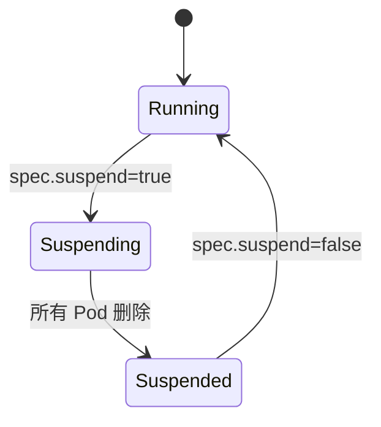

# 第 7 章 控制器调和循环：从 CR 到 Pod

本章沿着一次 `kubectl apply -f ray-cluster.yaml` 的路径，逐步看 KubeRay 如何把 CR 变成 Pod、Service 和 status。理解这条路径后，排查“为什么 Pod 没起来”“为什么 status 不更新”会容易得多。

## 7.1 事件入口

1. 用户提交 RayCluster；
2. API Server 写入 etcd，分配 resourceVersion、UID、generation；
3. operator 的 informer 收到 ADDED 事件；
4. workqueue 放入 key（namespace/name）；
5. 某个 worker goroutine 取出 key，调用 `Reconcile`；
6. Reconcile 成功/失败后 `Done`，失败则限速重入队。

KubeRay 的 controller 注册了：

- `For(&RayCluster{})`：主资源；
- `Owns(&Pod{})`、`Owns(&Service{})` 等：子资源变化也会触发调和；
- `Watches`：部分外部资源（如 Ingress、Gateway）。

这意味着 Pod 状态变化会触发 RayCluster 重新计算 status。

## 7.2 Reconcile 的完整顺序

KubeRay v1.7 的 `rayClusterReconcile` 关键步骤：

```text
1. managedBy 外部控制器？ -> skip
2. setDefaults(instance)
3. ValidateRayClusterMetadata
4. ValidateRayClusterSpec
5. autoscaler v1 restartPolicy 警告
6. mTLS/cert-manager 可用性检查
7. ValidateRayClusterUpgradeOptions
8. ValidateRayClusterStatus
9. 保存 originalRayClusterInstance
10. GCS FT finalizer（添加/清理/Redis cleanup Job）
11. 删除分支：deletionTimestamp -> return
12. 依次执行：
    reconcileAutoscalerServiceAccount
    reconcileAutoscalerRole
    reconcileAutoscalerRoleBinding
    reconcileIngress
    reconcileAuthSecret
    reconcileHeadService
    reconcileHeadlessService
    reconcileServeService
    reconcileGCSStoragePVC
    reconcilePods
13. calculateStatus
14. updateRayClusterStatus
15. 有变化/错误 -> RequeueAfter 2s
16. 否则 RequeueAfter 300s
```

这个顺序有两个重要含义：

- **Service 先于 Pod**：worker 启动时需要 head Service DNS 已经存在。
- **RBAC 先于 autoscaler**：autoscaler sidecar 启动时要能 patch RayCluster。

## 7.3 默认值与校验

### 7.3.1 默认值

KubeRay 的 CRD schema 提供一部分默认值，控制器再补：

- `replicas` 默认 0；
- `minReplicas` 默认 0；
- `maxReplicas` 默认 maxInt32；
- `numOfHosts` 默认 1；
- `suspend` 默认 false；
- `autoscalerOptions.idleTimeoutSeconds` 默认 60；
- `autoscalerOptions.version` 未设置时按 Ray 版本推断；
- head `serviceType` 默认 ClusterIP。

### 7.3.2 校验

校验失败时，KubeRay 不会创建 Pod，而是：

- 发 `Warning InvalidRayClusterSpec` 事件；
- 在日志中记录错误；
- 某些版本会设置 condition。

MiniKubeRay 为了可观察性，会把 `reason/message` 和 `RayClusterProvisioned=False` 写入 status（第 21 章）。

## 7.4 reconcilePods 的细节

### 7.4.1 计算 spec hash

KubeRay 计算一个**排除 replicas 和 workersToDelete** 的 spec hash，用于判断“模板是否变化”：

- 模板变化 + `upgradeStrategy: Recreate` -> 删除所有 Pod；
- 模板变化 + `None`/未设置 -> 不自动删除/重建现有 Pod；
- 只有 `Recreate` 会在 hash 变化时删除所有 Pod 并重建。

hash 存在 head Pod 的注解 `ray.io/upgrade-strategy-recreate-hash` 中（常量 `UpgradeStrategyRecreateHashKey`）；Pod 上的 `ray.io/kuberay-version` 标记用于避免 operator 升级时误重建。

### 7.4.2 head Pod

```text
headPods := list(cluster, node-type=head)
if len == 1:
    if shouldDelete(headPod): delete
elif len == 0:
    createHeadPod
else:
    error("multiple head pods")
```

`shouldDelete` 的条件包括：

- Pod phase Failed/Succeeded；
- 容器 terminated 且 restartPolicy Never；
- 节点不可用；
- 模板不匹配（在升级策略允许时）。

### 7.4.3 worker Pod

对每个 worker group：

1. 列出该 group 的 Pod；
2. 删除 unhealthy 的 Pod；
3. 处理 `scaleStrategy.workersToDelete`（autoscaler 指定的牺牲者）；
4. 计算 desired（clamp 后的 replicas × numOfHosts）；
5. `diff = desired - running`；
6. diff > 0：创建 Pod；
7. diff < 0：
   - autoscaling 开启且未允许随机删除 -> 不删，交给 autoscaler；
   - 否则删除多余 Pod；
8. 更新 scale expectations，避免在缓存未同步时重复创建。

### 7.4.4 Scale Expectations

controller-runtime 的缓存是最终一致的：刚创建的 Pod 可能还没出现在 informer 缓存里。如果不做保护，下一轮调和会以为“还缺 Pod”，重复创建。

KubeRay 用 `scale_expectations` 记录“我已经期望创建/删除了某个 Pod”，在缓存追上之前跳过该 group 的调和。这是生产级控制器必须处理的细节。

MiniKubeRay 直接读同步 store，不需要 expectation，但保留了“一次调和只创建一个批次”的幂等逻辑。

一次扩容的时间线：

```text
t0  autoscaler patch replicas 2 -> 4
t1  informer 收到 RayCluster MODIFIED
t2  Reconcile: list worker pods -> 2
t3  desired=4, diff=2 -> create Pod 2, Pod 3
t4  scale expectations: {add: 2}
t5  Pod 2/3 尚未进入 informer 缓存
t6  下一轮 Reconcile: cache 仍显示 2
t7  expectation 匹配 -> 跳过该 group，避免重复创建
t8  informer 收到 Pod ADDED
t9  expectation 清空 -> 正常调和
```

没有 expectation 时，t6/t7 会再创建一批 Pod，导致超缩/超卖。

## 7.5 自动扩缩容的接入点

KubeRay 不在 operator 里直接计算扩缩容，而是：

1. head Pod 里运行 autoscaler sidecar；
2. sidecar 读取 Ray 的待调度需求；
3. sidecar 通过 Kubernetes API **patch RayCluster 的 replicas**；
4. RayCluster 控制器看到 spec 变化，创建/删除 Pod。

因此：

- autoscaler 需要 RBAC（`reconcileAutoscalerRole`）；
- autoscaler 的 ServiceAccount 是 head Pod 的 `serviceAccountName`；
- 缩容时 autoscaler 写 `scaleStrategy.workersToDelete`，控制器只删除指定 Pod。

第 9 章展开。

## 7.6 status 计算

`calculateStatus` 做这些事：

1. 列出 head/worker Pod；
2. 统计 desired/ready/available；
3. 计算 CPU/Memory/GPU；
4. 读取 head Service 的端口；默认 head Service 是 headless（`clusterIP: None`），没有可用的 ClusterIP，因此 head 的 `serviceIP` 通常为空/回退到 head Pod IP，endpoints 用 Pod IP + Service 端口生成；
5. 读取 head Pod IP/name；
6. 设置 conditions；
7. 设置 state；
8. 设置 observedGeneration/lastUpdateTime；
9. 只在变化时写 status。

KubeRay 的 `RayClusterProvisioned` 是“粘性”的：第一次全部 Ready 后一直保持 True，**即使后续 Pod 失败或集群被 suspend 也不会自动重置**。这样上层可以区分“曾经就绪”和“当前就绪”；判断当前可用性要看 `HeadPodReady`、Pod Ready 数或 state。

## 7.7 suspend 的状态机



KubeRay 用 conditions 保证原子性：

- 第一次看到 suspend=true，只设置 `RayClusterSuspending=True`；
- 下一轮开始删除 Pod；
- Pod 全部删除后，设置 `Suspended=True`、`Suspending=False`；
- 恢复时清除 conditions，重新创建 Pod。

MiniKubeRay 的 `_reconcile_suspend` 实现了同样的状态机（`minikuberay/controllers/raycluster.py`）。

### 7.7.1 实验：把生命周期操作跑成断言

`examples/cluster_lifecycle.py` 依次执行 suspend、resume、Recreate 升级、按名字删除 worker、扩容和缩容，并用 Pod UID 区分“重建了”和“什么都没发生”：

```bash
python examples/cluster_lifecycle.py
```

输出：

```text
created       pods=3 state=ready
suspend       pods=0 state=suspended
resume        pods=3 state=ready
recreate      pods=3 images=['rayproject/ray:2.60.0']
victim delete pod=lifecycle-workers-0 replaced=True workersToDelete_cleared=True
scale out     workers=3
scale in      workers=1

OK: suspend/resume, Recreate upgrade, victim deletion and scaling converged
```

> 示例把镜像改成 `2.60.0` 只是为了制造 spec hash 变化，不代表教程基线升级；基线仍是 Ray 2.59.0。

它验证了控制器最容易出错的几个不变量：

- suspend 删除 Pod 但保留 CR；resume 后 Pod UID 必须变化；
- `upgradeStrategy.type=Recreate` 必须替换 **所有** Pod，而不是只换 head；
- `scaleStrategy.workersToDelete` 删除指定 Pod 后必须清空，否则下一轮会删掉刚创建的替代者；
- 扩缩容只改副本数，不触发 spec hash 变化。

## 7.8 错误处理与 requeue

KubeRay 的默认节奏：

| 场景 | 行为 |
|---|---|
| 调和成功且有变化 | 2 秒后重入队 |
| 调和成功无变化 | 300 秒后无条件重入队 |
| 调和错误 | 2 秒后重入队，指数退避 |
| 校验失败 | 发事件，不重试到死循环 |
| 外部依赖未就绪 | 2 秒后重试 |

300 秒的 resync 是为了捕获“没有 watch 事件但状态变了”的情况（例如外部系统直接改了 Pod）。

## 7.9 删除路径

删除 RayCluster 时分三类路径：

1. **普通 RayCluster（上游）**：通常没有自定义 finalizer；API Server 删除 CR 后，ownerReference 让 Kubernetes GC 级联删除 Pod/Service/EndpointSlice 等子对象。控制器只需要停止调和、清理 runtime 缓存。
2. **GCS FT（Redis）**：带有 `ray.io/gcs-ft-redis-cleanup-finalizer`。API Server 只设置 deletionTimestamp；控制器先停止 Pod，再创建/等待 Redis cleanup Job，最后移除 finalizer，CR 才真正消失。如果 cleanup 卡住，`ray.io/gcs-ft-deletion-timeout`（整数秒，默认 300s）到期后控制器会强制移除 finalizer，可能留下 Redis 垃圾数据，需要人工清理。
3. **RayJob/RayService**：各自有 finalizer（停止 Ray job、等待子集群清理），见第 10、11 章。

MiniKubeRay 为了演示完整链路，给 RayCluster 额外加了一个通用 finalizer，并显式删除子资源；这不是上游普通 RayCluster 的必需行为。对 GCS FT，MiniKubeRay 也实现了 Redis cleanup finalizer（`_cleanup_gcs_ft`），与上游语义对齐。

> 所有权比标签更重要：RayService 会创建以 `ray.io/cluster=<active>` 为标签、但 ownerReference 指向 RayService 的 per-cluster Serve Service。RayCluster 的清理/裁剪逻辑必须只处理 ownerReference 指向自己的子对象，否则会把 RayService 的流量入口删掉（MiniKubeRay 的 `_owned_by_cluster` 就是为此加的）。

删除/驱逐时的 preStop、grace、PDB 和 finalizer 时序见[第 52 章](kuberay教程-52-生命周期、驱逐与优雅终止.md)。

## 7.10 真实 KubeRay 与简版实现的对照

| 环节 | 真实 KubeRay | MiniKubeRay |
|---|---|---|
| 事件源 | informer/watch | store watch + 扫描 |
| 队列 | controller-runtime workqueue | `WorkQueue` |
| 调度 | kube-scheduler | `SimulatedScheduler` |
| Pod 生命周期 | kubelet | `Kubelet.step` |
| 状态写入 | status subresource | `update_status` |
| 冲突 | 重试 | `Conflict` + 重试 |
| 子资源清理 | ownerRef + 显式删除 | GC + 显式删除 |
| autoscaler | sidecar + K8s API | 进程内 policy |

从 `kubectl apply` 到 `state=ready` 的完整参与者/消息顺序见[附录 J.1](kuberay教程-68-附录J-端到端时序图集.md#j1-raycluster-首次创建)；本节和 7.4 讲的是其中“operator 内部”这一段。

## 7.11 排查调和问题的方法

1. `kubectl describe raycluster <name>`：看 Events 和 Conditions；
2. `kubectl -n kuberay-system logs deploy/kuberay-operator`：看 reconcile 错误；
3. `kubectl get pods -l ray.io/cluster=<name> -o wide`：看 Pod 状态/节点；
4. `kubectl get svc <name>-head-svc -o yaml`：看 selector/ports；
5. 检查 RBAC：operator 是否有权限创建 Pod/Service；
6. 检查资源：GPU/CPU/内存是否可调度；
7. 检查 CRD 版本：Helm 升级是否遗漏 CRD；
8. 检查 finalizer：删除卡住时看 `metadata.finalizers`。

第 17 章有更完整的 runbook。

## 7.12 调和 bug 的十种模式

下面这些问题在自研 operator 中反复出现；MiniKubeRay 的测试和故障实验室覆盖了其中大部分。

| # | 现象 | 根因 | 修复 |
|---|---|---|---|
| 1 | 同一 Pod 被创建两次 | cache 最终一致 + 没有 scale expectations | 记录期望的 create/delete，等 cache 追上 |
| 2 | status 永远在变 | `lastTransitionTime`/时间戳每次更新 | 只在 status 变化时更新时间 |
| 3 | 删除后还在创建子资源 | 没先处理 `deletionTimestamp` | 删除分支最先返回 |
| 4 | 删除卡住 | finalizer 清理不幂等/无超时 | 幂等清理 + 超时兜底 |
| 5 | 模板小改动导致全量重建 | spec hash 包含 replicas/自动字段 | 排除 autoscaler 拥有的字段 |
| 6 | 扩缩容反复抖动 | 手动改 replicas 与 autoscaler 竞争 | 单一写入者；autoscaler 用 workersToDelete |
| 7 | 多条 head Pod | 并发调和/重复 create | 创建前 list + 名字确定性 + 冲突重试 |
| 8 | Service selector 误删别人的 Pod | 只按 label 清理，没校验 ownerReference | 只处理 owner UID 匹配的子资源 |
| 9 | 默认值循环写入 | apply_defaults 每次都产生新值（时间/随机） | 默认值必须稳定；比较后再写 |
| 10 | 事件/日志风暴 | 每次调和都发 Event | 同 reason/message 去重，只在变化时发 |

### 7.12.1 如何定位“不收敛”

```text
1. operator.run_once() 是否一直返回 True？
2. store.resource_version 每轮增加多少？
3. 哪个对象在变？打印它的 before/after diff。
4. 变化来自 spec、status 还是 metadata？
5. 是否有时间戳/随机值/列表顺序不稳定？
```

MiniKubeRay 的 `Controller.ensure` 会剥离易变字段再比较；真实 operator 要自己保证。

### 7.12.2 如何定位“删除卡住”

```text
1. 看 metadata.finalizers；
2. 看 deletionTimestamp 与控制器是否还在调和；
3. 看 finalizer 对应的清理步骤（Pod/Job/Redis/外部资源）；
4. 看清理是否幂等、是否有超时；
5. 最后才考虑手动移除 finalizer（记录风险）。
```

## 7.13 小结

- 一次调和 = 默认值 + 校验 + 依赖资源 + Pod + status + requeue。
- Service/RBAC 必须先于 Pod。
- spec hash 决定升级行为；scale expectations 防止重复创建。
- autoscaler 通过修改 replicas 和 workersToDelete 参与调和。
- status 只在变化时写，condition 的 lastTransitionTime 只在状态变化时更新。
- 删除路径依赖 finalizer + ownerReference。

下一章看可观测性：status、conditions、events、日志、指标、Dashboard、History Server。

→ [第 8 章 状态、条件、事件与可观测性](kuberay教程-08-状态、条件、事件与可观测性.md)
