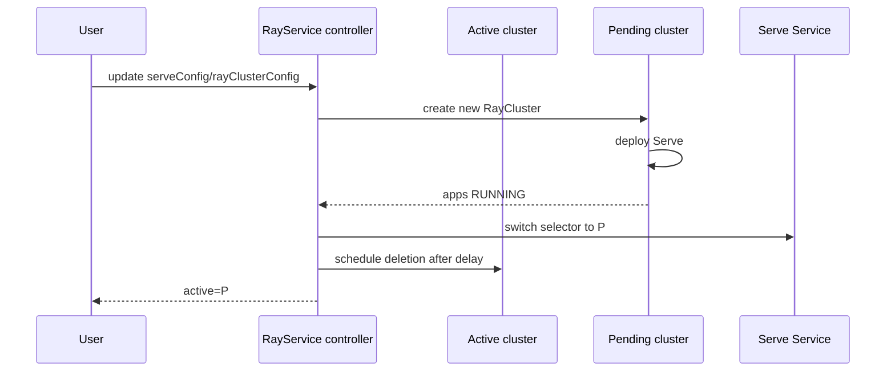

# 第 11 章 RayService：Serve、零停机升级与流量切换

RayService 把 Ray Serve 应用和 RayCluster 打包成一个可升级的在线服务。它比 RayCluster 多做了三件事：

1. 部署/更新 Serve 应用；
2. 维护 active/pending 两个集群；
3. 在升级时切换流量，尽量不丢请求。

## 11.1 最小 RayService

```yaml
apiVersion: ray.io/v1
kind: RayService
metadata:
  name: echo
spec:
  serveConfigV2: |
    applications:
      - name: echo
        import_path: app:deployment
        route_prefix: /echo
        deployments:
          - name: Echo
            num_replicas: 2
  rayClusterConfig:
    rayVersion: "2.59.0"
    headGroupSpec:
      rayStartParams: {}
      template:
        spec:
          restartPolicy: Never
          containers:
            - name: ray
              image: rayproject/ray:2.59.0
              resources:
                requests:
                  cpu: "1"
                  memory: 2Gi
    workerGroupSpecs:
      - groupName: serve
        replicas: 1
        minReplicas: 1
        maxReplicas: 10
        rayStartParams: {}
        template:
          spec:
            restartPolicy: Never
            containers:
              - name: ray
                image: rayproject/ray:2.59.0
                resources:
                  requests:
                    cpu: "2"
                    memory: 4Gi
```

创建后：

- 一个 RayCluster（上游形如 `<service>-raycluster-<5 字符后缀>`；MiniKubeRay 为 `<service>-<revision hash>`）；
- 一个稳定的 head Service `<service>-head-svc`（RayService 维护，selector 指向 active/pending；底层 RayCluster 自己还会有 `<raycluster-name>-head-svc`，但平台应使用稳定名）；
- 一个稳定的 Serve Service `<service>-serve-svc`；
- status 里 active/pending 两个集群状态。

## 11.2 serveConfigV2

Ray Serve 的 V2 配置是 YAML 字符串：

```yaml
applications:
  - name: text
    import_path: text_app:deployment
    route_prefix: /text
    runtime_env:
      working_dir: s3://bucket/code.zip
    deployments:
      - name: TextModel
        num_replicas: 2
        ray_actor_options:
          num_cpus: 0.5
          num_gpus: 0
        autoscaling_config:
          min_replicas: 1
          max_replicas: 8
          target_num_ongoing_requests_per_replica: 4
```

关键点：

- 一个 RayService 可以部署多个 application；
- 每个 application 有独立 route_prefix；
- deployment 的 `num_replicas`/`autoscaling_config` 决定副本；
- `runtime_env` 在每个节点准备依赖；
- `import_path` 指向代码中的 `deployment`/`app`。

KubeRay 把这段字符串通过 Dashboard API 部署到 active/pending 集群。

### 11.2.1 deployment graph 与组合

一个 application 可以有多个 deployment，通过 handle 组合：

```yaml
applications:
  - name: rag
    import_path: rag:app
    route_prefix: /rag
    deployments:
      - name: Router
        num_replicas: 1
      - name: Embed
        num_replicas: 2
        ray_actor_options: {num_cpus: 0.5}
      - name: LLM
        num_replicas: 1
        ray_actor_options: {num_gpus: 1}
```

- `Router` 调用 `Embed`/`LLM` 的 handle；
- 每个 deployment 独立扩缩；
- 一个 deployment 失败会影响依赖它的上游；
- `route_prefix` 只暴露入口 deployment。

### 11.2.2 Serve autoscaling 与 Ray autoscaler

| 层 | 控制什么 | 指标 |
|---|---|---|
| Serve autoscaling | deployment 副本数 | ongoing requests、队列、自定义指标 |
| Ray autoscaler | worker 节点数 | pending Ray 资源 |
| Kubernetes CA/Karpenter | 节点数 | Pending Pod |

三层要同时配置 `max`，否则：

- Serve 想扩到 10 副本，但 Ray `maxReplicas` 只有 4 -> 4 个副本；
- Ray 想加节点，但节点池上限 0 -> Pending；
- 节点加好了，但镜像/模型加载慢 -> 长时间不可用。

### 11.2.3 proxy_location 与多应用

- `proxy_location: EveryNode`（默认）让每个节点都有 proxy；
- `HeadOnly` 减少 proxy 数量，但 head 成为流量瓶颈；
- 多应用用不同 `route_prefix`，共享同一组 proxy；
- 多应用之间要隔离资源/限流，避免互相影响。

## 11.3 active 与 pending

RayService 维护两组状态：

| 状态 | 含义 |
|---|---|
| `status.activeServiceStatus` | 当前接流量的集群 |
| `status.pendingServiceStatus` | 正在准备的新集群 |

每个状态包含：

- `rayClusterName`
- `rayClusterStatus`
- `applicationStatuses`
- `targetCapacity`
- `trafficRoutedPercent`
- `lastTrafficMigratedTime`

升级流程（NewCluster）：



这个模式需要 **2 倍资源**：旧集群在新集群就绪前不能删。

完整的参与者/消息顺序见[附录 J.6](kuberay教程-68-附录J-端到端时序图集.md)；增量升级的权重迁移见[附录 J.7](kuberay教程-68-附录J-端到端时序图集.md)。

## 11.4 升级策略

### 11.4.1 NewCluster（默认）

**先分清两类变更：**

| 变更 | 行为 |
|---|---|
| `serveConfigV2`、`excludeHeadPodFromServeSvc` | 在 active 集群上**原地部署**，不创建新集群 |
| worker `replicas`/`minReplicas`/`maxReplicas` | 原地 patch RayCluster（autoscaler 仍可接管） |
| 镜像、Pod 模板、资源、`numOfHosts` 等 | revision hash 变化 -> 创建新集群 |

只有第三类才会触发下面的 NewCluster 流程：

- 创建新集群；
- 新集群 Serve 应用全部 RUNNING；
- 把 head Service/Serve Service 指向新集群；
- 旧集群延迟删除（`rayClusterDeletionDelaySeconds`，默认 60 秒）；
- 期间新旧集群并存。

优点：简单、可靠、回滚容易。
缺点：资源翻倍；切换是瞬时的，长连接可能中断。

### 11.4.2 NewClusterWithIncrementalUpgrade（v1.5 alpha，v1.7 beta）

使用 Gateway API + HTTPRoute 做渐进式流量迁移。两个前置条件必须先确认：

- **feature gate**：`RayServiceIncrementalUpgrade`。v1.7 分支经历过 promote 后又 revert 的提交，不同 tag 的默认值可能不同；上线前用目标 tag 的 `pkg/features/features.go` 或 `--feature-gates=RayServiceIncrementalUpgrade=true` 显式确认。
- **in-tree autoscaler**：`rayClusterConfig.enableInTreeAutoscaling: true`。pending 集群要按 `target_capacity` 扩副本；没有 autoscaler 时流量迁移会停在低容量。

v1.7 有两种入口配置，**二选一**：

```yaml
spec:
  upgradeStrategy:
    type: NewClusterWithIncrementalUpgrade
    clusterUpgradeOptions:
      maxSurgePercent: 40
      stepSizePercent: 5
      intervalSeconds: 10
      # 方式 A：KubeRay 创建 Gateway
      gatewayClassName: cluster-gateway
      # 方式 B（MiniKubeRay 扩展；上游 v1.7.1 只有 gatewayClassName）：
      # 接管已有 HTTPRoute，只改 backendRefs
      # httpRouteName: platform-ray-route
      # httpRouteInProgressLabels:
      #   argocd.argoproj.io/ignore: "true"
```

方式 A 会创建：

```yaml
apiVersion: gateway.networking.k8s.io/v1
kind: Gateway
metadata:
  name: <service>-gateway
spec:
  gatewayClassName: cluster-gateway
  listeners:
    - name: serve
      port: 8000
      protocol: HTTP
---
apiVersion: gateway.networking.k8s.io/v1
kind: HTTPRoute
metadata:
  name: <service>-httproute
spec:
  parentRefs:
    - name: <service>-gateway
  rules:
    - matches:
        - path: {type: PathPrefix, value: /}
      backendRefs:
        - name: <active-cluster>-serve-svc
          port: 8000
          weight: 90
        - name: <pending-cluster>-serve-svc
          port: 8000
          weight: 10
```

方式 B 是 MiniKubeRay 的教学扩展：不创建 Gateway/HTTPRoute，只 patch 已有路由的 `spec.rules[0].backendRefs`；适合 GitOps 管理路由的场景。上游 v1.7.1 的 RayService API 没有 `httpRouteName`/`httpRouteInProgressLabels`，写进真实 CR 会被裁剪。

流程：

1. 创建 pending 集群，Serve `target_capacity` 初始为 0%；
2. 新集群应用全部 RUNNING 后，每 `intervalSeconds` 把 `stepSizePercent` 的流量从 active 切到 pending；
3. pending 的 `target_capacity` 跟随迁移比例上升，但不超过 `maxSurgePercent`（因此不是一次性扩到 surge，而是随流量逐步预热）；
4. 到 100% 后，pending 变成 active，稳定 Serve Service 的 selector 切到新集群；
5. 旧集群延迟 `rayClusterDeletionDelaySeconds` 删除。

优点：资源占用更平滑；切换渐进，长连接更友好。
缺点：依赖 Gateway API（v1.7.1 operator 依赖 v1.4.x 的 CRD，需有可用的 GatewayClass/实现）；配置更复杂；需要额外的 Gateway/路由运维。

生产注意：

- Gateway 的 idle timeout 要覆盖流式响应；
- gRPC 需要单独的 HTTPRoute 匹配规则；
- 接管已有 HTTPRoute 时，确保 operator 的 RBAC 允许 patch；
- 回滚时把权重切回 active，并删除 pending；
- 监控 `trafficRoutedPercent`、`backendRefs` 权重、5xx 比例。

### 11.4.3 None

不创建新集群；适用于：

- 手动控制升级；
- 只改 Serve 配置、由 Ray Serve 自己滚动；
- 调试。

## 11.5 健康与流量

### 11.5.1 `ray.io/serve` 标签

- worker Pod 默认 `ray.io/serve=true`；
- head Pod 的标签由 RayService 控制器管理：proxy 健康且允许 head 接流量时设为 `true`，否则 `false`。不同版本/场景下初始值可能不同，**不要手动改这个标签**；
- Serve Service selector：`ray.io/cluster=<active>` + `ray.io/serve=true`；
- `excludeHeadPodFromServeSvc=true` 时 head 永远为 false，只使用 worker。

判断“谁在接流量”要看 Service selector + `ray.io/serve` 标签 + EndpointSlice，而不是只看 Pod Ready。

### 11.5.2 健康判断

RayService 不只看 Pod Ready，还看 RayCluster、Serve application、deployment 和 endpoint。但 **v1.7.1 的 `RayServiceReady` condition 本身主要由 endpoint 数决定**：

| `status.numServeEndpoints` | `RayServiceReady` | reason |
|---|---|---|
| > 0 | True | `NonZeroServeEndpoints` |
| 0 | False | `ZeroServeEndpoints` |
| 尚未初始化 | False | `Initializing` / `InitializingTimeout` |

所以不要把 RayCluster Ready、application RUNNING、deployment HEALTHY 当成四个独立的 condition；它们是你**解释 endpoint 为什么为 0** 的诊断证据：

```text
numServeEndpoints=0
├─ active RayCluster 不 Ready        -> 看 RayCluster conditions
├─ Serve application 不是 RUNNING    -> 看 applicationStatuses / Serve 日志
├─ deployment 不 HEALTHY             -> 看 serveDeploymentStatuses / 副本
└─ 都正常但没有 endpoint            -> 看 ray.io/serve 标签 / Service selector / proxy
```

`serviceUnhealthySecondThreshold` / `deploymentUnhealthySecondThreshold` 早在 v1.1 起就不再使用（源码标记 deprecated）；实际以 Serve 状态和 endpoints 为准。

排障时不要只看 `serviceStatus=Running`（已弃用）；先看 `Ready` condition 的 reason，再按上面的树找证据。

### 11.5.3 零停机的边界

“零停机”不等于“请求绝不失败”：

- 长连接/WebSocket 可能被断开；
- 旧集群删除前的 in-flight 请求需要 `rayClusterDeletionDelaySeconds`；
- 新集群模型加载可能慢；
- Gateway/Ingress 的 draining 配置会影响；
- 客户端重试仍然必要。

## 11.6 回滚

如果在升级过程中把 spec 改回旧版本：

- 控制器检测到 desired hash == active revision；
- 删除 pending 集群；
- 保持 active 不变；
- 设置 `RollbackInProgress` condition（短暂）；
- Serve Service 继续指向 active。

v1.7 的增量升级支持“升级中回滚”，但要注意：

- 如果流量已经切到 pending，回滚需要把流量切回；
- 旧集群可能已被标记删除；
- 回滚窗口受 `rayClusterDeletionDelaySeconds` 限制。

## 11.7 资源与容量

- NewCluster 需要 2 倍集群容量；
- 增量升级通过 `maxSurgePercent` 控制额外容量；
- `targetCapacity` 是 Serve 的全局副本百分比，不是节点数；
- Ray Serve 的 autoscaling 与 Ray autoscaler 是两套机制：
  - Serve autoscaling 调整 deployment replicas；
  - Ray autoscaler 调整 worker 节点。
- 两者要配合，否则可能出现“Serve 想扩副本但节点不够”。

## 11.8 status 与 conditions

```yaml
status:
  serviceStatus: Running
  numServeEndpoints: 3
  activeServiceStatus:
    rayClusterName: echo-abcde
    trafficRoutedPercent: 100
    applicationStatuses:
      echo:
        status: RUNNING
  pendingServiceStatus: {}
  conditions:
    - type: Ready
      status: "True"
      reason: NonZeroServeEndpoints
```

conditions：

- `Ready`：可以接流量（**首选信号**）；
- `UpgradeInProgress`：升级中；
- `RollbackInProgress`：回滚中。

> `status.serviceStatus` 自 v1.3 起已弃用，保留仅为兼容；告警/自动化请读 `Ready` condition。RayService 也有 `Suspending`/`Suspended` condition，同时底层 RayCluster 会展示 `RayClusterSuspending`/`RayClusterSuspended`；排障时两层都看。

## 11.9 自定义 Service 与端口

```yaml
spec:
  serveService:
    metadata:
      annotations:
        service.beta.kubernetes.io/aws-load-balancer-type: nlb
    spec:
      type: LoadBalancer
      ports:
        - name: http
          port: 80
          targetPort: 8000
```

注意：

- RayService 会管理 selector，不要自定义 selector；
- 自定义端口时 targetPort 仍应指向 Serve proxy（通常 8000）；
- head Service 是另一个 Service，不要混淆。

## 11.10 生产建议

- 用 NewCluster 作为默认；需要平滑流量再上增量升级；
- 监控 `numServeEndpoints`、Serve app 状态、P99 延迟；
- 设置 `rayClusterDeletionDelaySeconds` 覆盖 in-flight 请求；
- 为 pending 集群预留资源/配额；
- 用 Gateway API 做 TLS、限流、重试、流量镜像；
- 升级前预热镜像/模型；
- 客户端配置重试和超时；
- 对模型版本做 canary/蓝绿，而不是只依赖 RayService 的切换。

## 11.11 MiniKubeRay 的实现

`minikuberay/controllers/rayservice.py`：

- 计算 cluster revision hash；
- 创建 active/pending RayCluster；
- 部署 Serve（`runtime.deploy_serve`）；
- 更新 `ray.io/serve` 标签；
- 维护 head/serve Service selector；
- NewCluster / 增量升级 / None；
- 回滚；
- suspend/delete；
- status/conditions。

测试：`tests/test_rayservice.py` 覆盖初始就绪、exclude head、升级、增量流量、回滚、suspend、删除、非法配置、自定义 Service。

## 11.12 Serve 状态机速查

RayService 的 Ready 判断依赖 Serve 的内部状态。注意 **application 状态**与 **deployment 状态**是两套枚举，不要混用。

Application（`applicationStatuses[*].status`）常见值：

| 状态 | 含义 |
|---|---|
| `DEPLOYING` | 正在创建/更新 |
| `RUNNING` | 应用可用 |
| `DEPLOY_FAILED` | 部署失败 |
| `UNHEALTHY` | 应用不健康 |
| `UPSCALING` / `DOWNSCALING` | 副本调整中 |
| `DELETING` | 正在删除 |

Deployment（`serveDeploymentStatuses[*].status`）常见值：

| 状态 | 含义 |
|---|---|
| `UPDATING` | 正在更新 |
| `HEALTHY` | 副本健康 |
| `UNHEALTHY` | 有副本不健康 |
| `DEPLOY_FAILED` | 部署失败 |
| `UPSCALING` / `DOWNSCALING` | 副本调整中 |

`HEALTHY` 属于 deployment，不是 application。看到 application `RUNNING` 但 deployment `UNHEALTHY`，说明路由存在但副本不健康。

排查顺序：

```text
1. kubectl get rayservice <name> -o yaml     # status/conditions
2. kubectl exec <head> -- ray serve status   # application/deployment
3. kubectl get pods -l ray.io/cluster=<active> --show-labels
4. kubectl get endpointslices -l kubernetes.io/service-name=<service>-serve-svc
5. kubectl logs <head> -c ray | grep -i serve
```

三个常见误区：

- **Pod Ready ≠ Serve Ready**：还要看 application/deployment 状态和 endpoint 数；
- **Serve RUNNING ≠ 可接流量**：还要看 `ray.io/serve=true` 和 Service selector；
- **`target_capacity` ≠ 流量权重**：前者控制 Serve 副本容量，后者是 Gateway/HTTPRoute 权重。

更深的 Serve controller/proxy/replica 内部机制见[第 35 章](kuberay教程-35-Ray运行时深潜-GCS、Raylet、对象存储与调度.md)。

## 11.13 Serve 配置的版本管理与灰度

### 11.13.1 配置也是代码

`serveConfigV2` 是字符串，容易被当成“随手改的配置”。生产建议：

- 放在 Git，按 application/deployment 拆分；
- CI 做 YAML/字段校验（`import_path`、`route_prefix`、资源）；
- 版本号写进 application 名称或镜像 tag；
- 变更走 PR/评审，不要直接 `kubectl edit`；
- 保留上一版本，便于回滚。

### 11.13.2 只改 Serve 配置 vs 改集群模板

| 变更 | 行为 | 资源影响 |
|---|---|---|
| `serveConfigV2` | 原地部署到 active | 不创建新集群 |
| `excludeHeadPodFromServeSvc` | 原地更新标签/Service | 不创建新集群 |
| 镜像/模板/资源/numOfHosts | 新 revision -> pending | 2 倍或 surge |
| worker replicas | 原地 patch | autoscaler 接管 |

不要把“模型版本”只写进 `serveConfigV2` 的注释里；如果模型权重在镜像中，改镜像就会触发 pending 集群。要明确你希望的是“原地滚动”还是“蓝绿”。

### 11.13.3 多 application 的发布顺序

一个 RayService 可以部署多个 application。升级时：

1. 先确认依赖关系（Router -> Embed -> LLM）；
2. 新版本先部署无状态/低风险 application；
3. 用 `route_prefix`/权重控制流量；
4. 每个 application 的 `applicationStatuses` 单独检查；
5. 不要假设“一个 app RUNNING = 整个服务 Ready”。

### 11.13.4 灰度与回滚的检查表

- [ ] 新配置通过 schema 校验
- [ ] pending 集群资源已预留
- [ ] 新模型/镜像已预热
- [ ] HTTPRoute 权重/Service selector 正确
- [ ] 监控 `numServeEndpoints`、5xx、TTFT/TPOT
- [ ] 回滚配置已准备（旧 `serveConfigV2`/镜像）
- [ ] 客户端重试/超时配置合理
- [ ] 升级窗口与 on-call 就位

## 11.14 小结

- RayService = RayCluster + Serve 配置 + 两个 Service + 升级状态机。
- active/pending 是零停机升级的核心；NewCluster 简单但占 2 倍资源，增量升级更平滑但依赖 Gateway API。
- `ray.io/serve` 标签决定哪些 Pod 接流量。
- Ready 的判断要同时看集群、应用、endpoint。
- 零停机是“尽量不丢”，客户端重试和延迟删除仍然重要。

下一章 RayCronJob 与批调度生态。

→ [第 12 章 RayCronJob 与批调度生态](kuberay教程-12-RayCronJob与批调度生态.md)
