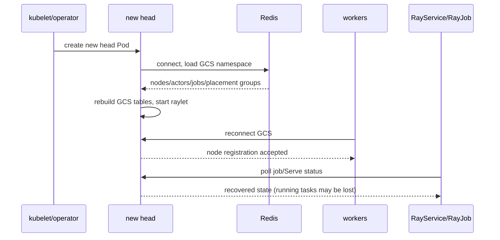

# 第 13 章 高可用、容错与 GCS FT

Ray 的架构决定了 head 是单点：GCS 在 head 上，worker 通过 head 注册。KubeRay 不能把 Ray 变成无状态系统，但可以通过 GCS 容错、RayService 多集群、重试和存储设计，把故障影响降到可接受。

## 13.1 故障分类

| 故障 | 影响 | 默认行为 | 可选缓解 |
|---|---|---|---|
| worker 进程崩溃 | 该节点 task 失败/重试 | Raylet 重启 worker | 增加副本、重试、检查 OOM |
| worker Pod 崩溃 | 节点消失 | 控制器重建 Pod | autoscaler 补副本 |
| head 进程崩溃 | GCS 丢失，集群不可用 | 重建 head | GCS FT |
| head Pod 所在节点故障 | 同上 | 重建 head | GCS FT + 反亲和 |
| GCS 与 worker 断连 | worker 退出 | 重连超时 | `RAY_gcs_rpc_server_reconnect_timeout_s` |
| Redis 故障 | GCS FT 失效 | 无法恢复 | Redis HA/持久化 |
| 对象存储故障 | 任务失败 | 重试/失败 | 多副本/对象存储重试 |
| 网络分区 | 节点失联 | 任务失败 | 网络策略、拓扑 |

## 13.2 GCS 容错（Redis 后端）

### 13.2.1 原理

- GCS 把元数据持久化到外部 Redis；
- head 重启后，从 Redis 恢复 GCS 状态；
- worker 重新连接，集群恢复；
- 每个集群用 `externalStorageNamespace` 隔离。

### 13.2.2 配置

```yaml
apiVersion: ray.io/v1
kind: RayCluster
metadata:
  name: ft-cluster
spec:
  rayVersion: "2.59.0"
  gcsFaultToleranceOptions:
    backend: redis
    redisAddress: redis.default.svc.cluster.local:6379
    redisPassword:
      valueFrom:
        secretKeyRef:
          name: redis-password
          key: password
    externalStorageNamespace: ft-cluster
  headGroupSpec:
    rayStartParams: {}
    template:
      spec:
        restartPolicy: Never
        containers:
          - name: ray
            image: rayproject/ray:2.59.0
            resources:
              requests:
                cpu: "1"
                memory: 2Gi
  workerGroupSpecs:
    - groupName: workers
      replicas: 1
      minReplicas: 0
      maxReplicas: 4
      rayStartParams: {}
      template:
        spec:
          restartPolicy: Never
          containers:
            - name: ray
              image: rayproject/ray:2.59.0
              resources:
                requests:
                  cpu: "2"
                  memory: 4Gi
```

### 13.2.3 Redis 要求

- 高可用：Redis Sentinel/Cluster 或托管 Redis；
- 持久化：AOF/RDB；
- 网络：head 与 Redis 低延迟、稳定；
- 安全：密码/TLS、NetworkPolicy；
- 容量：GCS 元数据随 actor/task 增长；
- 隔离：每个**逻辑集群**一个 `externalStorageNamespace`；RayService 的 active/pending 两代集群在升级时可能刻意复用同一个 namespace 以便恢复状态，这是唯一例外，不要把这个 namespace 再共享给无关集群。

### 13.2.4 Redis cleanup finalizer

删除 RayCluster 时：

1. 删除 head/worker Pod；
2. 等 head 停止写入；
3. 运行 Redis cleanup Job 删除命名空间；
4. 移除 finalizer。

如果 cleanup Job 卡住，finalizer 会阻止 CR 删除。KubeRay v1.7.1 提供：

- `ray.io/gcs-ft-deletion-timeout` 注解（整数秒，默认 300s）；
- 删除时间超过该值后，控制器强制移除 finalizer（可能留下 Redis 垃圾数据）；
- cleanup Job 自身还有 `activeDeadlineSeconds`/`backoffLimit`。

生产上不要只看超时放行：先看 cleanup Job/operator 日志，确认 Redis namespace 是否真的需要人工清理，避免孤儿数据污染下一次同名集群。

### 13.2.5 验证 GCS FT 是否生效

```bash
# 1. head env 是否注入 Redis
kubectl exec <head> -- env | grep -E 'REDIS|external_storage'
# 2. Ray 进程是否启用 FT
kubectl exec <head> -- ray status
kubectl logs <head> -c ray | grep -i 'redis\|fault tolerance'

# 3. 删除 head，观察恢复
kubectl delete pod <head>
kubectl get pods -l ray.io/cluster=<cluster> -w
kubectl exec <new-head> -- ray status
# 4. worker 是否重连
kubectl logs <worker> -c ray | grep -i reconnect
```

注意：Ray 的 GCS FT 只保证元数据恢复，不保证正在运行的 task/actor 状态；应用仍要幂等/checkpoint。

## 13.3 RocksDB 后端（v1.7 alpha）

```yaml
spec:
  gcsFaultToleranceOptions:
    backend: rocksdb
    storage:
      size: 20Gi
      storageClassName: fast-ssd
      accessModes: [ReadWriteOnce]
      deletionPolicy: Retain
```

特点：

- 不依赖 Redis；
- GCS 状态写到 head 的 PVC；
- 单写者：同一时间只能一个 head 挂载同一个 PVC/路径；
- 适合没有 Redis 的环境；
- 升级/故障切换需要外部协调；
- `Retain` 保留 PVC 供恢复；
- 需要 `GCSFaultToleranceEmbeddedStorage` gate；
- 需要 Ray ≥ 2.57.0，且节点是 Linux（以官方文档为准）。

限制：

- 默认情况下 operator 为每个 RayCluster 创建自己的 `{cluster}-gcs-pvc`，所以 RayService 的 active/pending **各用各的 RWO 卷，不需要 ReadWriteMany**；
- 但 v1.7.1 支持用 `gcsFaultToleranceOptions.storage.claimName` **显式指定已有 PVC**。这是跨升级代际保留 GCS 状态的受支持路径：只要新 head 能挂载同一个卷（RWX，或由外部协调 active/passive 交接），状态就可以延续；
- 如果不使用 `claimName`，pending 集群默认从空状态开始，旧集群的 actor/object 元数据不会自动带过去；
- RocksDB 损坏时恢复困难，必须有备份。

运维要点：

- PVC 用支持快照的 StorageClass，定期 VolumeSnapshot；
- `deletionPolicy: Retain` 防止误删；
- 恢复时先确认没有旧 head 在写；
- 监控 PVC 容量/IOPS；
- 升级前做一次“删 head -> 恢复”演练；
- 不要把 RocksDB PVC 放在跨区不可挂载的存储上。

## 13.4 Active-Passive Head（master/未来）

社区在 REP-65/master 上设计 active-passive head（leader election、备用 head），但 **v1.7.1 的发布 API 没有 `activePassiveHeadOptions`**。当前生产可用的仍是 Redis/RocksDB GCS FT + 控制器重建 head。

如果未来版本提供该字段，需要关注：

- 只支持 Redis 后端；
- leader election 的 lease/renew/retry 时间顺序；
- 切换期间 GCS 仍可能短暂不可用；
- 仍需要 Redis 高可用。

本教程不把未发布字段作为生产建议。

## 13.5 Worker 故障与重试

- Ray task 的**系统故障**（worker 消失、节点丢失）默认最多重试 3 次（`max_retries`，可配置）；
- **应用异常**（entrypoint 里抛出的异常）默认**不重试**；需要显式 `retry_exceptions=True` 或业务层重试；
- actor 默认不自动重建（除非 `max_restarts`）；
- worker Pod 重建后，Raylet 重新注册；
- 如果 head 也丢失，worker 会退出，等待新 head；
- GCS FT 下 worker 可以重连。

生产建议：

- task 幂等；
- actor 设置 `max_restarts`；
- 用 Ray Data/ Train 的容错机制；
- 监控 worker 重启次数；
- 区分“进程崩溃”和“节点丢失”。

## 13.6 RayService 的高可用

RayService 的 active/pending 机制提供：

- 升级时双集群；
- 新集群不健康时不切流量；
- 回滚；
- Serve Service 只选健康 proxy。

但它不是“多活”：

- 同一时间只有一个 active 接流量；
- pending 是热备，不是负载均衡；
- 如果 active 所在可用区整体故障，需要控制器重建/切换，仍有中断；
- 跨可用区/跨集群多活要在 Gateway/DNS/业务层做。

## 13.7 存储与数据容错

- 模型/数据放对象存储，不依赖 Pod 本地盘；
- PVC 用支持快照/多副本的 StorageClass；
- Ray 对象存储是节点本地，节点丢失会丢对象（Ray 会重算/重传）；
- checkpoint 写到持久存储；
- 训练任务定期保存 checkpoint；
- GCS RocksDB PVC 要备份。

## 13.8 混沌测试

建议的故障注入：

1. 删除 worker Pod：观察 Ray 重试/控制器重建；
2. 删除 head Pod：观察 GCS FT 恢复/集群重建；
3. 杀掉 Redis：观察 GCS FT 失效与恢复；
4. 网络分区：用 NetworkPolicy/iptables 隔离 worker；
5. 资源耗尽：填满 GPU/内存；
6. 镜像拉取失败：改错 tag；
7. 节点 drain：观察 Pod 驱逐与重建；
8. 高频扩缩容：观察抖动与 API 限流。

MiniKubeRay 提供注解：

- `minikuberay.io/crash-after-seconds`：Pod 运行 N 秒后失败；
- `minikuberay.io/job-exit-code`：作业退出码；
- `minikuberay.io/job-duration-seconds`：作业时长。

用于测试控制器对失败的反应。

## 13.9 恢复 Runbook

### head 崩溃（无 GCS FT）

1. 确认 head Pod 状态/事件；
2. 检查是否被控制器重建；
3. 如果卡住，删除 head Pod 让控制器重建；
4. 注意：worker 会退出/重连，正在运行的 task 可能丢失；
5. 作业需要重跑。

### head 崩溃（有 GCS FT）

1. 检查 Redis 可达；
2. 检查 head 是否从 Redis 恢复；
3. 检查 worker 重连；
4. 检查 GCS 日志中的恢复错误；
5. 如果 Redis 数据损坏，按备份恢复。

### RayService 升级卡住

1. 看 `status.pendingServiceStatus`；
2. 看 pending cluster 的 Pod/Serve 状态；
3. 看 `UpgradeInProgress` condition；
4. 检查资源配额；
5. 必要时回滚 spec；
6. 检查 Gateway/HTTPRoute。

## 13.10 GCS FT 恢复时序

有 Redis GCS FT 时，head 重建不是“新集群”，而是“从元数据恢复”。跨组件的完整时序见[附录 J.9](kuberay教程-68-附录J-端到端时序图集.md)：



时间线（典型）：

| 阶段 | 发生什么 | 观察点 |
|---|---|---|
| t0 | head 崩溃 | worker 重连失败 |
| t+秒 | 控制器删除/重建 head | Pod 事件 |
| t+秒 | 新 head 连接 Redis | `gcs_server.out` |
| t+秒 | GCS 恢复表 | `ray status` 节点出现 |
| t+分 | worker 重连 | worker 日志 `reconnect` |
| t+分 | 作业/Serve 状态恢复或失败 | RayJob/RayService status |

关键不变量：

- **只恢复元数据**，不恢复正在运行的 task/actor 状态；
- worker 重连受 `RAY_gcs_rpc_server_reconnect_timeout_s` 控制；
- Redis 必须可达且数据未损坏；
- `externalStorageNamespace` 必须在**逻辑集群**内唯一；无关集群共用会串数据，但 RayService 升级代际可以刻意复用；
- 恢复后要验证 actor/object/placement group，而不只是“Pod Running”。

恢复演练：

```bash
# 1. 记录基线
kubectl exec <head> -- ray status > before.txt
kubectl get rayjob,rayservice -o yaml > crs-before.yaml

# 2. 删除 head
kubectl delete pod <head>

# 3. 观察恢复
kubectl get pods -l ray.io/cluster=<cluster> -w
kubectl exec <new-head> -- ray status > after.txt
diff before.txt after.txt

# 4. 验证业务
kubectl get rayjob <name> -o jsonpath='{.status.jobStatus}'
kubectl get rayservice <name> -o jsonpath='{.status.conditions}'
```

## 13.11 GCS FT 选型：Redis、RocksDB 还是不用

三种选择不是“越新越好”，而是由 RTO/RPO、运维能力和负载形态决定。

| 维度 | 不用 FT | Redis 后端 | RocksDB 后端（alpha） |
|---|---|---|---|
| head 故障后 | 新集群，元数据丢失 | 从 Redis 恢复 | 从 PVC 恢复 |
| RTO | 重建集群 + 重跑作业 | 秒–分钟 | 分钟级（挂载/恢复） |
| RPO | 正在运行的状态全丢 | 取决于 Redis 持久化 | 取决于 PVC/快照 |
| 外部依赖 | 无 | Redis HA/备份 | PVC/StorageClass |
| 多集群隔离 | — | `externalStorageNamespace` | PVC/命名 |
| RayService 双集群 | 可用（pending 独立） | 可用 | 可用（各自 PVC；状态不跨代迁移） |
| 运维复杂度 | 低 | 中高 | 中 |
| 适用 | 可重跑批作业、开发 | 生产、长作业、需要快速恢复 | 无 Redis、可接受单写 |

### 13.11.1 什么时候不用 GCS FT

- 作业可以从头重跑，且 checkpoint 在对象存储；
- RayJob 的 `backoffLimit` 能覆盖失败；
- RayService 用 pending 集群做升级/故障切换；
- 开发/测试环境。

不要为了“高可用”引入 Redis，却没有监控/备份/故障演练。

### 13.11.2 选择 Redis 的前提

- 有 Redis HA（Sentinel/Cluster/托管）；
- 有持久化/备份；
- head 到 Redis 的网络低延迟、稳定；
- 有 `externalStorageNamespace` 隔离；
- 接受“只恢复元数据，不恢复 task/actor 状态”。

### 13.11.3 选择 RocksDB 的前提

- 没有 Redis，或不想维护 Redis；
- 能接受单写者（同一时间一个 head）；
- PVC 支持快照/恢复；
- RayService 升级期间能协调旧/新 head 不并发写；
- 有 PVC 容量/IOPS 监控。

### 13.11.4 恢复目标要写清楚

```text
RTO：head 故障后多久恢复调度？
RPO：允许丢多少元数据/作业状态？
```

没有这两个数字，“上不上 FT”就无法决策。

## 13.12 小结

- head 是 Ray 的单点；GCS FT 通过 Redis/RocksDB 持久化元数据。
- Redis 后端成熟；RocksDB 是 v1.7 alpha，适合无 Redis 环境但有单写限制。
- active-passive head（未来方向）可降低切换时间，但不是零停机。
- RayService 的 active/pending 是升级机制，不是多活。
- 容错需要应用幂等、checkpoint、对象存储、监控和混沌测试共同配合。

下一章安全：RBAC、Pod Security、NetworkPolicy、Secret、token auth、mTLS、多租户。

→ [第 14 章 安全](kuberay教程-14-安全-RBAC、网络、Secret、mTLS与多租户.md)
