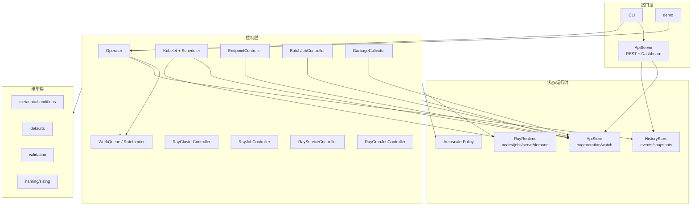

# 第 19 章 MiniKubeRay 架构与设计取舍

从本章开始进入实现部分。MiniKubeRay 的目标不是“再写一个 KubeRay”，而是把控制平面拆成可以逐行调试的零件。它必须：

- 能独立运行，不需要 Kubernetes/Ray/网络；
- 行为与 KubeRay v1.7 的关键语义对齐；
- 有真实的 API 语义（resourceVersion、generation、watch、status subresource）；
- 有真实的控制器结构（workqueue、限速、finalizer、ownerReference）；
- 覆盖四个 CRD 和主要功能；
- 有确定性测试和文档校验。

## 19.1 非目标

- 不执行真实 Ray 分布式计算；
- 不实现真实 kube-scheduler/kubelet/CNI/CSI；
- 不实现真实 Redis/Gateway/cert-manager；
- 不追求生产性能；
- 不兼容所有 KubeRay 字段（但覆盖主要路径）。

这些边界会在第 25 章“与真实 KubeRay 的差距”中明确列出。

## 19.2 总体架构



## 19.3 目录与职责

```text
minikuberay/
├── __main__.py              # python -m minikuberay
├── version.py               # 版本常量与兼容判断
├── constants.py             # 标签/注解/端口/默认值
├── clock.py                 # RealClock / ManualClock
├── util.py                  # 数量解析、hash、selector、命名
├── errors.py                # Kubernetes 风格错误
├── events.py                # EventRecorder
├── metrics.py               # Prometheus 文本
├── tracing.py               # OTel 风格 span/trace 收集
├── demo.py                  # 端到端演示
├── models/
│   ├── meta.py              # metadata/owner/condition
│   ├── core.py              # Pod/Service/Job/Event/EndpointSlice
│   ├── defaults.py          # 四个 CRD 默认值
│   ├── validation.py        # 四个 CRD 校验
│   ├── ippr.py              # IPPR 注解/状态机/回滚
│   ├── raycluster.py        # 副本/命名/容量
│   ├── rayjob.py            # job/deployment 状态
│   ├── rayservice.py        # Serve 配置/状态
│   └── raycronjob.py        # cron 解析/时区
├── store/
│   └── store.py             # ApiStore + watch
├── kube/
│   └── client.py            # LocalClient / HTTPClient
├── controllers/
│   ├── base.py              # WorkQueue/Controller/Operator
│   ├── builders.py          # Pod/Service/RBAC/PVC/NetworkPolicy
│   ├── batch.py             # Kubelet/Scheduler/Endpoint/Job/GC
│   ├── raycluster.py        # 核心调和
│   ├── rayjob.py            # 作业状态机
│   ├── rayservice.py        # active/pending 升级
│   └── raycronjob.py        # 定时创建
├── runtime/
│   └── cluster_runtime.py   # Ray 模拟
├── autoscaler/
│   └── policy.py            # 扩缩容策略
├── history/
│   └── server.py            # 事件/快照/回放（History Server）
├── apiserver/
│   ├── server.py            # REST + auth + watch
│   └── dashboard.py         # 单页 Dashboard
└── cli/
    └── main.py              # apply/get/describe/logs/scale/...
```

## 19.4 关键设计决策

### 19.4.1 对象用 dict 而不是 dataclass

Kubernetes 对象是任意嵌套的 JSON。用 dataclass 表达 PodTemplate 会非常笨重。MiniKubeRay 选择：

- 顶层 CR 用 dict；
- 用 `models/meta.py`、`models/core.py` 提供构造/访问 helper；
- 用 `validation.py` 保证关键字段；
- 保留未知字段，便于模拟 CRD 的“宽松 schema”。

代价：没有静态类型检查；收益：与 YAML/JSON 无缝转换，便于对比真实 KubeRay。

### 19.4.2 进程内 Store，而不是真实 apiserver

`ApiStore` 实现最小但真实的语义：

- resourceVersion 递增；
- generation 只在 spec 变化时递增；
- status subresource 不修改 spec；
- finalizer 两阶段删除；
- watch 事件（ADDED/MODIFIED/DELETED）；
- 乐观并发冲突。

这让控制器代码与真实 Kubernetes 客户端的行为接近，同时测试不需要 envtest。每个方法的精确契约（create/update/delete/list/watch/patch）见 20.5。

### 19.4.3 可注入时钟

所有控制器通过 `Clock` 获取时间：

- `RealClock`：生产/demo；
- `ManualClock`：测试，显式 `advance`。

好处：

- 没有 `sleep` 导致的 flaky；
- TTL/超时/idle 可以精确测试；
- 同样的场景可以快进。

### 19.4.4 模拟 kubelet/scheduler

`SimulatedScheduler`：

- 3 个节点（CPU/内存/GPU）；
- filter：资源、nodeSelector、taint/toleration；
- score：最少已用 CPU/GPU；
- 找不到节点 -> Pending + Unschedulable。

`Kubelet`：

- Pending -> Running；
- 分配 Pod IP；
- 注册 RayRuntime 节点；
- 读取 crash/finish 注解并据此推进 Pod 状态；
- 删除没有 finalizer 的 terminating Pod；有 finalizer 的 Pod 继续保持 Terminating 并占用资源（与真实 kubelet 一致）。

这让“Pod 状态变化 -> 控制器反应”的链路可测。

### 19.4.5 RayRuntime 模拟

`RayRuntime` 保存：

- 每个集群的节点；
- 作业状态机；
- Serve 应用状态；
- pending demand；
- 空闲时间。

控制器只通过这个边界与“Ray”交互，和第 2 章的真实边界对应。

### 19.4.6 Operator 的“扫描式”循环

真实 controller-runtime 是 watch + workqueue。MiniKubeRay 也实现了 WorkQueue，但 `Operator.run_once` 为了让测试确定性，采用：

1. kubelet step；
2. endpoints reconcile；
3. 依次扫描四个 CR 控制器（RayCluster/RayJob/RayService/RayCronJob）和 batch controller；
4. GC。

每次扫描所有对象，而不是只处理队列 key。好处：

- 测试简单；
- 不依赖事件顺序；
- 收敛后 `run_once` 返回 False。

代价：

- 规模大时效率低；
- 不是真实 informer 语义。

`WorkQueue` 仍然保留，用于演示限速/去重，CLI/扩展可以使用。`run_once` 每一步的细节（kubelet/endpoint/controller/GC 的顺序与写入行为）见 21.1.2。

### 19.4.7 模拟而不是执行

Ray 作业默认是状态机：

- PENDING -> RUNNING -> SUCCEEDED/FAILED；
- 时长/退出码由注解控制；
- 不执行用户 entrypoint。

原因：

- 安全（不执行任意 YAML 中的命令）；
- 确定性；
- 无需安装 Ray。

`examples/ray_job.py` 是给真实集群用的；`--execute` 只是接口占位。

### 19.4.8 trace 收集：把一次调和拆成 span

`minikuberay/tracing.py` 实现了一个最小的 OpenTelemetry 风格收集器：

- `Tracer.span(name)` 是上下文管理器，创建/结束 span；底层也可用 `start_span()`/`finish_span()`；
- `Span.set_attribute()` / `add_event()` / `set_status()` 记录属性、事件与状态；
- `Operator.run_once` 记录 `operator.round` span；
- 每个控制器的 `reconcile` 记录子 span，形成 `round -> reconcile(kind/name)` 的树；
- span 保存在进程内，REST 通过 `/api/traces` 暴露，CLI 通过 `python -m minikuberay traces --tree` 打印。

它不是完整的 OTel SDK（没有 exporter、采样、上下文传播），但足以回答“这一轮调和把时间花在哪个对象/哪个阶段”。第 48 章会把它和真实 OTel 管道对照；第 23 章列出 REST/CLI 接口。

## 19.5 保真度矩阵

| 能力 | 真实 KubeRay | MiniKubeRay | 说明 |
|---|---|---|---|
| CRD schema | 完整 OpenAPI | 教学 schema | 主要字段 |
| 默认值 | CRD + Go | Python | 对齐关键默认 |
| 校验 | Go | Python | 对齐关键规则 |
| resourceVersion | etcd | 内存 | 单调递增/乐观并发语义子集 |
| watch | apiserver | 内存事件 | 子集：无 bookmark、无 resourceVersion 过期/410 Gone |
| 调度 | kube-scheduler | 模拟 | 资源/选择器 |
| Pod 生命周期 | kubelet | 模拟 | 状态/IP/注册 |
| Ray 运行时 | 真实 | 模拟 | 作业/Serve/demand |
| autoscaler | sidecar | 进程内 | 决策逻辑 |
| GCS FT | Redis/RocksDB | 字段/PVC/env + Redis cleanup Job/finalizer | 无真实 Redis 数据面 |
| NetworkPolicy | CNI | 对象 | 无数据面 |
| mTLS | cert-manager | 字段/校验 | 无证书 |
| Gateway API | 真实 | Gateway/HTTPRoute 对象 + 权重 | 无数据面 |
| 批调度 | Volcano/YuniKorn/Kueue | PodGroup/schedulerName/queue | 无真实调度器 |
| History Server | collector + 对象存储 | 事件/快照/JSON + REST/CLI | 无 collector sidecar |
| APIServer | Go | Python 子集 | REST/watch/history |
| Dashboard | React | 单页 HTML | 只读 |
| CLI | kubectl-ray | Python | apply/get/create/job/history 等 |

## 19.6 运行方式

```bash
# 安装依赖
python -m pip install -r requirements-dev.txt

# 测试
python -m pytest -q

# 演示（无网络、无 K8s）
python -m minikuberay demo --fast

# 本地平台
python -m minikuberay server
# http://127.0.0.1:8080/dashboard

# 单独跑自动扩缩容
python examples/autoscaling_smoke.py
```

## 19.7 代码阅读顺序

1. `minikuberay/models/meta.py`：对象/条件；
2. `minikuberay/store/store.py`：API 语义；
3. `minikuberay/controllers/base.py`：循环/队列；
4. `minikuberay/controllers/raycluster.py`：核心；
5. `minikuberay/controllers/batch.py`：调度/kubelet；
6. `minikuberay/autoscaler/policy.py`：扩缩容（含 IPPR 垂直决策）；
7. `minikuberay/controllers/rayjob.py` / `rayservice.py` / `raycronjob.py`；
8. `minikuberay/apiserver/server.py` / `cli/main.py`；
9. `tests/`。

## 19.8 为什么不用真实 K8s 客户端

- 需要集群/envtest，门槛高；
- 网络/证书/CRD 安装影响可重复性；
- 教学重点是控制逻辑，而不是 client-go；
- 进程内 Store 可以精确注入冲突、watch、finalizer。

如果你要扩展成真实 operator，第 25 章给出适配路径。

## 19.9 小结

- MiniKubeRay 是“控制平面实验台”，不是生产 operator。
- dict 对象 + 进程内 Store + 可注入时钟 + 模拟 kubelet/Ray 是四个核心取舍。
- 它覆盖四个 CRD、主要功能、REST/CLI/Dashboard/trace、State API 子集、IPPR 和 272 个测试。
- 保真度矩阵明确了哪些是真实语义、哪些是模拟。

下一章拆 API 模型、默认值、校验与 Store。

→ [第 20 章 实现：API 模型、默认值、校验与 Store](kuberay教程-20-实现-API模型、默认值、校验与Store.md)
