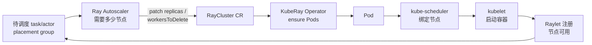
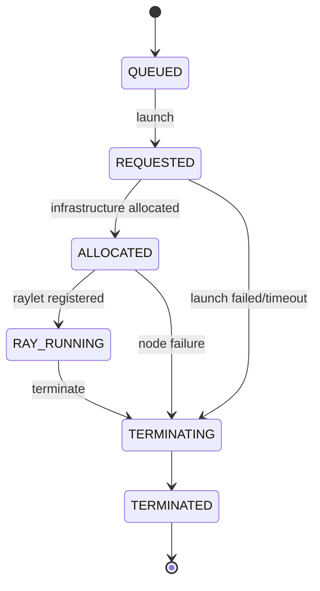
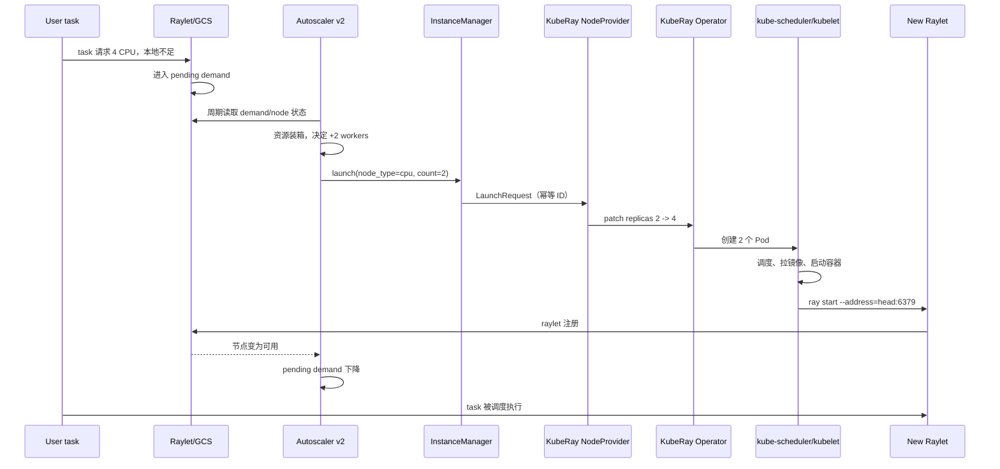

# 第 34 章 Autoscaler v2 内部机制与容量模型

第 9 章从使用者视角讲了 `enableInTreeAutoscaling`、`minReplicas`、`maxReplicas`、`idleTimeoutSeconds` 和 `upscalingMode`。本章往下走一层：Ray autoscaler v2 如何把“待调度资源”变成“节点类型 + 实例数”，KubeRay 如何把这些实例变成 Pod，以及为什么扩容经常“看起来没反应”。

本章的目标不是复述配置，而是建立三个能力：

1. 能根据 pending demand 手算出目标副本数；
2. 能判断一次扩容卡在 Ray、KubeRay、kube-scheduler 还是节点池；
3. 能解释并复现 MiniKubeRay `AutoscalerPolicy` 的每一个决策。

> 版本边界：autoscaler v2 的内部类名和指标在 Ray 小版本间会调整。本章描述的是 v2 的稳定抽象（instance manager、resource demand scheduler、node provider、terminate/launch 请求），具体字段以你使用的 Ray 版本源码为准。KubeRay 侧的行为以 v1.7.1 为基线。

## 34.1 三个控制回路

自动扩缩容不是“一个控制器”，而是三个互相嵌套的回路：



| 回路 | 负责者 | 输入 | 输出 | 典型周期 |
|---|---|---|---|---|
| 需求回路 | Ray autoscaler | pending task/actor、节点利用率 | 目标节点数 | 秒级 |
| 资源回路 | KubeRay operator | `replicas`、`workersToDelete` | Pod | 秒级 |
| 供给回路 | kube-scheduler / Cluster Autoscaler | Pod requests、节点容量 | 绑定/新节点 | 秒到分钟 |

三个回路各有自己的“延迟”和“失败模式”。把它们混在一起，就会得到错误的结论，例如：

- Ray 里任务排队，但 `replicas` 已经是 `maxReplicas`：瓶颈是配额，不是 autoscaler；
- `replicas` 涨了，但 Pod Pending：瓶颈是节点池或调度约束；
- Pod Running，但 Ray 看不到节点：瓶颈是 Raylet 注册、端口、token 或资源声明；
- 节点已注册，但任务仍排队：瓶颈可能是 placement group、label selector 或自定义资源。

### 34.1.1 autoscaler 不是 HPA

Kubernetes HPA 看的是 CPU/内存/自定义指标的**时间序列**，按比例调整副本。Ray autoscaler 看的是**待调度资源向量**，并按节点类型做装箱。两者关键差异：

| 维度 | HPA | Ray autoscaler |
|---|---|---|
| 信号 | 指标阈值 | 排队资源需求 + 节点形状 |
| 单位 | 副本比例 | 节点/实例 |
| 异构节点 | 不感知 | 按 node type 选择 |
| gang/placement group | 不感知 | 支持 |
| 缩容对象 | 任意 Pod | 空闲节点，且需 drain |
| 与调度器关系 | 间接 | 强依赖节点可调度 |

因此不要用 HPA 去扩 Ray worker group；也不要指望 autoscaler 解决“节点池没有 GPU”的问题。

## 34.2 v1 与 v2 的架构差异

### 34.2.1 v1：配置驱动的节点提供者

v1 的核心是一个 `autoscaling-config`（YAML），里面列出 `head_node`、`worker_nodes`、`available_node_types`、`max_workers` 等。它通过 cloud provider / node provider 直接创建或终止实例。

在 Kubernetes 上，v1 的 node provider 把“创建节点”翻译成创建 Pod 或修改副本数。问题是：

- 配置和 CRD 字段重复；
- 多 group 优先级、label selector、placement group 支持有限；
- 扩容/缩容是逐实例调用，状态分散；
- 可观测性弱，难以回答“为什么是这个数”。

### 34.2.2 v2：实例状态机 + 资源调度器

v2 把问题拆成三层：

```text
Ray 状态（demand / nodes / placement groups）
        │
        ▼
ResourceDemandScheduler：把 ResourceRequest 装进 NodeTypeConfig
        │  SchedulingReply（launch / terminate）
        ▼
InstanceManager：维护 Instance 状态机，去重、限流、重试
        │  LaunchRequest / TerminateRequest
        ▼
NodeProvider：KubeRay / cloud / on-prem 的具体实现
        │
        ▼
RayCluster.spec.workerGroupSpecs[].replicas
```

三层各自可测试：

- **scheduler** 是纯函数式的装箱：给定需求和节点类型，输出 launch/terminate 集合；
- **instance manager** 负责异步状态：已请求但未 Running 的实例不能重复请求；
- **node provider** 只负责“把请求变成基础设施动作”。

这带来几个直接好处：

1. **批量决策**：一次 update 可以同时扩多个 group，而不是逐节点循环；
2. **幂等**：实例有稳定 ID，重复 update 不会重复创建；
3. **可观测**：每个实例有状态，能区分“已请求”“已分配”“Ray 已注册”；
4. **可扩展**：新增云/调度后端只实现 node provider。

### 34.2.3 v2 的概念对象

不同版本的类名不同，但抽象稳定：

| 概念 | 作用 | 关键字段 |
|---|---|---|
| `NodeTypeConfig` | 一种可申请的节点形状 | resources、min/max、labels、taints、launch config |
| `ResourceRequest` | 一个待满足的资源请求 | resource vector、count、label selector、placement group |
| `Instance` | 一个已请求/已运行的节点 | instance id、node type、state、ray node id |
| `SchedulingRequest` | 一次调度输入 | demand、existing instances、node types |
| `SchedulingReply` | 一次调度输出 | to_launch、to_terminate、failed requests |
| `LaunchRequest` | 请求创建实例 | node type、count、labels、idempotency key |
| `TerminateRequest` | 请求删除实例 | instance ids、cause |

实例状态机（概念）：



这张状态机解释了三个常见现象：

- **为什么 `replicas` 涨了但 Pod 没出现**：实例停在 `REQUESTED`，node provider 还没成功；
- **为什么 Pod Running 但 autoscaler 还要等**：实例还没到 `RAY_RUNNING`；
- **为什么缩容后 Pod 还在**：实例进入 `TERMINATING`，等待优雅退出。

## 34.3 一次扩容的完整时序

下面是一次“Ray 任务排队 → 新 worker 真正可调度”的时序。把每一步的时间预算记下来，排查时就知道该怪谁。



### 34.3.1 时间预算

| 阶段 | 常见耗时 | 影响因素 |
|---|---|---|
| autoscaler 观测 | 1–10s | update interval、GCS 状态聚合 |
| patch CR | <1s | API Server 限流、冲突重试 |
| operator 调和 | <1–2s | watch 延迟、队列、并发度 |
| Pod 调度 | <1s–分钟 | 资源碎片、亲和性、批调度器 |
| 镜像拉取 | 秒–分钟 | 镜像大小、仓库带宽、缓存 |
| 容器启动 | 秒 | entrypoint、runtime_env、模型加载 |
| Raylet 注册 | 秒 | head DNS/6379、token、init container |
| autoscaler 再次观测 | 1–10s | 同上 |

**结论：扩容的端到端时间通常是分钟级，不是秒级。** 如果 SLO 要求 30 秒内扩容，必须预热镜像、保留 warm pool，或使用 `minReplicas > 0`。

### 34.3.2 为什么“扩容看起来没反应”

按回路拆：

```text
Ray 有 demand 吗？
  ├─ 否：任务可能已经调度，或 demand 已过期
  └─ 是
      ├─ autoscaler 在跑吗？日志有 update 吗？
      ├─ 目标数被 maxReplicas 截断了吗？
      ├─ patch 成功了吗？RBAC 403？冲突？
      ├─ operator 创建 Pod 了吗？事件？
      ├─ Pod 调度了吗？Pending 原因？
      ├─ 容器启动了吗？ImagePull/CrashLoop？
      └─ raylet 注册了吗？ray status 能看到吗？
```

第 37 章会给出对应的真实故障案例。

## 34.4 需求从哪里来，如何聚合成副本数

### 34.4.1 需求的三类来源

autoscaler 看到的不是“CPU 使用率”，而是**资源需求**（包含已运行负载占用 + 尚未满足的请求）：

1. **task/actor 的 pending 请求**：`@ray.remote(num_cpus=4, num_gpus=1)` 在本地节点放不下时进入全局队列；
2. **placement group 的 pending 请求**：gang 语义，必须一次性满足；
3. **label selector / 自定义资源请求**：只有带特定标签或资源的节点才能满足。

它**不会**读取 Kubernetes 的 Pending Pod。这意味着：

- Ray 里有排队任务 → 扩容；
- Kubernetes 里有 Pending Pod → autoscaler 不会因此扩容（它可能已经在等这个 Pod 对应的实例）；
- 节点池满 → Pod Pending，但 Ray 侧可能仍然显示 demand。

### 34.4.2 聚合公式

对每个 worker group（node type）：

```text
per_replica_capacity[r] = 单 Pod 的 r 资源 × numOfHosts
remaining[r]            = max(0, gross_demand[r] - current × per_replica_capacity[r])
required_extra[r]       = ceil(remaining[r] / per_replica_capacity[r])
required_extra          = max over r
target                  = clamp(current + required_extra, minReplicas, maxReplicas)
```

其中 `gross_demand` 是“已运行占用的资源 + 排队请求”的总和；如果你只想用“未满足的请求”作为输入，就不要减 `current × capacity`，两种口径不能混用。

如果考虑目标利用率 `u`（例如只希望用到 80%）：

```text
required_extra[r] = ceil(remaining[r] / (per_replica_capacity[r] × u))
```

`u` 不是 Ray 的内置字段；通常通过 `maxReplicas`、节点池余量或上层容量规划实现。

### 34.4.3 一个手算例子

假设一个 group：

- 每个 Pod：8 CPU、1 GPU、64 GiB；
- `numOfHosts = 1`；
- pending demand：120 CPU、7 GPU、256 GiB；
- `minReplicas = 0`，`maxReplicas = 10`。

计算：

| 资源 | demand | per replica | required |
|---|---:|---:|---:|
| CPU | 120 | 8 | 15 |
| GPU | 7 | 1 | 7 |
| Memory | 256 GiB | 64 GiB | 4 |

`required = max(15, 7, 4) = 15`，被 `maxReplicas` 截断为 10。结果：

- 目标 10 个副本；
- CPU 仍有 40 的缺口（10 × 8 = 80 < 120），继续排队；
- GPU 已经被 10 个副本满足，多出的 3 个 GPU 容量闲置；
- 任务不会失败，但 CPU 任务会一直 Pending，直到有副本释放或上限提高。

这个例子说明：**`maxReplicas` 是硬上限，不是建议值**。容量规划时要么提高上限，要么增加节点池，要么让上层队列等待。

### 34.4.4 多主机 group 的容量

`numOfHosts > 1` 时，一个 replica 包含多个 Pod：

```text
per_replica_capacity = 单 Pod 容量 × numOfHosts
total_pods           = replicas × numOfHosts
```

例如 TPU 切片：`numOfHosts=2`，每个 Pod 4 个 TPU，则一个 replica 提供 8 个 TPU。把 `replicas` 当成 Pod 数是最常见的多主机错误，会导致扩容翻倍或缩容留下半个切片。

### 34.4.5 需求不是“当前利用率”

一个常见误解是“GPU 利用率低就应该缩容”。autoscaler 缩容看的是：

- 节点上是否还有 task/actor 持有资源；
- 节点是否空闲超过 `idleTimeoutSeconds`；
- 是否有对象引用/placement group 依赖该节点。

一个 GPU 利用率 5% 的节点，可能仍然被一个长期 actor 持有，不能缩容。反过来，一个 CPU 利用率 100% 的节点，如果没有 Ray 资源请求，也不会驱动扩容。

## 34.5 装箱、节点类型选择与优先级

### 34.5.1 装箱问题

把 demand 装进 node type，本质是**多维装箱**：

- 维度：CPU、GPU、内存、自定义资源、端口/网络、拓扑；
- 约束：label selector、taint/toleration、affinity、可用区；
- 目标：最少节点、最少碎片、满足 gang。

Ray 的 scheduler 不是通用 ILP 求解器；它使用启发式：

1. 先满足有严格约束的请求（placement group、label selector）；
2. 再按资源形状匹配 node type；
3. 尽量 pack（减少节点数）或 spread（提高可用性），取决于策略；
4. 放不下的请求保留在 pending，下一轮再试。

v2 的 `ResourceDemandScheduler` 在选择 node type 时会对候选做多键排序，常见的维度包括：资源利用率/装箱紧密度、可恢复的可用容量（recoverable availability）、group priority，以及是否满足 strict spread。具体 tuple 的字段与顺序随 Ray 版本变化，读源码时以 `resource_demand_scheduler.py`/对应 Go 实现为准；本教程只要求你理解“不是一个单一分数，而是多目标排序”。

### 34.5.2 碎片示例

假设集群有 8 个节点，每个节点 8 GPU：

- 场景 A：先跑 8 个各需 7 GPU 的作业 → 每个节点剩 1 GPU，共 8 个碎片；
- 场景 B：再提交一个需要 8 GPU 的作业 → 没有任何节点有 8 个连续 GPU，Pending。

即使总空闲 GPU 是 8，也无法满足。这就是 GPU 碎片。缓解：

- 按机型/整机预留节点池；
- 用 gang scheduling + 队列限制同时运行的作业形状；
- 大作业优先，或使用 topology-aware 调度；
- 监控“最大可调度形状”，而不只是总空闲量。

### 34.5.3 优先级

v2 支持 worker group 优先级（Ray 2.56+）：

- 高优先级 group 先满足 demand；
- 适合“便宜 CPU 机型优先，GPU 兜底”；
- 它不是 Kubernetes `PriorityClass`，不参与 Pod 抢占；
- 优先级只影响扩容顺序，不改变已经运行的节点。

示例：

```yaml
workerGroupSpecs:
  - groupName: spot-cpu
    priority: 100
    maxReplicas: 50
  - groupName: ondemand-gpu
    priority: 10
    maxReplicas: 8
```

当需求既能用 CPU 也能用 GPU 时，先尝试 spot-cpu；但 Ray 的资源请求通常带 GPU/CPU 约束，实际选择仍由资源匹配决定。

### 34.5.4 `upscalingMode`

| 值 | 语义 | 适用 |
|---|---|---|
| `Default` | 直接扩到目标，受 `maxReplicas` 限制 | 大多数场景 |
| `Aggressive` | 与 `Default` 相同（alias），不额外限速 | 兼容旧配置 |
| `Conservative` | v1 为 `max(5, current)`；v2 部分版本未严格遵守（#50259）。MiniKubeRay 用 `max(1, current)` | 镜像慢、API 限流、成本敏感 |

`Conservative` 的效果（v1）：

```text
current=0  -> delta = min(target, max(5, 0)) = min(target, 5)
current=1  -> delta = min(target-1, max(5, 1)) = min(target-1, 5)
current=10 -> delta = min(target-10, 10)
```

v1 不是“每轮翻倍”，而是“初始一次最多 5 个，之后最多与当前规模相当”；从 0 到 16 需要 0→5→10→16 三次更新（current=10 时 delta=min(6,10)=6，直接到 16）。MiniKubeRay 的教学实现把初始下限降为 1，因此表现为 0→1→2→4→8→16；不要把这段伪代码当成上游 v1 的精确行为。v2 的 Conservative 在部分版本还有未修复的偏差（#50259），生产以实测扩容曲线为准。

### 34.5.5 `scaleGate`（未发布）

`scaleStrategy.scaleGate` 是 master 上讨论的外部扩容门控：由外部系统决定“现在允不允许扩”。v1.7.1 的发布 API 没有它。当前可用替代：

- `priority` + `maxReplicas`；
- Kueue 队列/配额；
- 批调度器 PodGroup；
- 上层工作流控制提交速率。

不要把未发布字段写进生产 YAML；CRD 会拒绝或静默裁剪，行为不可预测。

### 34.5.6 IPPR：装箱的第四步

v2 的装箱在 2026 年多了一步：**垂直装箱**。当 pending demand 装不进现有 Pod 的 current requests 时，autoscaler 会用 `ray.io/ippr` 声明的 `max-cpu`/`max-memory` 再装一次；能装下的部分通过 Kubernetes 的 `resize` 子资源原地扩容，剩下的才进入水平装箱。

这改变了 34.4 节“需求 → 副本数”的公式：

```text
需求 = 现有 Pod current 容量 + 现有 Pod 可垂直扩展的 headroom + 新副本容量
```

三个直接后果：

- **副本数不再是容量的唯一变量**；同一个 demand 可能对应“更少但更大的 Pod”；
- **装箱的可用容量依赖 Pod 当前状态**，而不是模板；一个已经扩到 4 核的 Pod 不能再按 1 核算；
- **失败会回落到水平路径**：resize 超时/节点无余量时，autoscaler 回滚并把 demand 交给 scale-up。

完整算法、注解契约、失败回滚和 MiniKubeRay 实现见[第 57 章](kuberay教程-57-垂直弹性-KubeRay-IPPR与原地Pod扩缩.md)。

## 34.6 缩容：idle、victim 与优雅退出

### 34.6.1 idle 判定

一个节点被认为 idle，通常需要同时满足：

- 没有正在运行的 task；
- 没有存活的 actor；
- 没有 placement group 占用；
- 节点资源使用低于阈值（实现上可能看 raylet 统计）；
- 持续时间超过 `idleTimeoutSeconds`。

`idleTimeoutSeconds` 的优先级：

```text
worker group 的 idleTimeoutSeconds
  > autoscalerOptions.idleTimeoutSeconds
  > 默认 60 秒
```

太短会抖动，太长会浪费。生产建议：

- CPU 批处理：60–300 秒；
- GPU 训练：300–900 秒（避免频繁丢 warm worker）；
- Serve：通常不由 Ray autoscaler 直接缩容，交给 Serve autoscaling + `minReplicas`。

### 34.6.2 victim 选择

缩容不是“随便删一个 Pod”。autoscaler 会：

1. 选出 idle 节点；
2. 排除 head、排除有 actor/对象引用的节点；
3. 优先删“最年轻/最空闲/最贵”的节点（策略随版本）；
4. 把 Pod 名写进 `scaleStrategy.workersToDelete`；
5. operator 只删除这些 Pod。

KubeRay 默认在 autoscaling 开启时禁止随机删除（`ENABLE_RANDOM_POD_DELETE=false`）。如果 operator 随机删 Pod，可能删掉有任务的节点，导致任务重试甚至失败。

### 34.6.3 优雅退出

删除 Pod 时：

- Kubernetes 发送 SIGTERM；
- Raylet 有机会 drain 本地对象/任务；
- `terminationGracePeriodSeconds` 到期后 SIGKILL；
- 如果节点上有 actor，actor 会死亡，除非有 `max_restarts` 或上层重建。

生产建议：

- 给 worker 设置足够的 `terminationGracePeriodSeconds`（例如 60–120 秒）；
- 有状态 actor 不要依赖 autoscaler 缩容，改用显式迁移；
- 训练任务要 checkpoint，缩容/抢占后能恢复；
- 监控“缩容后任务重试率”。

### 34.6.4 缩容竞态

一个经典竞态：

```text
t0  autoscaler 认为节点 A idle
t1  新任务被调度到节点 A
t2  autoscaler 仍决定删除 A
t3  operator 删除 Pod
t4  任务失败/重试
```

缓解：

- autoscaler 在 terminate 前再次确认；
- 增加 idle 宽限；
- 任务侧重试 + 幂等；
- 对有状态负载使用 `minReplicas` 保底；
- 不要把 `idleTimeoutSeconds` 设得比任务最短执行时间还短。

## 34.7 稳定性：抖动、节流与容量

### 34.7.1 抖动从哪来

| 原因 | 表现 | 缓解 |
|---|---|---|
| demand 波动 | 副本数上下跳 | idle 宽限、Conservative、队列 |
| 启动慢 | 刚扩就缩 | 预热、镜像缓存、`minReplicas` |
| 缩容太快 | 任务被中断 | 提高 idle、优雅退出 |
| `maxReplicas` 太小 | 长期 Pending | 提高上限/节点池 |
| 多控制器改 replicas | 冲突/回滚 | 禁止手动改，统一入口 |
| API 限流 | patch 失败/延迟 | 降低并发、批量更新 |

### 34.7.2 节流参数

| 参数 | 作用 | 建议 |
|---|---|---|
| `idleTimeoutSeconds` | 缩容宽限 | 大于任务启动/最短执行时间 |
| `upscalingMode` | 扩容速度 | 镜像慢用 Conservative |
| `maxReplicas` | 硬上限 | 按节点池/配额设置 |
| `minReplicas` | 保底 | 关键 Serve/热池 |
| `terminationGracePeriodSeconds` | 优雅退出 | 覆盖 drain 时间 |
| 节点池上限 | 供给上限 | 与 `maxReplicas` 对齐 |

### 34.7.3 与 Cluster Autoscaler/Karpenter 的配合

```text
Ray demand ↑
  -> autoscaler 扩 replicas
  -> Pod Pending（节点不足）
  -> Cluster Autoscaler/Karpenter 加节点
  -> Pod 绑定
  -> Raylet 注册
```

节点层的控制回路（CA/Karpenter 的扩容/缩容/consolidation、Spot 中断、配额与抢占）见[第 51 章](kuberay教程-51-Kubernetes弹性伸缩栈-从Pending-Pod到节点池.md)；worker 被删时的优雅终止见[第 52 章](kuberay教程-52-生命周期、驱逐与优雅终止.md)。

如果节点池的节点数上限 `maxSize` 乘以单节点可分配资源后，仍小于 `maxReplicas × numOfHosts × 单 Pod 请求`（再扣掉 head/系统预留），扩容会在节点层被截断。比较时两边都必须是资源量，不能拿“节点数”直接和“Pod 资源”比。容量规划要同时看：

- Ray 的 `maxReplicas`；
- 节点池的 `min/max`；
- 资源配额（ResourceQuota/Kueue）；
- 节点启动时间；
- GPU 机型/可用区。

## 34.8 观测与排障

### 34.8.1 看什么

```bash
# Ray 侧
kubectl exec <head> -- ray status
kubectl exec <head> -- ray list nodes
kubectl exec <head> -- ray list actors
kubectl exec <head> -c autoscaler -- tail -n 200 /tmp/ray/session_latest/logs/autoscaler.out

# KubeRay 侧
kubectl get raycluster <name> -o jsonpath='{.spec.workerGroupSpecs[*].replicas}'
kubectl get raycluster <name> -o jsonpath='{.status.conditions}'
kubectl get pods -l ray.io/cluster=<name> -o wide
kubectl -n kuberay-system logs deploy/kuberay-operator --tail=200

# 节点/调度
kubectl describe pod <pending-pod>
kubectl get events --sort-by=.lastTimestamp | tail -30
```

### 34.8.2 诊断决策树

```text
有 pending demand？
├─ 没有
│   ├─ 任务已调度 -> 正常
│   └─ 任务失败/卡住 -> 看 driver/worker 日志
└─ 有
    ├─ enableInTreeAutoscaling=true？
    │   └─ 否 -> 打开
    ├─ autoscaler 日志有 update/launch？
    │   ├─ 否 -> sidecar 崩溃/RBAC/镜像/资源
    │   └─ 是
    │       ├─ 目标被 maxReplicas 截断 -> 提高上限/队列
    │       ├─ patch 403 -> autoscaler RBAC
    │       ├─ patch 冲突 -> 重试/并发
    │       └─ replicas 已涨
    │           ├─ Pod 未创建 -> operator 日志/事件
    │           ├─ Pod Pending -> 节点/配额/亲和性
    │           ├─ Pod ImagePull -> 镜像/Secret
    │           ├─ Pod CrashLoop -> 命令/探针/权限
    │           └─ Pod Running 但 Ray 看不到 -> init/DNS/6379/token/资源
    └─ 仍排队
        ├─ placement group 太大 -> gang/节点池
        ├─ label selector 无匹配 -> 标签
        └─ 自定义资源不足 -> 节点形状
```

### 34.8.3 指标

| 指标 | 含义 | 告警 |
|---|---|---|
| `kuberay_autoscaler_actions_total` | MiniKubeRay 教学指标（非上游） | 频繁抖动 |
| `ray_tasks{State="PENDING"}` / `ray_actors{State="PENDING"}` | 排队 | 持续 > 阈值 |
| `ray_node_cpu_utilization` | 节点 CPU | 长期低/高 |
| `ray_node_gpus_utilization` | GPU | 长期低 |
| `kube_pod_status_phase{phase="Pending"}` | Pending Pod | 持续 |
| `controller_runtime_reconcile_errors_total` | operator 错误 | 增长 |

指标名随 Ray/KubeRay 版本变化；上线前先 `curl /metrics` 核对标签。

## 34.9 MiniKubeRay 的决策函数

`minikuberay/autoscaler/policy.py` 用 100 多行实现了 v2 的核心决策。它不追求完整，但保留了三个关键语义：

1. **需求先减已有容量**；
2. **多主机按 replica 计算容量**；
3. **缩容写 `workersToDelete`，不随机删 Pod**。

### 34.9.1 代码骨架

```python
demand = self.runtime.pending_demand(namespace, name)
remaining_cpu, remaining_gpu = demand["cpu"], demand["gpu"]

for group in sorted(groups, key=lambda item: int(item.get("priority", 0)), reverse=True):
    current = group_replicas(group)
    capacity = worker_group_capacity(group)
    hosts = max(1, int(group.get("numOfHosts", 1) or 1))
    replica_cpu = capacity.get("cpu", 0.0) * hosts
    replica_gpu = capacity.get("gpu", 0.0) * hosts

    # 已有副本先抵扣需求
    remaining_cpu = max(0.0, remaining_cpu - current * replica_cpu)
    remaining_gpu = max(0.0, remaining_gpu - current * replica_gpu)

    required = max(
        math.ceil(remaining_cpu / replica_cpu) if replica_cpu else 0,
        math.ceil(remaining_gpu / replica_gpu) if replica_gpu else 0,
    )
    target = max(minimum, min(maximum, current + required))
    if target > current:
        delta = target - current
        if mode == "Conservative":
            delta = min(delta, max(1, current))
        desired = current + delta
```

### 34.9.2 逐行解释

| 代码 | 语义 | 容易错的地方 |
|---|---|---|
| `pending_demand` | 读取未过期 demand，CPU 已转毫核 | demand 有 TTL，过期会自动消失 |
| `sorted(priority, reverse=True)` | 高优先级先满足 | priority 不是 K8s 抢占 |
| `current * replica_cpu` | 已有容量抵扣 | 忘记乘 `numOfHosts` 会重复扩容 |
| `ceil(remaining / replica_cpu)` | 需要多少整副本 | CPU 是毫核，单位要一致 |
| `current + required` | 只增不缩 | 缩容在另一分支 |
| `max(minimum, min(maximum, ...))` | clamp | `maxReplicas` 是硬上限 |
| `delta = min(delta, max(1, current))` | Conservative | 0→1 必须允许，否则永远起不来 |
| `idle_workers` | 找空闲节点 | 只看时间，不看对象引用 |
| `workersToDelete` | 指定牺牲者 | operator 必须校验 Pod 归属 |

### 34.9.3 它没有模拟什么

| 真实 v2 能力 | MiniKubeRay | 影响 |
|---|---|---|
| 多维装箱/碎片优化 | 简单按 group 顺序 | 不会模拟“8 个 1 GPU 碎片 vs 1 个 8 GPU” |
| label selector | 不读取 | 无法测试标签约束 |
| placement group | 不建模 | 无法测试 gang 扩容 |
| 并发 launch 限流 | 无 | 不会模拟 API 限流 |
| 实例状态机 | 直接改 replicas | 不区分 REQUESTED/ALLOCATED |
| 优雅 drain | 直接删 Pod | 不模拟对象/任务 drain |
| head 排除 | 只选 worker group | 天然不会删 head |
| 每节点池容量 | 无节点池 | 不模拟 CA/Karpenter |

这些边界让实现可读，但也意味着：**MiniKubeRay 能验证“决策公式”，不能验证“真实装箱”。** 第 25 章给出了扩展路线。

### 34.9.4 跑一个可复现的决策实验

`examples/autoscaler_walkthrough.py` 用确定性时钟构造四个场景：

1. 120 CPU + 7 GPU 的 demand，10 个 8 CPU/1 GPU 的副本上限；
2. Conservative 模式从 1 个副本开始；
3. `numOfHosts=2` 的多主机容量折算；
4. 空闲超时后的缩容与 `workersToDelete` 选择。

```bash
python examples/autoscaler_walkthrough.py
```

输出会打印每个 group 的 `current`、`action`、`desired`、`reason` 和 `workersToDelete`。它不执行 Ray，只验证决策函数。

## 34.10 容量模型

### 34.10.1 基础公式

```text
需要的副本数 = max over resource r of ceil(demand[r] / capacity_per_replica[r])

capacity_per_replica[r] = 单 Pod 的 r × numOfHosts

实际副本数 = clamp(需要的副本数, minReplicas, maxReplicas)
```

如果希望保留余量：

```text
capacity_per_replica_effective = capacity_per_replica × target_utilization
```

### 34.10.2 排队论视角

对 Serve/在线推理，扩容不只是“资源够不够”，还要看排队：

```text
Little's Law: L = λ × W
L = 系统中平均请求数
λ = 到达率（requests/s）
W = 平均停留时间（s）
```

如果每个副本的目标并发是 `C`，则：

```text
replicas ≈ ceil(λ × W / C)
```

其中 `W` 应使用 SLO 的目标延迟，而不是实测延迟。这个公式解释了两件事：

- 延迟升高时，即使 QPS 不变，也需要更多副本；
- 只看 CPU/GPU 利用率会低估副本需求。

### 34.10.3 LLM 推理的显存模型

```text
权重显存 ≈ 参数量 × 每参数字节数
KV cache ≈ 2 × layers × num_kv_heads × head_dim × context_len × batch × bytes_per_element
总显存 ≈ 权重 + KV cache + 激活/碎片
```

`num_kv_heads × head_dim` 不能简写成 `hidden_size`；GQA/MQA 模型会因此高估数倍。例如 8B 模型 FP16：权重约 16 GB；A100 80GB 剩余约 60 GB 给 KV cache/激活。`gpu_memory_utilization` 控制 engine 可用比例；太高会 OOM，太低浪费卡。

### 34.10.4 容量规划表

| 项 | 公式/来源 | 示例 |
|---|---|---|
| 峰值 demand | 业务压测/历史 P95 | 120 CPU、7 GPU |
| 单副本容量 | Pod requests × hosts | 8 CPU、1 GPU |
| 需要的副本 | `ceil(demand/capacity)` | 15 |
| 上限 | `maxReplicas`/配额/节点池 | 10 |
| 启动时间 | 镜像+调度+Ray 注册 | 3 分钟 |
| 升级 surge | NewCluster 2× / maxSurgePercent | 2× |
| 故障冗余 | N+1 节点池 | +1 节点 |
| 队列配额 | Kueue/Volcano | 按租户 |

### 34.10.5 一个完整的容量例子

目标：每分钟 200 个请求（λ ≈ 3.33 req/s），每请求平均占用 0.5 GPU、SLO 延迟 2 秒，单副本 1 GPU。配置里写了 `max_concurrent_queries=8`，但 8 个并发请求需要 `8 × 0.5 = 4` GPU，1 GPU 副本实际只能承载 **2** 个并发请求。有效的并发上限要取配置值与资源上限的较小者。

**W 必须用 SLO 目标延迟（2 秒），不能用观测到的 30 秒停留时间**；如果实际停留是 30 秒，说明当前系统已经远超 SLO，拿它做规划会把违规状态当成目标。

```text
λ = 200 / 60 ≈ 3.33 req/s
在途请求 L = λ × W = 3.33 × 2 ≈ 6.67
有效并发 = min(8, 1 / 0.5) = 2
按并发：replicas ≈ ceil(6.67 / 2) = 4
```

再按 GPU 资源算：

```text
在途请求占用的 GPU = 6.67 × 0.5 ≈ 3.33
按资源：replicas ≈ ceil(3.33 / 1) = 4
```

作为对照：如果业务真实允许的平均停留是 30 秒（即 SLO 应设为 30 秒），那么 `L≈100`，需要的副本数约为 50。**先确认 W 的语义，再谈副本数**，否则会差一个数量级。

两个约束一致，得到 **50 个副本**作为下限。如果 `max_concurrent_queries` 写得比资源能支撑的更大，并发公式会给出偏小的副本数——这是最常见的容量错误。为了满足 SLO 并留利用率余量：

```text
目标 GPU 利用率 70% -> 50 / 0.7 ≈ 72
峰值 3×            -> 72 × 3 = 216（或靠排队/限流削峰）
升级 surge 40%     -> 再乘 1.4
```

所以合理起点是 50（硬下限），容量规划通常落在 70–100+，而不是 10–14。10–14 只满足并发约束，忽略了 GPU 资源约束。**公式给下限，容量规划要给上限；并发公式和资源公式要同时算，并显式写出利用率/突发假设。**

## 34.11 调优清单

- [ ] `enableInTreeAutoscaling` 已开启，autoscaler sidecar 正常
- [ ] `minReplicas`/`maxReplicas` 与节点池、配额一致
- [ ] `idleTimeoutSeconds` 大于任务最短执行时间
- [ ] 多主机 group 按 `replicas × numOfHosts` 计算容量
- [ ] Pod requests 与 Ray 资源（`num-cpus`/`num-gpus`）一致
- [ ] GPU 节点池有足够容量，碎片可控
- [ ] 镜像/模型预热，启动时间纳入 SLO
- [ ] 缩容有优雅退出和 checkpoint
- [ ] 监控 pending demand、Pending Pod、autoscaler 动作
- [ ] 不用 HPA 或手动改 replicas 与 autoscaler 竞争

## 34.12 练习

1. 用 34.4.2 的公式，为“2 个 group、priority 分别为 100/10、CPU 需求 200、GPU 需求 8”设计容量，并写出被 `maxReplicas` 截断后的排队资源。
2. 修改 `examples/autoscaler_walkthrough.py`，增加 memory 约束，观察 `required` 是否变化；解释为什么当前 policy 不读 memory。
3. 设计一个最小 label selector 支持方案：在 `AutoscalerPolicy` 里如何过滤 group？需要哪些测试？
4. 把一个 `idleTimeoutSeconds=10` 的场景改成 300，观察缩容轮次变化。

## 34.13 小结

- autoscaler 是“需求 → 节点类型 → 实例”的三层系统，不是 HPA。
- v2 用 instance manager + resource demand scheduler + node provider 分离关注点。
- 目标副本数由多维 demand 和每副本容量决定，`maxReplicas` 是硬上限。
- 扩容端到端是分钟级；启动时间、镜像、调度、注册都要算进去。
- 缩容必须由 autoscaler 指定 victim，并配合优雅退出和幂等任务。
- MiniKubeRay 复现了决策公式，但没有复现装箱、placement group 和真实 drain。

下一章进入 Ray 运行时内部：GCS、Raylet、对象存储和 Serve 到底如何协作。

→ [第 35 章 Ray 运行时深潜](kuberay教程-35-Ray运行时深潜-GCS、Raylet、对象存储与调度.md)
