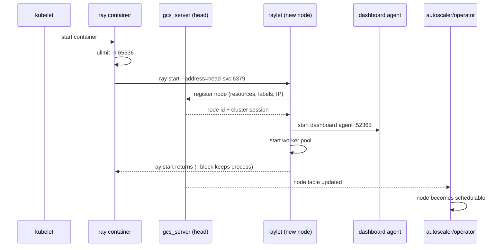

# 第 35 章 Ray 运行时深潜：GCS、Raylet、对象存储与调度

第 2 章给出了 Ray 的进程和端口地图。本章继续往下，回答四个工程问题：

1. 一个 Pod 从 `Running` 到“Ray 认为它可用”之间发生了什么？
2. GCS 里到底存了什么，为什么它一挂整个集群就不可用？
3. 对象存储为什么依赖 `/dev/shm`，对象丢失后 Ray 会怎么处理？
4. Ray Serve 和 Ray Job Submission 在运行时里分别由谁负责？

理解这些边界，才能把 KubeRay 的字段（`/dev/shm`、`num-cpus`、`RAY_gcs_rpc_server_reconnect_timeout_s`、`ray.io/serve`）和真实故障对应起来。

> 版本边界：Ray 2.59 的内部类名/指标可能随小版本变化；本章描述进程边界、状态机和不变量，这些在 2.x 内相对稳定。

## 35.1 从 Pod Running 到 Ray 节点可用

Kubernetes 的 `Running` 只表示容器进程起来了，**不表示 Ray 节点已经加入集群**。完整链路是：



### 35.1.1 head 的启动顺序

head 上 `ray start --head` 大致做：

1. 启动 **GCS server**（默认 6379）；
2. 启动 **Raylet**，向 GCS 注册 head 节点；
3. 启动 **Dashboard**（8265）和 **Dashboard Agent**（52365）；
4. 启动 **Client Server**（10001，若启用）；
5. 初始化对象存储（Plasma）；
6. 进入 `--block`，保持进程。

KubeRay 生成的 head 命令还会加：

```text
--dashboard-host=0.0.0.0
--metrics-export-port=8080
```

以及可选的 `--num-cpus`、`--num-gpus`、`--resources`、`--labels`。

### 35.1.2 worker 的启动顺序

worker 的 `ray start --address=<head-svc>:6379`：

1. 解析 head Service DNS；
2. 连接 GCS 的 6379；
3. 注册节点，上报资源形状；
4. 启动本地 Raylet；
5. 启动 Dashboard Agent；
6. 等待本地 worker 进程按需创建。

KubeRay 的 `wait-gcs-ready` init container 就是在第 1–2 步之前循环 `ray health-check`，避免 worker 在 head 未就绪时反复崩溃。

### 35.1.3 为什么 Pod Ready 不等于 Ray Ready

Pod 的 readiness probe 可能只检查进程/端口；而 Ray 节点可用还要求：

- GCS 可达；
- 节点注册成功；
- 资源形状有效；
- 没有 token/mTLS/版本不匹配；
- 本地对象存储初始化成功。

所以排查“Pod Running 但 Ray 看不到节点”时，要看：

```bash
kubectl logs <pod> -c ray --tail=200
kubectl logs <pod> -c wait-gcs-ready
kubectl exec <head> -- ray status
kubectl exec <head> -- ray list nodes
```

## 35.2 进程、线程与共享内存地图

一个 Ray Pod 里通常有：

```text
ray container
├── raylet (C++)
│   ├── node manager（本地调度）
│   ├── object manager（对象传输）
│   ├── worker pool（worker 进程池）
│   └── object store（ObjectStoreRunner）
├── gcs_server (head only, C++)
│   ├── KV store（Redis 或内存）
│   ├── pubsub
│   └── 各种 manager（node/actor/job/placement group）
├── dashboard (head, Python)
├── dashboard agent (每个节点, Python)
├── runtime env agent (每个节点, Python)
├── log monitor
├── worker processes (Python, 动态创建)
└── Serve controller/proxies (head/worker, Python actors)
```

### 35.2.1 关键进程职责

| 进程 | 语言 | 职责 | 挂了会怎样 |
|---|---|---|---|
| `gcs_server` | C++ | 集群元数据、节点/actor/job 表 | 集群不可用（除非 GCS FT） |
| `raylet` | C++ | 本地调度、对象管理、worker 池 | 该节点失联，任务重调度 |
| object store（raylet 内） | C++ | 共享内存对象存储；Ray 2.x 由 `ObjectStoreRunner` 在 raylet 进程内管理，没有独立的 `plasma_store_server` 进程 | 该节点对象丢失，任务可能失败/重建 |
| `dashboard` | Python | UI/Job/Serve API | Job 提交/Serve 部署受影响 |
| `dashboard_agent` | Python | 本地指标/日志/健康 | 监控/日志缺失，调度不受影响 |
| `runtime_env_agent` | Python | 安装依赖/下载 working_dir | 作业启动失败 |
| worker | Python | 执行 task/actor | task 重试，actor 可能死亡 |
| Serve controller | Python actor | deployment 状态 | Serve 升级/扩缩受影响 |
| Serve proxy | Python actor | HTTP 入口 | 该节点流量失败 |

### 35.2.2 线程模型

- Raylet 是单进程多线程：调度线程、对象管理线程、gRPC 线程池；
- GCS 是单进程多线程 + 异步 IO；
- Python worker 是单进程，默认单线程执行用户代码（除非用 async/线程）；
- Serve proxy 是 async event loop；
- Dashboard 是 aiohttp。

这解释了为什么：

- `ulimit -n` 很重要：每个 worker/连接都占 fd；
- CPU limit 过紧会导致 Raylet/worker 线程被节流；
- 大量小对象会增加 Raylet/对象管理器压力；
- Python GIL 会让单 worker 的 CPU 利用率上不去。

## 35.3 GCS：集群的元数据大脑

### 35.3.1 GCS 存什么

GCS（Global Control Store）是一个带 pubsub 的 KV 存储。常见表：

| 表 | 内容 | 谁写 |
|---|---|---|
| `NODE` | 节点注册、资源、状态、心跳 | raylet |
| `ACTOR` | actor 位置、状态、重启计数 | GCS actor manager |
| `JOB` | 作业、driver、runtime env | job manager |
| `TASK` | task 元数据/lease | raylet/GCS |
| `OBJECT` | 对象位置/所有权 | owner/raylet |
| `PLACEMENT_GROUP` | placement group 状态 | GCS placement group manager |
| `RESOURCE` | 集群资源形状 | raylet |
| `WORKER` | worker 进程注册 | raylet |
| `SESSION_NAME` | 集群会话标识 | head |
| `INTERNAL_CONFIG` | 内部配置 | GCS |

不同 Ray 版本的表名/结构会变，但“节点、actor、job、对象、placement group”这五类元数据是核心。

### 35.3.2 pubsub

GCS 提供 pubsub：

- raylet 订阅节点/资源变化；
- dashboard 订阅任务/actor/日志；
- Serve controller 订阅节点/actor 变化；
- autoscaler 订阅节点状态。

pubsub 让“状态变化 → 各组件反应”解耦，但也意味着：

- GCS 是热点；
- 大量小对象/actor 会增加 pubsub 压力；
- GCS 重启后订阅者要重连。

### 35.3.3 存储后端

GCS 的 KV 后端可以是：

- 内存（默认，非持久）；
- Redis（GCS FT）；
- RocksDB（v1.7 alpha，嵌入式）。

没有 GCS FT 时，head 重启 = 元数据丢失 = 集群不可恢复。GCS FT 只持久化**元数据**，不持久化用户对象/任务状态。

### 35.3.4 为什么 GCS 是单点

所有节点都要向 GCS 注册/心跳；所有 actor/task 的全局状态都在 GCS。GCS 挂了：

- 节点无法注册/续约；
- actor 位置丢失；
- 调度器无法做全局决策；
- dashboard/autoscaler 失去数据源。

KubeRay 能做的是：

- 重建 head（无 FT 时集群重来）；
- GCS FT（Redis/RocksDB）恢复元数据；
- 反亲和/节点池降低 head 故障概率；
- RayService 双集群做升级/故障切换。

### 35.3.5 GCS 内存与对象数量

GCS 内存随以下因素增长：

- 节点数；
- actor 数（尤其是长期存活的小 actor）；
- placement group 数；
- task 元数据（短期）；
- 对象元数据（大量小对象）。

如果 GCS OOM，整个集群会失联。缓解：

- 避免创建海量细粒度 actor；
- 用 task 替代短命 actor；
- 控制 placement group 数量；
- 监控 GCS 进程 RSS；
- 给 head 足够内存。

## 35.4 Raylet：本地调度与 worker 池

### 35.4.1 Raylet 的组成

```text
raylet
├── NodeManager
│   ├── LocalTaskManager：本地 task 队列
│   ├── LocalObjectManager：本地对象/溢出
│   ├── WorkerPool：worker 进程池
│   └── ClusterResourceScheduler：本地资源视图
├── ObjectManager
│   ├── PullManager：拉取远程对象
│   └── PushManager：推送对象
└── gRPC server：接收 task/对象请求
```

### 35.4.2 本地调度流程

当一个 task 到达节点：

1. 检查本地资源是否足够；
2. 足够 → 从 worker pool 取一个空闲 worker（没有则启动）；
3. 把 task 分配给 worker；
4. 执行完成后，worker 回到池中；
5. 资源不足 → 把 task 退回 GCS/全局调度。

Ray 的默认调度策略是 **hybrid**：

- 先尝试本地节点（减少对象传输）；
- 本地放不下，再让 GCS 全局调度；
- 全局调度按资源/标签/placement group 选节点。

### 35.4.3 worker 池

Worker pool 维护：

- idle workers（可复用）；
- starting workers（正在启动）；
- running workers（执行 task）；
- 最大 worker 数（受 CPU/资源限制）。

关键点：

- 一个 worker 同时只执行一个 task；
- worker 进程启动有成本（Python import）；
- 大量短 task 会反复创建 worker，影响延迟；
- `max_calls` 可以让 worker 执行 N 个 task 后退出，避免内存泄漏；
- actor 是长期 worker，不回到池中。

### 35.4.4 资源形状

Ray 的资源包括：

- CPU（可以是小数）；
- GPU（通常是整数，也可以是小数）；
- memory；
- 自定义资源（`--resources '{"Custom1": 1}'`）；
- 节点标签（label selector）。

资源形状由 `ray start` 参数决定：

```text
--num-cpus=8
--num-gpus=1
--memory=16000000000
--resources='{"Custom1": 1}'
--labels='{"ray.io/zone": "us-west-2a"}'
```

KubeRay 1.5+ 推荐用顶层 `resources`/`labels`，由控制器转换成这些参数，并镜像到 Pod 标签。

### 35.4.5 placement group

Placement group 是一组资源的原子分配：

- `PACK`：尽量放在同一节点（软约束）；
- `SPREAD`：尽量分散（软约束）；
- `STRICT_PACK`：必须放在同一节点，否则整体失败；
- `STRICT_SPREAD`：必须分散到不同节点，否则整体失败。

（没有单独的 `STRICT` 策略名；它通常指 `STRICT_PACK`/`STRICT_SPREAD` 的“全有或全无”语义。）

Ray 的 placement group 由 GCS 的 placement group manager 管理。KubeRay 不直接创建 placement group，但批调度器的 PodGroup 在 Pod 层提供类似的 gang 语义。

### 35.4.6 调度失败的原因

| 现象 | 原因 |
|---|---|
| task 一直 Pending | 资源不足、标签不匹配、placement group 不可满足 |
| task 在本地排队但不全局调度 | 本地资源视图未更新、GCS 不可达 |
| task 被调度到错误节点 | 标签/自定义资源配置错误 |
| GPU task 永远不调度 | `num-gpus=0` 或 GPU 资源未注册 |
| actor 无法创建 | actor 资源形状/节点标签/placement group |

## 35.5 对象存储：Plasma、所有权与传输

### 35.5.1 Plasma 是什么

Plasma 是 Ray 的共享内存对象存储：

- Ray 2.x 的对象存储运行在 raylet 进程内（`ObjectStoreRunner`），不再有独立的 `plasma_store_server` 进程；
- 对象放在 `/dev/shm`（共享内存）；
- worker 通过 raylet/共享内存机制访问，支持零拷贝读取；
- 对象不可变。

KubeRay 挂载 `medium: Memory` 的 emptyDir 到 `/dev/shm`，就是为了给 Plasma 足够的共享内存。容器默认 `/dev/shm` 往往只有 64MB，远小于对象存储需求。

### 35.5.2 对象生命周期

```text
ray.put(obj) / task 返回
  -> 对象写入本地 Plasma
  -> owner 记录对象位置
  -> 其他节点 ray.get 时拉取
  -> 引用计数归零后释放
```

关键概念：

- **owner**：创建对象的进程（driver/worker）；
- **reference**：对象引用，跨进程/跨节点；
- **distributed reference counting**：owner 跟踪引用；
- **object directory**：GCS/raylet 记录对象位置；
- **pull/push**：节点间传输对象。

### 35.5.3 对象丢失

对象可能因为：

- 节点故障；
- Plasma 内存不足被溢出/驱逐；
- owner 死亡；
- 对象存储配置错误。

Ray 的处理：

- **lineage reconstruction**：如果对象由 task 产生且 lineage 可用，重新执行 task；
- **owner 重建**：如果 owner 是 actor 且有 restart，重建 actor；
- **失败**：如果无法重建，task 失败。

这也是为什么：

- 关键数据要写对象存储/checkpoint，不要只依赖 Plasma；
- driver 不要持有大量对象引用；
- `ray.get` 大对象会阻塞 driver。

### 35.5.4 对象传输

跨节点传输由 ObjectManager 负责：

- `PullManager` 在需要时拉取；
- `PushManager` 在对象被引用时推送；
- 分块传输，避免大对象阻塞；
- 网络带宽是瓶颈；
- 对象本地性影响性能。

优化：

- 让数据与计算同节点/同区；
- 用 `ray.put` 共享只读大对象；
- 避免在 driver 里 `ray.get` 大量对象；
- 用 Ray Data 的流式/分块处理；
- 控制 batch 大小。

### 35.5.5 `/dev/shm` 与 `object-store-memory`

两者相关但不同：

- `/dev/shm` 是容器内共享内存挂载；
- `object-store-memory` 是 Ray 对象存储的上限；
- 如果 `/dev/shm` 小于 `object-store-memory`，Plasma 可能无法启动或频繁溢出；
- 如果 `/dev/shm` 太大，会计入节点内存，可能触发 OOM。

KubeRay 根据 Ray 容器的 memory request/limit 推导 `sizeLimit`；MiniKubeRay 固定 2Gi 仅用于模拟。生产要按对象大小/并发调整。

## 35.6 Task、Actor 与失败语义

### 35.6.1 Task 生命周期

```text
PENDING -> RUNNING -> FINISHED
   |          |
   +-> FAILED +-> retry
```

- task 失败默认重试（`max_retries`，默认取决于调用方式）；
- 重试可能在不同节点；
- task 必须幂等，否则重试会产生副作用；
- task 的输出对象可能丢失，需要重建。

### 35.6.2 Actor 生命周期

```text
DEPENDENCIES_UNREADY -> PENDING_CREATION -> CREATED -> ALIVE
                                                 |         |
                                                 |         +-> DEAD
                                                 +-> RESTARTING
```

- actor 默认不自动重启；
- `max_restarts` 控制重启次数；
- `max_task_retries` 控制 actor task 重试；
- actor 死亡后，持有的对象/状态可能丢失；
- 有状态 actor 要 checkpoint 或外部存储。

### 35.6.3 节点故障

节点故障时：

- GCS 标记节点 dead；
- 该节点上的 task 失败/重试；
- 该节点上的 actor 死亡（可能重启到其他节点）；
- 对象丢失，可能触发 lineage 重建；
- autoscaler 补副本。

KubeRay 的控制器会重建 Pod，但**不会恢复 Ray 的内部状态**；恢复靠 Ray 的重试/checkpoint/GCS FT。

### 35.6.4 GCS 故障

无 GCS FT：

- head 挂 → 集群不可恢复；
- 控制器重建 head → 新集群；
- 正在运行的作业失败，需要重跑。

有 GCS FT：

- head 重启 → 从 Redis/RocksDB 恢复元数据；
- worker 重连（受 `RAY_gcs_rpc_server_reconnect_timeout_s` 控制）；
- 正在运行的 task/actor 状态仍可能丢失；
- 应用要幂等/checkpoint。

## 35.7 Ray Job Submission 的内部路径

`ray job submit` 不是直接把代码发给 head 进程，而是：

```text
ray job submit
  -> Dashboard HTTP API (8265) /api/jobs/
  -> JobManager 创建 JobSupervisor actor
  -> JobSupervisor 准备 runtime_env
  -> 启动 driver 进程
  -> driver ray.init(address="auto")
  -> 作业状态/日志回传 Dashboard
```

关键点：

- `submission_id` 是幂等键；
- JobSupervisor 是 actor，运行在 head/worker；
- runtime_env 由 runtime env agent 安装；
- 日志由 driver 输出捕获；
- 作业状态：PENDING/RUNNING/SUCCEEDED/FAILED/STOPPED；
- `ray job stop` 停止 driver/actor。

KubeRay 的四种提交模式只是“谁调用这个 API”：

| 模式 | 调用者 | 路径 |
|---|---|---|
| K8sJobMode | submitter Pod | `ray job submit` → Dashboard |
| HTTPMode | operator | POST `/api/jobs/` |
| SidecarMode | head sidecar | 本地 Dashboard |
| InteractiveMode | 用户 | 手动提交 |

## 35.8 Ray Serve 的内部状态机

### 35.8.1 组件

```text
ServeController (actor, head)
├── DeploymentStateManager
├── ApplicationStateManager
└── ProxyStateManager

ProxyActor (每个节点)
├── HTTP server :8000
├── route table
└── replica handles

DeploymentReplica (actor)
├── user code (__call__/FastAPI)
├── max_concurrent_queries
└── health check
```

### 35.8.2 deployment 状态

| 状态 | 含义 |
|---|---|
| `DEPLOYING` | 正在创建/更新副本 |
| `HEALTHY` | 所有副本健康 |
| `UNHEALTHY` | 有副本不健康 |
| `UPSCALING` | 扩容中 |
| `DOWNSCALING` | 缩容中 |

KubeRay 的 RayService 通过 Dashboard/Serve API 部署 `serveConfigV2`，并读取 application/deployment 状态判断是否 Ready。

### 35.8.3 自动扩缩容

Serve autoscaling 看：

- 每副本 ongoing requests；
- 队列长度；
- 自定义指标；
- `target_num_ongoing_requests_per_replica`。

它调整的是 **deployment replicas（actor 数）**，不是 Ray 节点数。Ray autoscaler 再根据 actor 的资源需求调整节点。两层要一起配置：

```text
Serve max_replicas=20
Ray maxReplicas=4
  -> Serve 想扩到 20 副本，但只有 4 个 worker 节点
  -> 副本 Pending/排队
```

### 35.8.4 `target_capacity` 与流量

`target_capacity` 是 Serve 的全局容量百分比：

- 100 = 全部副本可接流量；
- 0 = 不接流量（用于 pending 集群预热）；
- 增量升级时随流量逐步提高。

它不等于 Kubernetes Service 的权重；流量切换由 Service selector 或 Gateway/HTTPRoute 权重完成。

### 35.8.5 `ray.io/serve` 标签

RayService 控制器根据 Serve 状态设置 Pod 的 `ray.io/serve` 标签：

- `true`：proxy 健康，可接流量；
- `false`：不接流量。

Serve Service 的 selector 是：

```text
ray.io/cluster=<active-cluster>
ray.io/serve=true
```

所以“Pod Ready 但 Service 没有 endpoint”时，先看这个标签，而不是只看 Pod 状态。

## 35.9 配置映射：Ray 内部 → KubeRay

| Ray 内部概念 | KubeRay 字段/环境变量 | 常见错配 |
|---|---|---|
| CPU 资源 | `resources.requests.cpu` + `num-cpus`/顶层 `resources` | Pod 8 核，Ray 2 核 |
| GPU 资源 | `nvidia.com/gpu` + `num-gpus`/顶层 `resources` | Pod 有 GPU，Ray 看不到 |
| 对象存储 | `/dev/shm` emptyDir + `object-store-memory` | `/dev/shm` 64MB |
| GCS 地址 | `RAY_ADDRESS`/`--address` | 写死错误 DNS |
| GCS 重连 | `RAY_gcs_rpc_server_reconnect_timeout_s` | 太短，worker 提前退出 |
| worker 池 | `num-cpus`/`num-gpus` | 资源超卖 |
| runtime env | `runtimeEnvYAML` + runtime env agent | 每个节点重复 pip |
| Serve 端口 | 8000 + Serve Service | selector 错 |
| Job API | 8265 + Dashboard | operator 无法访问 |
| 对象传输 | 网络/带宽 | 跨区大对象 |
| 日志 | `/tmp/ray/session_latest/logs` | 只看容器 stdout |

## 35.10 MiniKubeRay 模拟了哪些边界

`minikuberay/runtime/cluster_runtime.py` 用三个 dataclass 模拟 Ray 的可观测边界：

| 真实组件 | MiniKubeRay | 保留的语义 |
|---|---|---|
| 节点注册 | `NodeRecord` | CPU/GPU/内存、组、标签、空闲时间 |
| 作业 | `JobRecord` | PENDING/RUNNING/SUCCEEDED/FAILED/STOPPED、日志、时长、退出码 |
| Serve | `ServeState` | 配置、部署延迟、targetCapacity、trafficRoutedPercent、应用状态 |
| demand | `pending_demand` | CPU/GPU 请求、TTL |
| 集群生命周期 | `ClusterRuntime` | 节点/作业/Serve/删除时间 |

它没有模拟：

- GCS/Plasma/对象传输；
- task/actor 调度；
- worker 池；
- lineage 重建；
- runtime env 安装；
- Serve proxy/controller 的真实 actor；
- 网络/证书。

因此：

- 可以验证“控制器如何响应节点/作业/Serve 状态”；
- 不能验证真实吞吐、对象丢失、GCS 恢复；
- 第 24 章的分层测试和第 26 章的真实集群实验互补。

### 35.10.1 观察运行时边界

```bash
python -m minikuberay demo --fast
python -m minikuberay server
curl http://127.0.0.1:8080/apis/ray.io/v1/namespaces/default/rayclusters/demo/nodes
curl http://127.0.0.1:8080/api/history/sessions/default/demo/snapshot
```

`nodes` 返回的是 `NodeRecord`，`snapshot` 包含 runtime 的节点/作业/Serve/demand。对比真实集群的 `ray status`，可以理解哪些字段是控制面契约，哪些是运行时细节。

## 35.11 运行时排障清单

- [ ] Pod Running 后，`ray status` 是否看到节点？
- [ ] `ray list nodes` 的资源是否与 Pod requests 一致？
- [ ] `/dev/shm` 是否足够，Plasma 是否启动？
- [ ] GCS 日志是否有注册/心跳错误？
- [ ] worker 是否能解析 head Service、访问 6379？
- [ ] token/mTLS 是否匹配？
- [ ] runtime_env 是否安装成功？
- [ ] actor 是否持有资源导致不能缩容？
- [ ] 对象是否溢出/丢失，lineage 是否可重建？
- [ ] Serve proxy 是否健康，`ray.io/serve` 是否为 true？

把这份清单落到命令、State API 与日志证据上，见[第 56 章](kuberay教程-56-Ray活体诊断-State-API、ray-CLI与证据链.md)。

## 35.12 练习

1. 在一个 worker Pod 上按 35.1 的时序，用 `kubectl logs`/`ray status`/`ray list nodes` 找出“Pod Running 但节点未注册”的卡点。
2. 画出一个对象从 `ray.put` 到被另一个节点 `ray.get` 的完整路径，标出 owner、reference、pull/push。
3. 解释为什么 owner 死亡后对象可能丢失；lineage reconstruction 在什么条件下能恢复？
4. 对比 MiniKubeRay 的 `NodeRecord` 和真实 `ray status` 输出，列出 5 个真实但 Mini 没有的字段。
5. 用 `ray serve status` 观察一次 deployment 从 DEPLOYING 到 HEALTHY 的变化，记录耗时。

## 35.13 一次“worker 无法加入”的日志逐行解读

下面是一组经过脱敏/抽象的日志（不是逐字原文），展示如何从日志定位卡点。场景：worker Pod Running，但 `ray status` 看不到节点。

### 35.13.1 init container

```text
wait-gcs-ready  ray health-check --address demo-head-svc.default.svc.cluster.local:6379
wait-gcs-ready  [1/120] connection refused, retrying in 5s
wait-gcs-ready  [2/120] connection refused, retrying in 5s
```

解读：

- DNS 已解析（如果 DNS 失败，日志会是 `Could not resolve host`）；
- TCP 6379 被拒绝：head 未监听、Service 没有 endpoint、或 NetworkPolicy 拦截；
- 先查 head Pod 是否 Ready、EndpointSlice 是否有 IP、NetworkPolicy 是否放行。

### 35.13.2 worker ray 容器

```text
ray start --address=demo-head-svc...:6379
[raylet] Failed to connect to GCS: DeadlineExceeded
[raylet] Retrying...
```

解读：

- init container 可能已经通过（或探针未启用），但 GCS RPC 超时；
- 可能是 TLS/token 不匹配、GCS 过载、网络丢包/MTU；
- 对比 head 的 `gcs_server.out` 是否看到注册请求。

### 35.13.3 head 侧

```text
gcs_server.out  RegisterNode ... node_id=... resources={CPU:8, GPU:1}
gcs_server.out  Node ... heartbeat timeout
```

解读：

- 如果看到 RegisterNode，说明网络通了，问题在心跳/资源；
- 如果完全看不到，问题在 worker -> head 的路径；
- `heartbeat timeout` 可能是节点负载/网络分区/时钟。

### 35.13.4 资源形状

```text
ray status
Node status
  node-a  8.0/8.0 CPU  1.0/1.0 GPU
```

解读：

- 节点出现但资源为 0：`num-cpus`/`num-gpus` 未设置或 Pod resources 不匹配；
- 节点出现但标签不对：顶层 `labels`/`labelRefs` 配置错误；
- 节点出现但 task 不调度：placement group/label selector/自定义资源。

### 35.13.5 一张对照表

| 日志位置 | 看到什么 | 结论 |
|---|---|---|
| init `wait-gcs-ready` | `Could not resolve host` | DNS/Service 问题 |
| init `wait-gcs-ready` | `connection refused` | head 未监听/无 endpoint/策略拦截 |
| worker `raylet` | `DeadlineExceeded` | GCS RPC 超时（TLS/token/网络） |
| head `gcs_server.out` | `RegisterNode` | 网络通，查资源/心跳 |
| head `gcs_server.out` | 无注册记录 | worker->head 路径问题 |
| `ray status` | 节点资源为 0 | 资源参数错配 |
| `ray status` | 节点缺失 | 注册失败/进程退出 |

### 35.13.6 GCS 恢复日志

有 GCS FT 时，head 重建会看到：

```text
gcs_server.out  Loading GCS storage from Redis namespace=ft-cluster
gcs_server.out  Loaded N nodes, M actors, K jobs
gcs_server.out  Recovering placement groups...
```

要点：

- 看到 `Loaded` 不代表状态完全一致；对比恢复前后的 `ray status`；
- worker 重连受 `RAY_gcs_rpc_server_reconnect_timeout_s` 控制；
- 正在运行的 task/actor 可能丢失，应用要幂等/checkpoint。

## 35.14 小结

- Pod Running ≠ Ray 节点可用；注册要经过 GCS。
- GCS 存节点/actor/job/object/placement group 元数据，是单点。
- Raylet 负责本地调度、worker 池和对象管理；资源形状由 `ray start` 参数决定。
- Plasma 用 `/dev/shm`，对象有 owner/引用/传输/丢失语义。
- Ray Job Submission 走 Dashboard → JobSupervisor → driver。
- Serve 由 controller/proxy/replica actor 组成，`target_capacity` 与 `ray.io/serve` 是 KubeRay 的接入点。
- MiniKubeRay 只模拟控制面边界，不模拟真实运行时。

下一章从 Ray 回到 Kubernetes：GPU、device plugin、MIG、DRA 与异构资源调度。

→ [第 36 章 GPU 与异构资源调度](kuberay教程-36-GPU与异构资源调度-device-plugin、MIG、DRA与拓扑.md)
