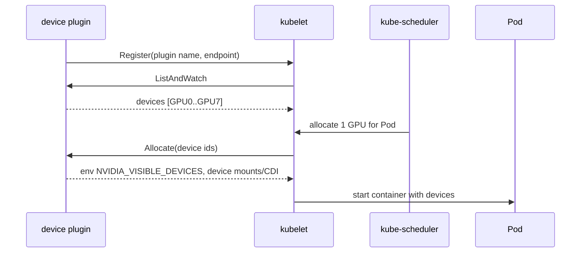

# 第 36 章 GPU 与异构资源调度：device plugin、MIG、DRA 与拓扑

KubeRay 的 Pod 最终要落到节点上。CPU 调度相对简单，GPU/TPU/NIC 则涉及设备插件、拓扑、显存隔离和 gang scheduling。本章从 Kubernetes 设备模型讲到 KubeRay 的资源配置，目标是让你能回答：

- 为什么 Pod 请求了 `nvidia.com/gpu: 1`，Ray 却看不到 GPU？
- MIG、time-slicing、MPS、DRA 分别解决什么问题，代价是什么？
- 为什么 8 张卡空着，一个 8 卡作业却调度不上去？
- 多机训练需要哪些网络/拓扑条件？

> 版本边界：DRA 的 API 版本随 Kubernetes 版本演进（`resource.k8s.io/v1beta1` → `v1`）。本章按“概念 + 版本提示”描述，具体字段以集群版本为准。KubeRay v1.7.1 没有专门的 DRA 字段，但可以通过 Pod template 使用 DRA。

## 36.1 Kubernetes 的设备模型

### 36.1.1 扩展资源

Kubernetes 把 GPU 当作**扩展资源**（extended resource）：

```yaml
resources:
  requests:
    nvidia.com/gpu: "1"
  limits:
    nvidia.com/gpu: "1"
```

规则：

- 扩展资源只能是整数；
- `requests` 和 `limits` 必须相等（不满足会被 API Server 拒绝）；
- 调度器按节点 `allocatable` 分配；
- 不超卖；
- 资源名由 device plugin 注册。

### 36.1.2 device plugin 协议

设备插件是运行在每个 GPU 节点上的 DaemonSet/Pod，通过 kubelet 的 Unix socket 注册：

```text
/var/lib/kubelet/device-plugins/kubelet.sock
/var/lib/kubelet/device-plugins/nvidia-gpu.sock
```

协议方法：

| 方法 | 作用 |
|---|---|
| `GetDevicePluginOptions` | 返回支持的选项 |
| `ListAndWatch` | 上报设备列表/健康状态 |
| `Allocate` | 为 Pod 分配设备，返回 env/mounts |
| `PreStartContainer` | 容器启动前钩子（可选） |

时序：



关键点：

- kubelet 负责调用 `Allocate`，不是调度器；
- `Allocate` 返回的 env/mounts 决定容器能看到哪些设备；
- 设备插件挂了，节点上的 GPU 会变成不可用；
- 节点重启后要重新注册。

### 36.1.3 GPU Operator 的组件

NVIDIA GPU Operator 把以下组件打包：

| 组件 | 作用 |
|---|---|
| driver | 节点 GPU 驱动（或使用预装驱动） |
| container-toolkit | 让容器访问 GPU |
| device-plugin | 注册 `nvidia.com/gpu` |
| DCGM exporter | GPU 指标 |
| GFD | GPU Feature Discovery，打节点标签 |
| MIG manager | 配置 MIG |
| validator | 安装后自检 |

不是所有集群都需要 GPU Operator；如果节点已预装驱动/插件，可以只装 device plugin + DCGM exporter。

## 36.2 GPU 发现与节点标签

### 36.2.1 GFD 标签

GPU Feature Discovery 给节点打标签，常见：

| 标签 | 示例 | 用途 |
|---|---|---|
| `nvidia.com/gpu.product` | `NVIDIA-A100-SXM4-80GB` | 选型号 |
| `nvidia.com/gpu.family` | `ampere`/`hopper` | 选代际 |
| `nvidia.com/gpu.memory` | `81920` | 选显存 |
| `nvidia.com/gpu.count` | `8` | 节点 GPU 数 |
| `nvidia.com/mig.config` | `all-1g.10gb` | MIG 配置 |
| `nvidia.com/mig.strategy` | `mixed`/`single` | MIG 策略 |
| `nvidia.com/gpu.clique` | 拓扑组 | NVLink 域 |

不要凭记忆写标签值；用：

```bash
kubectl get nodes --show-labels | tr ',' '\n' | grep nvidia
kubectl describe node <gpu-node> | sed -n '/Allocatable/,/System Info/p'
```

### 36.2.2 容量与可分配

```bash
kubectl get node <node> -o jsonpath='{.status.capacity.nvidia\.com/gpu}{"\n"}'
kubectl get node <node> -o jsonpath='{.status.allocatable.nvidia\.com/gpu}{"\n"}'
```

两者可能不同：

- 系统预留/驱逐会减少 allocatable；
- MIG 配置会改变资源名/数量；
- device plugin 未就绪时 allocatable 为 0。

### 36.2.3 节点池设计

| 池 | 用途 | 机型 | taint |
|---|---|---|---|
| cpu-general | 数据/小模型 | 32–64 核 | 无 |
| gpu-a100 | 大模型训练/推理 | A100 80GB | `nvidia.com/gpu=present:NoSchedule` |
| gpu-l4 | 轻量推理 | L4 | 同上 |
| spot | 可中断训练 | 多种 | `spot=true:NoSchedule` |
| tpu | TPU 训练 | TPU 切片 | `google.com/tpu=present:NoSchedule` |

KubeRay 的 worker group 通过 `nodeSelector`/`tolerations` 选择池；`maxReplicas` 要与池容量对齐。

## 36.3 请求、限制与隔离

### 36.3.1 基本写法

```yaml
resources:
  requests:
    cpu: "8"
    memory: 64Gi
    nvidia.com/gpu: "1"
  limits:
    nvidia.com/gpu: "1"
```

注意：

- GPU 不需要写 CPU limit；
- 不要 request 1 GPU、limit 2（API Server 拒绝）；
- 多卡请求：`nvidia.com/gpu: "8"`；
- device plugin 注入的是 `NVIDIA_VISIBLE_DEVICES`；`CUDA_VISIBLE_DEVICES` 由容器运行时/驱动与 Ray 的任务级分配共同决定，不要手动覆盖。

### 36.3.2 Ray 资源对齐

KubeRay 在未显式设置 `num-gpus` 时，会从 Ray 容器的 GPU limit 推导 `--num-gpus`；也可以用顶层 `resources` 覆盖。关键是**Pod 的 GPU 请求/限制与 Ray 看到的资源要一致**。使用 DRA 或非 `nvidia.com/gpu` 设备时，自动推导可能不适用，要显式设置。必须确保：

```yaml
# Pod 请求 1 GPU
resources:
  requests:
    nvidia.com/gpu: "1"
# Ray 也看到 1 GPU
rayStartParams:
  num-gpus: "1"
```

或：

```yaml
workerGroupSpecs:
  - groupName: gpu
    resources:
      GPU: "1"   # 这是 Ray 自定义资源，不是 K8s 资源
```

注意：顶层 `resources` 是 **Ray 节点资源**，不是 Kubernetes requests。两者不能互相替代：

- K8s requests 决定 Pod 能否调度；
- Ray resources 决定 Ray task/actor 能否调度。

### 36.3.3 常见错配

| 配置 | 结果 |
|---|---|
| Pod 1 GPU，`num-gpus=0` | Ray 永远不把 GPU task 调度到该节点 |
| Pod 8 CPU，`num-cpus=4` | Ray 只用 4 核，节点浪费 |
| Pod 无 GPU，`num-gpus=1` | Ray 以为有 GPU，task 启动后 CUDA 失败 |
| `CUDA_VISIBLE_DEVICES` 手动设死 | 多卡分配错乱 |
| 多容器共享 GPU | 只有申请资源的容器能看到设备 |

## 36.4 MIG、time-slicing 与 MPS

### 36.4.1 MIG（Multi-Instance GPU）

MIG 把一张 GPU 切成硬件隔离的实例：

- 每个实例有独立显存/SM；
- 资源名如 `nvidia.com/mig-1g.10gb`；
- 需要 GPU Operator 的 MIG manager 或手动配置；
- 配置变更通常需要重启节点/GPU；
- 适合小模型/多租户。

优点：强隔离、可预测。
缺点：切片固定、配置复杂、不是所有 GPU 支持。

### 36.4.2 time-slicing

NVIDIA device plugin 的 time-slicing 让多个容器共享一张 GPU：

```yaml
# device plugin 配置（概念）
sharing:
  timeSlicing:
    resources:
      - name: nvidia.com/gpu
        replicas: 4
```

效果：

- 节点上报 4 倍的 `nvidia.com/gpu`；
- 多个 Pod 轮流使用 GPU；
- **没有显存/故障隔离**；
- 延迟抖动，可能 OOM。

适合开发/低优先级负载，不适合 LLM 生产。

### 36.4.3 MPS

MPS（Multi-Process Service）让多个 CUDA 进程共享 GPU，提供更好的并发：

- 需要 NVIDIA MPS daemon；
- 仍然共享显存；
- 配置/兼容性复杂；
- 适合特定 HPC 负载。

### 36.4.4 选择矩阵

| 方式 | 隔离 | 显存 | 配置 | 适用 |
|---|---|---|---|---|
| 整卡 | 最强 | 独占 | 简单 | 训练/大模型推理 |
| MIG | 硬件分区 | 固定切片 | 中 | 多租户/小模型 |
| time-slicing | 时间片 | 共享 | 简单 | 开发/低优先级 |
| MPS | 进程级 | 共享 | 复杂 | HPC/特定负载 |
| 多副本小模型 | 进程隔离 | 独占 | 简单 | 成本换隔离 |

LLM 通常不建议 time-slicing：KV cache 和显存峰值不可预测。

## 36.5 拓扑：NUMA、NVLink、IB 与机架

### 36.5.1 单机拓扑

- **NUMA**：CPU/内存/PCIe 分域；跨 NUMA 访问延迟高；
- **NVLink**：GPU 间高带宽互连；
- **PCIe**：GPU 与 CPU/网卡；
- **NVSwitch**：多 GPU 全互联。

Kubernetes 的拓扑管理：

| 机制 | 作用 |
|---|---|
| CPU Manager | 绑核/独占 CPU |
| Topology Manager | 让 CPU/设备/内存在同一 NUMA |
| Memory Manager | 内存分域 |
| device plugin `TopologyInfo` | 上报设备 NUMA 节点 |

策略：

- `none`：不协调；
- `best-effort`：尽量；
- `restricted`：只允许满足的分配；
- `single-numa-node`：最强，可能降低调度成功率。

### 36.5.2 多机拓扑

多机训练需要：

- InfiniBand 或 RoCE；
- GPUDirect RDMA；
- SR-IOV / Multus / RDMA device plugin；
- NCCL 配置（`NCCL_SOCKET_IFNAME`、`NCCL_IB_HCA`）；
- 同一叶交换机/机架，减少跳数。

Kubernetes 侧要暴露：

- `rdma/rdma_shared_device_a` 等资源；
- 网络附件（Multus NetworkAttachmentDefinition）；
- 节点标签（机架/交换机/可用区）。

### 36.5.3 调度约束

| 机制 | 用途 |
|---|---|
| `nodeSelector` | 机型/可用区 |
| `nodeAffinity` | 复杂规则 |
| `podAffinity` | 与数据/参数服务器同节点 |
| `podAntiAffinity` | 打散/避免单点 |
| `topologySpreadConstraints` | 跨区/跨机架均衡 |
| `tolerations` | GPU/Spot taint |
| `priorityClassName` | 抢占优先级 |
| `schedulerName` | Volcano/YuniKorn/Kueue |

训练通常希望**聚合**（同机架/同区），推理通常希望**打散**（高可用）。不要盲目用默认的 spread。

## 36.6 DRA：Dynamic Resource Allocation

### 36.6.1 为什么需要 DRA

device plugin 模型把 GPU 当作整数资源，无法表达：

- 需要特定型号/显存的 GPU；
- 需要 MIG 切片组合；
- 需要多个设备（GPU + NIC + FPGA）满足拓扑；
- 设备初始化/清洁；
- 设备属性/容量。

DRA 把这些变成**结构化请求**。注意 `resource.k8s.io/v1` 的 DRA 在 Kubernetes 1.34/1.35 才 GA/稳定；更早的集群只有 `v1beta1`，且字段形状不同（v1beta1 是扁平的 `deviceClassName`/`count`，v1 必须放在 `exactly:` 下）：

```yaml
apiVersion: resource.k8s.io/v1
kind: ResourceClaim
metadata:
  name: gpu-claim
spec:
  devices:
    requests:
      - name: gpu
        exactly:
          deviceClassName: nvidia-gpu
          count: 2
          selectors:
            - cel:
                expression: device.attributes["nvidia.com"].memory >= 80
```

Pod 引用：

```yaml
spec:
  resourceClaims:
    - name: gpu
      resourceClaimTemplateName: gpu-claim-template
  containers:
    - name: ray
      resources:
        claims:
          - name: gpu
```

### 36.6.2 核心对象

| 对象 | 作用 |
|---|---|
| `DeviceClass` | 设备类别（NVIDIA GPU、MIG、NIC） |
| `ResourceSlice` | 节点/驱动上报的设备清单 |
| `ResourceClaim` | 一次设备分配请求 |
| `ResourceClaimTemplate` | 每个 Pod 生成独立 claim |
| `ResourceClaim` 状态 | 已分配设备/结果 |

### 36.6.3 版本与启用

- DRA 在 1.26 alpha，后续版本逐步 beta/GA；
- API 版本可能是 `resource.k8s.io/v1beta1` 或 `v1`；
- 需要 `DynamicResourceAllocation` feature gate + API；
- 需要支持 DRA 的 device driver（NVIDIA DRA driver）；
- 调度器需要 DRA plugin。

以集群版本和厂商文档为准，不要假设所有 1.30+ 都支持。

### 36.6.4 对 KubeRay 的影响

KubeRay v1.7.1 没有专门的 DRA 字段，但 Pod template 是原样的 `PodTemplateSpec`，可以写 `resourceClaims`：

```yaml
workerGroupSpecs:
  - groupName: gpu
    template:
      spec:
        resourceClaims:
          - name: gpu
            resourceClaimTemplateName: ray-gpu
        containers:
          - name: ray
            image: rayproject/ray:2.59.0-gpu
            resources:
              claims:
                - name: gpu
```

关键问题：**Ray 的资源检测不认识 DRA 设备**。DRA 分配的设备不在 `resources.requests` 里，Ray 可能看到 0 GPU。必须显式设置：

```yaml
rayStartParams:
  num-gpus: "1"
# 或顶层 resources
resources:
  GPU: "1"
```

同时确保 DRA driver/CDI 正确暴露设备，并让 Ray 的任务级分配设置 `CUDA_VISIBLE_DEVICES`（不要手动写死）。完整样例见 `manifests/samples/ray-cluster-dra.yaml`；它需要在支持 DRA 的集群上配合 `ResourceClaimTemplate`/`DeviceClass` 使用。

### 36.6.5 DRA 的运维代价

- 需要 DRA driver/版本匹配；
- 调试链路更长（claim/slice/class）；
- 不是所有 GPU Operator 版本都支持；
- 与 gang scheduling/队列的交互需要验证；
- 回滚到 device plugin 要重新配置。

建议：**只在需要 MIG/多设备/拓扑约束时上 DRA**；普通整卡训练继续用 device plugin。

## 36.7 异构资源：TPU、AMD、Habana 与 ARM

### 36.7.1 资源名

| 厂商 | 资源名 | 备注 |
|---|---|---|
| NVIDIA | `nvidia.com/gpu` | device plugin |
| Google TPU | `google.com/tpu` | GKE TPU |
| AMD | `amd.com/gpu` | ROCm device plugin |
| Habana | `habana.ai/gaudi` | Gaudi |
| Intel | `gpu.intel.com/i915` | Intel GPU |
| RDMA | `rdma/rdma_shared_device_a` | SR-IOV |

KubeRay 的 `resources`/`rayStartParams` 要使用对应资源名；不要假设只有 `nvidia.com/gpu`。

### 36.7.2 多主机 TPU

TPU 切片通常需要多个 Pod 组成一个逻辑切片：

```yaml
workerGroupSpecs:
  - groupName: tpu
    numOfHosts: 2
    replicas: 4
    template:
      spec:
        nodeSelector:
          cloud.google.com/gke-tpu-topology: 2x2x2
        containers:
          - name: ray
            resources:
              requests:
                google.com/tpu: "4"
```

KubeRay 的 `numOfHosts` 让一个 replica 跨多个 Pod；索引标签用于互相发现。调度要求：

- 同一拓扑域；
- 节点池有足够 TPU；
- gang scheduling（否则半个切片无法工作）。

### 36.7.3 ARM/多架构

- 镜像要匹配节点架构（arm64/amd64）；
- GPU 驱动/算子可能有架构差异；
- 用 `nodeSelector: kubernetes.io/arch` 固定；
- CI 要多架构构建。

## 36.8 GPU 碎片与 gang scheduling

### 36.8.1 碎片数学

假设节点 8 GPU，作业形状：

| 作业 | 需求 | 剩余 |
|---|---|---|
| A | 7 GPU | 1 |
| B | 7 GPU | 1 |
| C | 8 GPU | 无法调度 |

总空闲 2 GPU，但没有 8 GPU 连续空间。缓解：

- 大作业优先；
- 队列限制同时运行的小作业；
- 节点池按作业形状划分；
- gang scheduling + `minMember`；
- 监控“最大可调度形状”。

### 36.8.2 PodGroup

Volcano/scheduler-plugins 用 PodGroup 表达 gang：

```yaml
apiVersion: scheduling.volcano.sh/v1beta1
kind: PodGroup
metadata:
  name: ray-cluster-podgroup
spec:
  minMember: 9   # head + 8 workers
  queue: team-a
```

`minMember` 太小：部分 Pod 运行、部分 Pending，资源被占住。
`minMember` 太大：队列永远无法满足，作业一直 Pending。

KubeRay 的 `build_podgroup` 用 head + 所有 worker 的 desired Pod 数计算 `minMember`；扩容时要同步更新。

### 36.8.3 节点池与队列

- 每个队列的 GPU 配额与节点池容量对齐；
- 预留整机给大作业；
- 小作业用 MIG/time-slicing 池；
- Spot 池只跑可 checkpoint 的任务；
- 监控队列 Pending 原因（配额 vs 碎片 vs 镜像）。

## 36.9 容量与成本

### 36.9.1 GPU 利用率

```text
GPU 利用率 = 实际计算时间 / 可用 GPU 时间
```

低利用率常见原因：

- 数据加载瓶颈（CPU/IO）；
- batch size 太小；
- 副本/worker 不足；
- 模型并行通信瓶颈；
- GPU 型号混用；
- 调度碎片导致等待。

### 36.9.2 成本公式

```text
GPU 成本 = GPU 数 × 小时单价 × 运行时长
闲置成本 = 分配的 GPU 小时 - 实际计算 GPU 小时
```

降本：

- autoscaling/缩容到 0；
- Spot + checkpoint；
- MIG/共享（隔离允许时）；
- 量化/小模型；
- 对象存储生命周期；
- 监控闲置 GPU。

### 36.9.3 容量规划

| 项 | 说明 |
|---|---|
| 峰值 GPU | 业务压测 |
| 单作业最大 GPU | 决定节点池形状 |
| 碎片率 | 预留整机/队列 |
| 启动时间 | 镜像/模型加载 |
| 升级 surge | NewCluster 2× |
| 故障冗余 | N+1 节点 |

## 36.10 检查清单

- [ ] device plugin/DRA driver 正常，节点 allocatable 正确
- [ ] GFD 标签与 `nodeSelector` 匹配
- [ ] Pod GPU requests = limits
- [ ] Ray `num-gpus`/顶层 `resources` 与 Pod 一致
- [ ] MIG/time-slicing 配置与业务隔离要求匹配
- [ ] 多机训练有 IB/RoCE、NCCL 配置
- [ ] topology/NUMA 策略经过验证
- [ ] PodGroup `minMember` 覆盖 head + workers
- [ ] 队列配额与节点池容量对齐
- [ ] 监控 GPU 利用率/显存/碎片
- [ ] DRA（如使用）有 driver/版本/回滚方案

## 36.11 练习

1. 在一个 MIG 节点上分别申请 `nvidia.com/mig-1g.10gb` 和 `nvidia.com/gpu`，观察调度结果和容器内 `nvidia-smi`。
2. 用 `manifests/samples/ray-cluster-dra.yaml` 在支持 DRA 的集群上跑通一次；记录 `ResourceClaim`/`ResourceSlice` 状态。
3. 构造 8 节点 × 8 GPU 的碎片场景，比较“先跑 8 个 7 GPU 作业”和“先跑 8 个 1 GPU 作业”后，8 GPU 作业的可调度性。
4. 给多机训练 Pod 加 `topologySpreadConstraints` 和 RDMA 资源，验证 NCCL 是否走 IB。
5. 用 `kubectl describe node` 找出一个“总空闲 GPU 够但形状不够”的例子，并设计队列策略。

## 36.12 GPU 调度验收脚本

把“GPU 能不能用”拆成可自动化的检查，而不是人工 `nvidia-smi`。

### 36.12.1 节点层

```bash
set -euo pipefail

# 1. 节点可分配 GPU
kubectl get nodes -o custom-columns=\
NAME:.metadata.name,\
GPU:.status.allocatable.nvidia\.com/gpu,\
PRODUCT:.metadata.labels.nvidia\.com/gpu\.product,\
MIG:.metadata.labels.nvidia\.com/mig\.config

# 2. device plugin / GPU Operator（Operator 通常装在 gpu-operator namespace）
kubectl get pods -A | grep -E 'nvidia-device-plugin|gpu-operator'
kubectl -n kube-system logs ds/nvidia-device-plugin-daemonset --tail=50 2>/dev/null \
  || kubectl -n gpu-operator logs ds/nvidia-device-plugin-daemonset --tail=50

# 3. 节点事件
kubectl get events -A --field-selector reason=FailedScheduling --sort-by=.lastTimestamp | tail -20
```

期望：

- 每个 GPU 节点 `GPU` 等于物理卡数（或 MIG 切片数）；
- `PRODUCT` 有值；
- device plugin Pod Running；
- 没有持续 FailedScheduling。

### 36.12.2 Pod 层

```bash
# 1. Pod 请求/限制
kubectl get pod <pod> -o jsonpath='{.spec.containers[0].resources}'

# 2. 容器内可见 GPU
kubectl exec <pod> -- nvidia-smi -L
kubectl exec <pod> -- env | grep -E 'CUDA_VISIBLE_DEVICES|NVIDIA_VISIBLE_DEVICES'

# 3. Ray 侧资源
kubectl exec <head> -- ray status
kubectl exec <head> -- ray list nodes
```

期望：

- requests == limits；
- 容器内 GPU 数 = Pod 请求数；
- `ray status` 的 GPU 数与 Pod 请求一致。

### 36.12.3 作业层

```bash
# 提交一个只检查 GPU 的 Ray task
kubectl exec <head> -- python - <<'PY'
import ray
ray.init(address="auto")

@ray.remote(num_gpus=1)
def gpu_info():
    import torch
    return torch.cuda.get_device_name(0), torch.cuda.device_count()

print(ray.get(gpu_info.remote()))
PY
```

期望：返回正确的 GPU 型号，`device_count()==1`。

### 36.12.4 自动化门禁

把上面的检查写成一个脚本/CI job：

```text
节点 allocatable == 期望
device plugin Running
Pod requests == limits
ray status GPU == Pod GPU
一个 GPU task 成功
```

任何一项失败，不要继续跑训练/推理。

### 36.12.5 常见“看起来有 GPU”的假象

- 节点有 GPU，但 device plugin 没注册 -> allocatable 为 0；
- Pod 请求了 GPU，但 `num-gpus=0` -> Ray 看不到；
- `CUDA_VISIBLE_DEVICES` 被手动覆盖 -> 看到全部/错误设备；
- MIG 配置变更后资源名变化 -> 旧 selector 失效；
- time-slicing 上报数量翻倍 -> 多个 Pod 争抢同一张卡。

## 36.13 小结

- GPU 是扩展资源，由 device plugin 注册，requests=limits，不超卖。
- GFD 标签是选型的基础；MIG/time-slicing/MPS 解决不同隔离/共享需求。
- Ray 资源与 Kubernetes 资源是两套模型，必须显式对齐。
- DRA 提供结构化设备请求，但 KubeRay 需要手动告诉 Ray 有 GPU。
- 多机训练依赖网络/拓扑；gang scheduling 和节点池设计决定碎片。
- 容量规划要同时看 GPU 数、形状、启动时间、升级 surge 和故障冗余。

下一章进入生产故障案例：把前面所有机制放进真实事故时间线。

→ [第 37 章 生产故障案例与复盘](kuberay教程-37-生产故障案例与复盘.md)
