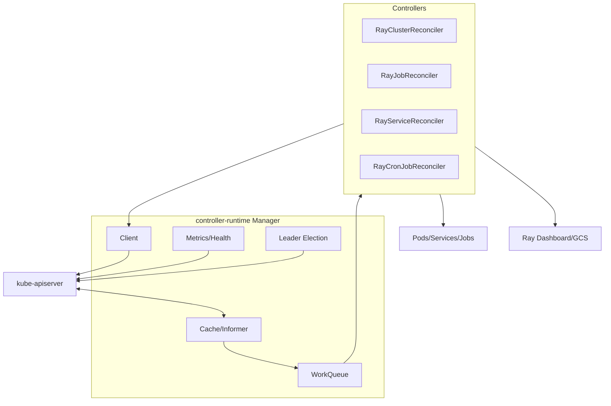

# 第 38 章 从 MiniKubeRay 到生产 Operator：移植与二次开发

MiniKubeRay 用 Python + 进程内 Store 把控制逻辑讲清楚；生产 KubeRay 用 Go + controller-runtime + 真实 API Server。本章给出一条可执行的移植路线：哪些代码可以直接搬，哪些必须重写，每一步如何验收。

> 目标不是“把 MiniKubeRay 翻译成 Go”，而是**保留行为契约，替换基础设施**。状态机、幂等规则、finalizer 顺序、status 语义可以复用；Store、调度器、kubelet、Ray 运行时必须换成真实实现。

## 38.1 移植的原则

| 原则 | 含义 |
|---|---|
| 行为优先 | 先写测试锁定行为，再换实现 |
| 边界清晰 | 控制器只依赖 client/runtime 接口，不直接碰 etcd/HTTP |
| 幂等 | 任何 Reconcile 重复执行都不产生额外副作用 |
| 最终一致 | 不假设缓存/外部状态是最新的 |
| 可观测 | 每个失败都要有 Event/Condition/日志 |
| 渐进 | 先单控制器，再多控制器；先单 namespace，再多租户 |

### 38.1.1 保留什么

- 四个 CRD 的状态机；
- 默认值与校验规则；
- spec hash / Recreate / None 的语义；
- `workersToDelete` 的缩容协议；
- RayService active/pending 与增量升级；
- RayJob 四种提交模式与清理规则；
- RayCronJob 调度语义；
- finalizer/ownerReference 顺序；
- status/condition 的“只在变化时写”。

### 38.1.2 替换什么

| MiniKubeRay | 生产实现 |
|---|---|
| `ApiStore` | kube-apiserver + controller-runtime client/cache |
| `LocalClient`/`HTTPClient` | `client.Client` + typed clients |
| `WorkQueue` | controller-runtime workqueue |
| `SimulatedScheduler` | kube-scheduler / Volcano / YuniKorn / Kueue |
| `Kubelet` | 真实 kubelet |
| `RayRuntime` | Ray Dashboard/Job/Serve API |
| `ManualClock` | `time.Now` + `RequeueAfter` |
| `EventRecorder` | `record.EventRecorder` |
| `OperatorMetrics` | Prometheus registry/controller-runtime metrics |

## 38.2 目标架构



关键点：

- 控制器读 cache，写 API；
- `Owns` 让子资源变化触发父对象调和；
- 外部状态（Ray job/Serve）通过 HTTP 轮询；
- leader election 保证同一时刻只有一个副本调和。

## 38.3 第 1 步：定义 CRD 类型

### 38.3.1 Go 类型

```go
// apis/ray/v1/raycluster_types.go
type RayClusterSpec struct {
    RayVersion              string                  `json:"rayVersion,omitempty"`
    HeadGroupSpec           HeadGroupSpec           `json:"headGroupSpec"`
    WorkerGroupSpecs        []WorkerGroupSpec       `json:"workerGroupSpecs,omitempty"`
    EnableInTreeAutoscaling *bool                   `json:"enableInTreeAutoscaling,omitempty"`
    AutoscalerOptions       *AutoscalerOptions      `json:"autoscalerOptions,omitempty"`
    Suspend                 *bool                   `json:"suspend,omitempty"`
    ManagedBy               *string                 `json:"managedBy,omitempty"`
    GCSFaultToleranceOptions *GCSFaultToleranceOptions `json:"gcsFaultToleranceOptions,omitempty"`
}
```

### 38.3.2 kubebuilder 标记

```go
// +kubebuilder:validation:Minimum=0
// +kubebuilder:default=0
// +optional
Replicas *int32 `json:"replicas,omitempty"`

// +kubebuilder:validation:Enum=Default;Aggressive;Conservative
// +kubebuilder:default=Default
UpscalingMode *string `json:"upscalingMode,omitempty"`
```

生成：

```bash
make generate    # deepcopy
make manifests   # CRD YAML
```

### 38.3.3 默认值放在哪

三个地方都可能：

1. CRD OpenAPI `default`：API Server 写入时补；
2. controller `setDefaults`：兼容旧对象/复杂逻辑；
3. Pod builder 兜底。

原则：

- 简单标量默认值放 CRD；
- 跨字段/版本相关默认值放 controller；
- 不要在三个地方写不同值；
- 测试要覆盖“未设置/显式零值/旧对象”。

### 38.3.4 校验放在哪

- OpenAPI：类型、枚举、范围、必填；
- controller：跨字段、互斥、外部依赖；
- webhook：需要拒绝非法对象时（可选）；
- 不要只依赖 CLI 校验。

MiniKubeRay 的 `validate_raycluster` 可以逐条翻译成 Go 函数；测试用例可以直接复用。

## 38.4 第 2 步：替换 Store/Client

### 38.4.1 定义接口

```go
type KubeClient interface {
    Get(ctx context.Context, key client.ObjectKey, obj client.Object) error
    List(ctx context.Context, list client.ObjectList, opts ...client.ListOption) error
    Create(ctx context.Context, obj client.Object, opts ...client.CreateOption) error
    Update(ctx context.Context, obj client.Object, opts ...client.UpdateOption) error
    Patch(ctx context.Context, obj client.Object, patch client.Patch, opts ...client.PatchOption) error
    Delete(ctx context.Context, obj client.Object, opts ...client.DeleteOption) error
    Status() client.SubResourceWriter
}
```

控制器只依赖这个接口，测试可以用 fake client。

### 38.4.2 乐观并发

Kubernetes 的 `resourceVersion` 冲突：

```go
err := r.Client.Update(ctx, obj)
if apierrors.IsConflict(err) {
    return ctrl.Result{Requeue: true}, nil
}
```

或者：

```go
err := retry.RetryOnConflict(retry.DefaultRetry, func() error {
    if err := r.Get(ctx, key, obj); err != nil {
        return err
    }
    // mutate
    return r.Update(ctx, obj)
})
```

不要吞掉冲突；也不要无限重试。

### 38.4.3 status subresource

```go
if !reflect.DeepEqual(oldStatus, newStatus) {
    obj.Status = newStatus
    if err := r.Status().Update(ctx, obj); err != nil {
        return ctrl.Result{}, err
    }
}
```

只写 status 不会触发 spec 的 generation 变化；这也是为什么 status 要单独设计。

### 38.4.4 SSA（可选）

如果多个控制器管理同一对象的字段：

```go
apply := client.Apply
if err := r.Patch(ctx, obj, apply, client.FieldOwner("kuberay-operator")); err != nil {
    return ctrl.Result{}, err
}
```

SSA 需要仔细设计字段所有权；KubeRay 核心路径通常用 Create/Update。

## 38.5 第 3 步：RayCluster Reconciler

### 38.5.1 骨架

```go
type RayClusterReconciler struct {
    client.Client
    Scheme   *runtime.Scheme
    Recorder record.EventRecorder
    Config   OperatorConfig
}

func (r *RayClusterReconciler) Reconcile(ctx context.Context, req ctrl.Request) (ctrl.Result, error) {
    var cluster rayv1.RayCluster
    if err := r.Get(ctx, req.NamespacedName, &cluster); err != nil {
        return ctrl.Result{}, client.IgnoreNotFound(err)
    }

    if !cluster.ObjectMeta.DeletionTimestamp.IsZero() {
        return r.reconcileDelete(ctx, &cluster)
    }

    // 交给外部控制器（如 MultiKueue）的对象不要加 finalizer：
    // 否则删除会卡在我们永远不会处理的清理逻辑上。
    if managedByExternal(&cluster) {
        return ctrl.Result{}, nil
    }

    if !controllerutil.ContainsFinalizer(&cluster, RayClusterFinalizer) {
        controllerutil.AddFinalizer(&cluster, RayClusterFinalizer)
        if err := r.Update(ctx, &cluster); err != nil {
            return ctrl.Result{}, err
        }
        return ctrl.Result{}, nil
    }

    r.setDefaults(&cluster)
    if errs := validateRayCluster(&cluster); len(errs) > 0 {
        r.Recorder.Event(&cluster, corev1.EventTypeWarning, "InvalidRayClusterSpec", strings.Join(errs, "; "))
        return ctrl.Result{}, r.updateStatus(ctx, &cluster, validationFailedStatus(errs))
    }

    // 依赖先行：RBAC/Service/PVC/Secret -> Pods
    if err := r.reconcileAuxiliary(ctx, &cluster); err != nil {
        return ctrl.Result{}, err
    }
    if err := r.reconcileServices(ctx, &cluster); err != nil {
        return ctrl.Result{}, err
    }
    if err := r.reconcilePods(ctx, &cluster); err != nil {
        return ctrl.Result{}, err
    }
    if err := r.updateStatus(ctx, &cluster, calculateStatus(&cluster)); err != nil {
        return ctrl.Result{}, err
    }

    return ctrl.Result{RequeueAfter: 300 * time.Second}, nil
}
```

### 38.5.2 注册

```go
func (r *RayClusterReconciler) SetupWithManager(mgr ctrl.Manager) error {
    return ctrl.NewControllerManagedBy(mgr).
        For(&rayv1.RayCluster{}).
        Owns(&corev1.Pod{}).
        Owns(&corev1.Service{}).
        Owns(&corev1.Secret{}).
        Owns(&corev1.PersistentVolumeClaim{}).
        Owns(&networkingv1.NetworkPolicy{}).
        WithOptions(controller.Options{
            MaxConcurrentReconciles: 4,
        }).
        Complete(r)
}
```

### 38.5.3 调和对顺序

保留 MiniKubeRay 的顺序：

```text
managedBy -> finalizer -> defaults -> validate
  -> autoscaler RBAC -> ingress -> auth secret
  -> head Service -> headless Service -> Serve Service
  -> GCS PVC -> Pods -> autoscale -> status -> requeue
```

原因：

- Service 先于 Pod，worker 启动时 DNS 已存在；
- RBAC 先于 autoscaler sidecar；
- Secret/PVC 先于 Pod；
- status 最后写。

### 38.5.4 spec hash 与 Recreate

```go
func specHash(spec rayv1.RayClusterSpec) string {
    copy := spec.DeepCopy()
    for i := range copy.WorkerGroupSpecs {
        copy.WorkerGroupSpecs[i].Replicas = nil
        copy.WorkerGroupSpecs[i].MinReplicas = nil
        copy.WorkerGroupSpecs[i].MaxReplicas = nil
        if copy.WorkerGroupSpecs[i].ScaleStrategy != nil {
            copy.WorkerGroupSpecs[i].ScaleStrategy.WorkersToDelete = nil
        }
    }
    data, _ := json.Marshal(copy)
    sum := sha256.Sum256(data)
    return hex.EncodeToString(sum[:8])
}
```

MiniKubeRay 存 hash 在 CR 注解/Pod 标签；上游存在 head Pod 注解。移植时要保持“删除 head 不丢基线”的不变量。

### 38.5.5 scale expectations

cache 是最终一致的。创建 Pod 后，下一轮可能还看不到它。实现：

```go
type Expectations struct {
    mu       sync.Mutex
    expected map[types.NamespacedName]int
}

func NewExpectations() *Expectations {
    return &Expectations{expected: make(map[types.NamespacedName]int)}
}

func (e *Expectations) Expect(group types.NamespacedName, count int) {
    e.mu.Lock()
    defer e.mu.Unlock()
    e.expected[group] = count
}

func (e *Expectations) Satisfied(group types.NamespacedName, observed int) bool {
    e.mu.Lock()
    defer e.mu.Unlock()
    if observed >= e.expected[group] {
        delete(e.expected, group)
        return true
    }
    return false
}
```

这只是“期望总数”版本；上游的 `scale_expectations` 会分别跟踪 add/delete，并处理对象 UID、重复事件和超时。移植时优先用上游实现。没有它，扩容会重复创建 Pod，缩容会误删。

## 38.6 第 4 步：Pod/Service Builder

MiniKubeRay 的 `builders.py` 可以逐函数翻译：

| Python | Go |
|---|---|
| `ray_start_command` | `generateRayStartCommand` |
| `build_head_pod` | `buildHeadPod`（未导出）/ `BuildPod` + head 分支 |
| `build_worker_pod` | `buildWorkerPod`（未导出）/ `BuildPod` + worker 分支 |
| `build_head_service` | `BuildServiceForHeadPod` |
| `build_serve_service` | `BuildServeService` |
| `build_gcs_pvc` | `BuildGCSStoragePVC` |
| `build_network_policies` | `buildHeadNetworkPolicy` / `buildWorkerGroupNetworkPolicy` |
| `build_autoscaler_rbac` | `BuildServiceAccount` + `BuildRole` + `BuildRoleBinding` |
| `build_podgroup` | `createPodGroup` |

### 38.6.1 Golden 测试

不要只断言“Pod 存在”，要断言完整 YAML：

```go
func TestBuildHeadPod(t *testing.T) {
    cluster := testCluster()
    pod := BuildHeadPod(cluster)
    golden := filepath.Join("testdata", "head-pod.golden.yaml")
    if *update {
        os.WriteFile(golden, mustYAML(pod), 0o644)
    }
    assert.Equal(t, string(mustRead(golden)), string(mustYAML(pod)))
}
```

Golden 测试能抓住：

- 端口/环境变量变化；
- 卷/挂载顺序；
- label/annotation 变化；
- 命令拼接错误。

### 38.6.2 不要手写 YAML 字符串

用 typed `corev1.Pod` 构造，最后序列化；避免缩进/转义错误。

## 38.7 第 5 步：替换 RayRuntime

MiniKubeRay 的 `RayRuntime` 是模拟边界；生产要换成：

| 能力 | API |
|---|---|
| 作业提交 | Dashboard `/api/jobs/` 或 `ray job submit` |
| 作业状态 | `/api/jobs/{job_id}` |
| 作业日志 | `/api/jobs/{job_id}/logs` |
| Serve 部署 | Dashboard Serve API |
| Serve 状态 | `/api/serve/applications/` |
| 节点状态 | `/nodes` 或 `ray status` |
| autoscaler | Ray autoscaler 自身 |

### 38.7.1 幂等提交

```go
func (c *RayClient) Submit(ctx context.Context, req SubmitRequest) (string, error) {
    // submission_id 是幂等键
    body := map[string]any{
        "entrypoint": req.Entrypoint,
        "submission_id": req.SubmissionID,
        "runtime_env": req.RuntimeEnv,
        "metadata": req.Metadata,
    }
    resp, err := c.post(ctx, "/api/jobs/", body)
    if err != nil {
        return "", err
    }
    return resp.JobID, nil
}
```

重试时复用 `submission_id`；不要每次生成新 ID。

### 38.7.2 超时/重试

- 连接超时、读超时分开；
- 对 5xx 重试，对 4xx 不重试；
- 作业状态轮询要有退避；
- 不要让 Reconcile 阻塞太久；
- 用 `RequeueAfter` 而不是 `sleep`。

### 38.7.3 Serve 状态

RayService 需要区分：

- application 是否存在；
- deployment 是否 HEALTHY；
- endpoint 数；
- `target_capacity`；
- 版本/hash。

不要只看 HTTP 200；要读结构化状态。

## 38.8 第 6 步：RayJob

移植重点：

1. 两套状态（`JobStatus`/`JobDeploymentStatus`）；
2. 四种提交模式；
3. `backoffLimit` 与 `submitterConfig.backoffLimit` 的区别；
4. `activeDeadlineSeconds`/`preRunningDeadlineSeconds`；
5. deletion rules 的优先级/互斥；
6. `clusterSelector` 不删除共享集群；
7. finalizer 停止作业。

建议先写状态机表单测试：

```text
New -> Initializing -> Running -> Complete
New -> Initializing -> Failed
Running -> Retrying -> Initializing -> Running
Running -> Suspending -> Suspended -> Initializing
```

每个转移都要有“重复调和不变”的断言。

## 38.9 第 7 步：RayService

移植重点：

1. revision hash 只包含需要新集群的字段；
2. active/pending 状态；
3. Serve 部署与标签；
4. Service selector 切换；
5. 旧集群延迟删除；
6. 增量升级的 Gateway/HTTPRoute；
7. 回滚。

最容易错的是“只改 Serve 配置也创建新集群”。MiniKubeRay 的 `cluster_spec_hash` 排除了 `serveConfigV2`；移植时要保留这个语义。

## 38.10 第 8 步：RayCronJob

移植重点：

1. cron 解析/时区；
2. 下一次调度时间；
3. 子 RayJob 命名/幂等；
4. ownerReference；
5. suspend；
6. feature gate。

上游 v1.7 没有 `concurrencyPolicy`/history limits；不要擅自加字段，除非你明确标注为扩展。

## 38.11 第 9 步：测试

### 38.11.1 单元测试

- 默认值/校验；
- builder golden；
- 状态机纯函数；
- hash/命名。

### 38.11.2 envtest

```go
func TestRayClusterReconcile(t *testing.T) {
    testEnv := &envtest.Environment{
        CRDDirectoryPaths: []string{"../../config/crd/bases"},
    }
    cfg, err := testEnv.Start()
    if err != nil { t.Fatal(err) }
    defer testEnv.Stop()

    scheme := runtime.NewScheme()
    _ = rayv1.AddToScheme(scheme)
    _ = corev1.AddToScheme(scheme)

    mgr, _ := ctrl.NewManager(cfg, ctrl.Options{Scheme: scheme})
    reconciler := &RayClusterReconciler{Client: mgr.GetClient(), Scheme: scheme}
    _ = reconciler.SetupWithManager(mgr)
    go mgr.Start(ctrl.SetupSignalHandler())

    // create CR, wait for Pods/status
}
```

覆盖：

- finalizer 两阶段删除；
- status subresource；
- 冲突重试；
- ownerReference；
- scale expectations。

### 38.11.3 kind e2e

```bash
kind create cluster --name kuberay-e2e
make docker-build IMG=kuberay-operator:e2e
kind load docker-image kuberay-operator:e2e --name kuberay-e2e
make deploy IMG=kuberay-operator:e2e
kubectl apply -f ray-operator/config/samples/ray-cluster.sample.yaml
kubectl wait --for=condition=RayClusterProvisioned raycluster/raycluster-kuberay --timeout=5m
go test ./test/e2e/... -v
```

覆盖真实 Pod/Service/Ray 进程。

### 38.11.4 对照 MiniKubeRay 测试

| MiniKubeRay 测试 | 生产对应 |
|---|---|
| `tests/test_store.py` | envtest + API Server |
| `tests/test_raycluster.py` | envtest/e2e |
| `tests/test_rayjob.py` | envtest + fake Dashboard |
| `tests/test_rayservice.py` | envtest + fake Serve API |
| `tests/test_e2e.py` | kind e2e |
| `tests/test_docs.py` | CI schema/golden 检查 |

不要指望 1:1 复制；行为断言可以复用，基础设施要重写。

## 38.12 第 10 步：打包与上线

### 38.12.1 镜像

- 多阶段构建，最小运行时；
- 非 root；
- 固定 digest；
- 多架构（amd64/arm64）；
- SBOM/签名。

### 38.12.2 Helm

- CRD 放 `crds/`，升级单独处理；
- RBAC 最小化；
- values 支持镜像/资源/feature gates；
- 探针/PDB/leader election；
- ServiceMonitor。

### 38.12.3 上线策略

```text
1. staging 单 namespace
2. 只读/shadow 观察（不创建 Pod）
3. 灰度一个租户
4. 观察 reconcile 错误/延迟/资源
5. 扩大范围
6. 回滚预案
```

不要一开始就接管生产所有 namespace。

## 38.13 常见移植陷阱

| 陷阱 | 后果 | 修复 |
|---|---|---|
| 直接读 API Server 不用 cache | 打爆 API Server | 用 cache，强一致读用 APIReader |
| 忘记 scale expectations | 重复创建/误删 Pod | 实现 expectations |
| status 每次都写 | watch 风暴 | 只写变化 |
| `lastTransitionTime` 每次更新 | GitOps 不同步 | 只在 status 变化时更新 |
| finalizer 顺序错 | 删除卡住/泄漏 | 先清理子资源再移除 |
| ownerReference UID 错 | GC 不工作 | 用创建时的 UID |
| list 不带 namespace | 跨租户误操作 | 显式 namespace/label |
| 忽略 deletionTimestamp | 删除后继续创建 | 先处理删除分支 |
| 用 `time.Sleep` | 阻塞 worker | `RequeueAfter` |
| 没有 leader election | 双写/冲突 | 开启 lease |
| 默认值与 CRD 冲突 | 行为不一致 | 单一事实来源 |
| CRD 未升级 | 字段被裁剪 | 独立 CRD 流程 |

## 38.14 验收清单

- [ ] CRD schema/默认值/校验与文档一致
- [ ] 四个控制器都有 envtest/e2e
- [ ] 幂等：连续调和无额外写入
- [ ] finalizer/ownerReference 正确
- [ ] status 只在变化时写
- [ ] scale expectations 生效
- [ ] Ray API 超时/重试/幂等
- [ ] leader election/PDB
- [ ] RBAC 最小化
- [ ] Helm/CRD 升级流程
- [ ] 监控/告警/日志
- [ ] 回滚演练
- [ ] 与 MiniKubeRay 的行为差异有文档

## 38.15 练习

1. 把 `minikuberay/models/validation.py` 中的一条规则翻译成 Go，并写单元测试。
2. 用 envtest 跑一个最小 RayCluster Reconcile，断言 head Service/Pod 被创建。
3. 为 `BuildHeadPod` 写 golden 测试，覆盖 auth/GCS FT/mTLS 三种分支。
4. 实现一个最小 scale expectations，并写“缓存延迟”测试。
5. 设计一个从 MiniKubeRay 到生产 operator 的灰度计划（namespace/租户/回滚）。

## 38.16 从 Python 测试到 Go 表驱动测试

MiniKubeRay 的测试是“行为契约”；移植时不要丢掉，而是改写成 Go 的表驱动测试。

### 38.16.1 一一映射

| MiniKubeRay 测试 | Go 测试 | 断言重点 |
|---|---|---|
| `test_defaults_validation.py` | `TestSetDefaults` / `TestValidate` | 默认值、错误信息 |
| `test_raycluster.py` | `TestReconcileRayCluster` + envtest | 子资源/status/finalizer |
| `test_rayjob.py` | `TestReconcileRayJob` | 状态机/重试/清理 |
| `test_rayservice.py` | `TestReconcileRayService` | active/pending/路由 |
| `test_raycronjob.py` | `TestReconcileRayCronJob` | cron/幂等 |
| `test_scheduler_kubelet.py` | envtest + e2e | 调度/Pod 生命周期 |
| `test_e2e.py` | kind e2e | 全链路 |

### 38.16.2 表驱动模板

```go
func TestValidateRayCluster(t *testing.T) {
    cases := []struct {
        name    string
        spec    rayv1.RayClusterSpec
        wantErr string
    }{
        {
            name: "min greater than max",
            spec: rayv1.RayClusterSpec{
                WorkerGroupSpecs: []rayv1.WorkerGroupSpec{{
                    MinReplicas: ptr(int32(5)),
                    MaxReplicas: ptr(int32(2)),
                }},
            },
            wantErr: "minReplicas",
        },
        {
            name: "valid",
            spec: validSpec(),
        },
    }
    for _, tc := range cases {
        t.Run(tc.name, func(t *testing.T) {
            err := ValidateRayCluster(&rayv1.RayCluster{Spec: tc.spec})
            if tc.wantErr == "" {
                if err != nil { t.Fatalf("unexpected error: %v", err) }
                return
            }
            if err == nil || !strings.Contains(err.Error(), tc.wantErr) {
                t.Fatalf("want error containing %q, got %v", tc.wantErr, err)
            }
        })
    }
}
```

### 38.16.3 把“失败路径”也搬过去

Python 测试里最有价值的是失败/边界：

- 非法 spec 恢复；
- finalizer 卡住/超时；
- cache 延迟（scale expectations）；
- RayService 升级回滚；
- clusterSelector 不删除共享集群。

这些在 Go 里用 envtest/fake client 重写，不要只保留 happy path。

### 38.16.4 测试数据的组织

- `testdata/` 放 golden YAML；
- 用 `-update` flag 生成 golden；
- 每个 golden 覆盖一个分支（auth/GCS FT/mTLS/多主机）；
- 变更 golden 时在 PR 里解释“为什么”。

## 38.17 小结

- 移植的核心是“保留行为契约，替换基础设施”。
- CRD 类型/默认/校验 → client/cache → reconciler → builders → runtime → tests → packaging。
- scale expectations、status 抖动、finalizer 顺序、冲突重试是生产级细节。
- MiniKubeRay 的测试可以复用来定义行为，但不能替代 envtest/e2e。
- 上线要灰度、可回滚、可观测。

下一章从更宏观的角度看选型：KubeRay、托管 Ray、Slurm、Kubeflow 与其他方案如何取舍。

→ [第 39 章 选型与替代方案](kuberay教程-39-选型与替代方案-KubeRay、托管Ray、Slurm与其他系统.md)
