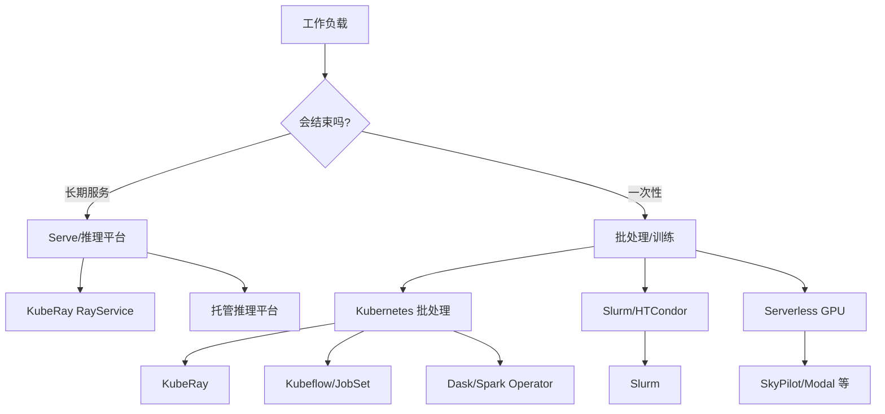

# 第 39 章 选型与替代方案：KubeRay、托管 Ray、Slurm 与其他系统

学完 KubeRay 不代表所有场景都该用 KubeRay。本章把选型问题拆成“工作负载、团队能力、隔离、成本、生态”五个维度，对比 KubeRay、托管 Ray、Kubernetes 原生批处理/训练、传统 HPC 和 Serverless GPU 平台，并给出迁移路径和 TCO 模型。

> 本章刻意不写“某产品一定更好”。产品能力变化很快；请用你的约束和 PoC 结果做决策。所有对比都是**类别级**的，具体版本以官方文档为准。

## 39.1 先定义问题，而不是先选工具

选型前先回答：

| 维度 | 问题 | 影响 |
|---|---|---|
| 工作负载 | 训练、ETL、Tune、在线推理、交互式？ | 决定 CRD/调度/生命周期 |
| 规模 | 多少租户、多少 GPU、多少并发？ | 决定单集群/多集群 |
| 弹性 | 是否需要秒级/分钟级扩缩？ | 决定 warm pool/CA |
| 隔离 | 软隔离还是强隔离？ | namespace/节点/集群 |
| 团队 | 有 K8s 平台团队吗？ | 决定运维复杂度 |
| 成本 | 预算/计费/Spot？ | 决定调度和节点池 |
| 合规 | 数据驻留/审计/离线？ | 决定托管/自建 |
| 生态 | 已有 Slurm/Kubeflow/Spark？ | 决定迁移成本 |

如果这些问题没有答案，任何架构都会变成“所有功能都开”的复杂系统。

## 39.2 方案空间



### 39.2.1 五类方案

1. **KubeRay（自建 Kubernetes Operator）**：CRD + operator，复用 K8s 生态。
2. **托管 Ray/ML 平台**：云厂商或商业公司提供控制面，用户只提交作业。
3. **Kubernetes 原生批处理/训练**：Kubeflow Training Operator、JobSet、Kueue、Volcano、Dask Operator、Spark Operator。
4. **传统 HPC/批调度**：Slurm、HTCondor、PBS、Nomad。
5. **Serverless/弹性 GPU 平台**：按需 GPU、冷启动优化、托管队列。

## 39.3 KubeRay 的定位

### 39.3.1 适合

- 已经在 Kubernetes 上运行；
- 需要 Ray 的 task/actor/Serve/Data/Train/Tune；
- 需要 GitOps、RBAC、NetworkPolicy、Kueue/Volcano；
- 需要多租户、队列、配额、GPU 池；
- 团队有 K8s 平台能力；
- 想避免 vendor lock-in。

### 39.3.2 不适合

- 单机 Ray：`ray.init()` 足够；
- 极短任务：建集群成本高于计算；
- 强依赖 VM/特殊内核/RDMA 直通：先确认节点能力；
- 无法接受 head 单点：需要 GCS FT/多集群；
- 团队没有 K8s 运维能力：CRD/RBAC/网络/GPU 都需要平台能力；
- 只需要简单批处理：Kubernetes Job/JobSet 可能更简单。

### 39.3.3 成本结构

KubeRay 本身免费，但总成本包括：

- 控制面（operator/监控/日志）；
- 节点（CPU/GPU）；
- 存储（对象存储/PVC）；
- 网络（跨区/出口）；
- 人力（平台/on-call）；
- 闲置/碎片。

“免费”不等于“便宜”。一个没有配额和自动缩容的 KubeRay 平台可能比托管服务更贵。

## 39.4 托管 Ray / 商业平台

### 39.4.1 典型能力

- 托管控制面/升级；
- 自动扩缩容/队列；
- 可观测性/日志；
- 多集群/多区域；
- 按用量计费；
- 技术支持。

### 39.4.2 优点

- 上线快；
- 运维负担低；
- 内置最佳实践；
- 适合小团队/短期项目。

### 39.4.3 代价

- 成本可能更高（尤其是长期 GPU）；
- 数据驻留/合规限制；
- 定制能力受限；
- vendor lock-in；
- 跨云/混合云困难。

### 39.4.4 选择建议

| 场景 | 倾向 |
|---|---|
| 小团队、快速验证 | 托管 |
| 大规模、长期、成本敏感 | 自建 KubeRay |
| 强合规/离线 | 自建 |
| 多集群/多地域 | 看托管是否支持 |
| 需要深度定制调度 | 自建 |

## 39.5 Kubernetes 原生批处理/训练

### 39.5.1 Kubeflow Training Operator

- 支持 PyTorchJob、TFJob、XGBoostJob、MPIJob 等；
- 与 Kubeflow Pipelines 集成；
- 适合已有 Kubeflow 的平台；
- 不提供 Ray 的 actor/Serve/Data 生态。

### 39.5.2 JobSet

- Kubernetes SIG 的 Job 组合 API；
- 适合多 Job 协同/ gang；
- 比 KubeRay 更底层；
- 不提供 Ray 运行时。

### 39.5.3 Kueue/Volcano/YuniKorn

- 队列/配额/gang scheduling；
- 可以与 KubeRay 组合；
- 不是 Ray 运行时。

### 39.5.4 Dask/Spark Operator

- Dask：Python 数据/并行，生态与 Ray 有重叠；
- Spark：成熟的数据处理，适合 SQL/批 ETL；
- 选择取决于现有代码/团队技能。

### 39.5.5 对比

| 维度 | KubeRay | Kubeflow Training | JobSet | Dask/Spark |
|---|---|---|---|---|
| Ray 生态 | 原生 | 无 | 无 | 无 |
| actor/Serve | 是 | 否 | 否 | 部分 |
| 训练框架 | Ray Train | 多框架 | 自定义 | 有限 |
| 队列/配额 | Kueue/Volcano | 外部 | 外部 | 外部 |
| 运维复杂度 | 中 | 中高 | 低 | 中 |

## 39.6 传统 HPC/批调度

### 39.6.1 Slurm

优点：

- 成熟的队列/配额/抢占；
- 高性能网络/GPU 调度；
- 大规模 HPC 经验；
- 用户熟悉 `sbatch`/`srun`。

缺点：

- 与 Kubernetes 生态分离；
- 容器化/多租户/云原生较弱；
- Ray 集成需要额外工作；
- 弹性伸缩不如 K8s。

### 39.6.2 HTCondor/PBS/Nomad

- HTCondor：高吞吐、异构资源；
- PBS：传统 HPC；
- Nomad：轻量调度，容器/非容器混合。

### 39.6.3 选择建议

| 场景 | 倾向 |
|---|---|
| 已有 Slurm/HPC 集群 | Slurm + Ray 混合 |
| 需要 K8s 生态/GitOps | KubeRay |
| 高吞吐批处理 | HTCondor/Slurm |
| 云原生弹性 | KubeRay/托管 |

## 39.7 Serverless/弹性 GPU 平台

### 39.7.1 典型能力

- 按需 GPU；
- 冷启动优化；
- 托管队列；
- 按秒/按请求计费；
- 无需管理节点。

### 39.7.2 优点

- 无容量规划；
- 适合突发/实验；
- 低运维。

### 39.7.3 代价

- 单价高；
- 冷启动；
- 数据驻留/网络；
- 定制/调试受限；
- 长期大负载不经济。

### 39.7.4 选择建议

- 突发推理/实验：Serverless；
- 长期训练/稳定推理：自建/托管集群；
- 混合：峰值用 Serverless，基线用自建。

## 39.8 对比矩阵

| 维度 | KubeRay | 托管 Ray | Kubeflow | Slurm | Serverless |
|---|---|---|---|---|---|
| Ray 原生 | 是 | 是 | 否 | 需集成 | 视平台 |
| K8s 生态 | 强 | 中 | 强 | 弱 | 弱 |
| 多租户 | 靠 K8s | 平台提供 | 中 | 队列 | 平台 |
| gang/队列 | Kueue/Volcano | 平台 | 外部 | 强 | 平台 |
| 弹性 | 强 | 强 | 中 | 中 | 强 |
| 运维负担 | 高 | 低 | 中高 | 中高 | 低 |
| 成本可控 | 高 | 中 | 高 | 高 | 低（单价高） |
| 定制能力 | 强 | 低 | 中 | 强 | 低 |
| 离线/合规 | 强 | 视厂商 | 强 | 强 | 弱 |
| 学习曲线 | 高 | 低 | 中 | 中 | 低 |

## 39.9 迁移路径

### 39.9.1 从 Ray Cluster Launcher/VM 迁移

```text
ray up / ray down
  -> 把 node types 映射成 workerGroupSpecs
  -> 把 setup_commands 放进镜像
  -> 把 file_mounts 换成 PVC/对象存储
  -> 把 autoscaling config 换成 autoscalerOptions
  -> 用 RayJob/RayService 替代手动提交
```

注意：

- VM 上的自定义内核/驱动要确认容器支持；
- 本地盘数据要迁移到 PVC/对象存储；
- 启动脚本要幂等；
- 网络/安全组要换成 NetworkPolicy。

### 39.9.2 从 Slurm 迁移

- 把 `sbatch` 脚本改成 Ray entrypoint；
- 把队列/配额映射到 Kueue/Volcano；
- 把 `srun` 多机启动改成 Ray Train/Data；
- 保留 Slurm 做非 Ray 负载，逐步迁移；
- 不要一次性替换所有工作流。

### 39.9.3 从 Kubeflow 迁移

- 保留 KFP 做 DAG；
- 把 PyTorchJob 换成 RayJob + Ray Train（如果需要 Ray 生态）；
- 用 Kueue 统一队列；
- 逐步迁移，不要重写所有 pipeline。

### 39.9.4 从 Dask/Spark 迁移

- 评估是否真的需要 Ray；
- 保留 Spark 做 SQL/ETL；
- 用 Ray Data 处理 Python/ML 负载；
- 避免“为了统一而统一”。

## 39.10 TCO 模型

```text
TCO =
  节点成本（GPU/CPU/内存）
+ 存储成本（对象存储/PVC/备份）
+ 网络成本（跨区/出口/加速）
+ 控制面成本（operator/监控/日志/镜像仓库）
+ 人力成本（平台/on-call/培训）
+ 闲置/碎片成本
+ 迁移/集成成本
- 弹性节省（缩容/Spot/Serverless 峰值）
```

### 39.10.1 一个简化例子

假设：

- 64 张 A100，单价 2 美元/小时；
- 平均利用率 60%；
- 平台团队 2 人；
- 托管服务单价高 30%，但省 1.5 人。

```text
自建节点月成本 ≈ 64 × 2 × 730 ≈ 93,440 美元
托管节点月成本 ≈ 93,440 × 1.3 ≈ 121,472 美元
人力节省 ≈ 1.5 人 × 月成本
```

如果人力成本高于差价，托管可能更便宜；否则自建。实际还要算闲置、碎片、升级、故障。

### 39.10.2 不要只看单价

- 闲置 GPU；
- 碎片；
- 启动时间；
- 失败重试；
- 运维事故；
- 迁移成本。

## 39.11 决策树

```text
已经在 Kubernetes 上吗？
├─ 否
│   ├─ 已有 Slurm/HPC -> Slurm + Ray（按需）
│   ├─ 小团队/快速验证 -> 托管 Ray / Serverless
│   └─ 长期自建 -> 先建 K8s，再评估 KubeRay
└─ 是
    ├─ 需要 Ray 生态（actor/Serve/Data/Train/Tune）？
    │   ├─ 是
    │   │   ├─ 需要深度定制/多租户/离线 -> KubeRay
    │   │   ├─ 想省运维 -> 托管 Ray
    │   │   └─ 只是简单批处理 -> RayJob 或 JobSet
    │   └─ 否
    │       ├─ 训练 -> Kubeflow/JobSet
    │       ├─ 数据 -> Spark/Dask
    │       └─ 推理 -> KServe/自建 Deployment
    └─ 需要 gang/队列？
        ├─ 是 -> Kueue/Volcano + 上述
        └─ 否 -> 原生 kube-scheduler
```

## 39.12 反模式

- 为了“统一”把 Spark/Slurm 全部迁到 KubeRay，忽略团队技能；
- 没有配额/队列就上多租户；
- 用 KubeRay 跑极短任务，建集群成本高于计算；
- 用 Serverless 跑长期稳定 GPU 负载，单价失控；
- 用托管服务但把数据放在不能驻留的区域；
- 同时开多个 gang 调度器；
- 把 alpha 功能当稳定功能；
- 没有 PoC 就做大规模迁移。

## 39.13 PoC 验收清单

- [ ] 真实工作负载（不是 toy demo）
- [ ] 峰值/平均利用率
- [ ] 扩容时间（Pending→Running）
- [ ] 失败恢复（head/worker/节点）
- [ ] 队列/配额/抢占
- [ ] 多租户隔离
- [ ] 监控/日志/告警
- [ ] 成本（节点+存储+网络+人力）
- [ ] 迁移成本
- [ ] 回滚方案

## 39.14 练习

1. 用 39.10 的公式，为你的团队算一版自建 vs 托管的 3 年 TCO（含人力/闲置/迁移）。
2. 设计一个 2 周 PoC：工作负载、指标、通过标准、回滚条件。
3. 从 Ray Cluster Launcher 迁移一个真实作业到 RayJob，记录差异和坑。
4. 对比 Slurm 与 KubeRay 在你的场景下的队列/配额/抢占能力，给出选择理由。
5. 写一份“不选 KubeRay”的论证：什么条件下托管/Serverless/Slurm 更合适？

## 39.15 选型评分卡

把定性讨论变成可复盘的评分。权重按你的约束调整，但**先固定权重再打分**，避免“先有结论再找理由”。

| 维度 | 权重 | 1 分 | 3 分 | 5 分 |
|---|---:|---|---|---|
| 工作负载匹配 | 20% | 主要负载不适合 | 部分适合 | 原生支持 |
| 团队能力 | 15% | 无 K8s/分布式经验 | 有基础 | 专职平台 |
| 运维负担 | 15% | 需要大量自建 | 中等 | 托管/自动化 |
| 弹性/成本 | 15% | 固定高成本 | 可扩缩 | 按需/Spot |
| 隔离/合规 | 10% | 无法满足 | 部分 | 强隔离/合规 |
| 生态集成 | 10% | 孤立 | 部分 | GitOps/队列/监控 |
| 迁移成本 | 10% | 重写 | 部分改造 | 平滑 |
| 风险/锁定 | 5% | 强锁定 | 中等 | 可迁移 |

### 39.15.1 评分示例

| 方案 | 匹配 | 团队 | 运维 | 弹性 | 隔离 | 生态 | 迁移 | 风险 | 加权 |
|---|---:|---:|---:|---:|---:|---:|---:|---:|---:|
| 自建 KubeRay | 5 | 4 | 2 | 5 | 4 | 5 | 2 | 5 | 4.00 |
| 托管 Ray | 5 | 5 | 5 | 5 | 3 | 3 | 4 | 2 | 4.35 |
| Slurm + Ray | 4 | 3 | 3 | 2 | 4 | 2 | 3 | 4 | 3.10 |
| Serverless GPU | 3 | 5 | 5 | 5 | 2 | 2 | 3 | 2 | 3.65 |

计算方式：`Σ(分数 × 权重)`。上表托管 Ray 得分最高，但如果合规要求“数据不出区/离线”，隔离和风险分数会下降，自建可能反超。

### 39.15.2 打分时的证据要求

每个分数至少有一条证据：

- 压测/ PoC 结果；
- 现有团队经验/事故记录；
- 厂商合同/SLA；
- 合规审计要求；
- 迁移工作量估算。

没有证据的分数是“感觉”，不是选型。

### 39.15.3 决策记录（ADR）

```markdown
# ADR-001：Ray 平台选型

## 背景
## 候选方案
## 评分与证据
## 决策
## 后果（正面/负面）
## 复审时间
```

选型不是一次性的；6–12 个月后按新约束复审。

## 39.16 小结

- 选型从约束开始，不是从功能清单开始。
- KubeRay 适合已有 K8s、需要 Ray 生态、需要定制/多租户/离线的团队。
- 托管 Ray 适合小团队/快速上线；Slurm 适合已有 HPC；Kubeflow/JobSet 适合非 Ray 训练；Serverless 适合突发。
- TCO 要算节点、存储、网络、控制面、人力、闲置和迁移。
- 迁移要渐进，保留回滚和并行运行。

选型之后还有两件事：把网络、规模和故障域这三类“平台级约束”验证清楚，再把流程固化成可重复的工程实践。第 40–44 章分别覆盖网络深潜、控制面规模化、可运行故障实验室、发布工程和多可用区/灾难恢复；第 45–50 章继续进入 Ray Data、弹性训练、LLM 推理、可观测性、平台治理与数据/模型治理；第 51–54 章补齐节点弹性、优雅终止、交互式开发与 operator 可靠性；第 55–56 章收束变更管理与活体诊断；第 57–58 章补齐垂直弹性（IPPR）与 Kubernetes 新原语。

→ [第 40 章 Kubernetes 网络深潜](kuberay教程-40-Kubernetes网络深潜-CNI、DNS、Service、NetworkPolicy与mTLS.md)
