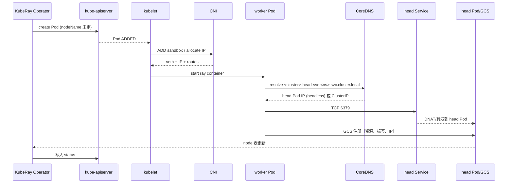

# 第 40 章 Kubernetes 网络深潜：CNI、DNS、Service、NetworkPolicy 与 mTLS

前 39 章多次出现同一类故障：worker 无法加入、Dashboard 打不开、RayService 返回 503、NetworkPolicy 开启后 DNS 失效。它们的共同点是：**Ray 的控制面逻辑没有问题，问题出在数据包根本没有到达该到的地方**。

本章从 Linux 网络命名空间一路讲到 Gateway API，目标是建立一条可验证的排障链路：

```text
Pod 有 IP 吗？
  -> CNI 把包送到对端了吗？
  -> Service/EndpointSlice 选对 Pod 了吗？
  -> DNS 解析对了吗？
  -> NetworkPolicy 放行了吗？
  -> 入口代理把请求转对了吗？
  -> TLS/认证通过了吗？
```

> 版本边界：本章的 Kubernetes 行为以 1.30+ 为基准，KubeRay 字段以 v1.7.1 为基准，Gateway API 以 v1.3 为基准。不同 CNI/云厂商的实现细节会不同，命令以你的环境为准。

## 40.1 一次 worker 加入的完整路径

一个 worker Pod 从 `Pending` 到“Ray 认为它可用”，网络路径如下：



链路上任何一步失败，表现都可能是“Pod Running 但 Ray 看不到节点”。本章按层拆开。

## 40.2 Pod 网络与 CNI

### 40.2.1 最小模型

每个 Pod 有自己的 network namespace。Kubernetes 通过 CNI 插件把它接到节点网络：

```text
Pod netns
  ├── eth0 (veth 一端)
  ├── 默认路由 -> 节点网桥/隧道
  └── /etc/resolv.conf（由 kubelet 写入）
节点
  ├── veth 另一端（cni0 / lxc* / cilium_*）
  ├── 路由表
  └── 到其他节点的 overlay/underlay 路径
```

CNI 负责三件事：

1. **分配 IP**（IPAM）；
2. **把 veth/路由接好**；
3. **执行插件链**（portmap、bandwidth、NetworkPolicy 等，取决于实现）。

### 40.2.2 overlay 与 underlay

| 模式 | 原理 | 优点 | 代价 |
|---|---|---|---|
| Overlay（VXLAN/IPIP） | Pod 包封装在节点包里 | 不依赖底层网络 | MTU 变小、封装开销 |
| Underlay（BGP/路由） | Pod IP 直接可路由 | 性能好、可观测 | 需要网络设备配合 |
| eBPF（Cilium） | 用 eBPF 替代 iptables/kube-proxy | 性能/可观测性好 | 内核/版本要求高 |
| 云厂商 CNI | 弹性网卡/IP 直通 | 与云网络集成 | IP 数量/配额限制 |

对 KubeRay 的影响：

- **headless Service 依赖 Pod IP 的直达性**；overlay 的 MTU 问题会先影响大对象传输；
- 多机训练的 RDMA/IB 通常需要 SR-IOV/Multus/underlay，不能只靠 overlay；
- NetworkPolicy 是否生效取决于 CNI，不取决于 YAML 是否 apply 成功。

### 40.2.3 MTU

Overlay 会增加封装头：

```text
物理 MTU 1500
  - VXLAN 50 字节（IPv4 外层 + UDP + VXLAN）
  => Pod MTU 1450（常见配置）
```

如果 Pod MTU 配置错误，会出现：

- 小请求正常，大响应卡住；
- TLS 握手偶尔超时；
- Ray 对象传输吞吐骤降；
- `curl` 小文件正常，下载大文件 hang。

排查：

```bash
kubectl exec <pod> -- ip link show eth0
kubectl exec <pod> -- ping -M do -s 1472 <peer-ip>   # 1500 MTU 下不分片
kubectl exec <pod> -- tracepath <peer-ip>
```

### 40.2.4 常用 CNI 对照

| CNI | NetworkPolicy | 特点 | KubeRay 注意点 |
|---|---|---|---|
| Calico | 是 | iptables/eBPF、BGP | 策略生效范围要确认 |
| Cilium | 是 | eBPF、Hubble | 需要较新内核；可观测性强 |
| Flannel | 否（默认） | 简单 overlay | 不能靠 NetworkPolicy 隔离 |
| Antrea | 是 | OVS/eBPF | 与 Windows 节点集成 |
| 云厂商 CNI | 通常是 | 网卡/IP 直通 | IP 配额、安全组也要放行 |

> 先确认 CNI 是否真的执行 NetworkPolicy。`kubectl get networkpolicy` 有对象，不等于流量被拦截。

## 40.3 Service 与 EndpointSlice

### 40.3.1 Service 的三种数据面

Kubernetes Service 是一层虚拟 IP（ClusterIP），实际转发由节点上的数据面完成：

| 实现 | 机制 | 特点 |
|---|---|---|
| iptables | kube-proxy 写 DNAT 规则 | 成熟；规则多时更新慢 |
| IPVS | 内核四层负载均衡 | 大规模性能好 |
| eBPF | Cilium 等替代 kube-proxy | 可绕过 conntrack，性能/可观测性好 |

无论哪种，**Service 不是进程**，没有“Service 挂了”这回事；要检查的是 EndpointSlice、kube-proxy/CNI、以及目标 Pod。

### 40.3.2 EndpointSlice

Service 的 selector 不直接转发流量；控制器把匹配的 Pod 写入 EndpointSlice：

```yaml
apiVersion: discovery.k8s.io/v1
kind: EndpointSlice
metadata:
  name: demo-head-svc-abcde
  labels:
    kubernetes.io/service-name: demo-head-svc
addressType: IPv4
endpoints:
  - addresses: ["10.244.1.17"]
    conditions:
      ready: true
      serving: true
      terminating: false
ports:
  - name: gcs-server
    port: 6379
    protocol: TCP
```

排查顺序：

```bash
kubectl get svc <name> -o yaml                 # selector/ports
kubectl get endpointslices -l kubernetes.io/service-name=<name> -o yaml
kubectl get pods -l <selector> --show-labels
```

常见断点：

- selector 写错（标签被用户覆盖）；
- Pod Ready=False，endpoint 未加入；
- `publishNotReadyAddresses` 没开，head 未 Ready 时 worker 解析不到；
- 端口名/目标端口不一致；
- EndpointSlice 控制器没运行（极少见）。

### 40.3.3 headless Service 与 Ray

KubeRay 的 head Service 默认是 headless：

```yaml
spec:
  clusterIP: None
  publishNotReadyAddresses: true
  selector:
    ray.io/cluster: demo
    ray.io/node-type: head
  ports:
    - {name: gcs-server, port: 6379}
    - {name: dashboard, port: 8265}
    - {name: client, port: 10001}
    - {name: metrics, port: 8080}
    - {name: serve, port: 8000}
```

为什么：

1. 一个 RayCluster 只有一个 head，不需要 VIP 负载均衡；
2. headless 让 DNS 直接返回 head Pod IP，减少一跳 DNAT；
3. `publishNotReadyAddresses` 让 worker 在 head 尚未 Ready 时仍能拿到地址，配合 init container 重试；
4. 多主机 headless Service 还用于同一 replica 内 Pod 的互相发现。

### 40.3.4 ClusterIP 与 headless 的差异

| 维度 | ClusterIP | headless |
|---|---|---|
| DNS | 返回 Service VIP | 返回所有 Pod IP |
| 负载均衡 | kube-proxy/IPVS/eBPF | 客户端自己选 |
| 端口 | Service 端口映射到 targetPort | 直接访问 Pod 端口 |
| 适用 | 多副本无状态服务 | head、StatefulSet、多主机发现 |

Ray 的 Serve Service 是 ClusterIP（需要把流量分给多个 proxy）；head Service 是 headless（只有一个 head）。

多可用区场景下，ClusterIP Service 可以设置 `trafficDistribution: PreferSameZone`（Kubernetes 1.31 引入 `trafficDistribution`，1.34 起用 `PreferSameZone` 替代弃用的 `PreferClose`）：kube-proxy 优先选择与客户端同区的 Endpoint，本区没有 Ready Endpoint 时才回退到全部。它能降低跨区延迟和流量费，但可能造成本区过载。headless Service 不经过 kube-proxy，DNS 会返回所有 Pod IP，`trafficDistribution` 对 worker 加入 head 的解析没有意义；Serve 流量才会受益。`internalTrafficPolicy: Local` 没有回退，节点没有本地 Endpoint 时会直接失败，生产上优先用 `PreferSameZone`。完整语义与实验见[第 58.5 节](kuberay教程-58-Kubernetes新原语与KubeRay-原生sidecar、调度门、拓扑感知与Pod级资源.md)。

## 40.4 DNS

### 40.4.1 解析路径

Pod 的 `/etc/resolv.conf` 大致是：

```text
nameserver 10.96.0.10
search default.svc.cluster.local svc.cluster.local cluster.local
options ndots:5
```

`ndots:5` 意味着：如果名字里的点少于 5 个，解析器会先依次尝试 `search` 域，再尝试绝对名字。于是：

```text
demo-head-svc.default.svc.cluster.local.   # 末尾带点 = 绝对名字，1 次查询
demo-head-svc.default.svc.cluster.local    # 4 个点 < ndots:5，先拼 search 域，再试绝对名
demo-head-svc                              # 先试 default.svc.cluster.local 等
```

`demo-head-svc.default.svc.cluster.local` 只有 4 个点，达不到 `ndots:5` 的“先按绝对名”阈值，所以它会先经历若干次 `...default.svc.cluster.local` 之类的无效查询。要避免这部分开销，写 FQDN 时保留结尾点。

**建议**：跨 namespace、跨集群、写进配置文件的地址一律用 FQDN 并带结尾点，减少无谓查询和歧义。

### 40.4.2 headless 的 DNS 记录

```text
<service>.<namespace>.svc.<cluster-domain>        A/AAAA（所有 Ready Pod IP）
<pod>.<service>.<namespace>.svc.<cluster-domain>  A/AAAA（单个 Pod）
```

多主机场景用 Pod 级 DNS 互相发现；Pod 名必须符合 DNS label，KubeRay 的确定性命名满足这一点。

### 40.4.3 DNS 故障的典型表现

| 现象 | 原因 | 排查 |
|---|---|---|
| `Could not resolve host` | CoreDNS 不可用/NetworkPolicy 阻断 53 | `kubectl -n kube-system get pods -l k8s-app=kube-dns` |
| 解析慢（5s/10s） | ndots/search 导致多次查询、DNS 超时 | `dig +stats`、CoreDNS 日志 |
| 只能解析短名 | search 域不匹配 | 用 FQDN |
| 解析到旧 IP | DNS 缓存/EndpointSlice 未更新 | `dig`、`getent`、重启 CoreDNS |
| headless 无记录 | Pod 未 Ready 且未 publishNotReadyAddresses | 看 EndpointSlice |

调试：

```bash
kubectl exec <pod> -- cat /etc/resolv.conf
kubectl exec <pod> -- getent hosts <name>
kubectl exec <pod> -- nslookup <name>
kubectl exec <pod> -- dig +search <name>
kubectl exec <pod> -- dig @10.96.0.10 <fqdn> +short
kubectl -n kube-system logs -l k8s-app=kube-dns --tail=100
```

> DNS 是 NetworkPolicy 最常见的“隐形受害者”。默认拒绝 egress 后，必须显式放行 UDP/TCP 53 到 kube-system。

## 40.5 NetworkPolicy

### 40.5.1 语义

NetworkPolicy 是**允许列表**，不是拒绝列表：

- 没有策略选中 Pod：默认全通；
- 有策略选中 Pod 且 policyTypes 包含 Ingress：只允许规则中的入站；
- 多条策略是**并集**；
- 没有 “deny” 规则；要拒绝就先默认拒绝再逐条放行；
- 策略作用于 namespace 内的 Pod，选择器可以跨 namespace。

### 40.5.2 一个 Ray 的最小策略

```yaml
apiVersion: networking.k8s.io/v1
kind: NetworkPolicy
metadata:
  name: ray-cluster
  namespace: team-a
spec:
  podSelector:
    matchLabels:
      ray.io/is-ray-node: "yes"
  policyTypes: [Ingress, Egress]
  ingress:
    # Ray 节点之间：GCS 6379、对象传输、Dashboard agent 等
    - from:
        - podSelector:
            matchLabels:
              ray.io/is-ray-node: "yes"
    # 平台侧抓取指标
    - from:
        - namespaceSelector:
            matchLabels:
              kubernetes.io/metadata.name: monitoring
      ports:
        - {protocol: TCP, port: 8080}
  egress:
    # DNS
    - to:
        - namespaceSelector:
            matchLabels:
              kubernetes.io/metadata.name: kube-system
      ports:
        - {protocol: UDP, port: 53}
        - {protocol: TCP, port: 53}
    # Ray 节点之间
    - to:
        - podSelector:
            matchLabels:
              ray.io/is-ray-node: "yes"
    # 对象存储/镜像仓库/Redis（按需）
    - to:
        - ipBlock:
            cidr: 10.0.0.0/8
      ports:
        - {protocol: TCP, port: 443}
        - {protocol: TCP, port: 6379}
```

### 40.5.3 为什么 Ray 的策略不能只放行 6379

Ray 节点之间不只是 GCS 通信：

- Raylet 之间传输对象，使用动态端口；
- Dashboard agent 在 52365；
- Serve proxy 在 8000；
- worker 与 head 之间还有 gRPC/HTTP。

**最稳妥的做法**：对同一 RayCluster 的 Pod 之间放行全部 TCP/UDP；对外只放行必要端口。只放行 6379 往往能启动，但一跑大对象/多节点任务就出问题。

### 40.5.4 KubeRay 的 `spec.networkPolicy`

v1.7 alpha 的 `RayClusterNetworkPolicy` 可以自动生成 head/worker 策略：

```yaml
spec:
  networkPolicy:
    mode: DenyAll
    head:
      ingressRules:
        - from:
            - namespaceSelector:
                matchLabels:
                  kubernetes.io/metadata.name: monitoring
          ports:
            - port: 8080
    worker:
      egressRules:
        - to:
            - namespaceSelector:
                matchLabels:
                  kubernetes.io/metadata.name: kube-system
          ports:
            - {port: 53, protocol: UDP}
```

注意：

- `DenyAll` 仍保留集群内 Pod 互通（以实现为准，务必实测）；
- DNS egress 不会自动放行；
- 需要 CNI 支持；
- 开启前先用 audit 模式观察，不要直接在生产 enforce。

## 40.6 入口：Ingress、Gateway、NodePort 与 LoadBalancer

### 40.6.1 四层与七层

| 方式 | 层级 | 典型用途 | 注意 |
|---|---|---|---|
| NodePort | L4 | kind/临时访问 | 端口范围、节点防火墙 |
| LoadBalancer | L4 | 云上暴露 | 成本、外部 IP、健康检查 |
| Ingress | L7（HTTP） | Dashboard/Serve | 需要 Ingress Controller |
| Gateway API | L7（HTTP/gRPC） | 新平台、流量拆分 | 需要 GatewayClass/实现 |

### 40.6.2 反向代理的关键参数

Ray Serve 的请求可能是长连接、流式响应、大 body：

- `proxy-read-timeout` / `idle_timeout`：要覆盖最长生成时间；
- `proxy-buffering: off`：流式响应不要缓冲；
- `client_max_body_size`：上传/批量推理；
- `proxy-next-upstream` / 重试：只对幂等请求重试；
- gRPC：需要 HTTP/2，Ingress 注解或 GRPCRoute；
- WebSocket：需要 Upgrade/Connection 头透传。

### 40.6.3 Gateway API 与 RayService 增量升级

RayService 的增量升级用 HTTPRoute 的 `backendRefs[].weight` 做流量拆分：

```yaml
rules:
  - matches:
      - path: {type: PathPrefix, value: /}
    backendRefs:
      - name: svc-active-serve-svc
        port: 8000
        weight: 90
      - name: svc-pending-serve-svc
        port: 8000
        weight: 10
```

常见问题：

- GatewayClass 没有可用实现；
- HTTPRoute 的 parentRef 与 Gateway 不匹配；
- 权重指向的 Service 不存在/没有 endpoint；
- 长连接在权重变化时被断开；
- gRPC 没有单独的匹配规则。

### 40.6.4 外部访问的安全边界

- Dashboard 8265 不要直接暴露公网；
- Client 10001 是 Ray Client 协议，不是普通 HTTP，需谨慎；
- Serve 8000 通过 Gateway 做 TLS、认证、限流；
- GCS 6379 只在集群内；
- 训练集群用 port-forward/VPN，不要用 Ingress。

## 40.7 mTLS 与证书

### 40.7.1 mTLS 解决什么

Ray 节点之间的 gRPC/对象传输默认是明文。mTLS 提供：

- 双向身份认证（客户端和服务端都出示证书）；
- 传输加密；
- 防止集群内横向伪造节点。

它**不解决**：

- 外部入口的 TLS（仍需 Ingress/Gateway）；
- RBAC/授权；
- 多租户隔离（证书通常按集群签发）。

### 40.7.2 cert-manager 对象

KubeRay v1.7 的 `RayClusterMTLS` 依赖 cert-manager。**PKI 由 operator 的 MTLS controller 拥有**：用户只需要安装 cert-manager、开启 gate，并设置：

```yaml
spec:
  tlsOptions:
    enabled: true
```

operator 会创建自签名 Issuer、CA Certificate/Issuer、head/worker Certificate（具体对象名以版本为准）。不要自己再创建一套 `Issuer`/`Certificate` 指向同一个 Service，否则会出现两套互不信任的 PKI，排障时很难判断哪套生效。

要点：

- **优先用 DNS SAN**，不要只依赖 Pod IP SAN；Pod 重建后 IP 会变；
- 证书轮换后，Ray 容器要重新加载（通常需要重启 Pod）；
- 证书和私钥放 Secret，权限最小化；
- 信任链（CA）要同时挂到 head/worker；
- mTLS 开启后，`ray health-check`、Dashboard、submitter 都要使用 TLS；
- 升级/删除时确认 cert-manager 的对象也被清理，避免残留 Secret/Issuer。

### 40.7.3 TLS 与 Ray 环境变量

KubeRay 会注入类似：

```text
RAY_USE_TLS=1
RAY_TLS_SERVER_CERT=/etc/ray/tls/tls.crt
RAY_TLS_SERVER_KEY=/etc/ray/tls/tls.key
RAY_TLS_CA_CERT=/etc/ray/tls/ca.crt
```

自定义客户端/提交器时要显式配置，否则会连接失败。

### 40.7.4 服务网格与 sidecar 注入

Istio/Linkerd 常被平台团队用来做 mTLS、流量策略和可观测性。把它们直接套在 Ray 上，通常会遇到三类问题：**端口拦截、生命周期顺序、双重 mTLS**。

#### 为什么 Ray 对 sidecar 敏感

Ray 不是“一个 HTTP 端口”的应用：

- head 暴露 GCS 6379、Dashboard 8265、Client 10001、Serve 8000、dashboard agent 52365；
- Raylet/对象传输使用动态端口；
- 节点之间是长连接 gRPC/HTTP2，不是短请求；
- worker 数量多，每个 Pod 一个 sidecar 的 CPU/内存开销会被放大。

sidecar 默认拦截所有入站/出站流量。Ray 的动态端口没有出现在 Service 里，sidecar 无法正确识别协议，可能出现：

- worker 注册超时（6379 被当成普通 TCP 代理）；
- 大对象传输卡住（动态端口被拦截或连接复用异常）；
- Dashboard/Job API 正常但 Serve 8000 不通；
- 每个 worker 多一份 sidecar，启动慢、内存高。

#### 三种可选策略

| 策略 | 做法 | 优点 | 代价 |
|---|---|---|---|
| 不给 Ray Pod 注入 | `sidecar.istio.io/inject: "false"` / `linkerd.io/inject: disabled` | 行为最接近无网格 | 失去网格 mTLS/可观测性 |
| 注入但排除 Ray 端口 | 排除 6379/8265/10001/52365/8000 + 动态端口段 | 保留部分能力 | 配置复杂，动态端口难穷举 |
| 只在边缘用网格/网关 | Ray Pod 不注入，入口用 Gateway/Ingress | 边界清晰 | 东西向没有网格 mTLS |

多数 Ray 平台选择第三种：**南北向走 Gateway/Ingress，东西向用 NetworkPolicy + KubeRay mTLS/Token**，而不是给每个 worker 塞 sidecar。

#### Istio 的最小配置

如果确实要注入，至少显式处理端口与启动顺序：

```yaml
metadata:
  annotations:
    sidecar.istio.io/inject: "true"
    traffic.sidecar.istio.io/excludeInboundPorts: "6379,8265,10001,52365,8000"
    traffic.sidecar.istio.io/excludeOutboundPorts: "6379,8265,10001,52365,8000"
    proxy.istio.io/config: '{"holdApplicationUntilProxyStarts": true}'
```

说明：

- `excludeInboundPorts`/`excludeOutboundPorts` 让这些端口绕过 sidecar；动态端口仍需额外的 `excludeOutboundIPRanges` 或网络策略设计；
- `holdApplicationUntilProxyStarts` 让应用容器等待 proxy 就绪，避免 Ray 启动时连接被拒；
- 这些注解要放在 **Pod template** 上，不是 RayCluster 顶层；
- 版本/字段名以目标 Istio 版本为准。

#### Linkerd 的 opaque ports

Linkerd 需要把非 HTTP 协议标记为 opaque：

```yaml
metadata:
  annotations:
    config.linkerd.io/opaque-ports: "6379,8265,10001,52365,8000"
```

否则 Linkerd 会尝试 HTTP 解析，导致 gRPC/二进制协议失败。动态端口同样需要规划。

#### 双重 mTLS

KubeRay 的 `tlsOptions` 已经给 Ray 节点间通信加了一层 mTLS；网格再套一层会：

- 双重加密/解密，增加 CPU 与延迟；
- 两套证书轮换互不感知；
- 排障时无法判断是哪一层拒绝连接。

选择一层作为“Ray 数据面 mTLS”，另一层只做入口 TLS，并在架构图上标清楚。

#### 生命周期与终止

- sidecar 通常在应用容器之后启动、之前终止；Ray 的 `preStop`/SIGTERM drain 可能被 sidecar 拖长；
- 给 sidecar 设置独立的 resources，避免它和 Ray worker 抢 CPU；
- 如果 sidecar 持有连接，Pod 终止时可能阻塞到 grace 结束；
- 用 `kubectl get pod -o jsonpath='{.spec.containers[*].name}'` 确认实际注入了什么，不要假设注解生效。

#### 决策清单

```text
[ ] Ray Pod 是否真的需要 sidecar？
[ ] 需要的是 mTLS、流量策略，还是仅仅可观测性？
[ ] 固定端口是否已排除？动态端口如何处理？
[ ] 是否与 KubeRay mTLS 重复？
[ ] sidecar 的 CPU/内存是否计入容量？
[ ] 终止顺序是否会让 Ray drain 超时？
[ ] 如果注入失败，是否有“无网格”回退路径？
```

## 40.8 KubeRay 连接矩阵

把“谁访问谁”画清楚，排障时就不会到处猜。

| 源 | 目标 | 端口/协议 | 用途 | 失败表现 |
|---|---|---|---|---|
| operator | kube-apiserver | 443/TCP | watch/写 CR 与子资源 | 调和停止、日志 403 |
| autoscaler sidecar | kube-apiserver | 443/TCP | patch replicas/workersToDelete | 403、副本不涨 |
| worker Raylet | head GCS | 6379/TCP | 注册/心跳 | worker 不加入 |
| Ray 节点之间 | 动态端口 | TCP/UDP | 对象传输、raylet RPC | 大对象失败/超时 |
| submitter | head Dashboard | 8265/TCP | `ray job submit` | RayJob 卡 Initializing |
| 用户/客户端 | head Dashboard | 8265/TCP | Job API/UI | 提交失败 |
| 用户/客户端 | head Client | 10001/TCP | Ray Client | `ray.init` 失败 |
| 用户/Gateway | Serve proxy | 8000/TCP | HTTP 推理 | 503/超时 |
| Dashboard | dashboard agent | 52365/TCP | 节点指标/日志 | Dashboard 缺数据 |
| Prometheus | Ray/operator | 8080/TCP | 指标 | 图表空白 |
| collector | 对象存储 | 443/TCP | History Server | 无历史数据 |
| Ray | Redis | 6379/TCP | GCS FT | head 无法恢复 |
| operator | Redis/对象存储 | 6379/443 | cleanup、History | finalizer 卡住 |

> **重要**：Ray 对象传输和 Raylet RPC 使用动态端口，不能只按固定端口写 NetworkPolicy。最安全的策略是“同一 RayCluster 的 Pod 之间全放行，外部按需放行”。

## 40.9 排障手册

### 40.9.1 分层命令

```bash
# 1. Pod 与 IP
kubectl get pod <pod> -o wide
kubectl exec <pod> -- ip addr
kubectl exec <pod> -- ip route

# 2. DNS
kubectl exec <pod> -- cat /etc/resolv.conf
kubectl exec <pod> -- getent hosts <svc>
kubectl exec <pod> -- dig +short <fqdn>

# 3. 端口
kubectl exec <pod> -- nc -zv <host> <port>
kubectl exec <pod> -- ss -lntp

# 4. Service/EndpointSlice
kubectl get svc <svc> -o yaml
kubectl get endpointslices -l kubernetes.io/service-name=<svc> -o yaml

# 5. NetworkPolicy
kubectl get networkpolicy -A
kubectl describe networkpolicy <name>

# 6. 抓包（在 Pod 的 netns 里）
kubectl debug <pod> -it --image=nicolaka/netshoot -- \
  tcpdump -ni eth0 host <peer-ip> and port 6379

# 7. conntrack/iptables（节点上）
conntrack -L | grep <pod-ip>
iptables-save | grep <service-ip>
```

### 40.9.2 决策树

```text
worker 无法加入
├─ DNS 解析失败？
│   ├─ /etc/resolv.conf 错 -> kubelet/DNS 配置
│   ├─ CoreDNS 不可用 -> 看 kube-system
│   └─ NetworkPolicy 阻断 53 -> 放行 DNS
├─ 解析成功但 6379 不通？
│   ├─ Service 无 endpoint -> 看 selector/Ready
│   ├─ endpoint 有但连不上 -> CNI/NetworkPolicy/MTU
│   └─ 只在某些节点失败 -> 节点网络/路由/安全组
├─ 端口通但 Raylet 注册失败？
│   ├─ token/mTLS -> 证书/Secret
│   ├─ 版本不一致 -> 统一镜像
│   └─ 资源形状错误 -> num-cpus/num-gpus
└─ 注册成功但任务没有对象？
    ├─ 对象传输动态端口被拦 -> 放行 Pod 间流量
    └─ MTU/带宽 -> 调整 MTU/拓扑
```

### 40.9.3 `kubectl debug` 与临时容器

```bash
kubectl debug -it <pod> --image=nicolaka/netshoot --target=ray
```

注意：

- 临时容器共享 Pod 网络命名空间，适合抓包/DNS/端口测试；
- 不共享 Ray 容器的文件系统（除非用 `--target` 的进程命名空间）；
- 生产集群可能禁用 ephemeral containers，提前确认。

## 40.10 性能：MTU、GSO、跨区与 NCCL

### 40.10.1 MTU 与 TCP

- Overlay 下 Pod MTU 常见 1450/1400；
- 错误的 MTU 会导致大包被丢弃，表现为“小请求正常、大响应卡住”；
- TCP GSO/GRO 可以提升吞吐，但在某些 CNI/驱动组合下会导致包损坏；
- 跨区/跨可用区带宽和延迟是对象传输的硬约束。

### 40.10.2 Ray 对象传输

- 对象在节点本地 Plasma，跨节点拉取走网络；
- 大对象、宽依赖（many-to-many shuffle）会放大网络压力；
- head 不是数据转发中心，但 GCS 元数据和 Dashboard 在 head；
- 多机训练优先同机架/同区，使用 IB/RoCE + GPUDirect RDMA。

### 40.10.3 NCCL 环境

```text
NCCL_SOCKET_IFNAME=eth0
NCCL_IB_DISABLE=0
NCCL_IB_HCA=mlx5_0
NCCL_DEBUG=INFO
```

先用 `nccl-tests` 验证带宽，再跑训练；不要用训练任务本身做网络验收。

## 40.11 实验：在 kind 上观察 worker 加入

### 40.11.1 准备

```bash
kind create cluster --name net-lab --config kind-kuberay.yaml
kubectl apply -f manifests/samples/ray-cluster.yaml
kubectl get pods -l ray.io/cluster=raycluster-sample -o wide
```

### 40.11.2 观察 DNS 与 EndpointSlice

```bash
HEAD_POD=$(kubectl get pod -l ray.io/cluster=raycluster-sample,ray.io/node-type=head \
  -o jsonpath='{.items[0].metadata.name}')
WORKER_POD=$(kubectl get pod -l ray.io/cluster=raycluster-sample,ray.io/node-type=worker \
  -o jsonpath='{.items[0].metadata.name}')
kubectl get endpointslices -l kubernetes.io/service-name=raycluster-sample-head-svc -o yaml
kubectl exec "$HEAD_POD" -- getent hosts raycluster-sample-head-svc
kubectl exec "$WORKER_POD" -- getent hosts raycluster-sample-head-svc
```

### 40.11.3 抓一次 worker 到 head 的包

```bash
WORKER_POD=$(kubectl get pod -l ray.io/cluster=raycluster-sample,ray.io/node-type=worker \
  -o jsonpath='{.items[0].metadata.name}')
kubectl debug "$WORKER_POD" -it --image=nicolaka/netshoot -- \
  tcpdump -ni eth0 host <head-pod-ip> and port 6379
```

在另一个终端重启 worker，观察 SYN/ACK 与 GCS 注册。

### 40.11.4 验证 NetworkPolicy

```bash
kubectl apply -f manifests/samples/ray-cluster-network-policy.yaml
WORKER_POD=$(kubectl get pod -l ray.io/cluster=raycluster-sample,ray.io/node-type=worker \
  -o jsonpath='{.items[0].metadata.name}')
kubectl exec "$WORKER_POD" -- nc -zv <head-svc> 6379
```

如果失败，先放行 DNS 和 head 6379，再逐步收紧。

## 40.12 小结

- Pod 网络由 CNI 负责；NetworkPolicy 是否生效取决于 CNI，不是 YAML 本身。
- Service 的转发依赖 EndpointSlice；headless 让 DNS 直接返回 Pod IP，适合 Ray head。
- DNS 的 `ndots`/search 会影响解析路径和延迟；配置文件用 FQDN。
- Ray 节点之间的动态端口意味着“只放行 6379”是不够的。
- Ingress/Gateway 要处理长连接、流式响应、gRPC 和 TLS。
- mTLS 保护 Pod 间通信，不替代外部入口 TLS 和 RBAC。
- 排障按层走：IP -> DNS -> 端口 -> EndpointSlice -> NetworkPolicy -> 代理 -> 证书。

## 40.13 练习

1. 在一个启用了 NetworkPolicy 的 namespace 里，只放行 head 6379，观察多大的对象传输会失败；再放行 Pod 间全流量，比较。
2. 用 `dig +search` 和 FQDN 分别解析同一个 Service，数一数 DNS 查询次数。
3. 把 Pod MTU 从 1450 改成 1500，复现“大响应卡住”，再用 `ping -M do` 定位。
4. 用 `kubectl debug` 在 worker 的 netns 里抓一次 `ray start` 的包，标出 DNS、TCP 握手、GCS 注册。
5. 配置一个 Gateway + HTTPRoute，把 10% 流量切到 pending RayService，观察长连接行为。

→ [第 41 章 控制面规模化与多集群运营](kuberay教程-41-控制面规模化与多集群运营-从10到1000个RayCluster.md)
