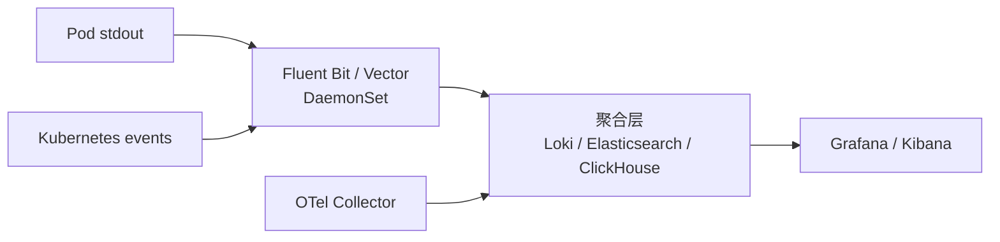

# 第 48 章 可观测性 2.0：OpenTelemetry、日志管道、SLO 与错误预算

第 8 章建立了五层模型（status/conditions/events/logs/metrics），并给出了 KubeRay 与 Ray 的指标与日志入口。本章补上现代平台真正需要的第四类信号 **trace**，以及把信号变成决策的 **SLO/错误预算**。

一句话区分：

- metrics 告诉你“错误率是 2%”；
- logs 告诉你“这一行报了 timeout”；
- traces 告诉你“是 RayJob 提交卡住，还是 operator 在重试，还是 worker 调度失败”；
- SLO 告诉你“现在要不要叫人”。

## 48.1 从“有监控”到“能定位”

一个 KubeRay 平台常见的事故现场：

```text
用户：作业失败率升高
Dashboard：RayJob Failed 数量上升
Prometheus：operator reconcile 错误率正常
日志：大量 "connection refused"
```

如果只看 metrics，会得出“operator 正常、Ray 有问题”的结论；如果有 trace，会看到：

```text
rayjob.reconcile
  └── submit_job (HTTP 8265)
        └── connect head-svc:8265 -> connection refused
  └── requeue (backoff 2s)
```

根因可能是 head Pod Ready 但 Dashboard 还没起来，或者 NetworkPolicy 挡了 8265。trace 把“控制面状态”和“数据面症状”连成因果链。

### 48.1.1 四类信号的分工

| 信号 | 回答的问题 | 基数 | 成本 | 保留 |
|---|---|---|---|---|
| metrics | 趋势、比例、告警 | 低 | 低 | 长 |
| logs | 具体事件与上下文 | 高 | 中高 | 中 |
| traces | 调用链与耗时分布 | 中高 | 中 | 中短 |
| events/status | Kubernetes 对象的状态变化 | 低 | 低 | 对象生命周期 |

不要把 trace 当成“更详细的日志”：trace 的价值是 **因果关系和耗时分解**，不是文本。

## 48.2 OpenTelemetry 数据模型

### 48.2.1 Trace 与 Span

```text
trace_id: 4bf92f3577b34da6a3ce929d0e0e4736
├── span: operator.round (root)
│   ├── span: reconcile (raycluster)
│   │   ├── span: ensure_pod
│   │   └── span: update_status
│   └── span: reconcile (rayjob)
│       └── span: submit_job
```

每个 span 包含：

- `trace_id` / `span_id` / `parent_span_id`；
- name、start/end time、duration；
- attributes（键值对）；
- events（带时间戳的注释）；
- status（OK/ERROR/UNSET）。

### 48.2.2 上下文传播

跨进程传播通常使用 W3C `traceparent`：

```text
traceparent: 00-4bf92f3577b34da6a3ce929d0e0e4736-00f067aa0ba902b7-01
```

在 Kubernetes 中，上下文传播的难点：

- operator → kube-apiserver：通常不传播业务 trace；
- operator → Ray Dashboard/Job API：可以注入 header；
- Ray driver → worker：Ray 不自动传播 OpenTelemetry context；
- Serve proxy → replica：需要在 middleware 中注入/提取。

### 48.2.3 资源属性

建议统一以下 resource attributes：

| 属性 | 示例 | 用途 |
|---|---|---|
| `service.name` | `kuberay-operator` | 服务维度 |
| `k8s.namespace.name` | `team-a` | 多租户 |
| `k8s.pod.name` | `kuberay-operator-...` | 实例定位 |
| `k8s.node.name` | `node-1` | 节点问题 |
| `ray.cluster.name` | `train` | Ray 集群 |
| `ray.job.id` | `raysubmit_...` | 作业 |
| `ray.node.type` | `head`/`worker` | 角色 |

## 48.3 Operator 侧：MiniKubeRay 的 trace 实现

MiniKubeRay 在 `minikuberay/tracing.py` 中实现了一个无依赖的 span 收集器，并把它接入了 `Controller.reconcile_all()` 与 `Operator.run_once()`。

### 48.3.1 结构

- `Operator.run_once()` 创建根 span `operator.round`；
- 每个 controller 的 `reconcile_all()` 为每个对象创建子 span `reconcile`；
- span 属性包含 `controller`、`kind`、`namespace`、`name`、`generation`、`result`；
- 异常/冲突会把 span 标为 `ERROR` 并记录 `exception` 事件；
- 收集器有上限（`trace_max_spans`），避免内存无限增长。

### 48.3.2 查看 trace

启动平台：

```bash
python -m minikuberay server
```

浏览器或 curl：

```bash
curl -s http://127.0.0.1:8080/api/traces?limit=5 | python -m json.tool
```

CLI：

```bash
python -m minikuberay traces --limit 5 --tree
```

输出类似：

```text
spans=49 errors=0 p50=0.65ms p95=5.0ms p99=6.8ms
14d0aba2ee57   5 spans  0 errors  root=operator.round
    operator.round 3.3ms
      reconcile 0.7ms raycluster
      reconcile 0.6ms raycluster
      reconcile 0.3ms rayjob
      reconcile 0.0ms batchjob
```

### 48.3.3 代码入口

```python
from minikuberay.tracing import Tracer

tracer = Tracer()
with tracer.span("submit_job", rayjob="train", mode="HTTPMode") as span:
    span.set_attribute("head.url", "http://train-head-svc:8265")
    try:
        submit()
    except TimeoutError as exc:
        span.add_event("retry", attempt=1)
        raise
```

### 48.3.4 映射到 OpenTelemetry

MiniKubeRay 的 span 字段与 OTel 的对应关系：

| MiniKubeRay | OpenTelemetry |
|---|---|
| `trace_id` | `TraceId` |
| `span_id` | `SpanId` |
| `parent_span_id` | `ParentSpanId` |
| `name` | `Name` |
| `start_time`/`end_time` | `StartTimeUnixNano`/`EndTimeUnixNano` |
| `attributes` | `Attributes` |
| `events` | `Events` |
| `status=ERROR` | `Status.Code=ERROR` |

生产环境用 OTel SDK 导出到 Collector：

```yaml
apiVersion: v1
kind: ConfigMap
metadata:
  name: otel-collector-config
data:
  config.yaml: |
    receivers:
      otlp:
        protocols:
          grpc: {}
          http: {}
    processors:
      batch: {}
      memory_limiter:
        check_interval: 1s
        limit_mib: 512
    exporters:
      otlphttp:
        endpoint: http://tempo.observability:4318
    service:
      pipelines:
        traces:
          receivers: [otlp]
          processors: [memory_limiter, batch]
          exporters: [otlphttp]
```

## 48.4 Ray 与应用侧：把数据面接进 trace

### 48.4.1 Ray 不自动传播 context

Ray task/actor 是独立进程，OpenTelemetry 的 context 不会自动跨进程传播。常见做法：

1. 在 driver 中创建 span；
2. 把 `traceparent` 作为参数/环境变量传给 task/actor；
3. 在 worker 中提取 context 并创建子 span；
4. 在日志中写入 `trace_id`/`span_id`。

```python
from opentelemetry import trace, propagate
from opentelemetry.context import attach, detach

tracer = trace.get_tracer("ray-app")

def remote_task(traceparent: str, payload):
    token = attach(propagate.extract({"traceparent": traceparent}))
    try:
        with tracer.start_as_current_span("remote_task") as span:
            span.set_attribute("payload.rows", len(payload))
            return process(payload)
    finally:
        detach(token)

with tracer.start_as_current_span("driver") as span:
    carrier = {}
    propagate.inject(carrier)
    ray.get(remote_task.remote(carrier.get("traceparent", ""), data))
```

### 48.4.2 Serve 中间件

Ray Serve 支持自定义 middleware（FastAPI/Starlette）。在 middleware 中：

- 提取 `traceparent`；
- 创建 `serve.request` span；
- 记录 route、status、prompt tokens（注意 PII）；
- 把 trace ID 注入响应 header，便于用户报障。

### 48.4.3 日志关联

每条日志都带：

```text
trace_id=4bf92f... span_id=00f067... ray_job_id=raysubmit_...
```

这样从日志可以跳到 trace，从 trace 可以回到日志。

## 48.5 日志管道

### 48.5.1 日志来源

| 来源 | 内容 | 采集方式 |
|---|---|---|
| operator | reconcile 错误、事件、限速 | stdout |
| Ray 容器 | raylet/gcs/dashboard/worker | stdout + `/tmp/ray/session_latest/logs` |
| Job | entrypoint 输出 | Ray Job API / Dashboard |
| Kubernetes | 事件、审计 | kube-apiserver/事件导出 |
| 应用 | 业务日志 | stdout（推荐） |

### 48.5.2 采集架构



要点：

- **stdout 优先**：容器日志由 kubelet 管理，采集简单；
- **多行日志**：Java/Python traceback 需要 multiline 配置；
- **元数据**：namespace/pod/container/node/labels 必须打上；
- **采样/过滤**：高吞吐服务不要全量保留 debug；
- **PII**：prompt、用户 ID、token 不应进入日志；
- **保留**：热/温/冷分层，按合规要求删除。

### 48.5.3 日志级别

- operator：INFO 记录状态变化，ERROR 记录需要动作的失败；
- Ray：WARNING 以上进告警，DEBUG 只临时开启；
- 应用：请求级 INFO 可能非常贵，用采样或结构化字段。

### 48.5.4 日志成本

成本通常由三部分构成：

```text
成本 ≈ 写入量 × 单价 + 索引量 × 单价 + 查询/保留成本
```

降低成本的顺序：

1. 删除无用的 debug；
2. 结构化日志，避免重复长文本；
3. 采样（尤其是成功请求）；
4. 冷热分层；
5. 只对关键字段建索引。

## 48.6 指标与基数

### 48.6.1 RED 与 USE

- **RED**：Rate、Errors、Duration（适合服务）；
- **USE**：Utilization、Saturation、Errors（适合资源）。

KubeRay 平台至少要有：

| 维度 | 指标 |
|---|---|
| operator | reconcile 速率/错误/耗时 |
| RayCluster | Ready、Pod Ready、desired/ready replicas |
| RayJob | 状态、执行时长、失败率 |
| RayService | Ready、升级中、回滚中 |
| autoscaler | 扩容/缩容动作、失败、pending demand |
| 节点 | CPU/GPU/内存/磁盘/网络 |
| Ray | 对象存储、task/actor、Serve 指标 |

### 48.6.2 基数陷阱

不要把以下值放进标签：

- job ID、task ID、actor ID、request ID；
- 完整镜像 tag；
- 用户输入；
- 高基数 URL。

基数爆炸的后果：

- Prometheus 内存/磁盘暴涨；
- 查询变慢；
- 告警规则失效。

处理方式：

- 用 `relabel_configs` 删除/哈希高基数标签；
- 把高基数维度放到日志/trace；
- 用 exemplar 把指标样本关联到 trace。

### 48.6.3 直方图与分位数

- 不要用平均值判断尾延迟；
- 用直方图计算 p50/p95/p99；
- 注意 bucket 边界要覆盖 SLO；
- 原生直方图（native histograms）能降低基数，但需要 Prometheus/后端支持。

## 48.7 SLO 与错误预算

### 48.7.1 定义 SLI

一个可用的 SLI 必须明确：

- 分子：成功请求数；
- 分母：总请求数；
- 时间窗口；
- 成功标准（状态码、延迟阈值、业务结果）。

示例：

```text
SLI_availability = 成功请求数 / 总请求数
SLI_latency      = 在 2s 内完成的请求数 / 总请求数
SLO              = 99.9% (30 天)
```

### 48.7.2 错误预算

```text
允许错误率 = 1 - SLO = 0.1%
预算分钟数 = 30 × 24 × 60 × 0.1% = 43.2 分钟
```

如果观测到 0.12% 的错误率：

```text
坏分钟数 = 43,200 × 0.12% = 51.84 分钟
预算消耗 = 51.84 / 43.2 = 120%
燃烧率   = 0.12% / 0.1% = 1.2x
```

### 48.7.3 多窗口燃烧率

单一窗口容易误报/漏报。常见策略：

| 窗口 | 燃烧率阈值 | 含义 |
|---|---:|---|
| 1h | 14.4x | 2% 预算在 1 小时内烧完 |
| 6h | 6x | 5% 预算在 6 小时内烧完 |
| 3d | 1x | 持续超支 |

告警规则通常是“短窗口高燃烧率 + 长窗口确认”，以减少抖动。

### 48.7.4 延迟 SLO

延迟 SLO 用“好请求比例”而不是平均值：

```text
good = requests with TTFT <= 1s AND ITL <= 100ms
SLI  = good / total
```

对 LLM 服务，还要区分：

- 交互式（TTFT 敏感）；
- 批处理（吞吐敏感）；
- 流式（ITL 敏感）。

### 48.7.5 SLO 的所有权

SLO 不是监控团队单方面定的：

- 产品定义“可接受的体验”；
- SRE 定义“可测量的 SLI”；
- 平台定义“错误预算怎么用”（发布门禁/冻结/回滚）；
- 业务定义“超支时先降级什么”。

## 48.8 告警与 Runbook

### 48.8.1 症状告警优先

好的告警针对用户可见的症状：

- RayService Ready=0 超过 1 分钟；
- RayJob 失败率 > 5%（10 分钟窗口）；
- TTFT p95 > 2s（5 分钟）；
- 错误预算燃烧率 > 阈值。

坏的告警针对内部原因：

- “某个 Pod 重启了”（可能是正常的滚动更新）；
- “CPU 高”（可能正在正常工作）。

### 48.8.2 告警分级

| 级别 | 例子 | 响应 |
|---|---|---|
| P1 | 全平台不可用、数据丢失 | 立即呼叫 |
| P2 | 单租户不可用、SLO 快速燃烧 | 15 分钟内 |
| P3 | 性能下降、容量接近上限 | 工作时间 |
| P4 | 趋势/成本 | 工单 |

### 48.8.3 Runbook 结构

每条告警都应链接一个 runbook：

1. 症状与影响；
2. 立即检查（3–5 条命令）；
3. 常见根因与处理；
4. 升级路径；
5. 恢复验证；
6. 复盘记录。

## 48.9 成本归因

### 48.9.1 标签体系

至少要有：

- `team` / `cost-center`；
- `workload`（train/serve/batch）；
- `ray.io/cluster`；
- `ray.io/originated-from-crd`；
- `environment`。

### 48.9.2 GPU 成本

```text
GPU 成本 = GPU 小时 × 单价
```

但要注意：

- 空闲但未缩容的 GPU 也算钱；
- 碎片化的 GPU 无法被其他作业使用；
- Spot 实例的中断成本；
- 冷启动/镜像拉取时间也计入作业时长。

### 48.9.3 Showback 与 Chargeback

- Showback：让团队看到用量；
- Chargeback：真正扣预算。

从 Showback 开始，先解决“看不见”的问题，再谈扣费。

## 48.10 实验：`examples/observability_lab.py`

实验用真实 MiniKubeRay operator：

1. 创建 RayCluster + RayJob；
2. 收敛后收集 span；
3. 打印一条 trace 树；
4. 计算 RED 指标与 SLO/错误预算；
5. 删除集群，验证 History Server 会话仍然存在。

运行：

```bash
python examples/observability_lab.py
```

输出示例：

```text
settled in 12 rounds; spans=49 traces=12
RED: errors=0 error_rate=0.0000 p50=0.65ms p95=5.0ms p99=6.8ms
    operator.round 3.3ms
      reconcile 0.7ms raycluster
      reconcile 0.6ms raycluster
      reconcile 0.3ms rayjob
      reconcile 0.0ms batchjob
error budget      : 43.2 min
bad minutes       : 51.84 min (120.0% consumed)
burn rate         : 1.2x
OK: spans form a trace tree, the SLO math is reproducible, and History survives deletion.
```

实验的关键断言：

- 每个 round 有根 span；
- 每个 reconcile 有子 span；
- 异常 span 的状态是 ERROR；
- SLO 数学可复现；
- History 会话在删除后仍可查询。

## 48.11 练习

1. 给 `minikuberay/tracing.py` 增加一个 `parent` 参数，让 RayJob 的 `submit_job` span 能挂在指定 reconcile span 下。
2. 把 trace 导出为 OTLP JSON（或写一个转换脚本），用 `otel-cli`/Collector 验证能被接收。
3. 设计一个 RayService 的 SLI：请求成功率 + TTFT p95 + ITL p95，写出 PromQL 与告警阈值。
4. 估算你所在平台的日志成本：每天多少 GB、保留 30 天、索引多少字段。
5. 给一个 GPU 队列设计 Showback 报表：按 team、workload、cluster 聚合 GPU 小时与成本。

## 48.12 小结

- trace 补上了 metrics/logs 缺失的因果链；operator、Ray、应用要共享 trace context。
- OpenTelemetry 的 trace/span 模型可以直接映射到 MiniKubeRay 的 `tracing.py`。
- 日志管道的关键是结构化、元数据、采样、PII 和成本。
- SLO 的核心是明确的 SLI、错误预算和多窗口燃烧率；没有分母的“可用性”没有意义。
- 告警要针对用户症状，并链接可执行的 runbook。
- 成本归因从标签开始，先 Showback 再 Chargeback。
- `examples/observability_lab.py` 把 span 树、RED、SLO 和 History 串成了一个可运行闭环。

下一章从“看见问题”转向“提前阻止问题”：准入控制、策略即代码、供应链安全，以及怎样让策略本身可测试、可回滚。

→ [第 49 章 平台治理：准入控制、策略即代码与供应链安全](kuberay教程-49-平台治理-准入控制、策略即代码与供应链安全.md)
