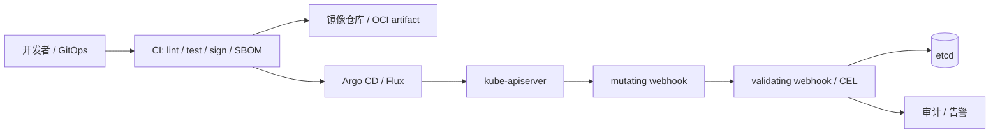

# 第 49 章 平台治理：准入控制、策略即代码与供应链安全

第 14 章从攻击面讲安全：RBAC、NetworkPolicy、Secret、mTLS、多租户。本章换一个角度：**怎样在对象进入集群之前就阻止错误配置，怎样证明镜像和清单没有被篡改，以及怎样让策略本身像代码一样被测试、评审和回滚**。

治理不是“再加一个 webhook”。一个可运营的治理体系要回答：

- 哪些规则必须在 admission 时强制，哪些只需审计？
- 策略失败时是拒绝对象，还是放行并告警？
- 策略引擎自己挂了，会不会阻塞所有 Ray CR 创建？
- 谁能申请例外，例外如何过期？
- 镜像从构建到部署，哪一步可以被篡改？

## 49.1 治理的三个平面



| 平面 | 目标 | 工具 |
|---|---|---|
| 构建时 | 产物可追溯、可验证 | SBOM、cosign、SLSA provenance、扫描 |
| 部署时 | 配置符合规则 | admission webhook、CEL、Kyverno/Gatekeeper |
| 运行时 | 行为符合预期 | NetworkPolicy、PSA、审计、Falco |

三者缺一不可：只做构建时签名，运行时仍可能跑特权容器；只做 admission，镜像仍可能来自不可信仓库。

## 49.2 Kubernetes Admission 链

### 49.2.1 请求顺序

一个创建请求大致经过：

```text
authentication -> authorization -> mutating admission -> schema validation
-> validating admission -> etcd
```

关键点：

- mutating webhook 可以改对象（注入 sidecar、补标签、加默认值）；
- validating webhook 只能拒绝；
- CRD 的 OpenAPI schema 校验发生在 admission 中；
- CEL validation 在 schema 之后执行；
- 多个 webhook 的顺序由 `webhookConfiguration` 的顺序和 `reinvocationPolicy` 决定。

### 49.2.2 failurePolicy

| 策略 | 行为 | 适用 |
|---|---|---|
| `Fail` | webhook 不可用时拒绝请求 | 强安全规则 |
| `Ignore` | webhook 不可用时放行 | 非关键/审计规则 |

`Fail` 的风险：策略引擎故障会阻塞所有 Ray CR 创建。缓解：

- webhook 多副本 + PDB；
- 合理的 `timeoutSeconds`（默认 10s 太长）；
- `namespaceSelector` 排除 kube-system；
- 关键例外走 break-glass；
- 监控 webhook 延迟与错误率。

### 49.2.3 matchConditions 与 namespaceSelector

只对需要的对象调用 webhook：

```yaml
matchConditions:
  - name: ray-resources-only
    expression: request.resource.group == "ray.io"
```

好处：

- 降低 apiserver 延迟；
- 降低策略引擎负载；
- 减少误伤。

## 49.3 CEL：把校验放进 CRD

Kubernetes 支持在 CRD schema 里写 CEL：

```yaml
# CRD schema 片段（不是完整 CRD）
properties:
  spec:
    x-kubernetes-validations:
      - rule: "self.workerGroupSpecs.all(g, g.minReplicas <= g.replicas && g.replicas <= g.maxReplicas)"
        message: "worker group replicas must be within [minReplicas, maxReplicas]"
      - rule: "self.workerGroupSpecs.all(g, !has(g.maxReplicas) || g.maxReplicas >= 0)"
        message: "maxReplicas must be non-negative"
```

优点：

- 无外部 webhook，延迟低；
- 规则随 CRD 版本走；
- 适合“字段之间”的不变量。

限制：

- 不能访问集群里的其他对象（例如“必须有对应 NetworkPolicy”）；
- 表达式有成本预算；
- 规则变更需要升级 CRD；
- 复杂逻辑可读性差。

### 49.3.1 CEL 的 ratcheting

升级校验规则时，已有对象可能不满足新规则。Kubernetes 的 **ratcheting** 允许：

- 更新时只校验被修改的字段；
- 未修改的旧值不因新规则而阻塞。

设计规则时要区分：

- **新对象必须满足**：创建时严格；
- **旧对象允许保留**：更新时放宽。

## 49.4 Kyverno、Gatekeeper 与 OPA

### 49.4.1 选型

| 工具 | 语言 | 优点 | 缺点 |
|---|---|---|---|
| Kyverno | YAML | 易读、原生 K8s、支持 mutate/validate/generate | 复杂逻辑表达力有限 |
| Gatekeeper | Rego | 表达力强、生态成熟 | 学习曲线、策略分发 |
| OPA/Conftest | Rego | CI 可复用 | 需要额外集成 |
| CEL | CEL | 无 webhook、低延迟 | 不能跨对象 |

### 49.4.2 Kyverno 示例

```yaml
apiVersion: kyverno.io/v1
kind: ClusterPolicy
metadata:
  name: ray-require-labels
spec:
  validationFailureAction: Enforce
  background: true
  rules:
    - name: require-team-and-cost-center
      match:
        any:
          - resources:
              kinds:
                - RayCluster
                - RayJob
                - RayService
              operations:
                - CREATE
                - UPDATE
      validate:
        message: "Ray resources must carry team and cost-center labels"
        pattern:
          metadata:
            labels:
              team: "?*"
              cost-center: "?*"
```

### 49.4.3 Gatekeeper 示例

```yaml
apiVersion: templates.gatekeeper.sh/v1
kind: ConstraintTemplate
metadata:
  name: kuberaypinnedimages
spec:
  crd:
    spec:
      names:
        kind: KubeRayPinnedImages
  targets:
    - target: admission.k8s.gatekeeper.sh
      rego: |
        package kuberay.pinned

        violation[{"msg": msg}] {
          container := input.review.object.spec.rayClusterSpec.workerGroupSpecs[_].template.spec.containers[_]
          endswith(container.image, ":latest")
          msg := sprintf("image %v uses :latest", [container.image])
        }
```

Rego 的表达力更强，但要注意：

- 遍历所有可能的 CRD 形状（RayJob/RayService/RayCronJob 嵌套不同）；
- 处理缺失字段；
- 给策略写单元测试。

### 49.4.4 策略即代码的测试

无论用哪种引擎，都应把策略当代码：

- 正向用例（合规对象必须通过）；
- 反向用例（每个规则至少一个违规对象）；
- 边界用例（缺失字段、空数组、nil）；
- 版本化与代码评审；
- 在 CI 中对样例清单运行策略。

## 49.5 Ray 平台的策略库

以下规则适合大多数 KubeRay 平台：

### 49.5.1 标签与所有权

- 必须带 `team`、`cost-center`、`app.kubernetes.io/part-of`；
- `ray.io/originated-from-crd` 由控制器生成，用户不能覆盖；
- 禁止用户手动设置 `ray.io/cluster` 等身份标签（避免控制器误认领）。

### 49.5.2 镜像

- 禁止 `:latest`；
- 生产建议使用 digest（`@sha256:`）；
- 限制镜像仓库前缀（只允许内部 registry）；
- 禁止特权容器、hostPath、hostNetwork；
- 要求 `runAsNonRoot`、`allowPrivilegeEscalation: false`、`drop: ALL`。

### 49.5.3 资源

- 每个容器必须有 CPU/内存 requests；
- GPU requests == limits；
- 单 Pod GPU 数量上限（防止一个作业占满节点）；
- 必须有 `activeDeadlineSeconds`（RayJob）；
- 必须有 `ttlSecondsAfterFinished` 或清理策略；
- 资源不超过 namespace 的 ResourceQuota。

### 49.5.4 调度与多租户

- worker group 必须有 `minReplicas`/`maxReplicas` 上限；
- 必须指定队列标签（Kueue/Volcano/YuniKorn）；
- 禁止使用其他租户的 ServiceAccount；
- 必须启用 NetworkPolicy（或由平台自动生成）；
- 优先级不能超过租户配额。

### 49.5.5 运行时

- 禁止 `rayStartParams` 覆盖平台管理的参数（端口、对象存储）；
- 禁止挂载 docker.sock；
- 限制 `runtime_env.pip`（供应链风险）；
- 要求 `shutdownAfterJobFinishes` 或明确的清理策略。

## 49.6 供应链安全

### 49.6.1 威胁模型

| 威胁 | 例子 | 控制 |
|---|---|---|
| 镜像篡改 | 仓库被入侵，tag 被覆盖 | digest 固定、签名验证 |
| 依赖投毒 | `runtime_env.pip` 安装恶意包 | 私有索引、锁文件、扫描 |
| 构建污染 | CI 被注入 | SLSA provenance、隔离构建 |
| 基础镜像漏洞 | Ray 镜像含 CVE | 扫描、重建、补丁策略 |
| 权限过大 | 容器 privileged | PSA/策略 |
| 供应链混淆 | 内部包名与公共包重名 | 私有 registry、命名空间 |

### 49.6.2 SBOM

SBOM（Software Bill of Materials）列出镜像中的组件与版本：

- SPDX；
- CycloneDX。

生成方式（示例）：

```bash
syft rayproject/ray:2.59.0 -o spdx-json > ray.spdx.json
```

用途：

- 漏洞响应：CVE 公布后快速定位受影响镜像；
- 合规审计；
- 许可证检查。

### 49.6.3 签名与验证

cosign keyless 签名（示意）：

```bash
cosign sign --yes ghcr.io/example/ray-train@sha256:<digest>
```

部署时验证：

- Kyverno `verifyImages`；
- Gatekeeper + cosign；
- 或 admission webhook 调用 cosign verify。

验证要绑定：

- 签名身份（OIDC issuer/subject）；
- 镜像 digest；
- 时间戳（防止旧签名重放）。

### 49.6.4 SLSA

SLSA 等级关注“构建过程的可信度”：

SLSA v1.0 起使用 **Build track L1–L3**；旧版的 “L4” 已不再是 v1.0 的构建等级（其“双人评审/可复现”要求被推迟到未来规范）：

| 等级 | 要求（简化） |
|---|---|
| Build L1 | 有 provenance，说明构建方式（可不签名） |
| Build L2 | 托管构建平台生成并签名 provenance |
| Build L3 | 隔离/加固构建，签名材料对构建步骤不可见 |

如果公司内部仍沿用旧版 L1–L4 说法，要在文档里注明是 legacy 模型，不要和 SLSA v1.0 混用。

对 Ray 平台：

- 自己的业务镜像至少 SLSA 2；
- 记录 base image digest；
- 保留 provenance 与 SBOM；
- CI 中禁止手动 `docker build && push`。

### 49.6.5 runtime_env 的供应链风险

`runtime_env.pip` 允许作业在运行时安装依赖：

- 可能从公共 PyPI 拉取恶意包；
- 可能绕过镜像扫描；
- 可能引入不兼容版本。

治理：

- 生产禁用或限制 `pip`；
- 使用私有索引/镜像；
- 固定版本与 hash；
- 在 CI 中预先构建镜像。

## 49.7 多租户护栏

### 49.7.1 资源配额

```yaml
apiVersion: v1
kind: ResourceQuota
metadata:
  name: team-a
  namespace: team-a
spec:
  hard:
    requests.cpu: "200"
    requests.memory: 800Gi
    requests.nvidia.com/gpu: "32"
    count/rayclusters.ray.io: "20"
```

注意：

- GPU 配额要用扩展资源名；
- CRD 的对象数配额键是 `count/<plural>.<group>`，即 `count/rayclusters.ray.io`；只写 `count/rayclusters` 不会生效；
- 配额是 namespace 级的，跨 namespace 的公平性要靠 Kueue/队列。

### 49.7.2 LimitRange

给没有写 requests/limits 的 Pod 兜底：

```yaml
apiVersion: v1
kind: LimitRange
metadata:
  name: defaults
  namespace: team-a
spec:
  limits:
    - type: Container
      defaultRequest:
        cpu: "1"
        memory: 2Gi
      default:
        cpu: "4"
        memory: 8Gi
```

但不要用 LimitRange 掩盖“作业没声明资源”的问题；策略仍应要求显式声明。

### 49.7.3 Pod Security Admission

为 namespace 设置 PSA：

```yaml
apiVersion: v1
kind: Namespace
metadata:
  name: team-a
  labels:
    pod-security.kubernetes.io/enforce: restricted
    pod-security.kubernetes.io/audit: restricted
    pod-security.kubernetes.io/warn: restricted
```

`restricted` 对 Ray 镜像的要求：

- 非 root；
- 禁止特权；
- 禁止 hostPath/hostNetwork；
- 需要 seccomp/AppArmor 配置。

先在 `audit`/`warn` 模式跑一段时间，再切 `enforce`。

### 49.7.4 网络与队列

- 默认拒绝的 NetworkPolicy；
- 每个租户一个队列；
- 跨租户访问需要显式策略；
- 禁止租户修改平台 CRD/operator。

## 49.8 GitOps 与策略 CI

### 49.8.1 清单校验

CI 中至少跑：

```bash
kubeconform -strict manifests/
python check_docs.py
python examples/policy_lab.py
conftest test manifests/ -p policy/
```

### 49.8.2 策略测试

把策略仓库和清单仓库分开：

```text
platform-policies/
├── kyverno/
├── gatekeeper/
├── tests/
│   ├── allowed/
│   └── denied/
└── ci.yaml
```

每次策略变更：

1. 跑正向/反向用例；
2. 在 audit 模式部署到 staging；
3. 观察一周；
4. 切 enforce；
5. 保留回滚版本。

### 49.8.3 Argo CD 的注意点

- CRD 升级需要单独 sync wave；
- webhook 配置变更可能阻塞所有 CR；
- 策略与工作负载分开同步；
- 使用 `ServerSideApply` 时注意 managedFields；
- 生产 namespace 的自动同步要谨慎。

## 49.9 上线与事故处理

### 49.9.1 分阶段上线

1. **离线**：对所有样例跑策略，修复误报；
2. **Audit**：只记录不拒绝，观察一周；
3. **Warn**：返回 warning，调用方可见；
4. **Enforce**：拒绝不合规对象；
5. **例外**：为迁移中的租户设置带过期时间的豁免。

### 49.9.2 例外管理

例外必须是：

- 显式的（annotation/label）；
- 有 owner；
- 有过期时间；
- 有审计记录；
- 定期清理。

不要让例外变成永久后门。

### 49.9.3 Webhook 故障

预案：

- 监控 webhook 的 p99 延迟与错误率；
- `failurePolicy: Ignore` 用于非关键策略；
- 关键策略的多副本/PDB；
- break-glass 流程（临时移除 webhook）；
- 恢复后补审计。

## 49.10 实验：`examples/policy_lab.py`

实验实现了一个无依赖的策略引擎：

- 扫描 `manifests/samples/` 中的 Ray CR；
- 检查标签、镜像、requests、GPU、安全上下文、hostPath、autoscaler 边界、名称长度；
- 演示 `enforce` 与 `audit` 两种模式；
- 用合规对象与故意违规对象验证规则。

运行：

```bash
python examples/policy_lab.py
```

输出示例：

```text
scanned 31 Ray CRs in samples/
require-ownership-labels               31
pin-images                              0
declare-requests                        1
restricted-security                   177
compliant / enforce : allowed=True warnings=0
bad / enforce       : allowed=False reasons=9
bad / audit         : allowed=True warnings=9
OK: the admission contract is explicit, testable and mode-aware.
```

这个实验说明：

- 样例清单通常不满足生产策略（缺少 team/cost-center、缺少 securityContext）；
- 先 audit 再 enforce，可以避免一次性打爆所有提交；
- 策略必须能用“合规/不合规”对象做回归测试。

## 49.11 练习

1. 把 `policy_lab.py` 的一条规则改写成 Kyverno 策略，并用 `kyverno test` 验证。
2. 给策略增加“RayJob 必须有 `activeDeadlineSeconds`”与“RayService 必须开启 incremental upgrade gate”两条规则。
3. 设计一个带过期时间的例外机制：annotation 格式、校验逻辑、审计字段。
4. 为你的镜像仓库设计 cosign 签名与 admission 验证流程，画出构建到部署的信任链。
5. 评估 `runtime_env.pip` 的风险：给出禁用、私有索引、锁文件三种方案的取舍。

## 49.12 小结

- 治理分构建时、部署时、运行时三个平面，缺一不可。
- Admission 链的顺序、failurePolicy、matchConditions 决定了策略的可靠性与爆炸半径。
- CEL 适合字段间不变量；Kyverno/Gatekeeper 适合跨对象/复杂规则；两者可以组合。
- 策略必须像代码一样测试：正向、反向、边界、版本化、audit 先行。
- 供应链安全的核心是“digest + 签名 + provenance + SBOM”，而不是“扫描过一次”。
- 多租户护栏要同时覆盖配额、PSA、网络和队列。
- `examples/policy_lab.py` 把策略引擎的 enforce/audit 行为和回归断言变成了可运行代码。

下一章把治理延伸到数据与模型：schema 契约、版本与血缘、point-in-time 特征、模型注册与回滚。计算平台只保证作业跑完，治理层才保证“这个模型是用正确的数据训练出来的”。

→ [第 50 章 数据与模型治理](kuberay教程-50-数据与模型治理-Schema、血缘、Point-in-Time特征与模型注册.md)
