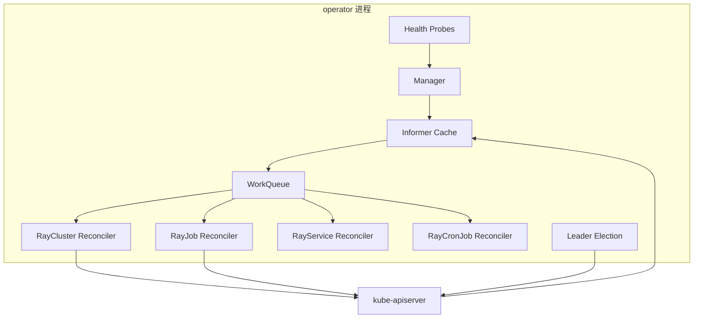

# 第 54 章 Operator 可靠性与控制面 SLO

前面大多数章节把 operator 当作“永远在线”的组件：它 watch CR、创建 Pod、写 status。但 operator 自己也是一个会 OOM、会重启、会选主、会限流、会缓存陈旧的分布式系统。控制面一旦不可用，表现不是“某个 Ray 任务失败”，而是**所有租户的调和同时停摆**。

本章讨论 operator 自身的可靠性：启动顺序、探针、leader election、workqueue、缓存一致性、panic/OOM/API 限流、升级，以及一套独立于业务 SLO 的控制面 SLO。

## 54.1 控制面的故障域



控制面故障可以分成四层：

| 层 | 典型故障 | 影响 |
|---|---|---|
| 进程 | OOMKilled、panic、死锁 | 单副本失联；多副本时由 leader election 接管 |
| 缓存 | watch 断开、410 Gone、cache sync 超时 | 调和看到旧对象或根本起不来 |
| 队列 | 重试风暴、限流、队列积压 | 调和延迟上升，最终超时 |
| API | 429/5xx、APF 限流、etcd 慢 | 写失败、status 不更新、finalizer 卡住 |

这四层里，**进程重启通常是最容易恢复的**；真正难的是“进程活着，但缓存/队列/权限已经不对”。

## 54.2 启动顺序：先同步，再服务

controller-runtime 的 manager 启动顺序大致是：

```text
load config -> create manager -> start health probes
  -> start informers -> wait for cache sync
  -> start leader election (if enabled)
  -> start reconcilers and workers
```

关键点：

- **cache sync 完成前，controller 不应该处理事件**；否则会基于空缓存做错误决策（例如把所有 Pod 当成“不存在”而重复创建）。
- **readiness 应该反映 cache 是否同步**，而不是“进程还在”。
- **cache sync 有超时**（controller-runtime 的 `CacheSyncTimeout`，KubeRay 是否暴露为 flag 以版本为准）。对象很多、API 很慢时，超时会让 manager 启动失败并退出，而不是带着旧缓存运行。
- **leader election 在 cache sync 之后**；非 leader 副本也会维护缓存，但不执行调和。

一个常见的启动事故：

```text
operator 启动 -> cache sync 超过 120s -> manager 退出
-> Deployment 重启 -> 再次 sync -> 再次超时 -> CrashLoopBackOff
```

根因通常不是 operator bug，而是：

- 集群里有几十万个 Pod/Event，informer 首次 list 很慢；
- apiserver 被限流；
- watch 的 namespace 范围过大；
- 网络到 apiserver 的延迟/丢包。

处理方向：缩小 `watchNamespace`、提高 apiserver 容量、增加 cache sync 超时、减少不必要的对象类型（第 41 章）。

## 54.3 探针：liveness 与 readiness 不是一回事

| 探针 | 失败后果 | 应该检查什么 |
|---|---|---|
| `startupProbe` | 重启容器 | 进程是否完成初始化 |
| `livenessProbe` | 重启容器 | 事件循环是否还在推进 |
| `readinessProbe` | 从 Service 端点移除（不重启） | cache 是否同步、是否 leader、是否在优雅退出 |

常见错误：

- **把 readiness 写成“进程活着”**：cache 没同步也返回 200，控制器开始用空缓存调和；
- **把 liveness 写成“依赖 apiserver 可用”**：apiserver 抖动时所有 operator 副本一起重启，放大故障；
- **liveness 检查太重**：探针里做 list/watch，探针本身成为 API 压力源；
- **没有 startupProbe**：大集群首次 sync 超过 liveness 初始延迟，容器被反复杀死。

KubeRay operator 默认在 `:8082` 暴露健康探针（以部署版本为准），metrics 常见在 `:8080`。探针路径通常是 `/healthz` 和 `/readyz`；确认方式：

```bash
kubectl -n kuberay-system get deploy kuberay-operator -o yaml | \
  sed -n '/livenessProbe/,/readinessProbe/p'
kubectl -n kuberay-system port-forward deploy/kuberay-operator 8082:8082
curl -s localhost:8082/healthz
curl -s localhost:8082/readyz
```

## 54.4 Leader election：多副本不等于高可用

KubeRay 默认开启 leader election（Helm `leaderElectionEnabled: true`）。多个副本通过 Kubernetes `Lease` 对象选主：

- leader 定期续约；
- 非 leader 只维护缓存，不调和；
- leader 失联后，租约到期，另一个副本接管。

三个时间参数：

| 参数 | 典型值 | 含义 |
|---|---:|---|
| `leaseDurationSeconds` | 15 | 租约有效期 |
| `renewDeadlineSeconds` | 10 | leader 必须在此前续约 |
| `retryPeriodSeconds` | 2 | 非 leader 尝试接管的间隔 |

必须满足：

```text
leaseDuration > renewDeadline > retryPeriod
```

否则会出现：

- 续约还没完成，租约已经过期 → 频繁切换；
- 多个副本同时认为自己可以接管 → **split brain**（脑裂）。

### 54.4.1 脑裂与 fencing

Kubernetes 的 Lease 只能降低脑裂概率，不能从物理上阻止“旧 leader 还活着但租约已过期”的瞬间。旧 leader 如果继续写 API，可能和新 leader 同时创建 Pod。

防护：

- **写操作带 resourceVersion/乐观并发**，冲突时重试；
- **ownerReference/标签**让重复创建的资源可被识别；
- **幂等的 ensure 逻辑**：先 get 再 create，AlreadyExists 视为成功；
- **fencing token**（Lease 的 `resourceVersion`/holderIdentity）在关键写路径校验；
- 旧 leader 在失去租约后应主动退出或停止调和（`leaderElectionReleaseOnCancel` 相关行为以 controller-runtime 版本为准）。

### 54.4.2 部署拓扑

- 至少 2 副本，反亲和到不同节点/AZ；
- PDB `minAvailable: 1`，避免节点 drain 时两个副本同时被驱逐；
- 副本数不要太多：每个副本都维护全量缓存，内存和 API list 压力随副本数增长；
- 非 leader 副本仍然消耗内存，容量规划要算进去。

## 54.5 WorkQueue：重试是有限资源

controller-runtime 的 workqueue 语义：

- 同一个 key 在队列中只保留一份（去重）；
- `Add` 一个正在处理的 key 会标记为 dirty，处理完后再次入队；
- 处理失败返回 error → 重新入队；
- 重新入队使用**指数退避 + 令牌桶**（`ItemExponentialFailureRateLimiter` + `BucketRateLimiter` 的组合）；
- **没有内置的“最大重试次数”**：`ItemExponentialFailureRateLimiter` 只把延迟封顶在 `maxDelay`（默认常见 1000s），默认会一直重试。要限制次数，调用方需要自己检查 `NumRequeues(item)`，超过阈值后写事件/status 并 `Forget`（或返回 `reconcile.TerminalError`），否则毒丸对象会以封顶延迟永久占用队列。

一个常见的重试风暴：

```text
RBAC 缺权限 -> 每次 reconcile 都 403
-> 返回 error -> 指数退避重试
-> 每个对象都在重试 -> 队列积压 -> API 压力上升
-> 更多 403/429 -> 雪崩
```

防护：

- 对**不可重试错误**（权限、非法 spec）记录事件/condition 后 `Forget`，不要无限重试；
- 对**可重试错误**（冲突、临时 5xx）返回 error；
- 对**需要延迟**的场景用 `RequeueAfter`，不要把 `sleep` 放进 reconcile；
- 监控队列深度、重试次数、reconcile 错误率；
- 限制并发 reconcile 数，避免打爆 apiserver。

## 54.6 缓存一致性：你看到的对象可能不是最新的

Informer cache 是最终一致的：

- watch 事件有延迟；
- watch 断开后需要 relist；
- 410 Gone 会触发重新 list；
- 本地缓存可能比 apiserver 旧几秒。

这带来几个经典 bug：

| 现象 | 原因 | 处理 |
|---|---|---|
| 刚创建的 Pod 在缓存里看不到，重复创建 | 缓存还没收到事件 | get 失败时用 APIReader 直读，或接受 AlreadyExists |
| 删除后缓存里还有对象 | 删除事件延迟 | 以 deletionTimestamp 为准，不假设对象已消失 |
| status 写入冲突 | 缓存旧 resourceVersion | 冲突时重新 get 再更新 |
| 调和循环抖动 | 自己写 status 触发自己 watch | 只在变化时写；忽略非 spec 变化 |

原则：

- **写路径以 apiserver 为准**，缓存只用于读和触发；
- **不要用缓存做“唯一性”判断**（例如“缓存里没有就可以创建”）；
- **status 更新要幂等**，避免写回自己触发新一轮调和；
- **关键一致性场景用直读**（APIReader），代价是额外的 API 调用。

## 54.7 panic、OOM 与 API 限流

### 54.7.1 panic

controller-runtime 的 reconciler 默认会 recover panic（具体行为与版本/`RecoverPanic` 配置有关），把 panic 转成错误并重新入队。但：

- panic 前的半成品写入可能已经发生；
- 反复 panic 会形成重试风暴；
- panic 的堆栈要进日志/指标，不能只看到“reconcile failed”。

防护：

- 在 reconcile 入口加 recover + 结构化日志；
- 对 nil map/slice、类型断言做防御；
- 用单元测试覆盖空对象/缺失字段；
- 监控 panic 计数和重启次数。

### 54.7.2 OOM

operator 的内存主要来自 informer cache：

- 对象数 × 每对象内存；
- 大 CR（RayCluster 的 PodTemplate 很大）；
- 事件/History 对象；
- 缓存了不需要的类型。

估算方法见第 41 章。防护：

- 设置合理的 memory limit；
- 缩小 watch 范围；
- 不缓存不需要的对象；
- 监控 `container_memory_working_set_bytes` 与 GC 指标；
- 给 operator 独立的节点池/优先级，避免被 Ray worker 挤掉。

### 54.7.3 API 限流

operator 是 apiserver 的重度客户端：

- 每个副本都 list/watch；
- 调和时大量 get/create/update；
- status 写入频繁；
- 事件写入（Event 也是 API 对象）。

限流表现：

- `429 Too Many Requests`；
- `client-side rate limiter` 排队；
- reconcile 延迟上升；
- 最终超时/重试。

防护：

- 调整 client QPS/burst（以 operator flag/配置为准）；
- 减少不必要的写（只在变化时更新）；
- 批量/合并 status 更新；
- 用 APF（API Priority and Fairness）给 operator 合理的优先级；
- 分片/多 operator（第 41 章）。

## 54.8 Webhook 与可选组件

Admission webhook 是可选的，但一旦启用：

- `failurePolicy: Fail` 会让 webhook 不可用时**所有相关写请求失败**；
- 证书过期/Service 不可达会直接阻塞 CR 创建；
- webhook 的超时时间要短，避免拖垮 apiserver。

原则：

- 核心路径不依赖 webhook（KubeRay 的默认部署就是如此）；
- 启用前先测证书轮换和故障注入；
- 给 webhook 独立的 Service/Deployment 和 PDB；
- 监控 webhook 延迟/失败率；
- 关键租户可以用 `failurePolicy: Ignore` + 控制器二次校验，但要接受“策略可能被绕过”。

## 54.9 升级 operator

滚动升级期间：

1. 新 Pod 启动、同步缓存；
2. 旧 leader 释放租约（或租约到期）；
3. 新副本接管；
4. 旧副本退出。

风险：

- **两个版本同时调和**：新旧的默认值/写入格式不同，可能来回覆盖；
- **CRD 与 operator 版本不匹配**：新字段被旧 CRD 裁剪；
- **leader 切换期间调和暂停**：短则几秒，长则几十秒；
- **缓存重建**：大集群首次 sync 很慢。

升级检查表：

- [ ] 先升级 CRD（Helm 不会自动升级 `crds/`）；
- [ ] 读 release notes 的 breaking changes；
- [ ] 副本数 ≥ 2，PDB ≥ 1；
- [ ] 选择低峰期，观察 leader 切换；
- [ ] 监控 reconcile 错误率、队列深度、API 429；
- [ ] 准备回滚镜像与 CRD 兼容性说明。

## 54.10 控制面 SLO

控制面 SLO 和业务 SLO 要分开：

| SLO | 指标 | 目标示例 |
|---|---|---|
| 调和成功率 | `controller_runtime_reconcile_errors_total / total` | 99.9% |
| 调和延迟 | `controller_runtime_reconcile_time_seconds` p99 | < 5s（正常对象） |
| 队列深度 | workqueue depth | < 100 |
| 缓存同步 | 启动到 Ready 的时间 | < 60s |
| leader 稳定性 | leader 切换次数/天 | < 2 |
| API 错误 | operator 侧 429/5xx 比例 | < 0.1% |
| 事件延迟 | CR 变更到 status 更新 | p99 < 10s |

### 54.10.1 错误预算

以 99.9% 为例，30 天预算：

```text
30 × 24 × 60 × 0.001 = 43.2 分钟
```

如果观测到 0.12% 的调和失败率：

```text
burn_rate = 0.0012 / 0.001 = 1.2
```

意味着按当前速度，预算会在约 25 天内耗尽。多窗口告警（1h/6h/3d）可以降低误报。

### 54.10.2 告警建议

```promql
# 调和错误率
sum(rate(controller_runtime_reconcile_errors_total[5m]))
/
sum(rate(controller_runtime_reconcile_total[5m])) > 0.001

# 队列积压
workqueue_depth{name=~".*ray.*"} > 100

# leader 切换：这是 gauge（0=backup, 1=leader），用 changes() 而不是 increase()
changes(leader_election_master_status[1h]) > 1

# operator 重启
increase(kube_pod_container_status_restarts_total{container="kuberay-operator"}[1h]) > 0
```

指标名以实际部署的 controller-runtime 版本为准；没有的指标用日志/CR status 补。

## 54.11 故障模式表

| 现象 | 可能原因 | 先看 |
|---|---|---|
| operator CrashLoopBackOff | 配置/权限/CRD/缓存 sync | 启动日志、events |
| 所有 CR 不调和 | leader 丢失/缓存未同步/API 不可达 | leader lease、readyz、apiserver |
| 调和延迟高 | 队列积压/限流/大对象 | workqueue、API 429、对象数 |
| 重复创建 Pod | 缓存陈旧/非幂等 ensure | 事件、resourceVersion、ownerReference |
| status 不更新 | 冲突/权限/限流 | operator 日志、RBAC |
| 删除卡住 | finalizer/清理 Job/权限 | finalizers、Job、日志 |
| 内存持续上涨 | 缓存膨胀/泄漏 | 对象数、heap profile |
| 升级后行为异常 | 版本偏差/CRD 未升级 | 版本矩阵、CRD diff |

## 54.12 实验：`examples/operator_reliability_lab.py`

```bash
python examples/operator_reliability_lab.py
```

预期输出：

```text
[cache] fast sync 5s -> Ready; 300k objects at 1k/s -> timeout, never Ready
[leader] lease expiry at t=25, handover to b at t=26; exactly one active leader
[queue] exponential backoff=[0.005, 0.01, 0.02, 0.04, 0.08], then dropped after 5 retries
[panic] one reconciler panicked; manager recovered and kept processing other keys
[probes] readiness gates on cache sync; liveness fails only when the loop stalls
[slo] 99.9% 30d budget=43.2 min; 0.12% errors -> burn 1.2x
OK: cache sync, leader election, retry backoff, panic recovery, probe semantics and the reconcile SLO are reproducible.
```

实验对应的真实机制：

| 场景 | 真实系统 | 关键结论 |
|---|---|---|
| cache sync | informer 首次 list | 同步超时 → 不 Ready，不能带旧缓存服务 |
| leader | Lease 选主 | 租约到期前旧 leader 失联，也不能有新 leader |
| queue | 指数退避；上限由调用方实现 | 毒丸对象要 `Forget`/`TerminalError`，不能无限重试 |
| panic | controller-runtime recover | 单个 reconciler 崩溃不应杀死 manager |
| probes | liveness/readiness | readiness 失败不重启；liveness 失败才重启 |
| SLO | 错误预算 | 99.9% → 43.2 分钟/30 天 |

## 54.13 检查表

- [ ] operator 副本 ≥ 2，开启 leader election；
- [ ] 反亲和到不同节点/AZ，PDB `minAvailable: 1`；
- [ ] readiness 反映 cache sync/leader，而不是“进程活着”；
- [ ] liveness 不依赖 apiserver 可用性；
- [ ] 有 startupProbe，覆盖大集群首次 sync；
- [ ] workqueue 有最大重试，毒丸错误会 `Forget`；
- [ ] 只在变化时写 status，避免自激；
- [ ] 监控队列深度、调和错误率、p99、leader 切换、429；
- [ ] operator 有独立资源配额/优先级，不被 Ray worker 挤掉；
- [ ] 升级前先升 CRD，准备回滚；
- [ ] 控制面 SLO 与业务 SLO 分开定义。

## 54.14 练习

1. 把 `WorkQueue` 的 `max_retries` 改为 0，观察“不可重试错误”和“临时错误”的行为差异。
2. 给 `elect()` 加一个 fencing token：旧 leader 在租约过期后尝试写入时被拒绝。
3. 设计一个 operator 的 startupProbe/livenessProbe/readinessProbe 配置，覆盖 30 万对象的首次同步。
4. 计算 99.95% SLO 的 30 天错误预算，并写出 1h/6h/3d 的燃烧率告警阈值。
5. 解释为什么“readiness 失败”不应该触发容器重启，而“liveness 失败”应该。

## 54.15 小结

- operator 自己也是分布式系统：进程、缓存、队列、API 四层都可能故障。
- 启动必须先完成 cache sync，再提供服务；readiness 要反映这一点。
- leader election 降低脑裂概率，但不能完全消除；写路径要幂等/带 fencing。
- workqueue 的重试是有限资源；controller-runtime 没有内置最大重试，毒丸对象要自己 `Forget`/`TerminalError`。
- 缓存是最终一致的，不要用它做唯一性判断。
- panic/OOM/API 限流各有独立的防护手段。
- 升级 operator 要同时考虑 CRD、leader 切换和缓存重建。
- 控制面 SLO 与业务 SLO 分开定义；99.9% 对应 43.2 分钟/30 天。

← [第 53 章 交互式开发与 Notebook 平台](kuberay教程-53-交互式开发与Notebook平台.md)

→ [第 55 章 变更管理：升级、重启与不丢状态](kuberay教程-55-变更管理-升级、重启与不丢状态.md)
